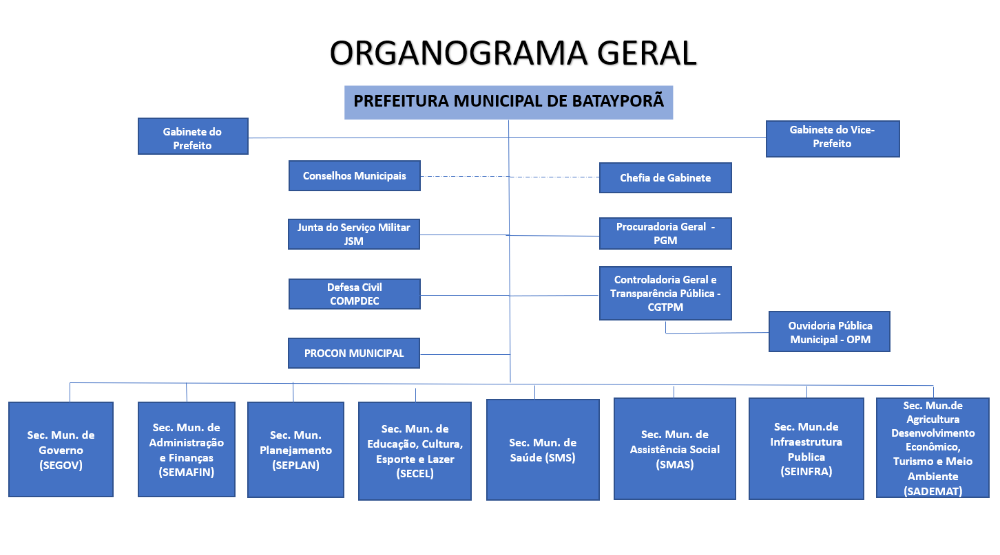
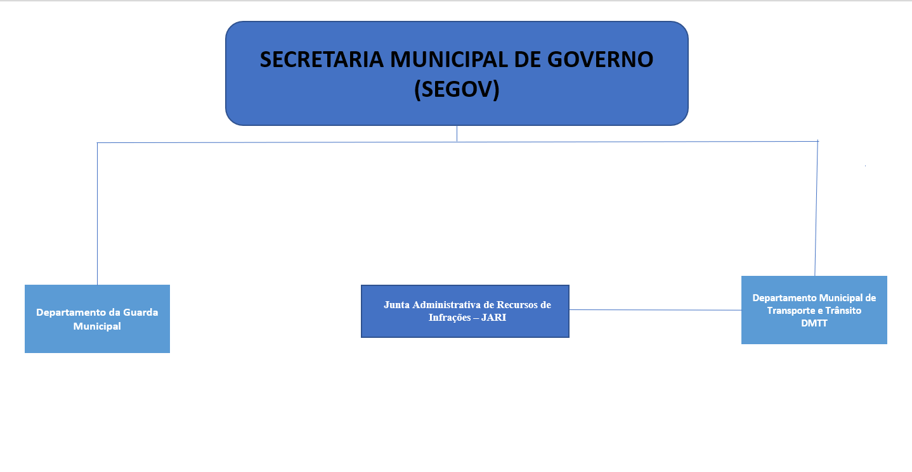
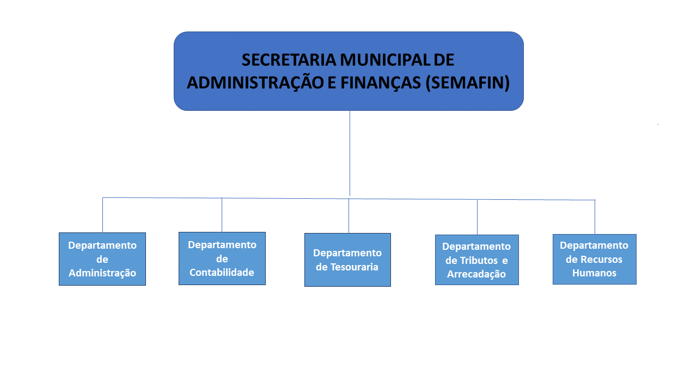
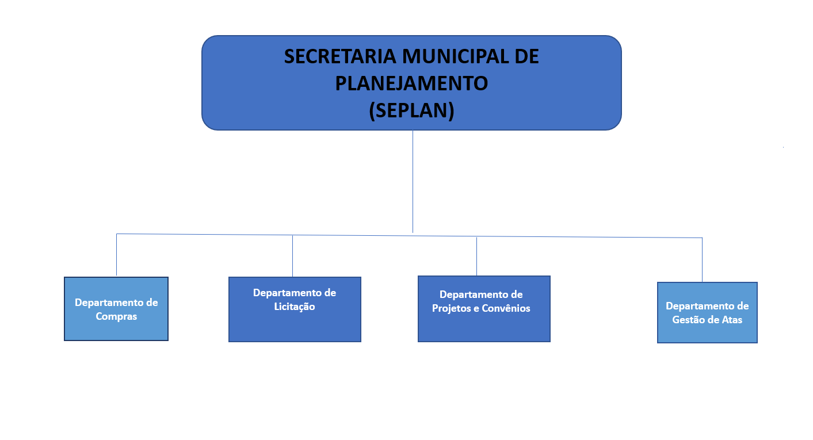
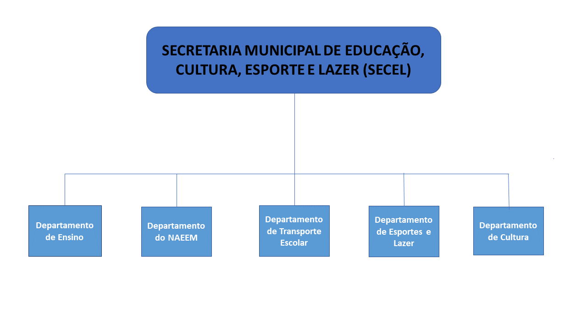
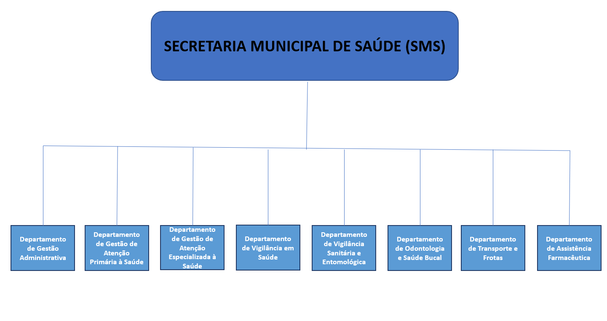
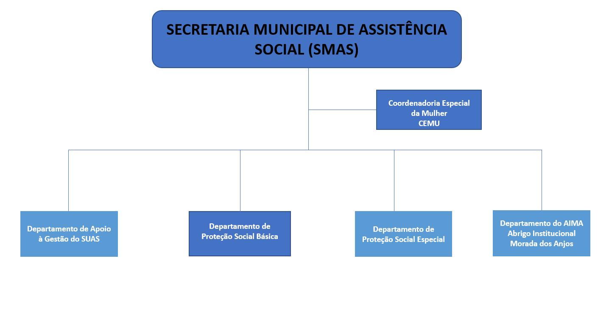
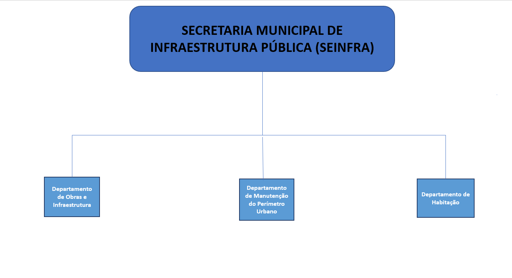
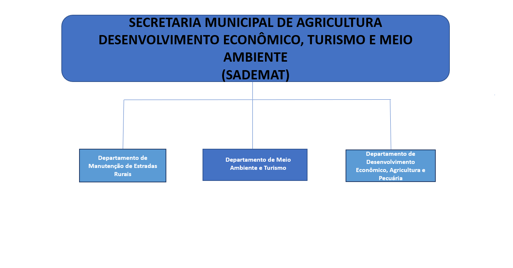

# Lei Complementar nº 070/2025

> Dispõe sobre a reorganização e a nova estrutura administrativa do Município de Batayporã-MS, e dá outras providências.

!!! warning "Texto em revisão"
    Extraído do texto do PDF publicado e **ainda em revisão**. Os organogramas do Anexo I são as imagens do próprio PDF. Veja também o [PDF publicado pela prefeitura](https://ecrie.com.br/sistema/conteudos/arquivo/a_222_0_1_31032025150713.pdf) ([página de origem](https://bataypora.ms.gov.br/cidadao/legislacao-municipal)).

Baixar: [PDF](../baixar/estrutura-administrativa/lc-070-2025.pdf){ .md-button download="lc-070-2025.pdf" } [Word (.docx)](../baixar/estrutura-administrativa/lc-070-2025.docx){ .md-button download="lc-070-2025.docx" } [Texto (.txt)](../baixar/estrutura-administrativa/lc-070-2025.txt){ .md-button download="lc-070-2025.txt" } [Markdown (.md)](../baixar/estrutura-administrativa/lc-070-2025.md.txt){ .md-button download="lc-070-2025.md" }

!!! abstract "Índice"
    | Divisão | Assunto | Artigos |
    |---|---|---:|
    | **DA ADMINISTRAÇÃO PÚBLICA E DO PODER EXECUTIVO MUNICIPAL** |  |  |
    | &emsp;Seção I | DO OBJETO PERMANENTE | [1](#art-1) e [2](#art-2) |
    | &emsp;Seção II | DAS DIRETRIZES GERAIS DA ADMINISTRAÇÃO MUNICIPAL | [3](#art-3) |
    | &emsp;Seção III | DOS PRINCÍPIOS FUNDAMENTAIS | [4](#art-4) |
    | &emsp;Seção IV | DO INSTRUMENTO DA ATUAÇÃO MUNICIPAL | [5](#art-5) |
    | **Capítulo II** | **DA ESTRUTURA ORGANIZACIONAL DO EXECUTIVO MUNICIPAL** | |
    | &emsp;Seção I | DO MODELO ESTRUTURAL | [6](#art-6) |
    | &emsp;Seção II | DA ESTRUTURA BÁSICA DO EXERCÍCIO MUNICIPAL | [7](#art-7) |
    | **Capítulo III** | **DA COMPETÊNCIA DOS ÓRGÃOS** | |
    | &emsp;Seção I | DOS ÓRGÃOS DE COLABORAÇÃO COM OS GOVERNOS FEDERAL E ESTADUAL | [8](#art-8) |
    | &emsp;Seção II | DOS ÓRGÃOS COLEGIADOS | [9](#art-9) |
    | &emsp;**Seção III** | **DOS ÓRGÃOS DE ASSESSORAMENTO E ASSISTÊNCIA DIRETA E IMEDIATA** | |
    | &emsp;&emsp;Subseção I | GABINETE DO PREFEITO (GAB) | [10](#art-10) |
    | &emsp;&emsp;Subseção II | DA CONTROLADORIA GERAL E TRANSPARÊNCIA PÚBLICA (CGMTP) | [11](#art-11) e [12](#art-12) |
    | &emsp;&emsp;Subseção III | DA PROCURADORIA GERAL (PGM) | [13](#art-13) |
    | &emsp;**Seção IV** | **DOS ÓRGÃOS DE ATIVIDADE ESTRUTURANTE E INSTRUMENTAL** | |
    | &emsp;&emsp;Subseção I | DA SECRETARIA MUNICIPAL DE GOVERNO (SEGOV) | [14](#art-14) a [16](#art-16) |
    | &emsp;&emsp;Subseção II | DA SECRETARIA MUNICIPAL DE ADMINISTRAÇÃO E FINANÇAS (SEMAFIN) | [17](#art-17) a [22](#art-22) |
    | &emsp;&emsp;Subseção III | DA SECRETARIA MUNICIPAL DE PLANEJAMENTO (SEPLAN) | [23](#art-23) a [27](#art-27) |
    | &emsp;**Seção V** | **DOS ÓRGÃOS DE ATIVIDADES FINALÍSTICAS** | |
    | &emsp;&emsp;Subseção I | DA SECRETARIA MUNICIPAL DE EDUCAÇÃO, CULTURA, ESPORTE E LAZER (SECEL) | [28](#art-28) a [33](#art-33) |
    | &emsp;&emsp;Subseção II | DA SECRETARIA MUNICIPAL DE SAÚDE (SMS) | [34](#art-34) a [42](#art-42) |
    | &emsp;&emsp;Subseção IV | DA SECRETARIA MUNICIPAL DE ASSISTÊNCIA SOCIAL (SMAS) | [43](#art-43) a [48](#art-48) |
    | &emsp;&emsp;Subseção V | DA SECRETARIA MUNICIPAL DE INFRAESTRUTURA PÚBLICA (SEINFRA) | [49](#art-49) a [52](#art-52) |
    | &emsp;&emsp;Subseção VI | DA SECRETARIA MUNICIPAL DE AGRICULTURA, DESENVOLVIMENTO ECONÔMICO, MEIO AMBIENTE E TURISMO (SADEMAT) | [53](#art-53) a [56](#art-56) |
    | **Capítulo IV** | **DAS RESPONSABILIDADES FUNDAMENTAIS E DAS ATRIBUIÇÕES BÁSICAS DOS TITULARES DOS ÓRGÃOS** | |
    | &emsp;Seção I | DAS RESPONSABILIDADES FUNDAMENTAIS | [57](#art-57) |
    | &emsp;Seção II | DAS ATRIBUIÇÕES BÁSICAS DOS TITULARES DE ÓRGÃOS | [58](#art-58) |
    | &emsp;Seção III | DOS ASSESSORES | [59](#art-59) |
    | Capítulo V | DOS CRITÉRIOS BÁSICOS PARA O PROCESSO DECISÓRIO | [60](#art-60) |
    | &emsp;Seção I | DO CONTROLE DE RESULTADOS | [61](#art-61) e [62](#art-62) |
    | &emsp;Seção II | DA COORDENAÇÃO FUNCIONAL | [63](#art-63) a [67](#art-67) |
    | &emsp;Seção III | Da Descentralização e Desconcentração | [68](#art-68) |
    | &emsp;Seção IV | Da Delegação de Competência | [69](#art-69) e [70](#art-70) |
    | Capítulo VI | DAS DISPOSIÇÕES TRANSITÓRIAS | [71](#art-71) a [76](#art-76) |
    | Capítulo VII | DAS DISPOSIÇÕES FINAIS | [77](#art-77) a [82](#art-82) |
    | **ANEXO I DA LEI COMPLEMENTAR Nº 70/2025** |  |  |
    | **ANEXO II DA LEI COMPLEMENTAR Nº 70/2025** |  |  |
    | **ANEXO III DA LEI COMPLEMENTAR Nº 70/2025** |  |  |
    | **ANEXO IV DA LEI COMPLEMENTAR Nº 70/2025** |  |  |

**Lei Complementar nº 70, de 31 de março de 2025.**
{ .centro }

“Dispõe sobre a reorganização e a nova estrutura administrativa do Município de Batayporã-MS, e dá outras providências.”

O PREFEITO MUNICIPAL DE BATAYPORÃ, ESTADO DE MATO GROSSO DO SUL, no uso das atribuições lhe conferidas pela Lei Orgânica Municipal;

Faz saber que a Câmara Municipal aprovou e ele sanciona a seguinte Lei;

## DA ADMINISTRAÇÃO PÚBLICA E DO PODER EXECUTIVO MUNICIPAL { .centro }

### SEÇÃO I — DO OBJETO PERMANENTE { .centro }
**Art. 1°.** O Município de Batayporã (MS), de conformidade com a Constituição da República Federal do Brasil, a Constituição Estadual e a Lei Orgânica do Município, tem como objetivo permanente proporcionar à população do Município condições e indispensáveis de acesso a níveis crescentes de bem-estar e progresso.
{ #art-1 }

**Art. 2°.** Na qualidade de Chefe do Poder Executivo Municipal, o Prefeito adotará medidas cabíveis para que os órgãos e entidades sob o seu comando atuem efetivamente de forma integrada e racional, com objetivo de solucionar um problema, atender a uma necessidade econômica, social e administrativa, ou realizar as prioridades do Governo.
{ #art-2 }

### SEÇÃO II — DAS DIRETRIZES GERAIS DA ADMINISTRAÇÃO MUNICIPAL { .centro }
**Art. 3°.** A atuação dos órgãos e entidades que compõe a Administração do Poder Executivo Municipal observará às seguintes diretrizes:
{ #art-3 }

I – Adoção do planejamento participativo, como método e instrumento da integração, celeridade e racionalização das ações do Governo;

II – Predominância do interesse social na prestação dos serviços públicos;

III – Fomento às atividades produtoras com aproveitamento das potencialidades do Município;

IV – Realização de investimentos públicos indispensáveis à criação de condição infraestruturais indutoras do maior aproveitamento das potencialidades econômicas do Município e necessárias à melhoria de qualidade de vida da população;

V – Exploração racional dos recursos naturais do município, ao menor custo ecológico, assegurando sua preservação como bens econômicos de interesse das gerações atuais e futuras;

VI – Promoção da modernização permanente da estrutura governamental, dos instrumentos, procedimentos e normas administrativas, com vista à redução de custos e desperdícios e a impedir ações redundantes;

VII – Valorização do pessoal administrativo e técnico da Administração Pública Municipal;

VIII – Criação de condições gerais necessárias aos cumprimentos eficientes, eficazes e éticos das missões incumbidas aos agentes públicos.

IX – Observância dos princípios e leis que regem a Administração Pública;

X – Respeito ao cidadão, probidade e transparência;

XI – Equilíbrio econômico-financeiro;

XII – Desenvolvimento sustentável.

### SEÇÃO III — DOS PRINCÍPIOS FUNDAMENTAIS { .centro }
**Art. 4°.** As atividades da Administração Pública do Poder Executivo Municipal obedecerão aos seguintes princípios fundamentais:
{ #art-4 }

I – Planejamento;

II – Organização;

III – Coordenação;

IV – Delegação de competência;

V – Controle, e

VI - Transparência.

§1°. O planejamento será adotado como método e instrumento de integração, celeridade, racionalização, reforço institucional das ações prioritárias de Governo, descentralização e renovação.

§2°. A organização tem como objetivo social melhorar as condições de trabalho, permitindo uma operacionalização das ações de Governo com o máximo de eficiência e com o mínimo de dispêndio e risco.

§3°. As atividades de Administração Pública Municipal, assim como a elaboração e execução de planos e programas de governo, serão objeto de permanente coordenação, em todos os níveis administrativos, com vistas a um efetivo rendimento.

§4°. A execução das atividades da Administração Pública Municipal deverá ser amplamente descentralizada, a saber:

I – Dentro dos quadros da Administração, pela distinção clara entre os níveis de direção e execução;

II – Da Administração para o setor privado, mediante convênios, parcerias, contratos ou concessões.

§5°. A Administração superior deve concentrar-se nas atividades de articulação política, planejamento, orientação, supervisão, coordenação e controle, liberando a administração casuística para os níveis de execução.

§6°. A delegação de competência será utilizada como instrumento de descentralização administrativa, com objetivo de assegurar maior rapidez e objetividade aos processos de decisão e execução.

§7°. O controle será exercido, sistematicamente:

I – Pelo Sistema de Controle Interno, através da Controladoria Geral e Transparência Pública;

II – Pelos diversos níveis de chefia e supervisão, relativamente aos programas, projetos e atividades, assim como quanto à observação das normas e regras instituídas pertinentes aos diversos sistemas e subsistemas das atividades municipais;

III – Pela fiscalização da regularidade da aplicação do dinheiro público e da guarda dos bens do município.

§8°. A transparência será priorizada diante da disponibilização de todos os procedimentos públicos através do Portal da Transparência do município, além da Ouvidoria e do respeito a Lei de Acesso à Informação.

### SEÇÃO IV — DO INSTRUMENTO DA ATUAÇÃO MUNICIPAL { .centro }
**Art. 5°.** São instrumentos principais de atuação da Administração Pública do Poder Executivo Municipal:
{ #art-5 }

I – Os atos normativos e executivos gerais e especiais;

II – As diretrizes gerais da ação do Governo;

III – O Plano Plurianual;

IV – As Diretrizes Orçamentárias;

V – Os Orçamentos Anuais;

VI – Os projetos especiais;

VII – A programação financeira de desembolso;

VIII – O acompanhamento da execução de planos, programas, projetos e atividades e avaliação de desempenho da Administração e dos resultados das ações do Governo;

IX – As auditorias, na atuação da controladoria;

X – As atividades de coordenação;

XI – A realização de pesquisas e estudos;

XII – O desenvolvimento de cursos, treinamentos e seminários;

XIII – A divulgação de resultados das atividades governamentais.

## CAPÍTULO II — DA ESTRUTURA ORGANIZACIONAL DO EXECUTIVO MUNICIPAL { .centro }
### SEÇÃO I — DO MODELO ESTRUTURAL { .centro }
**Art. 6°.** A estrutura organizacional básica do Poder Executivo Municipal é constituída do seguinte modelo funcional:
{ #art-6 }

I – ADMINISTRAÇÃO SUPERIOR:

a – Prefeito Municipal;

a.1 – Vice-prefeito Municipal.

II – ORGANISMOS DE APOIO AOS GOVERNOS FEDERAL E ESTADUAL:

a – Junta do Serviço Militar;

b – Defesa Civil;

c – PROCON.

III – ORGANISMOS COLEGIADOS DE DELIBERAÇÃO COLETIVA:

a – Conselhos Municipais.

IV – UNIDADES DO PRIMEIRO NÍVEL DE ORGANIZAÇÃO:

a - Gabinete do Prefeito;

b - Procuradoria Geral

c- Controladoria Geral e Transparência Pública;

d - Secretarias Municipais.

V – UNIDADE DO SEGUNDO NÍVEL DE ORGANIZAÇÃO:

b – Departamentos.

VI – UNIDADE DO TERCEIRO NÍVEL DE ORGANIZAÇÃO:

a – Divisões.

Parágrafo único. A criação dos desdobramentos estruturais a partir do terceiro nível de organização poderá ser efetuado, por legislação especifica, pela ordem, e referência hierárquica de Secretaria, Departamento, Divisão, Núcleo e Setor.

### SEÇÃO II — DA ESTRUTURA BÁSICA DO EXERCÍCIO MUNICIPAL { .centro }
**Art. 7°.** Observada a linha hierárquica e o consequente nível de organização definido no artigo anterior, a Estrutura da Município Municipal de Batayporã fica assim constituída:
{ #art-7 }

I – ADMINISTRAÇÃO SUPERIOR: a – Prefeito Municipal;

a.1 – Vice-Prefeito Municipal.

II – ÓRGÃOS DE COLABORAÇÃO COM OS GOVERNOS FEDERAL E ESTADUAL: a – Junta do Serviço Militar; b – Defesa Civil - COMPDEC; c – PROCON.

III – ÓRGÃOS COLEGIADOS: a – Conselhos Municipais.

IV – ÓRGÃOS DE ASSESSORAMENTO E ASSISTÊNCIA DIRETA E IMEDIATA: a – Gabinete do Prefeito (GAB); b – Procuradoria Geral (PGM); c- Controladoria Geral e Transparência Pública (CGTPM);

b.1 – Ouvidoria Pública Municipal (OPM).

V – ÓRGÃOS DE ATIVIDADE ESTRUTURANTE E INSTRUMENTAL:

a – SECRETARIA DE GOVERNO (SEGOV)

a.1 – Departamento da Guarda Municipal;

a.2 – Departamento Municipal de Transporte e Trânsito-DMTT/ Junta Administrativa de Recursos de Infrações – JARI

b - SECRETARIA MUNICIPAL DE ADMINISTRAÇÃO E FINANÇAS (SEMAFIN):

b.1 – Departamento de Administração;

b.2 – Departamento de Contabilidade;

b.3 – Departamento de Tesouraria;

b.4 – Departamento de Tributos e Arrecadação;

b.5 – Departamento de Recursos Humanos.

c – SECRETARIA MUNICIPAL DE PLANEJAMENTO (SEPLAN)

c.1 – Departamento de Compras;

c.2 – Departamento de Licitação;

c.3 – Departamento de Projetos e Convênios;

c.4. Departamento de Gestão de Atas.

VI – ÓRGÃOS DE ATIVIDADES FINALÍSTICAS: A - SECRETARIA MUNICIPAL DE EDUCAÇÃO, CULTURA, ESPORTE E LAZER (SECEL):

a.1 – Departamento de Ensino;

a.2 – Departamento do Núcleo de Atendimento Educacional Especializado Municipal – NAEEM;

a.3 – Departamento de Transporte Escolar;

a.4 – Departamento de Esportes e Lazer;

a.5 - Departamento de Cultura.

B - SECRETARIA MUNICIPAL DE SAÚDE (SMS):

b.1 - Departamento de Gestão Administrativa;

b.2 - Departamento de Gestão de Atenção Primária à Saúde;

b.3 - Departamento de Gestão de Atenção Especializadas à Saúde;

b.4 - Departamento de Vigilância em Saúde;

b.5 - Departamento de Vigilância Sanitária e Entomológica;

b.6 - Departamento de Odontologia e Saúde Bucal;

b.7 - Departamento de Transporte e Frotas;

b.8 - Departamento de Assistência Farmacêutica.

C - SECRETARIA MUNICIPAL DE ASSISTÊNCIA SOCIAL (SMAS):

c.1 - Departamento de Apoio à Gestão do SUAS;

c.2 - Departamento de Proteção Social Básica;

c.3 – Departamento de Proteção Social Especial;

c.4 – Departamento do AIMA - Abrigo Institucional Morada dos Anjos

c.5 – Coordenadoria Especial da Mulher – CEMU.

D - SECRETARIA MUNICIPAL DE INFRAESTRUTURA PÚBLICA (SEINFRA):

d.1 – Departamento de Obras e Infraestrutura;

d.2 –Departamento de Manutenção do Perímetro Urbano;

d.3 - Departamento de Habitação.

E - SECRETARIA MUNICIPAL DE AGRICULTURA, DESENVOLVIMENTO ECONÔMICO, MEIO AMBIENTE E TURISMO (SADEMAT):

e.1 – Departamento de Manutenção de Estradas Rurais

e.2 - Departamento de Meio Ambiente e Turismo;

e.3 – Departamento de Desenvolvimento Econômico, Agricultura e Pecuária.

Parágrafo único. A representação gráfica (organograma) da Estrutura Organizacional básica Municipal está expressa no Anexo I, desta Lei.

## CAPÍTULO III — DA COMPETÊNCIA DOS ÓRGÃOS { .centro }
### SEÇÃO I — DOS ÓRGÃOS DE COLABORAÇÃO COM OS GOVERNOS FEDERAL E ESTADUAL { .centro }
**Art. 8°.** São órgãos de colaboração com os governos Federal e Estadual, e suas atividades são norteadas pelas normas e regras emanadas do setor competente do respectivo Governo:
{ #art-8 }

I – Junta Militar;

II – Defesa Civil;

III – PROCON.

### SEÇÃO II — DOS ÓRGÃOS COLEGIADOS { .centro }
**Art. 9°.** Os Conselhos Municipais têm sua composição e competências definidas nos respectivos atos de criação e seus funcionamentos regulados em Regimentos Internos Próprios, têm como finalidade básica garantir a participação da sociedade civil no debate sobre os problemas locais e as alternativas para seu enfrentamento, buscando conciliar interesses e solucionar conflitos.
{ #art-9 }

### SEÇÃO III — DOS ÓRGÃOS DE ASSESSORAMENTO E ASSISTÊNCIA DIRETA E IMEDIATA { .centro }
#### SUBSEÇÃO I — GABINETE DO PREFEITO (GAB) { .centro }
**Art. 10.** Ao Gabinete do Prefeito, órgão de assessoramento direto ao Chefe do Poder Executivo, dirigido pelo Chefe de Gabinete, com status de Secretaria, incumbe prestar e exercer as atividades de:
{ #art-10 }

I – Organizar dentro dos protocolos estabelecidos pelo setor competente cerimonial de atos públicos ou administrativos;

II – Dar assistência, orientação e encaminhamentos nas relações com entidades, associações de classes e órgãos de imprensa;

III – Realizar manutenção e atualização de cadastro de autoridades, instituições e organizações;

IV - Receber e registrar expedientes recebidos da Câmara de Vereadores;

V – Acompanhar a tramitação dos pedidos de informações, proposições e providências, conjugado com outros organismos do governo municipal;

VI - Monitorar, junto ao Legislativo, o andamento de Projetos de Lei, verificação de prazos dos processos do Legislativo e providências para adimplemento das datas de sanção, promulgação, publicação e veto conjugados com outros organismos do governo municipal;

VII - Enviar à Câmara Municipal os Projetos de Lei e, no seu retorno, o encaminhar ao Prefeito para veto ou sanção;

VIII - Enviar à Câmara Municipal convênios e parcerias, conforme previsto nos dispositivos da Lei Orgânica Municipal;

IX – Promover a integração das diversas unidades administrativas do Poder Executivo;

X – Assessorar e secretariar o Prefeito nas reuniões internas ou públicas;

XI – Realizar atendimento inicial e, posterior, encaminhamento dos munícipes, autoridades e visitantes que demandem ao gabinete;

XII - Promover as relações públicas, incluindo as de representação e de divulgação;

XIII – Recepcionar, estudar e realizar a triagem do expediente encaminhado ao Prefeito;

XIV - Outras atividades que lhe forem atribuídas pelo Prefeito.

#### SUBSEÇÃO II — DA CONTROLADORIA GERAL E TRANSPARÊNCIA PÚBLICA (CGMTP) { .centro }
**Art. 11.** À Controladoria Geral e Transparência Pública, com status de Secretaria, compete:
{ #art-11 }

I - Avaliar o cumprimento das metas previstas no Plano Plurianual e na Lei de Diretrizes Orçamentárias, bem como a execução do Orçamento Anual do Município;

II - Verificar a legalidade e avaliar os resultados quanto à eficácia e à eficiência da gestão orçamentária, financeira e patrimonial nos órgãos e entidades da administração municipal, bem como da aplicação de recursos públicos por entidades de direito privado;

III - Aferir o controle das operações de crédito, dos avais e das garantias bem como dos direitos e haveres e, ainda, a inscrição em Restos a Pagar;

IV- Apoiar o controle externo no exercício de sua missão institucional;

V - Propor medidas para o retorno da despesa total com pessoal ao limite estabelecido em lei;

VI - Estabelecer providências para a recondução dos montantes das dívidas consolidada e mobiliária aos limites estabelecidos no artigo 31, da Lei Complementar nº 101/2000;

VII - Acompanhar a destinação de recursos obtidos com a alienação de ativos tendo em vista as restrições constantes na Constituição Federal e na Lei Complementar nº 101/2000;

VIII - Efetuar o controle das despesas decorrentes dos contratos e convênios;

IX - Elaborar mecanismos que permitam manter em boa ordem e disponibilidade permanente a documentação que dá suporte aos registros contábeis e procedimentos administrativos no que se refere aos itens anteriormente citados;

X - Dar ciência ao Chefe do Poder Executivo e ao Tribunal de Contas de qualquer irregularidade de que tomar conhecimento;

XI - Emitir Relatório sobre as contas dos órgãos e entidades da administração municipal - que deverá ser assinado pelo Chefe do Controle Interno – e assinar as demais peças que integram os relatórios de Gestão Fiscal e de contas juntamente com o Prefeito Municipal e a Secretaria Municipal de Administração e Finanças;

XII – Operar e manter o sistema de informação para disponibilizar, em local de fácil acesso ao público, aos contribuintes, partidos políticos, associações, sindicatos e aos cidadãos em geral, informações sobre a gestão dos recursos públicos por órgãos e entidades do Poder Executivo e suas transferências às entidades privadas ou organizações não governamentais;

XIII – Implementar normas inerentes ao processo de Controle Interno no âmbito da Administração Municipal;

XII – Exercer outras atividades relacionadas ao Controle Interno constante das legislações e normas das esferas Federal, Estadual e Municipal, especialmente do Tribunal de Contas do Estado do Mato Grosso do Sul;

XIII – Prestar assessoramento durante os procedimentos de compras e licitações, devendo se manifestar sobre a regularidade dos procedimentos;

XIV - Prestar manifestação sobre regularidade de qualquer ato público municipal submetido ao seu controle, mediante solicitação do Chefe do Poder Executivo;

XV – Exercer outras atividades correlatas.

Parágrafo único – A natureza, descrição dos cargos de provimento em comissão e efetivos, a quantidade, os salários básicos mensais, os requisitos de investidura, atribuições e grau de complexidade serão fixados em lei específica de instituição do Controle Interno do Município.

**Art. 12.** À Ouvidoria Pública Municipal, vinculada ao Controle Interno Municipal, compete:
{ #art-12 }

I - Ouvir o cidadão e prover com informações os órgãos da Administração Direta e Indireta, objetivando a criação de políticas públicas de atendimento ao Cidadão, voltadas para a melhoria da qualidade dos serviços públicos do Município.

II - Viabilizar um canal direto entre o Município e o Cidadão, a fim de possibilitar respostas a problemas no tempo mais rápido possível;

III - Receber e examinar sugestões, reclamações, elogios e denúncias dos cidadãos relativos aos serviços e ao atendimento prestados pelos diversos órgãos do Município de Batayporã, dando encaminhamento aos procedimentos necessários para a solução dos problemas apontados, possibilitando o retorno aos interessados;

IV - Encaminhar aos diversos órgãos do Município de Batayporã as manifestações dos cidadãos, acompanhando as providências adotadas e garantindo o retorno aos interessados;

V - Elaborar pesquisas de satisfação dos usuários dos diversos serviços prestados pelos órgãos do Município;

VI - Apoiar tecnicamente e atuar com os diversos órgãos da Administração Direta e Indireta, visando à solução dos problemas apontados pelos cidadãos;

VII - Produzir relatórios que expressem expectativas, demandas e nível de satisfação da sociedade e sugerir as mudanças necessárias, a partir da análise e interpretação das manifestações recebidas;

VIII - Recomendar a instauração de procedimentos administrativos para exame técnico das questões e a adoção de medidas necessárias para a adequada prestação de serviço público, quando for o caso;

IX - Contribuir para a disseminação de formas de participação popular no acompanhamento e fiscalização dos serviços prestados pelo Município;

X - Aconselhar o interessado a dirigir-se à autoridade competente quando for o caso;

XI - Resguardar o sigilo referente às informações levadas ao seu conhecimento, no exercício de suas funções;

XII - Divulgar, através dos diversos canais de comunicação do Município, o trabalho realizado pela Ouvidoria, assim como informações e orientações que considerar necessárias ao desenvolvimento de suas ações;

XIII – Exercer às atribuições precípuas definidas nos arts. 13 e 14 da Lei Federal n. 13.460, de 26 de junho de 2017.

XIV - Exercer outras atividades correlatas.

#### SUBSEÇÃO III — DA PROCURADORIA GERAL (PGM) { .centro }
**Art. 13.** À Procuradoria Geral, com status de Secretaria, compete:
{ #art-13 }

I – Defender em juízo ou fora dele, ativa ou passivamente, dos atos e prerrogativas do Prefeito em exercício, do Município e de suas entidades de direito público, exercida pelos Procuradores efetivos;

II – Planejar, executar, coordenar e controlar as atividades municipais relativas ao desenvolvimento e aplicação das atividades jurídicas da Município;

III – Prestar assessoramento jurídico ao Prefeito e as demais áreas da administração Municipal, quando solicitado, emitindo pareceres e considerações sobre consultas e matérias que lhe sejam submetidas;

IV – Executar judicialmente à dívida ativa, através dos procuradores efetivos;

V – Controlar às atividades relacionadas com a desapropriação;

VI – Analisar e, quando for o caso, preparar contratos, convênios, ajustes em que o Município seja parte;

VII – Elaborar outros atos com a aplicação e controle das normas jurídicas;

VIII – Organizar e manter biblioteca e arquivos jurídicos;

IX - Propor ação declaratória de nulidade ou de anulação de quaisquer atos, havidos como ilegais ou inconstitucionais;

X – Controlar a apresentação dos Precatórios Judiciais, nos termos da legislação vigente;

XI – Executar atividades referentes à apuração de irregularidades funcionais e de responsabilidades;

XII - Instruir processos de licitação e outros que lhe sejam submetidos.

XIII – Acompanhar e controlar às ações cuja representação judicial do município tenha sido conferida a terceiros;

XIV – Colaborar com o Prefeito no controle da legalidade no âmbito do Poder Executivo Municipal;

XV – Elaborar projetos de leis, decretos e outros atos normativos de competência do Prefeito Municipal ou dos Secretários Municipais;

XVI – Exercer outras atividades correlatas.

§1° A Procuradoria Geral do Município (PGM) será representada por um Procurador do Quadro de Cargos efetivos do Município, o qual será designado pelo Prefeito, por meio de Decreto Municipal.

§2° Na Procuradoria Geral do Município, excetuados os serviços de apoio e assessoria, a defesa judicial do município sempre sera praticada pelos Procuradores integrantes do Quadro de Cargos efetivos do Município.

### SEÇÃO IV — DOS ÓRGÃOS DE ATIVIDADE ESTRUTURANTE E INSTRUMENTAL { .centro }
#### SUBSEÇÃO I — DA SECRETARIA MUNICIPAL DE GOVERNO (SEGOV) { .centro }
**Art. 14.** À Secretaria Municipal de Governo, compete:
{ #art-14 }

I – Orientar e supervisionar a elaboração de estudos especiais destinados à racionalização do serviço-meio, com o fim de reduzir seus custos e aumentar sua eficiência;

II - Coordenar a realização de estudos e pesquisas que permitam o domínio de um conjunto adequado de dados e informações necessárias à elaboração de diretrizes para o Município;

III - Executar e fazer executar as disposições estabelecidas pelo Plano Diretor do Município;

IV - Coordenar e orientar as ações de guarda pelos bens, equipamentos e prédios públicos desenvolvidos pelo Departamento de Defesa Civil;

V - Promover estudos e propor diretrizes para as políticas setoriais pertinentes à fiscalização e controle de uso, ocupação e estruturação do espaço urbano;

VI - Promover a elaboração, formulação, revisão e avaliação periódica dos planos, programas, projetos e ações do governo municipal, de conformidade com os interesses comuns dos órgãos envolvidos;

VII - Subsidiar, nos assuntos de sua competência, as demais Secretarias e órgãos da Administração Pública Municipal, quando necessário;

VIII - Coordenar ações de suporte às relações com outros Municípios, consórcios municipais, Governo Estadual, Governo Federal, outros países e organizações estrangeiras;

IX – Subsidiar o Órgão de Trânsito Municipal em suas decisões e ações;

X – Coordenar a prestação de serviços de manutenção e conservação de prédios públicos, locação, alienação, permissão e cessão de uso de bens municipais, assim como a negociação para uso de imóveis de propriedade do Estado, da União ou de terceiros pelo Município;

XI - Coordenar, orientar, acompanhar, avaliar e controlar o credenciamento dos serviços pactuados, sob forma de convênios financeiro, termo de cooperação mútua e comodatos, com instituições públicas e privadas e outras organizações sem fins lucrativos, prestadoras de serviços públicos;

XII - Exercer outras atividades correlatas.

**Art. 15.** Ao Departamento de Guarda Municipal, vinculado à Secretaria Municipal de Governo, compete:
{ #art-15 }

I – Subsidiar e orientar a execução de policiamento ostensivo, preventivo, uniformizado e aparelhado, na proteção à população, bens, serviços e instalações do Município;

II - Desempenhar a coordenação das atividades de proteção do patrimônio público municipal no sentido de prevenir a ocorrência interna e externa de qualquer infração penal, para inspeção das dependências;

III – Gerenciar os serviços de prevenção e combate de incêndios e suporte básico da vida, quando necessário;

IV - Exercer a vigilância de edifícios públicos municipais, controlando a entrada de pessoas, adotando providências tendentes a evitar roubos, furtos, incêndios e outras danificações na área sob a sua guarda;

V – Proteger os bens, serviços e instalações do município visando prevenir a ocorrência de atos ilícitos, danos, vandalismos e sinistros, mediante vigilância: a) dos bens de uso comum do povo, assim entendidos as praças, os parques, jardins, monumentos e quais outros bens de domínio público municipal; b) das escolas, das unidades de saúde, dos CEINFS, utilizados para prestação dos serviços públicos; c) das áreas de preservação do patrimônio natural do município, para proteção, conservação do meio ambiente e defesa da fauna e da flora;

VI – Fiscalizar a utilização adequada dos parques, jardins, praças, cemitérios, mercados públicos e feiras-livres, além de outras atividades voltadas para o bem-estar dos munícipes;

VII – Prestar apoio as atividades dos agentes de fiscalização de postura e dos serviços prestados nos mercados públicos e nas feiras-livres;

VIII – Realizar o monitoramento dos prédios ocupados por órgãos, entidades e serviços da Prefeitura Municipal, mediante utilização de meios eletrônicos;

IX – Planejar e executar os serviços de vigilância ostensiva e preventiva, visando assegurar a proteção dos bens públicos municipais e o cumprimento da lei;

X – Colaborar com campanhas de interesse público e demais atividades de órgãos de segurança pública federal e estadual, dentro de suas atribuições específicas, no território do município.

Parágrafo Único. Lei complementar disporá sobre o acesso, direitos, deveres, vantagens e regime de trabalho dos servidores vinculados ao departamento, com base na hierarquia e disciplina.

**Art. 16.** Ao Departamento Municipal de Transporte e Trânsito-DMTT, e Junta Administrativa de Recursos de Infrações – JARI, além das atribuições previstas na Lei nº 648/2005, de 16 de março de 2005, ou outra Legislação que vir a substitui-la, vinculados à Secretaria Municipal de Governo, compete:
{ #art-16 }

I - Promover e participar de projetos e programas de educação e segurança de trânsito, particularmente de campanhas educativas junto às escolas municipais, de acordo com o Capítulo VI do Código de Trânsito Brasileiro - CTB e diretrizes estabelecidas pelo CONTRAN;

II – Planejar, executar, projetar, regulamentar, operar e fiscalizar o trânsito de veículos, de pedestres e de animais e o desenvolvimento da circulação e da segurança de ciclistas no âmbito de sua circunscrição.

III – Efetivar o projeto de sinalização do sistema viário de competência municipal;

IV - Estabelecer em conjunto com os órgãos de polícia, as diretrizes para o policiamento ostensivo de trânsito;

V - Proceder à autuação de infrações de trânsito;

VI - Incentivar e patrocinar a capacitação, o treinamento, a designação e o credenciamento de agentes de fiscalização, da própria administração ou através de convênios;

VII - Fiscalizar o nível de emissão de poluentes e ruídos produzidos pelos veículos automotores ou pela sua carga, de acordo com o estabelecido no artigo 99 do Código de Trânsito Brasileiro - CTB, além de dar apoio às ações especificas de órgão ambiental local, quando solicitado;

VIII - Vistoriar veículos que necessitem de autorização especial para transitar e estabelecer os requisitos técnicos a serem observados para circulação desses veículos;

IX – Implantar e manter sistema de sinalização (vertical, horizontal e semafórica), dos dispositivos e equipamentos de controle viário;

X – Exercer o poder de polícia administrativa de trânsito, gerando a aplicação de advertências por escrito, medidas administrativas, penalidade cabíveis, dentro da competência legalmente estabelecida e no âmbito da circunscrição do Município, através dos meios eletrônicos e não eletrônicos;

XI - Fiscalizar, autuar e aplicar as infrações por infração de trânsito, bem como notificar as autuações que efetuar;

XII - Fiscalizar o cumprimento da norma contida no artigo 95 do Código de Trânsito Brasileiro - CTB, aplicando as penalidades nele previstas;

XIII – Planejar a circulação de pedestres e veículos, de orientação de trânsito, de tratamento ao transporte coletivo, entre outros;

XIV – Executar Projeto de Área (mão de direção, segurança, pedestres, sinalização, etc.), de corredores de transporte coletivo (faixas exclusivas, localização de pontos de ônibus, prioridades em semáforos, etc.), de pontos críticos (congestionamentos e elevado número de acidentes), entre outros;

XV – Definir políticas de estacionamento, de carga e descarga de mercadorias, de segurança de trânsito, de pedestres, de veículos de duas rodas, de circulação e estacionamento de veículos de tração animal, entre outros;

XVI – Analisar o impacto das edificações geradoras e atrativas de trânsito de veículos ou de pedestres (pólos geradores de trânsito – escolas dos mais variados tamanhos, cursinhos, terminais, estádios, etc);

XVII – Estudar e emitir pareceres com vistas a autorização de obras e eventos na via ou fora dela, que possam gerar impacto no trânsito (obras viárias, shows, jogos de futebol, passeios ciclísticos, maratonas, festas juninas, parques de diversão, filmagens, etc);

XVIII - Planejar visando a implantação de medidas para redução da circulação de veículos e reorientação do tráfego, com objetivo de diminuir a emissão global de poluente;

XIX – Planejar, operar, estudar e fiscalizar o exercício das atividades com táxi, mototáxi, veículo escolar, ônibus e outras legalmente autorizadas;

XX - Credenciar os serviços de escolta, fiscalizar e adotar medidas de segurança relativas aos serviços de remoção de veículos, escolta e transporte de carga indivisível;

XXI - Arrecadar valores provenientes de estada e remoção de veículos e objetos e escolta de veículos de cargas superdimensionadas ou perigosas;

XXII - Integrar-se a outros órgãos e entidades do Sistema Nacional de Trânsito para fins de arrecadação e compensação de multas impostas na área de sua competência, com vistas à unificação do licenciamento, à simplificação e à celeridade das transferências de veículos e prontuários dos condutores de uma para outra unidade da Federação;

XXIII - Implantar as medidas de Política Nacional de Trânsito e do Programa Nacional de Trânsito;

XXIV - Articular-se com os demais órgãos do Sistema Nacional de Trânsito do Estado, sob a coordenação do CETRAN;

XXV - Nomear os membros da JARI e dar suporte administrativo às atividades;

XXVI - Registrar e licenciar, na forma da legislação municipal, ciclomotores, veículos de propulsão humana e de tração animal (artigo 129 do Código de Trânsito Brasileiro - CTB);

XXVII - Processar autorização para conduzir veículos de propulsão humana e de tração animal;

XXVIII - Coletar dados estatísticos e elaborar estudos sobre os acidentes de trânsito e suas causas, conforme Inciso IV do artigo 24 do Código de Trânsito Brasileiro - CTB;

XXIX – Guardar os veículos apreendidos, em local próprio da municipalidade;

XXX - Coordenar e controlar os serviços de Estacionamento Rotativo Municipal, para veículos automotores e similares;

XXXI – Exercer outras atividades correlatas.

#### SUBSEÇÃO II — DA SECRETARIA MUNICIPAL DE ADMINISTRAÇÃO E FINANÇAS (SEMAFIN) { .centro }
**Art. 17.** À Secretaria Municipal de Administração e Finanças, compete:
{ #art-17 }

I - A articulação com os órgãos municipais, estaduais e federais que participam do controle interno, finanças públicas, objetivando a formulação de programas e processos de coordenação e controle orçamentário, financeira e contábil da gestão municipal;

II - O estudo, a elaboração de projeto de operação de crédito e financiamento junto a órgãos e entidades públicas e do setor privado, observando as normas do Senado Federal e da legislação vigente;

III - A observância da legislação Federal, Estadual e Municipais, em especial a Lei de Responsabilidade Fiscal e dos diplomas que regem sobre as relações licitatórias;

IV - A formulação e monitoramento de projetos e programas para captação de recursos junto a entidades de crédito e financiamento público, em especial os de antecipação de receita orçamentária;

V - O cumprimento rigoroso do repasse do duodécimo destinado à Câmara Municipal;

VI - A articulação com órgãos municipais, estaduais e federais e com entidades que desenvolvem pesquisas e estudos, coleta e sistematização de informações econômicas e sociais que objetivem o planejamento e formulação de projetos, programas e ações coordenadas que propiciem o desenvolvimento econômico e social do município;

VII - Fornecer subsídios para avaliação do acompanhamento das licitações e dos contratos, possibilitando a adoção de estratégias para a obtenção de melhores resultados;

VIII - A assistência técnica para a representação política do Município junto ao Estado e União na formulação de projetos e programas que objetivem o financiamento do desenvolvimento econômico e social do município;

IX - A gestão e monitoramento das disponibilidades financeiras e valores dos fundos especiais;

X - Fornecer apoio técnico-logístico às unidades técnicas, com vistas às aquisições de materiais/contratações de serviços;

XI - O relacionamento com organismos nacionais e internacionais, visando recursos para projetos de desenvolvimento econômico e social;

XII - A realização dos pagamentos, nas formas estabelecidas pela administração e previstas no fluxo de pagamento;

XIII - O recolhimento das contribuições devidas, inclusive as de caráter previdenciário;

XIV - O monitoramento da escrituração do movimento de arrecadação e pagamento;

XV - A articulação com os órgãos Municipais, Estados e da União que participam do Sistema Tributário Nacional, objetivando a formulação de programas e processos de coordenação e controle da administração tributária e fiscal;

XVI - O desenvolvimento de programas e ações que busquem a eficiência na administração do Código Tributário Municipal, inclusive com a adoção de parcerias com órgãos sistêmicos congêneres do Estado e da União;

XVII - O desenvolvimento de programas e ações que objetivem o bom relacionamento e entendimentos em relação ao fisco municipal com entidades e organismos representativos e diretivos dos setores produtivos e de entidades de classes;

XVIII - O julgamento de processos administrativos referentes a autos de infração em grau de primeira instância;

XIX - A coordenação da formulação e definição dos programas e projetos governamentais e a elaboração da Lei de Diretrizes Orçamentárias, da Lei Orçamentária Anual e do Orçamento Plurianual do Município, observadas as normas da Constituição Federal, da Lei de Responsabilidade Fiscal, em conjunto com as Secretarias Municipais;

XXI - A orientação aos órgãos e entidades municipais sobre a proposição de seus orçamentos e consolidação das propostas, controle, acompanhamento e execução do orçamento anual;

XXII - O acompanhamento da execução orçamentária municipal, mediante a manutenção de registros da utilização dos recursos orçamentários alocados ao atendimento das despesas de custeio e de investimento dos órgãos da administração direta da Município Municipal;

XXIII - O levantamento dos gastos com pessoal, material, serviços e encargos diversos, instalações, material permanente e equipamentos para proposição da programação das despesas de custeio e de capital e sua inclusão no orçamento anual do Município, em articulação com as demais Secretarias;

XXIV - A emissão de autos para inscrição na dívida ativa e a promoção da sua cobrança, mediante encaminhamento à Procuradoria Jurídica do Município, e o acompanhamento, controle e registro do seu pagamento;

XXV - A promoção de estudos e a fixação de critérios para a concessão de incentivos fiscais e financeiros, tendo em vista o desenvolvimento econômico e social do Município;

XXVII- Controlar e gerenciar a arrecadação orçamentária e extraorçamentária e os pagamentos devidos pelo tesouro municipal;

XXVII - Realizar todos os registros e demonstrativos contábeis;

XXIII - Assessorar os demais órgãos quanto a assuntos de natureza fazendária;

XXIX - Aplicar e fiscalizar as posturas municipais;

XXX - A proposição e monitoramento da política de recursos humanos, do Estatuto dos Servidores Públicos do Município e do Plano de Cargos, Carreira e Remuneração de todos os Servidores;

XXXI - A supervisão das atividades desenvolvidas pelas suas unidades e, em especial, de segurança e medicina do trabalho;

XXXIV - Desempenhar outras atividades afins.

**Art. 18.** Ao Departamento de Administração, vinculado à Secretaria Municipal de Administração e Finanças, compete:
{ #art-18 }

I – Administrar o protocolo, arquivo e documentação oficial do município, garantindo a organização e conservação do acervo público;

II – Realizar o controle e gestão dos bens móveis e imóveis da Administração, assegurando sua utilização adequada e manutenção;

III – Promover a modernização administrativa, implementando práticas de eficiência e inovação na gestão pública;

IV – Supervisionar e controlar a manutenção da estrutura física e operacional dos órgãos municipais;

X – Exercer outras atividades correlatas.

**Art. 19.** Ao Departamento de Contabilidade, vinculado à Secretaria Municipal de Administração e Finanças, compete:
{ #art-19 }

I – Organizar e coordenar os trabalhos inerentes à contabilidade;

II - Planejar o sistema de registros e operações contábeis atendendo às necessidades administrativas e as exigências legais;

III – Verificar os saldos orçamentários e o correto enquadramento da execução da despesa solicitado pelas demais secretarias;

IV - Elaborar a prestação de contas anual, obedecendo às instruções do Tribunal de Contas do Estado;

V - Elaborar balancetes mensais e demais procedimentos contábeis dentro das normas de Direito Financeiro, obedecendo aos prazos estabelecidos por lei;

VI - Emitir empenhos;

VII – Elaborar o Plano Plurianual - PPA, da proposta da Lei de Diretrizes Orçamentária – LDO e da Lei de Orçamento Anual – LOA, conjugado com as atividades e projetos dos Órgãos do município;

VII – Analisar a necessidade de realização de alterações no orçamento para adequação da execução orçamentária, quando necessário;

VIII – Acompanhar a utilização do orçamento municipal;

IX – Exercer outras atividades correlatas.

**Art. 20.** Ao Departamento de Tesouraria, vinculado à Secretaria Municipal de Administração e Finanças, compete:
{ #art-20 }

I – Realizar o planejamento e supervisão do fluxo de caixa;

II – Gerir os recursos financeiros;

III – Acompanhar as contas bancárias e encargos;

IV – Realizar as conciliações bancárias da Prefeitura e de todos os seus órgãos;

V – Estabelecer rotinas administrativas e financeiras de tesouraria;

VI – Realizar o pagamento de fornecedores;

VII – Exercer outras atividades correlatas.

**Art. 21.** Ao Departamento de Tributos e Arrecadação, vinculado à Secretaria Municipal de Administração e Finanças, compete:
{ #art-21 }

I – Formular, coordenar, administrar e executar a política de administração tributária, fiscal e financeira do Município, a arrecadação, o lançamento e a fiscalização dos tributos e receitas municipais bem como o aperfeiçoamento da legislação tributária municipal;

II – Promover a educação fiscal da população como estratégia integradora de todas as ações da administração tributária, visando à realização da receita necessária aos objetivos do Município;

III – Formular e implementar as políticas tributárias de competência do Município;

IV – Promover a manutenção dos cadastros de pessoa jurídica e física sujeitos à tributação municipal;

V – Promover o lançamento e arrecadação dos tributos e das receitas municipais;

VI – Manter a planta cadastral do Município, para efeito de disciplinamento da expansão urbana, e do licenciamento de obras e edificações particulares, em apoio às atividades de tributação e fiscalização de bens imóveis localizados no Município;

VII - Estabelecer diretrizes para viabilizar as atividades de lançamento e fiscalização do IPTU, ITBI, Contribuição de Melhoria e Taxas de Serviços Urbanos;

VIII - Realizar a comunicação aos contribuintes inadimplentes através dos meios disponíveis, buscando evitar inscrições em dívida ativa;

IX - Gerenciar concessão e administração de benefícios de isenções ou outros benefícios estabelecidos em legislação específica;

X - Redigir documentos requisitados pelos contribuintes das disposições de lançamentos e de dados do cadastro imobiliário;

XI - Colaborar na elaboração de leis e decretos nos assuntos pertinentes aos tributos ou que tenha relacionamento efetivo aos interesses dos tributos e arrecadações;

XII – Atender ao público em geral, pessoalmente ou por telefone, dispensando-se informações acerca dos atributos, bem como também, efetuando-se entrega de carnês e demais documentos de interesses dos munícipes e que digam respeito aos assuntos do Departamento;

XIII - Acompanhar a arrecadação das receitas municipais.

XIV - Desenvolver outras atividades correlatas.

IX – Desenvolver outras atividades correlatas.

**Art. 22.** Ao Departamento de Recursos Humanos, vinculado à Secretaria Municipal de Administração e Finanças, compete:
{ #art-22 }

I – Administrar o processo de admissão, nomeação, exercício, dispensa, exoneração ou demissão de servidores municipais;

II – Monitorar o plano de cargos e salários, zelando pelos direitos, deveres e vantagens atribuíveis aos servidores;

III – Administrar e coordenar a política de Recursos Humanos do município;

IV – Solicitar parecer da procuradoria jurídica competente, com o fito de aferir a presença dos requisitos autorizadores para a contratação de servidores temporários, segundo critérios estabelecidos pela Constituição Federal e a Lei Municipal regulamentadora;

V – Propor a criação, extinção ou transformação de cargos ou funções;

VI – Propor a fixação e atualização do valor de diárias, sua apuração e controle;

VII – Processar os trabalhos de elaboração da folha de pagamento;

VIII – Processar o desconto, em folha de pagamento, de parcelas de financiamentos, impostos, taxas e contribuições, quando previsto em lei, e, observando o dever de aquiescer do servidor, quando necessário;

IX – Remeter ao banco depositário, da Relação Anual de Informações Sociais – RAIS;

X – Distribuir a Relação Anual de Rendimento pago aos servidores do Município;

XI – Acompanhar, manter e atualizar a lotação dos servidores nas unidades administrativas da Município;

XII – Promover e acompanhar as atividades de prevenção de acidentes;

XIII – Expedir normas e orientações aos órgãos do município, nos assuntos pertinentes a pessoal, inclusive estagiários, bolsistas e menores, quando for o caso;

XIV – Providenciar o preenchimento, controle e expedição de carteiras funcionais e de fiscalização;

XV - Coordenar, identificar, planejar, desenvolver e viabilizar condições adequadas de saúde e segurança no trabalho para os servidores;

XVI – Coordenar as atividades de prevenção de doenças ocupacionais.

XVII – Desenvolver outras atividades correlatas.

#### SUBSEÇÃO III — DA SECRETARIA MUNICIPAL DE PLANEJAMENTO (SEPLAN) { .centro }
**Art. 23.** À Secretaria Municipal de Planejamento, compete:
{ #art-23 }

I - O planejamento estratégico municipal, mediante orientação normativa, metodológica e executiva do processo de programação governamental dos demais órgãos e entidades da Administração Municipal e com a sociedade, observando as diretrizes políticas estabelecidas no Programa de Governo;

II – Promover estudos técnicos para orientar a contratação dos principais serviços terceirizados, possibilitando a prática de melhores preços, padronização e unificação na forma da contratação, em conjunto com as unidades técnicas;

III - O planejamento, organização, monitoramento e supervisão das atividades relativas à administração dos recursos humanos, de material, protocolo geral, arquivo e serviços gerais;

IV – Coordenar as ações relativas a processo licitatórios, seja na fase externa ou interna;

V – Planejar as contratações com a coordenação da elaboração do Plano de Contratações Anual – PCA;

VI – Planejar, em conjunto com a Secretaria de Administração e Finanças a elaboração da LOA, LDO e PPA;

VII - Desempenhar outras atividades afins.

**Art. 24.** Ao Departamento de Compras, vinculado à Secretaria Municipal de Planejamento, compete:
{ #art-24 }

I - Efetuar planejamento permanente junto aos órgãos do Município, para verificação das necessidades e compras, atividade agregadas, não isoladas, possibilitando redução de processos, de custos de materiais, e consequentemente contenção de gastos, formalizando o PCA – Plano de Compras Anual;

II – Organizar, coordenar e controlar a distribuição de materiais às unidades solicitantes;

III – Obedecer a amplitude da compra e sequência: Pedido de Compra do Órgão de origem, Processamento, Consulta ao Cadastro de Fornecedores, Dotação Orçamentária, Recurso, Modalidade Licitatória;

IV - Verificar e cobrar que sejam mantidas atualizadas as informações dos fornecedores cadastrados;

V - Manter atualizados os registros necessários à atividade;

VI - Planejamento para reposição dos materiais e controlar o consumo de materiais, estabelecendo níveis de estoque adequados;

VII – Elaboração de mapas de cotação de preços;

VIII - Realização de troca de materiais, quando em desacordo com o processo de compra;

IX – O acompanhamento ativo durante o período que decorrer entre o pedido e a entrega efetiva dos materiais, bens ou serviços;

X – Emitir relatórios para controle do consumo de materiais;

XI – Fornecer às Unidades e Departamentos competentes descrições completas de materiais, facilitando o processamento do pedido oportunamente;

XII - O planejamento, elaboração, controle e adoção de medidas indispensáveis à realização da primeira fase dos procedimentos licitatórios, observadas a legislação e as normas vigentes;

XIII - Efetuar as licitações, de conformidade com as necessidades do Município, identificando no mercado as melhores condições comerciais;

XIV - Desenvolver outras atividades correlatas.

**Art. 25.** Ao Departamento de Licitação, vinculado à Secretaria Municipal de Planejamento, compete:
{ #art-25 }

I - A realização dos procedimentos licitatórios visando à contratação de obras, serviços e à aquisição de bens de consumo e permanente para o município;

II – Gerenciar os serviços pertinentes à elaboração de editais de licitações, analisando seus enquadramentos legais e respeitando as inovações da legislação que doutrina as atividades do Departamento, definindo a modalidade licitatória mais adequada para cada processo em conjunto com o Departamento de Compras;

III – A promoção de certames licitatórios, consoante às leis que regem a matéria, para a seleção do licitante vencedor;

IV- A elaboração de atas de julgamentos e demais documentos relativos aos procedimentos licitatórios com base em parecer das comissões de licitação e Procuradoria Jurídica;

V - A elaboração e preparação de editais de licitação;

VI - As providências relativas às minutas de contrato de obras, serviços, publicidade, compras, alienação, locações e outros, submetendo-as à Procuradoria Jurídica do Município para aval;

VII - A emissão de certidões; apostilas, atestados e declarações, relativos aos processos licitatórios;

VIII – Auxiliar, quando possível, outros departamentos e unidades do Município, objetivando a correta elaboração dos processos que motivam os certames licitatórios;

IX – Desenvolver outras atividades correlatas.

**Art. 26.** Ao Departamento de Projetos e Convênios, vinculado à Secretaria Municipal de Planejamento, compete:
{ #art-26 }

I - Identificar e informar, ao Secretaria Municipal de Planejamento e demais unidades, sobre programas, editais, políticas que disponibilizem recursos para captação de recursos;

II - Revisar propostas ou planos de trabalho encaminhados pelas demais unidades, mantendo banco de projetos;

III - Coordenar os mecanismos e requisitos necessários à captação de recursos e linhas de financiamentos para subsidiar projetos;

IV - Fiscalizar os trabalhos necessários à consecução do objeto pactuado nos instrumentos, inclusive prazos;

V - Compor juntamente com a área interessada, comissões de seleção e julgamento de planos de trabalhos apresentados pelo Terceiro Setor;

VI - Exercer gestão sobre as parcerias com entidades do Terceiro Setor;

VII - Supervisionar as atividades de monitoramento e avaliação das parcerias celebradas com entidades do Terceiro Setor;

VIII - Formular, coordenar e executar a política de captação de recursos externos às finanças municipais;

IX - Formular, coordenar e executar os programas e projetos para obtenção de financiamentos;

X - Formular, coordenar e executar ações para o desenvolvimento de programas e projetos junta à iniciativa privada;

XI - Coordenar ações de captação de recursos junto aos governos estadual e federal;

XII - Atender e auxiliar o Terceiro Setor, sempre que necessário, na sua área de atuação;

XIII - Elaborar todos os projetos técnicos necessários;

XIV - Prestar contas de todos os convênios e contratos de repasse no âmbito estadual e federal;

XV - Acompanhar todas as obras oriundas de Convênios e Contratos de Repasse;

XVI - Promover, em conjunto com as demais Secretarias e órgãos Municipais, a regularização das áreas públicas municipais necessárias à formalização de convênios e contratos de repasse;

XVII - Exercer outras atividades correlatas.

**Art. 27.** Ao Departamento de Gestão de Atas, vinculado à Secretaria Municipal de Planejamento, compete:
{ #art-27 }

I – Planejar, coordenar e supervisionar as atividades relacionadas ao gerenciamento das Atas de Registro de Preços do município, garantindo o cumprimento das normas estabelecidas pela legislação aplicável;

II – Realizar o controle, atualização e acompanhamento das Atas de Registro de Preços, assegurando sua regularidade e validade;

III – Manter registro sistemático das solicitações de adesão às Atas de Registro de Preços por parte dos órgãos e entidades participantes;

IV – Coordenar a execução das aquisições e contratações decorrentes das Atas de Registro de Preços, observando os limites e condições estabelecidos;

V – Orientar e prestar suporte técnico aos órgãos e entidades municipais sobre a utilização das Atas de Registro de Preços;

VI – Fiscalizar o cumprimento das obrigações contratuais pelos fornecedores registrados nas Atas de Registro de Preços, inclusive com relação à qualidade e prazos de entrega;

VII – Gerir o sistema informatizado utilizado para o controle das Atas de Registro de Preços, promovendo a atualização e integração dos dados com outros sistemas de gestão pública;

VIII – Elaborar relatórios gerenciais e análises periódicas sobre a eficiência e economicidade das Atas de Registro de Preços;

IX – Responder às auditorias e aos órgãos de controle sobre a execução e regularidade das Atas de Registro de Preços;

X – Propor a atualização de normas e procedimentos relacionados ao gerenciamento de Atas de Registro de Preços, com vistas à melhoria contínua;

XI - Exercer outras atividades correlatas.

### SEÇÃO V — DOS ÓRGÃOS DE ATIVIDADES FINALÍSTICAS { .centro }
#### SUBSEÇÃO I — DA SECRETARIA MUNICIPAL DE EDUCAÇÃO, CULTURA, ESPORTE E LAZER (SECEL) { .centro }
**Art. 28.** À Secretaria Municipal de Educação, Cultura, Esporte e Lazer, incumbe:
{ #art-28 }

I – Elaborar política educacional do Município, com a participação do Conselho Municipal de Educação;

II – Coordenar a execução da política educacional do município;

III – Elaborar e executar planos, programas e projetos educacionais, no âmbito municipal, obedecendo às diretrizes e prioridades estabelecidas pelo governo local e mantendo consonância com as linhas de políticas educacionais, definidas nos níveis federal e estadual;

IV – Atualizar os dados necessários ao gerenciamento da rede municipal de ensino, no que se refere ao corpo discente, ao corpo docente, aos prédios e seus equipamentos e aos cursos oferecidos;

V - Definir padrões básicos de funcionamento para a rede municipal de ensino;

VI – Realizar, anualmente, o levantamento da população em idade escolar, procedendo a sua chamada para matrícula;

VII – Gerir os recursos do Fundo de Manutenção e Desenvolvimento da Educação Básica e Valorização dos Profissionais na Educação – FUNDEB;

VIII – Coordenar e orientar o funcionamento das atividades das bibliotecas públicas e das eventuais parcerias firmados com o Município;

IX - Promover o planejamento e execução da política municipal de esportes, através de programas, projetos de manutenção e expansão de atividades esportivas, recreativas, expressivas e motoras;

X - Participar do Planejamento e Desenvolvimento do Município, promovendo junto à comunidade organizada, a concepção de projetos de construção e equipamento de parques, jardins, parques infantis, centros de juventude e de convergência comunitária;

XI - Promover torneios esportivos;

XII - Estabelecer diretrizes que definam as responsabilidades do Município e da iniciativa privada no desenvolvimento de programas esportivos, de lazer e recreação, visando à captação de recursos indispensáveis aos programas planejados;

XIII - Definir e implementar políticas objetivando democratizar o acesso a bens esportivos de lazer e turísticos do município;

XIV - Planejar, organizar, dirigir controlar as atividades pertinentes a formação de seleções compostas por atletas amadores com o objetivo de representar o Município em eventos regional, estadual e nacional;

XV – Promover manifestações desportivas com o apoio de cursos, por meio de convênios, acordos ou contratos com entidades públicas e privadas;

XVI - Desempenhar outras atividades afins.

**Art. 29.** Ao Departamento de Ensino, vinculada à Secretaria Municipal de Educação, Cultura, Esporte e Lazer, compete:
{ #art-29 }

I - Monitorar e avaliar as políticas da rede pública municipal de ensino nos níveis de ensino e modalidades de educação;

II - Zelar pela qualidade social e implementar mecanismo de cooperação técnico-pedagógico com outras instituições/organizações;

III - Orientar, coordenar e supervisionar as atividades educacionais executadas pela SECEL;

IV - Compatibilizar as ações dos setores para garantir a unidade de operacionalização da política de educação;

V - Acompanhar e avaliar as normas do processo de ensino e de aprendizagem nos estabelecimentos de ensino da rede municipal;

VI - Analisar os dados educacionais para a proposição de intervenção pedagógica;

VII - Propor ao Secretário Municipal medidas que concorram para atingir a finalidade da Secretaria;

VIII - Desenvolver e implementar programas que assegurem as igualdades de oportunidades, respeito à diversidade e tratamento nas políticas afirmativas;

IX - Propiciar, sistematicamente, assessoramento técnico pedagógico aos estabelecimentos de ensino da rede municipal de educação;

X - Implementar programas de avaliação de desempenho de alunos da rede municipal de ensino;

XI - Monitorar, avaliar e propor intervenções no desempenho dos estudantes da rede municipal em avaliações externas;

XII - Participar da implementação e avaliação do plano municipal de educação;

XIII - Orientar gestores escolares e secretários escolares quanto aos procedimentos e adequações necessárias para o cumprimento das normas e legislações educacionais vigentes;

XIV - Prestar apoio as escolas e secretarias escolares;

XV - Orientar e acompanhar o Censo Escolar;

XVI – Monitorar a organização e registro da documentação escolar, incluindo o prontuário de aluno, pasta de servidores e registro em ata das atividades desenvolvidas na unidade escolar;

XVII – Orientar e monitorar a oferta de vagas e matrícula dos estudantes na rede municipal;

XVIII – Acompanhar as lotações de professores, contratações e substituições na rede municipal de ensino;

XIX - Exercer a intermediação entre as escolas e o sistema gestor;

XX - Conhecer as normas e a proposta pedagógica e funcionamentos dos estabelecimentos de ensino;

XXI – Exigir da Administração Escolar providências devidas, sempre que apurar infração de dispositivos legais ou regulamentares, quebra de eficiência do estabelecimento, ou ainda de desídia manifesta do corpo docente e administrativo;

XXII - Orientar na elaboração dos documentos legais dos estabelecimentos de ensino;

XXIII - Conhecer e acompanhar a execução e o resultado da avaliação dos projetos desenvolvidos pelos estabelecimentos de ensino;

XXIV – Zelar pelo cumprimento da legislação vigente;

XXV – Executar outras atividades correlatas.

**Art. 30.** Ao Departamento do Núcleo de Atendimento Educacional Especializado Municipal – NAEEM, vinculada à Secretaria Municipal de Educação, Cultura, Esporte e Lazer, compete:
{ #art-30 }

I – Planejar, coordenar e executar ações voltadas ao atendimento educacional especializado de alunos com necessidades educacionais específicas, matriculados na rede municipal de ensino;

II – Propor, implementar e monitorar políticas educacionais inclusivas, em conformidade com as diretrizes da legislação vigente e as melhores práticas pedagógicas;

III – Realizar diagnósticos, acompanhamentos e avaliações pedagógicas para identificar as necessidades educacionais dos alunos e orientar as estratégias de ensino e suporte;

IV – Oferecer suporte técnico-pedagógico aos professores e gestores escolares, promovendo formação continuada e disseminação de práticas inclusivas;

V – Articular e colaborar com outros órgãos municipais, estaduais e federais, bem como entidades da sociedade civil, para a garantia de direitos educacionais e sociais dos alunos atendidos;

VI – Coordenar e gerir recursos pedagógicos, tecnológicos e de acessibilidade utilizados no atendimento educacional especializado, garantindo sua disponibilidade e manutenção;

VII – Acompanhar e monitorar a execução dos Planos de Desenvolvimento Individual (PDI) ou instrumentos equivalentes, em parceria com escolas e famílias;

VIII – Promover ações de sensibilização e conscientização sobre a inclusão educacional junto à comunidade escolar e à sociedade em geral;

IX – Garantir o acesso dos alunos com necessidades educacionais específicas a profissionais especializados, como psicopedagogos, intérpretes de Libras, cuidadores e outros, conforme necessário;

X – Produzir relatórios e análises sobre o impacto das ações de inclusão educacional, visando à melhoria contínua dos processos e resultados;

XI – Executar outras atividades correlatas.

**Art. 31.** Ao Departamento de Transporte Escolar, vinculada à Secretaria Municipal de Educação, Cultura, Esporte e Lazer, compete:
{ #art-31 }

I – Organizar, coordenar e orientar a equipe em questões administrativas e de execução de atividades;

II – Reestruturar as linhas do transporte escolar;

III – Oferecer transporte com qualidade;

IV – Exigir cumprimento das normas que constam no Código Nacional de Trânsito;

V – Oferecer treinamentos e capacitação para os transportadores;

VI – Criar regulamento para alunos usuários do transporte escolar;

VII – Atender pais e alunos quando solicitado;

VIII – Monitorar e controlar quilometragem diária dos veículos do transporte escolar;

IX – Coordenar funcionários do setor;

X – Realizar periodicamente serviços de fiscalização nos veículos do transporte escolar; quanto às normas de segurança, de conduta e condições dos veículos;

XI – Elaborar relatórios e notificações, enviando à Procuradoria Jurídica;

XII – Controlar e cuidar para que o contrato firmado entre a Município e a concessionária do serviço seja cumprido nos seus artigos, quando for o caso;

XIII – Realizar periodicamente reuniões com os condutores dos veículos e alunos que utilizam o transporte;

XIV – Controlar os mapas de quilometragem diários;

XV – Acompanhar as inspeções semestrais nos veículos que prestam serviço;

XVI – Trabalhar junto à direção das escolas que utilizam o transporte para que o serviço seja executado da melhor maneira;

XVII – Pedir empenhos e emitir notas fiscais para pagamento às empresas prestadoras do transporte, quando for o caso;

XVIII - Desincumbir-se de outras tarefas ou atividades necessárias para o cumprimento de suas atribuições.

**Art. 32.** Ao Departamento de Esporte e Lazer, vinculada à Secretaria Municipal de Educação, Cultura, Esporte e Lazer, compete:
{ #art-32 }

I - Planejar, programar, organizar, amparar, incentivar e supervisionar as atividades esportivas, esporte-educacionais, de recreação e de lazer no Município;

II - Promover atividades na área do desporto formal e não formal, através de projetos e programações, tanto na zona urbana quanto na periférica e rural;

III – Promover a utilização de áreas públicas para fins de recreação e lazer, priorizando aqueles programas direcionados às pessoas carentes, idosas e às portadoras de deficiências, e aqueles que tenham caráter educativo;

IV – Promover, em conjunto com outros municípios, jogos e competições esportivas amadores, inclusive de alunos do sistema escolar;

V - Gerenciar todos os expedientes relativos à realização de promoções e eventos no âmbito do Município, em parceria, quando for o caso, com o Departamento de Cultura;

VI - Administrar os equipamentos municipais destinados a prática de esportes;

VII - Desempenhar outras atividades de cunho governamental, relacionadas às suas atribuições.

**Art. 33.** Ao Departamento de Cultura, vinculada à Secretaria Municipal de Educação, Cultura, Esporte e Lazer, compete:
{ #art-33 }

I – Elaborar e propor a política municipal de desenvolvimento do turismo e de promoção da cultura no município, executar e coordenar as ações programadas;

II - Gerenciar ou acompanhar os programas de apoio à cultura popular no Município;

III - Gerenciar expedientes relativos aos programas de apoio à cultura popular, assim como gerir e acompanhar os programas, projetos e atividades que se realizam no âmbito municipal;

IV - Gerenciar, planejar, organizar, controlar, executar e normatizar as atividades inerentes ao apoio à diversidade cultural do Município;

V - Propor a implantação da política cultural do Município, levando em conta os objetivos de desenvolvimento econômico, político e social;

VI - Desempenhar outras atividades de cunho governamental, relacionadas às suas atribuições.

#### SUBSEÇÃO II — DA SECRETARIA MUNICIPAL DE SAÚDE (SMS) { .centro }
**Art. 34.** À Secretaria Municipal de Saúde, incumbe:
{ #art-34 }

I - Garantir à população acesso universal e igualitário às ações e serviços para a promoção, proteção e recuperação da saúde;

II Planejar, organizar e monitorar as ações e serviços de saúde em articulação com o Conselho Municipal de Saúde;

III – Promover e organizar a rede regionalizada e hierarquizada do SUS em articulação com o Conselho Municipal de Saúde;

IV - Executar políticas de saúde que visem à redução de riscos de doenças e outros agravos, tendo como base os indicadores socioeconômicos e culturais da população;

V- Abastecer os insumos e equipamentos necessários ao funcionamento da rede de saúde;

VI – Gerenciar os laboratórios públicos de saúde;

VII – Avaliar e controlar a execução de convênios, contratos ou consórcios celebrados pelo Município, em articulação com o Conselho Municipal de Saúde;

VIII – Autorizar a instalação de serviços privados de saúde e fiscalização de seu funcionamento;

VIX – Desempenhar outras atividades de cunho governamental, relacionadas às suas atribuições.

**Art. 35.** Ao Departamento de Gestão Administrativa, vinculado à Secretaria Municipal de Saúde, compete:
{ #art-35 }

I - Controlar o andamento de processos e documentos funcionais;

II - Instruir processos funcionais com documentos e informações, de acordo com as legislações vigentes;

III - Elaborar, controlar, distribuir e publicar documentos;

IV – Gerenciar os processos de prestações de contas ligados à área da saúde;

V - Gerenciar os contratos e credenciamentos relacionados a área da saúde;

VI – Gerênciar e controlar a compra de suprimentos;

VII - Gerenciar e implementar as políticas de gestão administrativa, orçamentária, financeira, patrimonial e contábil no âmbito da saúde municipal;

VIII - Administrar recursos financeiros ligados a Secretária Municipal de Saúde;

IX - Gerenciar recursos humanos e coordenar interfaces com entidades sociais e profissionais;

X - Integrar as ações de regulação entre as centrais de regulação regional;

XI - Padronizar as solicitações de procedimento por meio dos protocolos de acesso, levando em conta os protocolos assistenciais;

XII – Controlar o fornecimento de medicamentos e outros por meio de demandas judiciais e serviço social;

X – Executar tarefas correlatas.

**Art. 36.** Ao Departamento de Gestão de Atenção Primária à Saúde, vinculado à Secretaria Municipal de Saúde, compete:
{ #art-36 }

I - Definir estratégias para unidades e/ou programas de saúde do Município;

II - Desenvolver e coordenar estratégias que reorientem o modelo de atenção à saúde na direção dos atributos essenciais e derivados da Ação Primária em Saúde, como acesso de primeiro contato, longitudinalidade, integralidade, coordenação da atenção;

III – Desenvolver orientações centradas na família, comunitária e de competência cultural;

IV - Fomentar estratégias que fortaleçam a APS e a Estratégia Saúde da Família, a fim de alcançar os objetivos de responsabilização dos serviços de atenção primária à saúde pela saúde da população com alta resolutividade clínico-assistencial;

V - Promover, coordenar e apoiar a implementação de estratégias que fortaleçam a atuação clínica multiprofissional centrada na pessoa e que estejam em consonância com a Estratégia Saúde da Família, com foco nas principais necessidades em saúde da população;

VI - Fomentar a implementação de políticas e ações intersetoriais de promoção da equidade em saúde, de forma a acolher e articular as demandas de grupos em situação de iniquidade no acesso e na assistência à saúde para a superação de desigualdades e vulnerabilidades sociais;

VII - Desenvolver estratégias de formação e provimento de profissionais para a APS, prioritariamente para a Estratégia Saúde da Família;

VIII - Coordenar a formulação e a definição de diretrizes para o financiamento federal das políticas, dos programas e das estratégias estruturantes e suficientes para alcançar uma atenção primária à saúde de qualidade;

IX - Coordenar a implementação, fortalecimento e avaliação da Política Nacional de Saúde Mental, Álcool e outras Drogas e da rede de atenção psicossocial para pessoas com sofrimento ou transtorno mental e com necessidades decorrentes do uso de álcool e outras drogas no âmbito do SUS;

X - Coordenar a organização das ações da Política Nacional de Promoção da Saúde, com ênfase nas ações de promoção da atividade física, promoção e prevenção de doenças crônicas, prevenção e controle do tabagismo e na articulação de ações intersetoriais;

XI - Promover, em conjunto com a Atenção Especializada à Saúde, ações de integração da atenção primária à saúde aos serviços de urgência e emergência, à atenção especializada e às ações de vigilância em saúde.

XII – Executar tarefas correlatas.

**Art. 37.** Ao Departamento de Gestão de Atenção Especializada à Saúde, vinculado à Secretaria Municipal de Saúde, compete:
{ #art-37 }

I – Coordenar os serviços especializados disponibilizados pelo SUS à população;

II - Identificar os serviços de referência para o estabelecimento de padrões técnicos no atendimento de urgência e emergência; atenção hospitalar; domiciliar e segurança do paciente;

III - Apoiar o desenvolvimento de mecanismos inovadores que fortaleçam a organização do sistema e a capacidade de sua gestão;

IV – Coordenar a política de sangue e hemoderivados;

V – Coordenar a política da pessoa com deficiência;

VI – Executar tarefas correlatas.

**Art. 38.** Ao Departamento de Vigilância em Saúde, vinculado à Secretaria Municipal de Saúde, compete:
{ #art-38 }

I – Observar e analisar, permanentemente a situação de saúde da população, articulando ações destinadas a controlar determinantes, riscos e danos à saúde;

II – Planejar e programas as ações individuais e coletivas;

III – Coordenar os processos de trabalho com a utilização de dispositivos e metodologias que favoreçam a integração da vigilância, prevenção, proteção, promoção e atenção à saúde, tais como linhas de cuidado, clínica ampliada, apoio matricial, projetos terapêuticos e protocolos, entre outros;

IV – Promover a educação dos profissionais da saúde, com abordagem integrada nos eixos clínica, vigilância, promoção e gestão;

V – Executar tarefas correlatas.

**Art. 39.** Ao Departamento de Vigilância Sanitária e Entomológica, vinculado à Secretaria Municipal de Saúde, compete:
{ #art-39 }

I – Controlar o fluxo de informações dos Boletins de Notificação Compulsória e das Fichas de Investigação Epidemiológica, condensando e analisando seu conteúdo;

II – Reconhecer as doenças e agravos de ocorrências no Município propondo ações que visem o seu controle;

III – Controlar e erradicar as doenças transmissíveis através de ações que interrompam sua transmissão;

IV – Propor e coordenar ações de saúde em caso de calamidade pública;

V – Identificar e fiscalizar os mananciais e sistema de abastecimento d’água, e coletar amostras para análise em laboratório de referência;

VI - Fomentar à criação e estruturação de serviços de água, esgoto e resíduos sólidos;

VII – Fiscalizar a limpeza de caixas d’água, cisternas e carros-pipa, no âmbito do comércio, hotéis, indústrias, restaurantes e similares;

VIII – Orientar e fiscalizar as obras e prédios coletivos, suas instalações hidráulicas e o respectivo estado de conservação, propondo sugestões de caráter sanitário;

IX – Realizar o apoio técnico de saneamento a programas e ações desenvolvidas por outros órgãos ou secretarias da administração pública municipal;

X – Apoiar tecnicamente na elaboração de projetos de abastecimento de água, esgotamento sanitário, resíduos sólidos, drenagem urbana, melhorias sanitárias domiciliares e outros;

XI - Analisar projetos de arquitetura, instalações especiais e projetos complementares de hospitais, unidades, postos e centro de saúde, laboratórios e outros relacionados com a área de saúde;

XII - Promover ações de educação e participação comunitária nas atividades e programas de saneamento;

XIII - Apoiar ao SUS na formulação das políticas de saúde e saneamento e execução de ações de saneamento básico;

XIV - Executar medidas de controle de vetores, identificando índices de infestação, eliminando focos de criadouros em terrenos, residências, comércio, indústria e outros pontos;

XV - Identificar situações de risco, provocadas por roedores ou vetores, propondo sugestões e soluções;

XVI - Promover campanhas de vacinação antirrábicas e de febre amarela, sintonizada com o perfil epidemiológico;

XVII – Orientar e fiscalizar à coleta, remoção, transporte e destinação final do lixo domiciliar e público, assim como do lixo especial (hospitalar, farmacêutico, industrial, químico e entulhos);

XVIII – Fiscalizar o funcionamento da compostagem de lixo, identificando os problemas e propondo soluções;

XIX – Elaborar, orientar e fiscalizar o código sanitário e de posturas;

XX - Realizar fiscalizações e inspeções técnicas, para fins de liberação de alvarás (habite-se e licença para funcionamento);

XXI - Participar, juntamente com a Defesa Civil, de trabalhos especiais em situação de emergência ou de calamidade pública;

XXII – Cadastrar e fiscalizar banheiros públicos, cozinhas coletivas, visando à comprovação dos aspectos relacionados com a limpeza, higiene, controle da qualidade de alimentos, origem e condição de portabilidade da água, existência de odores, focos de vetores, roedores e animais peçonhentos;

XXIII – Participar de medidas de saneamento e vigilância sanitária em situações especiais de assentamentos, invasão, remoção e acidentes em que envolva contaminação ambiental;

XXIV - Participar de investigação epidemiológica em caso de risco potencial ou de notificação de agravo decorrentes de possível contaminação ambiental;

XXV - Identificar fontes de radiação ionizantes, notificando-as aos órgãos competentes;

XXVI - Executar medidas de segurança do trabalho, na área de sua competência (água, lixo, esgoto, agrotóxico e outros contaminantes ambientais), inspecionando o cumprimento das normas de segurança;

XXVII – Realizar a inspeção sanitária nos estabelecimentos onde se fabrica, manipula, beneficia, acondiciona, conserva, transporta, armazena, deposita para venda, distribui ou comercializa alimentos, matéria-prima alimentar, alimentos ‘in natura’, aditivos e equipamentos destinados a entrar em contato com alimentos;

XXVIII - Fiscalizar estabelecimentos produtores, comércio e de serviços de interesse da saúde.

XXIX – Executar tarefas correlatas.

**Art. 40.** Ao Departamento de Odontologia e Saúde Bucal, vinculado à Secretaria Municipal de Saúde, compete:
{ #art-40 }

I – Ampliar e coordenar ações de Promoção de Saúde e prevenção das doenças bucais;

II - Definir estratégias para unidades e/ou programas de saúde do Município, nas áreas de Odontologia e Saúde Bucal;

III - Realizar atendimento biopsicossocial;

IV - Administrar recursos financeiros ligados a Secretária Municipal de Saúde para a área de odontologia e saúde bucal;

V - Gerenciar recursos humanos e coordenar interfaces com entidades sociais e profissionais ligados à área;

VI - Promover a vigilância em SB, com identificação do risco coletivo e individual;

VII - Realizar o planejamento, a execução e o monitoramento das ações de SB de maneira integrada com os outros setores da saúde e da sociedade;

VIII – Articular a integração do serviço com a comunidade e as instituições de ensino, desenvolvendo ações educativas;

IX – Definir critérios de priorização e fluxo de encaminhamento para a organização da demanda espontânea e programa;

X – Incentivar a prevenção e o controle das doenças bucais;

XI – Trabalhar na identificação dos fatores de risco para a Saúde Bucal;

VI – Executar tarefas correlatas.

**Art. 41.** Ao Departamento de Transporte e Frotas, vinculado à Secretaria Municipal de Saúde, compete:
{ #art-41 }

I - Coordenar toda a frota da Secretaria Municipal de Saúde de Batayporã;

II – Planejar e monitorar os gastos da frota, verificando oportunidades de economia e eficiência;

III – Coordenar e controlar a limpeza e conservação dos veículos da Saúde;

IV – Coordenar e supervisionar os motoristas da pasta;

V – Coordenar e preservar a manutenção dos veículos da frota da Secretaria de Saúde, tanto preventivas como corretivas ou emergenciais;

VI – Manter a operação dentro da legalidade, com o controle do pagamento do IPVA, seguro e o acompanhamento da situação da CNH dos condutores, como pontuação e validade;

VII - Manter controle de entrada, estadia e liberação dos veículos e equipamentos que deram entrada no Departamento;

VIII – Executar tarefas correlatas.

**Art. 42.** Ao Departamento de Assistência Farmacêutica, vinculado à Secretaria Municipal de Saúde, compete:
{ #art-42 }

I – Executar ações que garantam e ampliem o acesso da população a medicamentos que tenham qualidade, segurança e eficácia, promovendo o seu uso racional, sob orientação técnica e em estreita consonância com a Política Nacional de Saúde e de Assistência Farmacêutica;

II – Promover o acesso da população aos medicamentos considerados essenciais;

III – Garantir a aquisição de medicamentos e insumos da Assistência Farmacêutica no âmbito da atenção básica em saúde e àqueles relacionados a agravos e programas de saúde específicos;

IV – Assegurar o suprimento de medicamentos destinados à saúde da população, integrando sua programação com à do estado, visando garantir o abastecimento de forma permanente e oportuna;

V – Gerenciar o setor de medicamentos (selecionar, programar, armazenar, distribuir e dispensar medicamentos e insumos);

VI – Educar a população e informar aos profissionais de saúde sobre o uso racional de medicamentos, por intermédio de ações que disciplinem a prescrição, a dispensação e o uso;

VII – Executar tarefas correlatas.

!!! info "Não há Subseção III nesta Seção"
    A numeração passa da Subseção II para a Subseção IV, como no PDF publicado. Nenhum trecho foi perdido na transcrição.

#### SUBSEÇÃO IV — DA SECRETARIA MUNICIPAL DE ASSISTÊNCIA SOCIAL (SMAS) { .centro }
**Art. 43.** À Secretaria Municipal de Assistência Social, incumbe:
{ #art-43 }

I - Destinar recursos financeiros para custeio dos benefícios eventuais de que trata o art. 22, da Lei Federal nº 8.742, de 1993, mediante critérios estabelecidos pelo conselho municipal de assistência Social;

II - Efetuar o pagamento dos auxílios natalidade e funeral;

III - Executar os projetos de enfrentamento da pobreza, incluindo a parceria com organizações da sociedade civil;

IV - Atender às ações socioassistenciais de caráter de emergência;

V - Prestar os serviços socioassistenciais nos termos da legislação em vigor; e a Tipificação Nacional dos Serviços Socioassistenciais;

VI – Implantar vigilância socioassistencial no âmbito municipal, visando ao planejamento e à oferta qualificada de serviços, benefícios, programas e projetos socioassistenciais;

VII - Realizar acompanhamento, monitoramento e avaliação para promover o aprimoramento, qualificação e integração contínua dos serviços da rede socioassistencial, conforme Pacto de Aprimoramento do SUAS e Plano de Assistência Social;

VIII – Regulamentar e coordenar a formulação e a implementação da Política Municipal de Assistência Social, em consonância com a Política Nacional de Assistência Social e com a Política Estadual de Assistência Social, observando as deliberações das conferências nacional, estadual e municipal de assistência social e as deliberações de competência do Conselho Municipal de Assistência Social;

IX – Regulamentar os benefícios eventuais em consonância com as deliberações do Conselho Municipal de Assistência Social;

X – Cofinanciar o aprimoramento da gestão e dos serviços, programas, projetos e benefícios eventuais de assistência social, em âmbito local;

XI – Cofinanciar em conjunto com a esfera federal e estadual, a Política Nacional de Educação Permanente, com base nos princípios da Norma Operacional Básica de Recursos Humanos do SUAS - NOB-RH/SUAS, coordenando-a e executando-a em seu âmbito;

XII – Realizar a gestão local do Benefício de Prestação Continuada - BPC, garantindo aos seus beneficiários e famílias o acesso aos serviços, programas e projetos da rede socioassistencial;

XIII – Realizar em conjunto com o Conselho Municipal de Assistência Social, as conferências municipais de assistência social;

XIV – Gerir de forma integrada, os serviços, benefícios e programas de transferência de renda de sua competência;

XV – Gerir o Fundo Municipal de Assistência Social;

XVI – Gerir no âmbito municipal, o Cadastro Único para Programas Sociais do Governo Federal e o Programa Bolsa Família, nos termos do §1º do art. 8° da Lei nº 10.836, de 2004.

XVII – Organizar a oferta de serviços de forma territorializada, em áreas de maior vulnerabilidade e risco, de acordo com o diagnóstico socioterritorial;

XVIII - Organizar e monitorar a rede de serviços da proteção social básica e especial, articulando as ofertas;

XIX – Organizar e coordenar o SUAS em seu âmbito, observando as deliberações e pactuações de suas respectivas instâncias, normatizando e regulando a política de assistência social em seu âmbito em consonância com as normas gerais da União;

XX – Participar da elaboração da proposta orçamentária da assistência social no Município, assegurando recursos do tesouro municipal;

XXI – Submeter ao Conselho Municipal de Assistência Social, anualmente, a proposta orçamentária dos recursos do Fundo Municipal de Assistência Social - FMAS;

XXII – Elaborar e cumprir o plano de providências, no caso de pendências e irregularidades do Município junto ao SUAS, aprovado pelo CMAS e pactuado na CIB;

XXIII – Elaborar e executar o Pacto de Aprimoramento do SUAS, implementando o em âmbito municipal;

XXIV – Elaborar e executar a política de recursos humanos, de acordo com a NOB/RH - SUAS;

XXV – Elaborar o Plano Municipal de Assistência Social, a partir das responsabilidades e de seu respectivo estágio no aprimoramento da gestão do SUAS e na qualificação dos serviços, conforme patamares e diretrizes pactuadas nas instâncias de pactuação e negociação do SUAS;

XXVI – Elaborar e expedir os atos normativos necessários à gestão do FMAS, de acordo com as diretrizes estabelecidas pelo conselho municipal de assistência social;

XXVII – Aprimorar os equipamentos e serviços socioassistenciais, observando os indicadores de monitoramento e avaliação pactuados;

XXVIII – Alimentar e manter atualizado o Censo SUAS;

XXIX – Alimentar e manter atualizado o Sistema de Cadastro Nacional de Entidade de Assistência Social – SCNEAS de que trata o inciso XI do art. 19 da Lei Federal nº 8.742, de 1993;

XXX – Alimentar e manter atualizado o conjunto de aplicativos do Sistema de Informação do Sistema Único de Assistência Social – Rede SUAS;

XXXI – Garantir a infraestrutura necessária ao funcionamento do respectivo conselho municipal de assistência social, garantindo recursos materiais, humanos e financeiros, inclusive com despesas referentes a passagens, traslados e diárias de conselheiros representantes do governo e da sociedade civil, quando estiverem no exercício de suas atribuições;

XXXII - Garantir que a elaboração da peça orçamentária esteja de acordo com o Plano Plurianual, o Plano Municipal de Assistência Social e dos compromissos assumidos no Pacto de Aprimoramento do SUAS;

XXXIII – Garantir a integralidade da proteção socioassistencial à população, primando pela qualificação dos serviços do SUAS, exercendo essa responsabilidade de forma compartilhada entre a União, Estado e Município;

XXXIV – Garantir a capacitação para gestores, trabalhadores, dirigentes de entidades e organizações, usuários e conselheiros de assistência social, além de desenvolver, participar e apoiar a realização de estudos, pesquisas e diagnósticos relacionados à política de assistência social, em especial para fundamentar a análise de situações de vulnerabilidade e risco dos territórios e o equacionamento da oferta de serviços em conformidade com a tipificação nacional;

XXXV – Garantir o comando único das ações do SUAS pelo órgão gestor da política de assistência social, conforme preconiza a LOAS;

XXXVI – Definir os fluxos de referência e contrarreferência do atendimento nos serviços socioassistenciais, com respeito às diversidades em todas as suas formas;

XXXVII – Definir os indicadores necessários ao processo de acompanhamento, monitoramento e avaliação, observado a suas competências.

XXXVIII - Implementar os protocolos pactuados nas Comissões Intergestores Bipartite e Tripartite;

XXXIX – Implementar a gestão do trabalho e a educação permanente;

XL – Promover a integração da política municipal de assistência social com outros sistemas públicos que fazem interface com o SUAS;

XLI – Promover a articulação intersetorial do SUAS com as demais políticas públicas e Sistema de Garantia de Direitos e Sistema de Justiça;

XLII – Promover a participação da sociedade, especialmente dos usuários, na elaboração da política de assistência social;

XLIII - Participar dos mecanismos formais de cooperação intergovernamental que viabilizem técnica e financeiramente os serviços de referência regional, definindo as competências na gestão e no cofinanciamento, a serem pactuadas na CIB;

XLIV - Prestar informações que subsidiem o acompanhamento estadual e federal da gestão municipal;

XLV – Zelar pela execução direta ou indireta dos recursos transferidos pela União e pelos estados ao município, inclusive no que tange a prestação de contas;

XLVI - Assessorar as entidades de assistência social visando à adequação dos seus serviços, programas, projetos e benefícios socioassistenciais às normas do SUAS, viabilizando estratégias e mecanismos de organização para aferir o pertencimento à rede socioassistencial, em âmbito local, de serviços, programas, projetos e benefícios socioassistenciais ofertados pelas entidades de assistência social de acordo com as normativas federais;

XLVII – Acompanhar a execução de parcerias firmadas entre o município e as entidades de assistência social e promover a avaliação das prestações de contas;

XLVIII – Normatizar, em âmbito local, o financiamento dos serviços, programas, projetos e benefícios de assistência social ofertados pelas entidades vinculadas ao SUAS, observando-se as disponibilidades orçamentárias;

XLIX - Aferir os padrões de qualidade de atendimento, a partir da fiscalização realizada pelo respectivo conselho municipal de assistência social para a qualificação dos serviços e benefícios em consonância com as normas gerais;

L - Encaminhar para apreciação do conselho municipal de assistência social os relatórios trimestrais e anuais de atividades e de execução físico-financeira a título de prestação de contas;

LI – Compor as instâncias de pactuação e negociação do SUAS;

LII – Estimular a mobilização e organização dos usuários e trabalhadores do SUAS para a participação nas instâncias de controle social da política de assistência social;

LIII – Instituir o planejamento contínuo e participativo no âmbito da política de assistência social;

LIV – Dar publicidade ao dispêndio dos recursos públicos destinados à assistência Social.

**Art. 44.** Ao Departamento de Apoio à Gestão do SUAS, vinculado à Secretaria Municipal de Assistência Social, incumbe:
{ #art-44 }

I – Elaborar e executar o Plano de Educação Permanente do SUAS de acordo com as normativas específicas;

II – Executar, acompanhar, monitorar e avaliar cursos, seminários, palestras e outros eventos voltados à formação e à capacitação dos trabalhadores do SUAS;

III - Estabelecer contato e parceria com palestrantes, instituições e demais instâncias com a finalidade de desenvolver a educação permanente;

IV - Recomendar procedimentos ou capacitações que possam aprimorar o trabalho e o bom desenvolvimento dos serviços prestados;

V - Articular-se com demais setores da Secretaria para efetivar os encaminhamentos referentes aos direitos e deveres dos servidores, estabelecidos no Estatuto do Servidor Público Municipal, de acordo com a legislação vigente;

VI - Pleitear a criação de mesa de negociação permanente do SUAS;

VII - Pleitear Plano de Cargos, Carreiras e Salários específico para a área de Assistência Social;

VIII – Atualizar e manter atualizado o registro dos servidores nos sistemas de informação;

IX – Manter arquivo atualizado de atos dos servidores da Secretaria Municipal de Assistência Social;

X – Articular-se com os demais setores, visando a uma ação integrada para consecução dos objetivos da Secretaria;

XI – Subsidiar o Poder Executivo na elaboração de material informativo e na emissão de informações para a divulgação interna e externa referente aos assuntos pertinentes a Gestão do Trabalho;

XII – Elaborar planejamento anual, relatórios mensais e anual, e pareceres de suas ações;

XIII - Executar outras atividades que lhe forem atribuídas na área de sua competência.

**Art. 45.** Ao Departamento de Proteção Social Básica, vinculado à Secretaria Municipal de Assistência Social, incumbe:
{ #art-45 }

I – Dirigir e coordenar ações assistenciais que previnam situações de risco e fortaleçam vínculos sociais e familiares, tendo como público-alvo famílias em situação de vulnerabilidade social por decorrência da pobreza, da privação ou precariedade de acesso aos serviços públicos, da fragilização de vínculos afetivos, vítimas de discriminações de qualquer natureza, entre outros fatores;

II – Coordenar e acompanhar ações voltadas à Proteção Social Básica que tenham como finalidade prevenir situações de risco e vulnerabilidade socioeconômica e fortalecimento de vínculos familiares e comunitários;

III – Contribuir na formulação e na regulação dos serviços, programas e projetos da proteção social básica, assim como na definição dos critérios de acesso;

IV - Identificar e integrar a rede socioassistencial de proteção social básica;

V – Promover a articulação intersetorial e assegurar atendimento multidisciplinar nas unidades, programas e ações da proteção social básica;

VI – Manter-se atualizado quanto às orientações técnicas e regulamentações relacionadas à proteção social básica, emanadas das esferas de governo superiores;

VII – Promover a oferta territorializada de serviços de proteção social básica a todos os segmentos populacionais;

VIII - Submeter informações sobre os programas e serviços periodicamente à Secretária;

IX - Disseminar informações sobre os serviços de Proteção Social Básica promovendo um maior conhecimento desses serviços entre os diversos setores da sociedade, para que possam contribuir nos debates e propostas para a melhoria dos serviços executados;

X - Contribuir com a Vigilância Socioassistencial na definição de fluxos para o processo de trabalho nos Centros de Referência de Assistência Social - CRAS, Núcleo de Serviços de Convivência e de Convivência do Idoso - CCI, considerando as especificidades territoriais;

XI - Participar da elaboração e acompanhamento da execução dos Planos Municipais, Relatórios e demais instrumentos que envolvem ações de sua Coordenação, garantindo ampla participação das áreas de sua responsabilidade;

XII - Acompanhar a Lei de Diretrizes Orçamentárias (LDO) e a Lei Orçamentária Anual (LOA) da área de Assistência Social, em conjunto com as coordenações da gestão e setor de Apoio à Gestão Financeira;

XIII – Subsidiar tecnicamente os Conselhos vinculados à Secretaria, fornecendo conteúdos sobre o funcionamento dos serviços, programas, projetos, benefícios e gestão sobre recursos e demais assuntos pertinentes à apreciação, consulta e deliberação dessas instâncias;

XIX - Executar outras atividades que lhe forem atribuídas na área de sua competência.

**Art. 46.** Ao Departamento de Proteção Social Especial, vinculado à Secretaria Municipal de Assistência Social, compete:
{ #art-46 }

I – Coordenar a implementação de serviços e programas de proteção social especial e que visem prevenir situações de violação de direitos;

II – Regular os serviços e programas de proteção especial quanto ao seu conteúdo, cobertura, oferta, acesso e padrão de qualidade;

III – Implementar mecanismos de controle e avaliação dos serviços e programas de proteção especial;

IV – Definir diretrizes para a identificação e organização do conjunto de programas e serviços de proteção social especial que compõe a Política Municipal;

V – Propor e participar de estudos e pesquisas para subsidiar as ações relativas à proteção social especial;

VI – Promover a articulação da proteção social especial do município com as demais políticas públicas, organizações não governamentais e proteção social básica.

VII – Gerenciar o CREAS;

VIII – Gerir e organizar os acolhimentos para crianças e adolescentes;

IX – Assessorar, de forma técnica a Comissão Municipal Intersetorial das Ações Estratégicas do (PETI) Programa de Erradicação do Trabalho Infantil;

X - Analisar, compatibilizar e emitir parecer técnico em processos e documentos;

XI - Executar outras atividades que lhe forem atribuídas na área de sua competência.

**Art. 47.** Ao Departamento do AIMA - Abrigo Institucional Morada Dos Anjos, unidade de acolhimento insituida por meio da Lei Municipal nº 1076/2014 de 10 de setembro de 2014, vinculado à Secretaria Municipal de Assistência Social, compete:
{ #art-47 }

I- a gestão administrativa de serviço de assistência social direcionada ao abrigo de crianças e adolescentes em situação de abandono, negligência, destituição de poder familiar, ameaça e violação de seus direitos fundamentais, conforme estabelece os artigos 90, 92, 93 e 101 do Estatuto da Criança e do Adolescente, em conformidade com as disposições da Lei Municipal nº 1076/2014 de 10 de setembro de 2014, ou outra legislação que vier a substitui-la;

II- assegurar, no acolhimento de criança ou adolescente no AIMA, a alternativa de moradia provisória;

III- proporcionar ambiente sadio de convivência;

IV- oportunizar condições de socialização;

V- oferecer atendimento médico, odontológico, social, moral e/ou orientações;

VI- oportunizar a frequência da criança e do adolescente à escola e à profissionalização;

VII- garantir a aplicação dos princípios constantes no Estatuto da Criança e do Adolescente;

VIII- prestar assistência integral às crianças e adolescentes preservando sua segurança física e emocional;

**Art. 48.** À Coordenadoria Especial da Mulher – CEMU, compete:
{ #art-48 }

I- Desenvolver políticas que visem garantir os direitos humanos das mulheres no âmbito das relações domésticas e familiares no sentido de resguarda-las de toda forma de negligência, discriminação, exploração, violência, crueldade e opressão;

II- Estimular, apoiar e desenvolver estudos e diagnósticos sobre a situação da mulher no município;

III- Capacitar os órgãos do Governo Municipal na elaboração de programas de interesse da mulher;

IV- Estimular e apoiar a mobilização e organização feminina e feminista;

V- Articular a implantação do Conselho Municipal dos Direitos da Mulher;

VI- Receber, examinar e encaminhar aos órgãos competentes denúncias relativas a discriminação da mulher, requerendo providências efetivas;

VII- Firmar Convênios e acordos através de secretarias municipais e outras instâncias governamentais e não governamentais para a execução da política de atendimento à mulher;

II- Atender as disposições contidas na Lei nº. 740/2007 de 23 de agosto de 2007, que criou a Coordenadoria Especial da Mulher (CEMU) no município de Batayporã- MS, ou outra legislação que vier substitui-la.

#### SUBSEÇÃO V — DA SECRETARIA MUNICIPAL DE INFRAESTRUTURA PÚBLICA (SEINFRA) { .centro }
**Art. 49.** À Secretaria Municipal de Infraestrutura Pública, incumbe:
{ #art-49 }

I – Planejar, coordenar, promover, executar e fiscalizar obras e serviços públicos;

II – Coordenar o licenciamento dos projetos de urbanização de obras e dos reparos em vias urbanas, executadas por entidades públicas ou particulares;

III – Acompanhar e atualizar os cronogramas físicos das diversas fases de execução das obras em andamento, controlando disponibilidades financeiras;

IV – Propor a desapropriação de áreas e imóveis para a execução de projetos viários ou urbanísticos;

V - Elaborar normas técnicas a que devem subordinar-se à execução ou fiscalização das obras e serviços;

VI - Articular o desenvolvimento de suas atividades com as demais secretarias do município;

VII – Promover a coleta, sistematização e divulgação de informações estatísticas, geográficas, cartográficas, de infraestrutura e demais informes relativos ao município;

VIII – Analisar e avaliar a situação físico-territorial e socioeconômica no âmbito municipal, bem como, elaborar, coordenar e acompanhar os planos físicos, projetos e programas de natureza urbanística;

IX – Participar e promover estudos, cursos, seminários e pesquisas socioeconômicas, científicas, tecnológicas e urbanísticas de interesse do Município;

XI – Realizar a administração e manutenção dos cemitérios públicos;

XII – Realizar outras atividades correlatas.

**Art. 50.** Ao Departamento de Obras e Infraestrutura, vinculado à Secretaria Municipal de Infraestrutura Pública, compete:
{ #art-50 }

I - Fiscalizar obras de empreendimentos industriais;

II – Analisar e examinar os relatórios e a execução de obras e serviços, aprovando-as ou, se for o caso, recomendando ou determinando providências cabíveis;

III – Fiscalizar o licenciamento de equipamentos urbanos nos logradouros e áreas públicas;

IV - Cumprir normas relativas ao parcelamento, loteamento e uso do solo;

V - Emitir autos de infração, multas e embargos referentes ao descumprimento da legislação, Código de Obras e Posturas e legislação urbanística;

VI - Conceder licença para demolição de prédios, pequenas reformas, construção de passeios e instalação de tapumes;

VII – Realizar os projetos de construção, manutenção e conservação dos próprios municipais;

VIII – Analisar e aprovar os projetos de construção, terraplanagem e saneamento, concessão de licença, de alvará de construção e habite-se;

IX – Promover, acompanhar e fiscalizar as obras de saneamento, da manutenção da rede de galerias pluviais e da limpeza dos cursos d'água;

X - Promover, acompanhar e fiscalizar os serviços de obras, de manutenção, construção, conservação e pavimentação das vias públicas, logradouros e rodovias, excluídas as de construção civil;

XI - Promover, acompanhar e fiscalizar os serviços de implantação e manutenção da rede de energia elétrica ou iluminação pública do Município;

XII- Administrar e manter os cemitérios públicos;

XIII – Planejar as obras civis do município, de acordo com os programas e projetos da Secretaria de Governo e Políticas Públicas;

XIV – Executar as obras civis do município, incluindo todas as construções, reformas, fabricações, recuperações ou ampliações, realizadas por execução direta ou indireta;

XV – Executar todos os serviços destinados a obter determinada utilidade de interesse para a administração e vinculados especialmente às obras civis, tais como: demolição, conserto, instalação, montagem, operação, conservação, reparação, adaptação, manutenção e transporte;

XVI- Realizar outras atividades e projetos relacionados aos serviços públicos.

**Art. 51.** Ao Departamento de Manutenção Perímetro Urbano, vinculado à Secretaria Municipal de Infraestrutura Pública, compete:
{ #art-51 }

I - Orientar a execução da manutenção de estradas urbanas;

II - Estabelecer diretrizes de planejamento, implantação e manutenção das ruas, logradouros públicos, cemitérios etc.;

III – Promover a conservação das edificações, móveis e equipamentos;

IV - Manter e gerenciar o sistema de iluminação pública e de distribuição de energia; manter a rede de galerias pluviais, prover a implantação de obras públicas em geral e reparo dos próprios municipais;

V - Monitorar a manutenção da iluminação de praças, canchas esportivas, campos de futebol, pontes e postes em vias do município;

VI - Monitorar o reparo ou substituição de luminárias, lâmpadas, hastes, disjuntores, reatores e demais materiais elétricos que compõem a rede de iluminação pública de responsabilidade do município;

VII - Providenciar o controle, encaminhamento e solução das reclamações realizadas pelos usuários da rede de iluminação pública;

VIII - Informar e opinar em processos referentes a projetos de ampliação da rede de iluminação;

IX - Manter o controle das ligações e consumo de energia nos pontos que compõem a rede de iluminação pública do Município;

X - Efetuar outras atividades afins, no âmbito de sua competência.

**Art. 52.** Ao Departamento de Habitação, vinculado à Secretaria Municipal de Infraestrutura Pública, compete:
{ #art-52 }

I - Supervisionar e coordenar a formulação e execução de programas de regularização fundiária e melhoria de unidades habitacionais;

II - Apoiar tecnicamente o Prefeito Municipal e o Secretário na formulação, coordenação e execução de programas de produção e financiamento de unidades habitacionais e lotes urbanizados;

III - Auxiliar o Prefeito Municipal e o Secretário na definição de diretrizes para reassentamentos de moradores de áreas de risco e de preservação ambiental;

IV - Acompanhar pesquisas de desenvolvimento e aperfeiçoamento de tecnologias para melhoria de qualidade das unidades habitacionais;

V - Assistir ao Prefeito Municipal nas decisões para aquisição de áreas para o desenvolvimento de projetos habitacionais;

VI - Examinar as propostas de planejamento territorial das regiões, aglomerações urbanas, microrregiões e bairros do município;

VII - Acompanhar a formulação e revisões do Plano Diretor de Desenvolvimento nos títulos relativos às áreas de habitação e de desenvolvimento urbano;

VIII - Formular diretrizes para a realização de diagnóstico das condições de moradia no Município identificando seus diferentes aspectos, de forma a quantificar, no mínimo, os problemas relativos às moradias em situação de risco, loteamentos irregulares, sem-teto, cortiços, coabitações e casas de cômodos, áreas que apresentam ocorrências de epidemias, áreas com solo contaminado, áreas de interesse para preservação ambiental ocupadas por moradia, em bairros com carência de infraestrutura, serviços e equipamentos;

IX - Assistir ao Prefeito e ao Secretário nos assuntos referentes a acordo e assistência técnica-financeira nacional e internacional, nas áreas de habitação e de desenvolvimento urbano;

X - Auxiliar o Prefeito Municipal na definição de diretrizes e na implementação das ações da Política Municipal de Habitação e Desenvolvimento Urbano;

XI - Coordenar, em articulação com os departamentos setoriais, a elaboração de proposições legislativas sobre matérias atinentes a habitação e desenvolvimento urbano;

XII - Auxiliar o Prefeito Municipal na definição das diretrizes e na implementação do cadastro técnico unificado do município;

XIII - Propor e acompanhar projetos de capacitação para formação de agentes comunitários em habitação e desenvolvimento urbano, objetivando à ampliação da participação social da discussão coletiva, ampliando a gestão compartilhada entre os moradores, organizações sociais e governo;

XIV - Apreciar consultas e emitir parecer, em articulação com os departamentos setoriais, no que se refere a aplicação da legislação de edificações, uso, ocupação e parcelamento do solo e zoneamento;

XV - Supervisionar e acompanhar a execução de programas e projetos relacionados a habitação e desenvolvimento urbano;

XVI - Promover, de forma articulada, a integração dos departamentos setoriais, com objetivo de dar efetividade às diretrizes, programas e ações do governo, nas áreas de habitação e de desenvolvimento urbano;

XVII – Efetuar outras atividades afins, no âmbito de sua competência.

#### SUBSEÇÃO VI — DA SECRETARIA MUNICIPAL DE AGRICULTURA, DESENVOLVIMENTO ECONÔMICO, MEIO AMBIENTE E TURISMO (SADEMAT) { .centro }

**Art. 53.** À Secretaria Municipal de Agricultura, Desenvolvimento Econômico, Meio Ambiente e Turismo, incumbe:
{ #art-53 }

I – Propor e executar as políticas de desenvolvimento industrial, comercial e prestação de serviços;

II – Atrair e incentivar o desenvolvimento agroindustrial, comercial e de prestação de serviços, num contexto de globalização e competitividade econômica, que se proponham a promover a capacitação tecnológica das empresas instaladas ou a se instalarem no Município;

III – Executar a política, a promoção e a exploração do turismo e atividades afins no Município de Batayporã;

IV - Instituir e manter um sistema de divulgação turística para o município;

V - Formular, aplicar e promover a difusão de normas técnicas, regulamentos e padrões de proteção, conservação e melhoria do meio ambiente e o uso e manejo dos recursos ambientais, observada as legislações, federal e estadual;

VI - Estabelecer, as áreas em que a ação do Executivo Municipal, relativa à qualidade ambiental, deve ser prioritária;

VII - Fornecer diretrizes aos demais órgãos municipais em assuntos que se refiram ao meio ambiente e à qualidade de vida contida na legislação federal, estadual e municipal.

VIII – Efetuar outras atividades afins, no âmbito de sua competência.

**Art. 54.** Ao Departamento de Manutenção de Estradas Rurais, vinculado à Secretaria Municipal de Infraestrutura Pública, compete:
{ #art-54 }

I - Estabelecer diretrizes de planejamento, implantação e manutenção de estradas municipais;

II - Orientar a contratação e execução de obras necessárias;

III - Orientar a execução da manutenção de estradas rurais;

IV - Comandar os servidores lotados no setor, atribuindo-lhes as tarefas diárias e orientando sobre a forma como serão realizadas;

V - Consultar, quando for o caso, a equipe técnica da Município, como engenheiro civil e engenheiro agrônomo;

VI - Gerir os recursos da pasta, determinar a logística e estabelecer prazos e metas para os serviços de manutenção de estradas rurais;

VII- Realizar outras atividades correlatas.

**Art. 55.** Ao Departamento de Meio Ambiente e Turismo, vinculado à Secretaria Municipal de Agricultura, Desenvolvimento Econômico, Meio Ambiente e Turismo, compete:
{ #art-55 }

I - Representar e prestar assistência ao Prefeito Municipal e ao Secretário nas funções de elaboração, implantação e acompanhamento da política ambiental e da defesa do meio ambiente;

II - Superintender o planejamento, a organização, a execução e o controle da política ambiental do Município, e fazer cumprir as disposições da legislação em vigor;

III - Atender os interesses dos munícipes nos assuntos do meio ambiente;

IV - Manter relações públicas de contatos com os demais órgãos governamentais e entidades não governamentais de defesa ambiental;

V - Acompanhar e colaborar na elaboração do orçamento programa e de orçamento plurianual de investimentos, bem como das diretrizes orçamentárias e, Plano Diretor do município e Conselho municipal do Meio Ambiente;

VI - Exercer a coordenação e a supervisão dos setores na esfera de suas atribuições;

VII - Superintender a administração do pessoal lotado nos setores e a administração do material utilizado ou a disposição do Departamento de Meio Ambiente e Turismo;

VIII - Promover a integração da comunidade à política do meio ambiente desenvolvida pelo município;

IX - Desenvolver mecanismos e instrumentos com a finalidade de preservar e melhorar a qualidade da vida no município;

X - Promover articulação com entidades públicas ou privadas, internas ou externas, para execução e desenvolvimento de projetos ou aditadas ambientais de sua competência;

XI - Promover a articulação com os órgãos ambientais no âmbito Estadual e/ou Federal, a nível de fiscalização, bem como com as organizações não governamentais que atuem na área ambiental;

XII - Estimular a Educação Ambiental nas escolas;

XIII - Apoiar e fomentar a implantação, recuperação e manutenção de áreas verdes urbanos e áreas de proteção ambiental do município;

XIV – Executar e gerir as atividades e serviços relacionados aos Resíduos Sólidos Urbanos – RSU, Aterro Sanitário, Limpeza Pública e ações correlatas, preservando a higiene, limpeza e o meio habitante dos centros urbanos da sede do município, distritos e povoados;

XV - Definir e coordenar políticas, diretrizes e ações da atividade turística, objetivando sua expansão, a melhoria da qualidade de vida das comunidades, a geração de emprego e renda e a divulgação do potencial turístico do município;

XVI - Formular, coordenar e supervisionar a execução da Política de Turismo;

XVII - Propor planos, programas, projetos e ações relacionados com o apoio e o incentivo à atividade turística;

XVIII - Planejar, promover, monitorar e avaliar o desenvolvimento do turismo;

XIX - Propor normas relacionadas ao estímulo e ao desenvolvimento do turismo, no âmbito da sua competência;

XX – Efetuar outras atividades afins, no âmbito de sua competência.

**Art. 56.** Ao Departamento de Desenvolvimento Econômico, Agricultura e Pecuária, vinculado à Secretaria Municipal de Agricultura, Desenvolvimento Econômico, Meio Ambiente e Turismo, compete:
{ #art-56 }

I - Conduzir ações governamentais voltadas à geração de trabalho, emprego e renda, em parceria com o CIAT;

II – Conduzir ações governamentais voltadas à redução das desigualdades regionais;

III - Apoiar às vocações econômicas e desenvolvimento local;

IV - Promover ações voltadas ao fortalecimento da cultura empreendedora;

V - Promover a cooperação entre as instâncias federal e estadual, articulandose com os demais órgãos da Administração e com a sociedade, visando a melhoria da competitividade;

VI – Promover e monitoras os eventos que difundam a infraestrutura, logística, a política de incentivos, as adesões, os suportes institucionais em favor do desenvolvimento do agronegócio, pecuária e instalação de empresas no município;

VII - Promover medidas para atração de interessados em instalar atividades empresariais no Município, em articulação com os setores locais, estaduais e nacionais;

VIII – Incentivar e apoiar à pequena e média empresa em suas áreas de atuação e o estímulo à localização, manutenção e desenvolvimento de empreendimentos industriais, comerciais e de serviços no Município;

IX – Realizar orientações, de caráter indutor, à iniciativa privada para captação de empreendimentos de interesse econômico para o Município, em especial, a implementação de projetos voltados para a expansão dos segmentos industrial e de agronegócios;

X – Acompanhar os programas e projetos desenvolvidos nas esferas estadual e federal relacionados ao desenvolvimento dos setores agropecuário;

XI - Desenvolver propostas para a promoção de eventos de divulgação, como exposições, feiras, workshops e outros, que exploram as potencialidades de agronegócio no município;

XII – Acompanhar e fiscalizar a execução técnica indireta dos projetos e/ou programas de agricultura, fazendo cumprir as normas operativas da Secretaria;

XIII – Promover o desenvolvimento econômico do município, através do fomento de atividades nas áreas de agricultura e pecuária;

XIV - Planejar, coordenar e executar projetos e planos que incentive e de condições de melhorar a produção agrícola e que facilitem a venda dos produtos agrícolas produzidos no Município;

XV - Planejar, coordenar e executar projetos e planos que motive os pecuaristas a melhorar a qualidade de sua produção, além da realização de eventos para divulgação da produção pecuária e agrícola do município;

XVI - Organizar o setor rural fomentando o surgimento de associações, cooperativas e grupos de produtores fortalecendo o meio rural;

XVII - Propor e apoiar Leis, Decretos, Normas, Regulamentos e regras que atendam às necessidades do município dentro da área de atuação;

XVIII – Efetuar outras atividades afins, no âmbito de sua competência.

## CAPÍTULO IV — DAS RESPONSABILIDADES FUNDAMENTAIS E DAS ATRIBUIÇÕES BÁSICAS DOS TITULARES DOS ÓRGÃOS { .centro }
### SEÇÃO I — DAS RESPONSABILIDADES FUNDAMENTAIS { .centro }
**Art. 57.** Constituem responsabilidades fundamentais dos ocupantes dos órgãos de todos os níveis: criar nos colaboradores a mentalidade de bem servir ao público e, especificamente:
{ #art-57 }

I – Propiciar aos colaboradores o conhecimento dos objetivos das unidades a que pertencem;

II – Promover o treinamento e aperfeiçoamento dos colaboradores, orientandoos na execução de suas tarefas;

III – Conhecer os custos operacionais das atividades sob sua responsabilidade, combater o desperdício e evitar duplicidade de iniciativa;

IV – Incentivar os colaboradores, estimulando a criatividade e a participação crítica nos métodos de trabalho existentes.

### SEÇÃO II — DAS ATRIBUIÇÕES BÁSICAS DOS TITULARES DE ÓRGÃOS { .centro }
**Art. 58.** São atribuições comuns do Procurador-Geral, do Controlador-Geral, do Chefe de Gabinete e dos Secretários Municipais:
{ #art-58 }

I – Promover contatos sistemáticos com a população para assegurar a eficiência dos serviços sob sua responsabilidade;

II – Responder perante o Prefeito, pelo bom andamento dos trabalhos sob sua responsabilidade, buscando a plena realização dos objetivos da Município;

III – Delegar competências específicas de seu cargo, desde que não resultem em omissão da sua responsabilidade;

IV – Zelar pelos bens patrimoniais afetos ao órgão, respondendo por eles perante o Prefeito;

V – Indicar necessidade de pessoal, para o perfeito desempenho das atividades que lhe são cometidas;

VI – Exercer a ação disciplinar no âmbito do órgão que dirige;

VII – Desenvolver o plano setorial de trabalho do órgão que dirige de forma a indicar, precisamente, objetivos a atingir e recursos a utilizar, promovendo o controle sistemático dos resultados alcançados;

VIII – Desempenhar outras atividade delegadas pelo Prefeito Municipal.

### SEÇÃO III — DOS ASSESSORES { .centro }
**Art. 59.** O assessoramento superior e a assistência intermediária serão representadas por agentes públicos comissionados especialistas ou técnicos para a prestação de consultoria ou assessoramento, identificados como assessores.
{ #art-59 }

§1° Os assessores terão classificação funcional associada à posição hierárquica do agente ou unidade administrativa a que ficar subordinado diretamente, sendo suas funções básicas descritas no anexo III desta lei.

§2° O provimento dos cargos em comissão de assessoramento deverá tomar em consideração na escolha do nomeado a sua afinidade com a posição hierárquica do cargo e a educação formal, a experiência profissional relevante e a capacidade administrativa exigidas.

## CAPÍTULO V — DOS CRITÉRIOS BÁSICOS PARA O PROCESSO DECISÓRIO { .centro }
**Art. 60.** O processo decisório, no âmbito do Município, observará os seguintes critérios:
{ #art-60 }

I – Controle de resultados;

II – Coordenação funcional;

III – Descentralização das decisões.

### SEÇÃO I — DO CONTROLE DE RESULTADOS { .centro }
**Art. 61.** O controle de resultados dos programas e ações dos órgãos do Município constitui responsabilidade de todos os níveis e será exercida de forma sistemática e permanente, compreendendo:
{ #art-61 }

I – O exame da realização física dos objetivos dos órgãos expressos em planos, programas e orçamentos;

II – O confronto dos custos operacionais com os resultados;

III – O exame de obras, serviços e materiais, em confronto com especificações previstas nos contratos ou ordens de serviços;

IV – A eliminação de métodos, processos e práticas de trabalho que ocasionem desperdício de tempo e de recursos financeiros, materiais e humanos.

**Art. 62.** A Controladoria Geral e Transparência Pública e a Secretaria Municipal de Governo, participarão das iniciativas de controle levadas a efeito nos termos do artigo anterior, para orientar programas de modernização administrativa.
{ #art-62 }

### SEÇÃO II — DA COORDENAÇÃO FUNCIONAL { .centro }
**Art. 63.** O funcionamento da Município será objeto de coordenação funcional para evitar superposição de iniciativas, facilitar a complementaridade do esforço e as comunicações entre órgãos e servidores.
{ #art-63 }

**Art. 64.** A coordenação far-se-á por intermédio de reuniões periódicas e por níveis funcionais, a saber:
{ #art-64 }

I – Superior, envolvendo o Prefeito, e todos os diretores e assessores do primeiro nível de Organização, sob coordenação política do Prefeito e coordenação técnica do Chefe de Gabinete;

II – Interna, envolvendo o titular dos órgãos de primeiro nível de organização e os diretores das unidades setoriais de atuação específica.

**Art. 65.** A Coordenadoria Geral destina-se ao assessoramento ao Prefeito na promoção das medidas de coordenação das iniciativas dos diferentes órgãos e, especificamente:
{ #art-65 }

I – Ampliar a participação crítica dos dirigentes dos órgãos, nos programas setoriais da Município;

II - Evitar duplicidade;

III – Fornecer a troca de informações;

IV – Institucionalizar canais de comunicação entre as autoridades e os órgãos que dirigem.

**Art. 66.** Como mecanismo funcional, cabe à Coordenação Geral opinar sobre:
{ #art-66 }

I – As medidas de incentivo ao desenvolvimento e fortalecimento da economia municipal;

II – As diretrizes gerais dos planos de trabalho e a respectiva escala de prioridades;

III – A política relativa à ação social destinada a assistir e proteger a população de baixa renda;

IV – A revisão, segundo a conjuntura administrativa e financeira do orçamento e da programação dos diferentes órgãos da Município;

V – A conveniência de endividamento da Município, pela contratação de empréstimo;

VI – As alterações da política de vencimentos e dos salários e dos benefícios do pessoal da Município;

VIII – outros assuntos ou matérias sugeridas pelo Prefeito e dirigentes dos órgãos de primeiro nível de organização.

**Art. 67.** A Coordenação Geral ganha expressão funcional por meio de reuniões periódicas, convocadas e presididas pelo Prefeito Municipal ou por pessoa expressamente designada.
{ #art-67 }

Parágrafo único. As conclusões da Coordenação Geral poderão ter força normativa se assim decidir o Chefe do Executivo Municipal.

### SEÇÃO III — Da Descentralização e Desconcentração { .centro }
**Art. 68.** A descentralização e a desconcentração objetivarão o aumento da velocidade das respostas operacionais da Prefeitura Municipal, mediante o deslocamento, permanente ou transitório, da competência decisória para o ponto mais próximo do ato ou fato gerador de situações e eventos, que demandem decisão executiva.
{ #art-68 }

§1°. A execução das atividades da Prefeitura Municipal será descentralizada:

I - Da Administração Municipal para o setor privado, mediante contratos, concessões, convênios, parcerias ou outros instrumentos legais.

§2°. A execução das atividades da Prefeitura Municipal será desconcentrada:

I - Dentro dos quadros do Poder Executivo, pela distinção clara entre os níveis de direção e os de execução.

### SEÇÃO IV — Da Delegação de Competência { .centro }
**Art. 69.** A delegação de competência deverá ser utilizada como instrumento de desconcentração administrativa no âmbito interno da Administração Municipal, com o objetivo de assegurar maior rapidez e objetividade aos procedimentos de decisão e execução.
{ #art-69 }

§ 1° - É facultada ao Prefeito Municipal e aos Secretários delegar competência para a prática de atos administrativos.

§ 2° - O ato de delegação indicará com precisão e clareza a autoridade delegante, a autoridade delegada e as atribuições objeto da delegação e, se for o caso, o prazo para execução do objeto delegado.

**Art. 70.** Fica delegada a competência de Ordenador de Despesas do Município de Batayporã (MS) aos Secretários Municipais, no âmbito dos assuntos ligados às suas respectivas pastas.
{ #art-70 }

§ 1º. O Prefeito Municipal poderá regulamentar a delegação de competência aos ordenadores de despesas através de ato próprio do Poder Executivo.

§ 2º. Os ordenadores serão responsáveis pela regularidade e legalidade das despesas, devendo observar as normas previstas na Constituição Federal, nas Leis Federais que dispõem sobre direito financeiro, licitações e contratos administrativos, na Lei Orgânica Municipal e demais disposições legislativas aplicáveis ao processamento da despesa pública.

§ 3º. Os ordenadores de despesa respondem administrativa, civil e penalmente pelos atos que praticarem.

## CAPÍTULO VI — DAS DISPOSIÇÕES TRANSITÓRIAS { .centro }
**Art. 71.** Fica o Chefe do Executivo Municipal autorizado a promover no orçamento do exercício, os necessários ajustes para a implantação desta estrutura, com a abertura de créditos adicionais suplementares e especiais, bem como o remanejamento de recursos orçamentários necessários à modernização organizacional.
{ #art-71 }

Parágrafo único: As alterações orçamentárias se farão de conformidade com o que se contém nos artigos 42 e 43 da Lei Federal nº. 4.320/64 e seus parágrafos, sem prejuízo dos limites estabelecidos para suplementações na Lei Orçamentária.

**Art. 72.** Para atendimento da Reorganização Administrativa de que trata esta Lei serão necessários os cargos em comissão e funções gratificadas que integrarão o Quadro da Município, conforme consta da Tabela I do Anexo II desta Lei.
{ #art-72 }

**Art. 73.** Havendo necessidade de regulamentação do detalhamento das atribuições cabíveis a cada unidade, poderá ser elaborado, por meio de Lei especifica, o Regimento Interno por Secretaria, que deverá explicitar:
{ #art-73 }

I - as atribuições específicas e comuns dos servidores investidos em cargo de chefia e funções de confiança;

II - as normas de rotina e de trabalho que, por sua natureza não devam constituir disposição em separado;

III - outras disposições julgadas necessárias.

**Art. 74.** Os desdobramentos estruturais das Secretarias Municipais que figurem aumento de despesa, serão feitos por legislação específica, observada a demanda em cada área, a distribuição racional do trabalho, a disponibilidade de recursos e o limite de gastos definidos na legislação vigente.
{ #art-74 }

**Art. 75.** As funções de confiança, exercidas exclusivamente por servidores ocupantes de cargo efetivo, que apresentem experiência profissional ou capacidade específica, constituem a atribuição de encargos de gerência, chefia, intermediárias ou de assessoramento técnico ou assistência direta e são reunidas sob a denominação de funções de Direção, Chefia, Gerência e Assessoramento, Símbolo FC.
{ #art-75 }

§ 1°. A função de confiança constitui ampliação temporária das atribuições do cargo ou função, sendo de livre designação e dispensa do Prefeito Municipal.

§ 2°. O servidor efetivo contemplado com a gratificação de função de confiança não poderá ser designado para exercer qualquer outra função de confiança ou cargo em comissão.

§ 3°. O quantitativo e valor da função de confiança - FC será correspondente no Anexo IV desta Lei Complementar, incidente sobre o vencimento base do servidor a título de gratificação.

§ 4°. Fica alterado o Anexo III da Lei Complementar 20/2012 de 4 de abril de 2012 que passa a vigorar em conformidade com o Anexo IV desta Lei Complementar.

**Art. 76.** O Poder Executivo regulamentará, por meio de decreto, o Lotacionograma do Quadro de Servidores Efetivos do município, individualizado por cada unidade desta Prefeitura Municipal.
{ #art-76 }

## CAPÍTULO VII — DAS DISPOSIÇÕES FINAIS { .centro }
**Art. 77.** As disposições pertinentes aos Fundos Municipais e aos Conselhos dos respectivos Fundos encontram-se disciplinadas em diplomas autônomos.
{ #art-77 }

**Art. 78.** Para os cargos em comissão de Diretor de Departamento, órgãos de atividades estruturantes e instrumentais subordinados à Secretaria Municipal de Administração e Finanças (SEMAFIN), Secretaria de Governo (SEGOV), e Secretaria Municipal de Planejamento (SEPLAN), poderá ser concedido percentual de representação no limite de até 80% (oitenta por cento) sobre o valor do salário constante no Anexo II.
{ #art-78 }

**Art. 79.** O Departamento do AIMA e a Secretaria Municipal de Assistência Social deverá regularizar e adequar o Regimento Interno da Unidade de Acolhimento (Abrigo Institucional Morada dos Anjos – AIMA) que deverá ser instituído e aprovado pelo Conselho Municipal dos Direitos da Criança e do Adolescente, contendo normas de encaminhamento, funcionamento e atendimento e dispondo sobre a organização e disciplina dos trabalhos ali desenvolvidos, que, após a sua aprovação, deverá ser homologado pelo Poder Executivo Municipal através de Decreto Municipal.
{ #art-79 }

**Art. 80.** Esta Lei Complementar será regulamentada, naquilo que couber, por meio de Decreto do Poder Executivo.
{ #art-80 }

**Art. 81.** Revogam-se as disposições em contrário, e em especial a Lei nº 1.131, de 13 de setembro de 2016.
{ #art-81 }

**Art. 82.** Esta Lei entrará em vigor na data de sua publicação.
{ #art-82 }

Batayporã-MS, 31 de março de 2025.

**Germino da Roz Silva**
Prefeito Municipal
{ .centro }

Publicado e afixado na forma da Lei.

**Gabriel Boffo da Rocha**
Secretário Municipal de Administração, Finanças e Planejamento
{ .centro }

## ANEXO I DA LEI COMPLEMENTAR Nº 70/2025 { .centro }

**Organogramas**
{ .centro }

**Organograma geral**

**Secretaria Municipal de Governo (SEGOV)**

**Secretaria Municipal de Administração e Finanças (SEMAFIN)**

**Secretaria Municipal de Planejamento (SEPLAN)**

**Secretaria Municipal de Educação, Cultura, Esporte e Lazer (SECEL)**

**Secretaria Municipal de Saúde (SMS)**

**Secretaria Municipal de Assistência Social (SMAS)**

**Secretaria Municipal de Infraestrutura Pública (SEINFRA)**

**Secretaria Municipal de Agricultura, Desenvolvimento Econômico, Turismo e Meio Ambiente (SADEMAT)**

## ANEXO II DA LEI COMPLEMENTAR Nº 70/2025 { .centro }

**TABELA I - CARGOS DE PROVIMENTO EM COMISSÃO**
{ .centro }

**ÓRGÃOS DE ASSISTÊNCIA DIRETA E IMEDIATA**
{ .centro }

| SÍMBOLO | CARGOS | VAGAS | VENC. | GRATIF. | QUALIFICAÇÃO | C/H/S |
|---|---|---:|---|---:|---|---|
| SUBSÍDIO | CHEFE DE GABINETE | 1 | SUBSÍDIO – EQUIVALENTE AO CARGO DE SECRETÁRIO | 0 | NÍVEL MÉDIO COM EXPERIÊNCIA COMPROVADA | 40H |
| SUBSÍDIO | SECRETÁRIO MUNICIPAL | 8 | -- | - | NÍVEL MÉDIO COM EXPERIÊNCIA COMPROVADA | 40H |
| SUBSÍDIO | CONTROLADOR GERAL | 1 | SUBSÍDIO – EQUIVALENTE AO CARGO DE SECRETÁRIO | 0 | NÍVEL SUPERIOR EM DIREITO, CONTABILIDADE OU ADMINISTRAÇÃO | 40H |

**DIREÇÃO E ASSESSORAMENTO SUPERIORES – DAS**
{ .centro }

| SÍMBOLO | CARGOS | VAGAS | VENC. | GRATIF. | QUALIFICAÇÃO | C/H/S |
|---|---|---:|---|---:|---|---|
| DAS - 1 | ASSESSOR DE INSPEÇÃO1 | 1 | 7.020,00 | 0 | NIVEL SUPERIOR EM MEDICINA VETERINÁRIA E REGISTRO NO CFMV | 40H |
| DAS - 2 | ASSESSOR DIREÇÃO TÉCNICA EM SAÚDE | 1 | 7.020,00 | 0 | NIVEL SUPERIOR EM MEDICINA E REGISTRO NO CRM | 40H |
| DAS - 3 | ASSESSOR JURÍDICO | 2 | 5.652,71 | 0 | NIVEL SUPERIOR EM DIREITO E REGISTRO NA OAB | 40H |
| DAS - 4 | ASSESSOR ESPECIAL DE APOIO TÉCNICO | 2 | 6.048,00 | 0 | NIVEL MÉDIO COM CAPACIDADE TÉCNICA OU EXPERIÊNCIA COMPROVADA | 40H |
| DAS - 5 | ASSESSOR CONTÁBIL | 1 | 5.956,43 | 0 | NIVEL SUPERIOR EM CONTABILIDADE E REGISTRO NO CRC | 40H |
| DAS – 6 | ASSESSOR DE COMUNICAÇÃO | 1 | 5.652,71 | 0 | NIVEL SUPERIOR COM CAPACIDADE TÉCNICA COMPROVADA | 40H |
| DAS - 7 | ASSESSOR I | 12 | 5.652,71 | 0 | NIVEL FUNDAMENTAL INCOMPLETO COM CAPACIDADE TÉCNICA OU EXPERIENCIA COMPROVADA | 40H |
| DAS – 8 | ASSESSOR II | 15 | 4.522,18 | 0 | NIVEL FUNDAMENTAL INCOMPLETO COM CAPACIDADE TÉCNICA OU EXPERIENCIA COMPROVADA | 40H |
| DAS – 9 | DIRETOR DE DEPARTAMENTO | 34 | 3.896,65 | 0 | NIVEL FUNDAMENTAL INCOMPLETO COM CAPACIDADE TÉCNICA OU EXPERIENCIA COMPROVADA | 40H |
| DAS - 10 | ASSESSOR III | 13 | 3.888,00 | 0 | NIVEL FUNDAMENTAL INCOMPLETO COM CAPACIDADE TÉCNICA OU EXPERIENCIA COMPROVADA | 40H |
| DAS – 11 | ASSESSOR IV | 15 | 3.251,05 | 0 | NIVEL FUNDAMENTAL INCOMPLETO COM CAPACIDADE TÉCNICA OU EXPERIENCIA COMPROVADA | 40H |

**DIREÇÃO E ASSISTÊNCIA INTERMEDIÁRIA – DAI**
{ .centro }

| SÍMBOLO | CARGOS | VAGAS | VENC. | GRATIF. | QUALIFICAÇÃO | C/H/S |
|---|---|---:|---|---:|---|---|
| DAI – 1 | ASSESSOR V | 40 | 2.710,68 | 0 | NIVEL FUNDAMENTAL INCOMPLETO COM CAPACIDADE TÉCNICA OU EXPERIENCIA COMPROVADA | 40H |
| DAI – 2 | ASSESSOR VI | 25 | 1.863,63 | 0 | NIVEL FUNDAMENTAL INCOMPLETO COM CAPACIDADE TÉCNICA OU EXPERIENCIA COMPROVADA | 40H |
| DAI – 3 | ASSESSOR VII | 2 | 1.674,42 | 0 | NIVEL FUNDAMENTAL INCOMPLETO COM CAPACIDADE TÉCNICA OU EXPERIENCIA COMPROVADA | 40H |

**COLABORAÇÃO COM OS GOVERNOS FEDERAL E ESTADUAL**
{ .centro }

| SÍMBOLO | CARGOS | VAGAS | VENC. | GRATIF. | QUALIFICAÇÃO | C/H/S |
|---|---|---:|---|---:|---|---|
| CGFE - 01 | COORDENADOR DO PROCON2 | 1 | 2.710,68 | 0 | NIVEL MÉDIO COM CAPACIDADE TÉCNICA OU EXPERIÊNCIA COMPROVADA | 40H |
| - | COORDENADOR MUNICIPAL DE PROTEÇÃO E DEFESA CIVIL3 | - | - | - | - | 40h |

1 Criado pela Lei n. 1.272, de 10 de março de 2022.

2 Coordenadoria Municipal do PROCON instituída pela Lei Municipal n. 1.122/2016, de 06 de abril de 2016.

3 Coordenadoria Municipal de Proteção e Defesa Civil – COMPDEC regida pela Lei nº 1018/2013, de 07 de agosto de 2013, com alterações introduzidas por meio da Lei nº 1.293, de 16 de agosto de 2022.

## ANEXO III DA LEI COMPLEMENTAR Nº 70/2025 { .centro }

**TABELA DE FUNÇÕES DOS CARGOS COMISSIONADOS DE ASSESSORAMENTO SUPERIOR E ASSISTÊNCIA INTERMEDIÁRIA**
{ .centro }

| ASSESSORES – DAS 1, DAS 2, DAS 4, DAS 5, DAS 7, DAS 8, DAS 9, DAS 10, DAS 11, DAI 1, DAI 2, DAI 3 |
|---|
| Prestar assessoria e/ou consultoria relativas a assuntos de sua área de atuação; Prestar apoio e assessoramento ao prefeito e aos Secretários no desempenho de suas atribuições, coordenando e organizando as atividades técnicas, jurídicas, administrativas; Elaborar normas e manuais, visando à uniformização das atividades; Propor a edição de normas ou a alteração de procedimentos que visem à melhoria dos serviços e controles; Prestar assessoramento de nível superior, envolvendo matérias de natureza estratégica para a administração; Coordenar, quando necessário, o desenvolvimento de planos e programas estabelecidos pela administração; Desempenhar atividades de assessoramento superior, envolvendo matérias de alta relevância política e social e complexidade para a administração; Desenvolver trabalhos de natureza técnica para o gabinete; Interagir com as unidades organizacionais, a fim de que sejam implementadas as ações integradas necessárias ao atingimento dos objetivos estabelecidos pela administração; Desempenhar atividades de assessoramento intermediário e de coordenação de equipes envolvendo matérias relevantes para a gestão; Exercer outras atividades compatíveis com a função, a critério da chefia imediata ou institucional. |

| ASSESSOR DE COMUNICAÇÃO – DAS 6 |
|---|
| Desenvolver atividades relativas à comunicação de massa, especialmente a produção de matérias de cunho jornalístico e informativo sobre fatos e feitos da administração municipal, divulgando-as através de veículos apropriados; Atender jornalistas e profissionais assemelhados, fornecendo-lhes informações e materiais solicitados; Selecionar matérias jornalísticas que digam respeito ao governo municipal e informar o Prefeito; Arquivar todos os materiais de imprensa de interesse para o Município, de sua autoria ou não; Coordenar e supervisionar, em conjunto com o Gabinete do Prefeito, as atividades de cerimonial; Coordenar, em conjunto com as secretarias, as medidas referentes às festividades e solenidades do Município; Divulgar as atividades do município e secretarias, em suas atribuições constitucionais, por meio de seus veículos de comunicação impressos, eletrônicos, digitais e interativos assegurando transparência e interação com a sociedade; A execução de outras atividades correlatas. |

| ASSESSOR JURÍDICO – DAS 3 |
|---|
| Acompanhar os processos legislativos de interesse do executivo, Apoiar e assessorar o Prefeito nos assuntos de gabinete; Prestar informações e auxiliar o Prefeito no tomada de decisões; Auxiliar a redação de despaschos, ofícios e comunicações do gabinete; Orientar o Prefeito sobre questões normativas e regulares da gestão; Articulação jurídica com órgãos externos, como o Ministério Público e Tribunal de Contas Estadual, Análise de contratos, convênios e processos licitatórios; Emissão de pareceres; A execução de outras atividades correlatas. |

Batayporã-MS, 31 de março de 2025.

**Germino da Roz Silva**  
Prefeito Municipal
{ .centro }

## ANEXO IV DA LEI COMPLEMENTAR Nº 70/2025 { .centro }

**TABELA DE FUNÇÕES DE CONFIANÇA – FC**
{ .centro }

**ANEXO III DA LEI COMPLEMENTAR Nº 020/2012 — TABELA N°-1 - FUNÇÕES DE CONFIANÇA**
{ .centro }

| Função de Confiança Símbolo FC | Percentual da Gratificação sobre o Salário-Base | Quantidade Máxima |
|---|---|---:|
| FC-1 (Dedicação Exclusiva a Unidade de Saúde Municipal) | De até 50% | 10 |
| FC – 2 | Até 80% | 10 |
| FC – 3 | Até 70% | 15 |
| FC – 4 | Até 60% | 20 |
| FC – 5 | Até 50% | 30 |
| FC – 6 | Até 40% | 30 |
| FC - 7 | Até 30% | 60 |
| FC - 8 | Até 20% | 80 |
| FC – 9 | Até 10% | 80 |

Batayporã-MS, 31 de março de 2025.

**Germino da Roz Silva**  
Prefeito Municipal
{ .centro }
