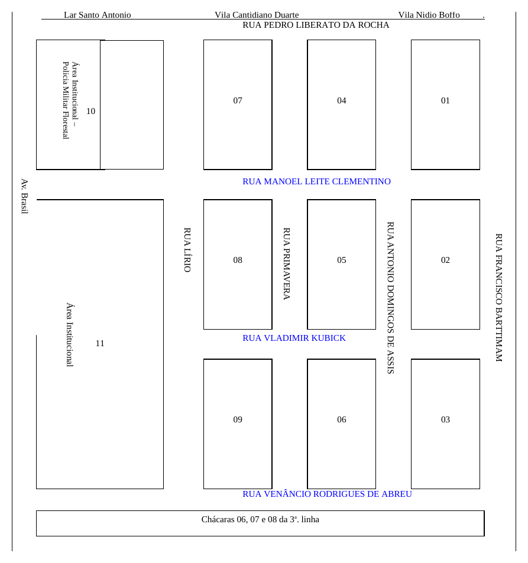

# Lei nº 572/2002

> Dispõe sobre denominação de próprios, vias e logradouros públicos, e dá outras providências.

!!! warning "Texto em revisão"
    Transcrito do arquivo .doc da prefeitura e **ainda em revisão**. Esta lei não está publicada na [página de legislação da prefeitura](https://bataypora.ms.gov.br/cidadao/legislacao-municipal); por isso não há PDF para conferir.

!!! note "Mapa do Anexo I"
    O Anexo I é um mapa desenhado no Word; a imagem foi gerada do próprio arquivo .doc.

Baixar: [PDF](../../baixar/leis-ordinarias/2002/lei-572-2002.pdf){ .md-button download="lei-572-2002.pdf" } [Word (.docx)](../../baixar/leis-ordinarias/2002/lei-572-2002.docx){ .md-button download="lei-572-2002.docx" } [Texto (.txt)](../../baixar/leis-ordinarias/2002/lei-572-2002.txt){ .md-button download="lei-572-2002.txt" } [Markdown (.md)](../../baixar/leis-ordinarias/2002/lei-572-2002.md.txt){ .md-button download="lei-572-2002.md" }

**Lei nº. 572/2002 de 21 de novembro de 2002.**
{ .centro }

“Dispõe sobre denominação de próprios, vias e logradouros públicos, e dá outras providências”.

**DR. JERCÉ EUSÉBIO DE SOUZA**, PREFEITO MUNICIPAL DE BATAYPORÃ, ESTADO DE MATO GROSSO DO SUL, no uso e gozo de suas atribuições legais, constantes no Art. 12, Item XV da Lei Orgânica do município;

Faz saber que a Câmara Municipal aprovou e o Poder Executivo sanciona e promulga a seguinte lei:

**Art. 1º** Ficam denominadas as Ruas da Vila Militar deste Município, a saber:
{ #art-1 }

a) Rua Manoel Leite Clementino a via pública com início na Av. Brasil entre as Quadras 10 e 11; 07 e 08; 04 e 05; e 01 e 02;

b) Rua Vladimir Kubick a via pública com início na Av. Brasil entre as Quadras 08 e 09; 05 e 06; e 02 e 03;

c) Rua Venâncio Rodrigues de Abreu a via pública com início na Av. Brasil paralela as Quadras 09, 06 e 03, margeando as Chácaras 06, 07 e 08 da 3ª. linha.

Parágrafo único. A presente denominação encontra se demonstrada no Anexo I da presente Lei.

**Art. 2º** As despesas decorrentes com a execução da presente Lei correrão por conta de dotações orçamentárias constantes do Orçamento em vigor.
{ #art-2 }

**Art. 3º** Esta Lei entra em vigor na data de sua publicação ou afixação.
{ #art-3 }

**Art. 4º** Revogadas as disposições em contrário.
{ #art-4 }

Prefeitura Municipal de Batayporã-MS., aos vinte e um dias do mês de novembro de 2002.

**Dr. Jercé Eusébio de Souza**
Prefeito Municipal
{ .centro }

Registrado em livro próprio da Secretaria de Administração, Finanças e Planejamento, e afixada em local de costume em data acima citada.

**José Antonio Frutuoso**
Secretário
{ .centro }

## ANEXO I — DEMONSTRATIVO DA DENOMINAÇÃO DAS RUAS DA VILA MILITAR: { #anexo-i .centro }

- **MANOEL LEITE CLEMENTINO;**

- **VLADIMIR KUBICK**

- **VENÂNCIO RODRIGUES DE ABREU**

Batayporã-MS, 21 de novembro de 2002.

**Dr. Jercé Eusébio de Souza**
Prefeito Municipal
{ .centro }
