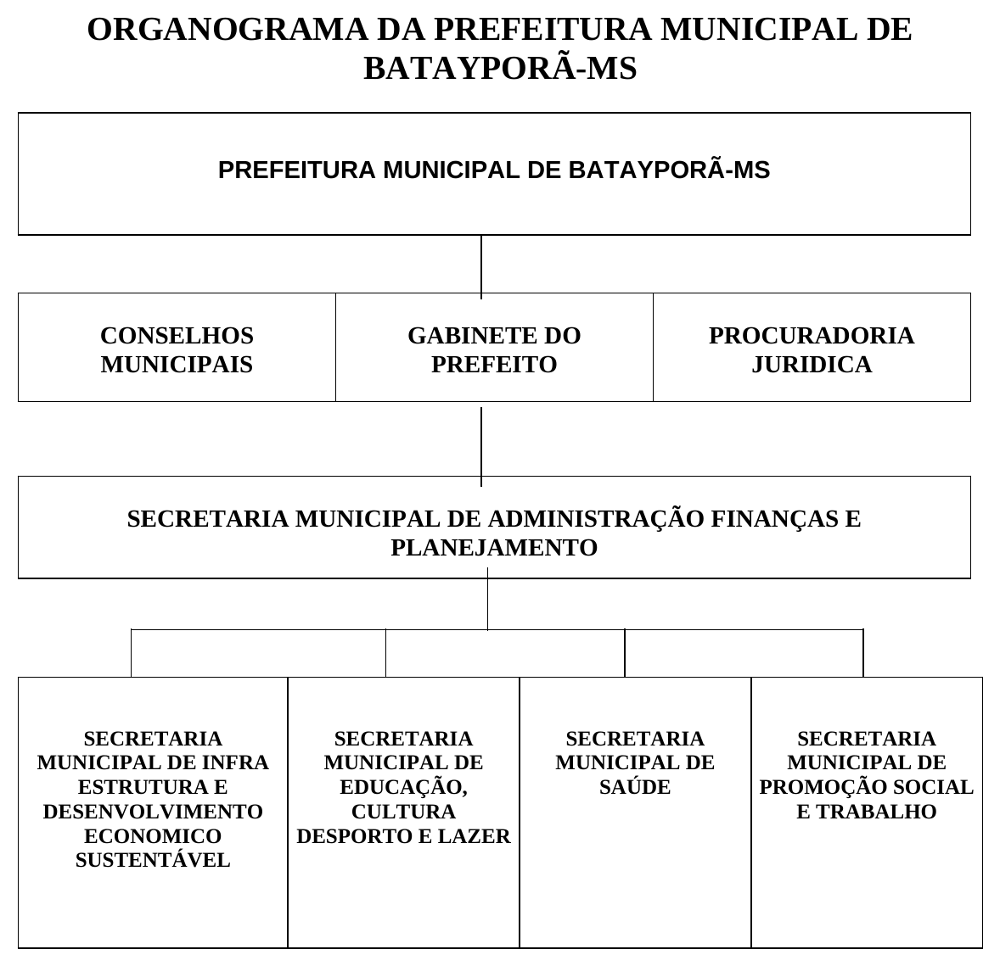
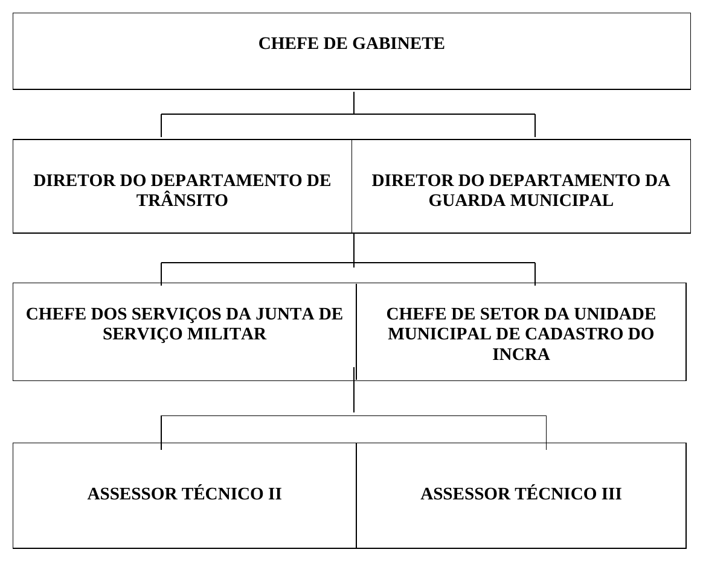
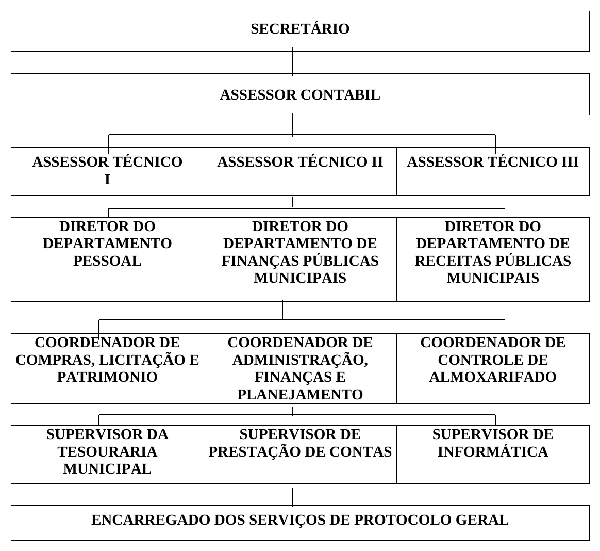
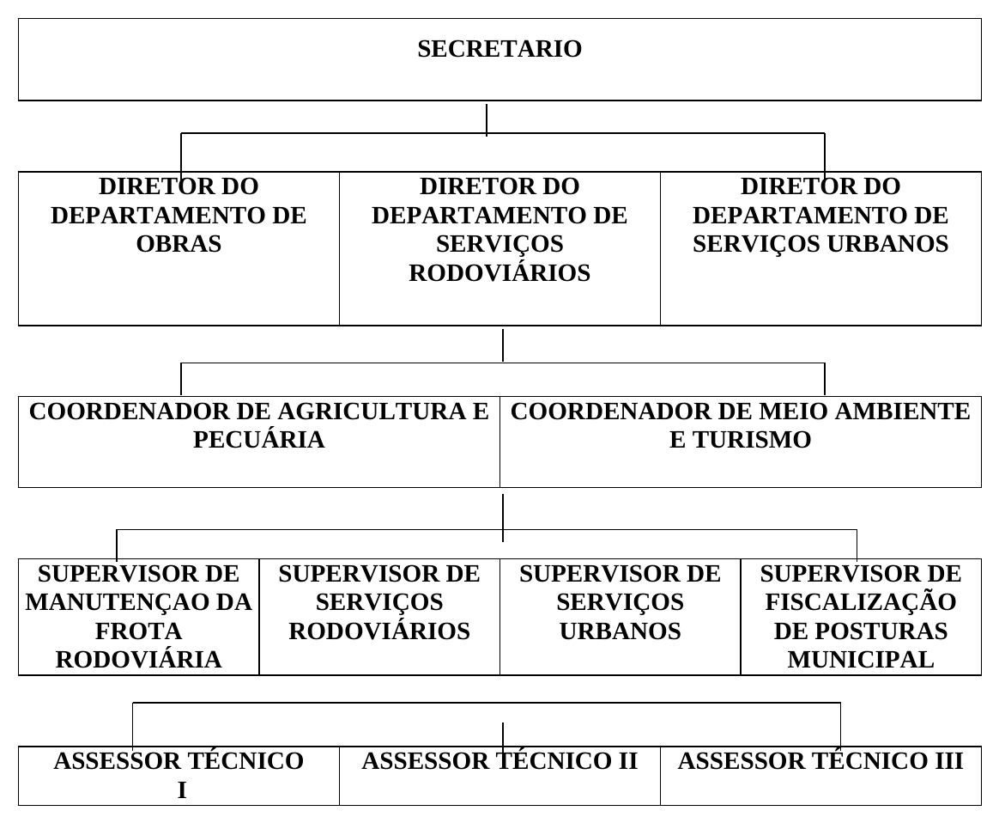
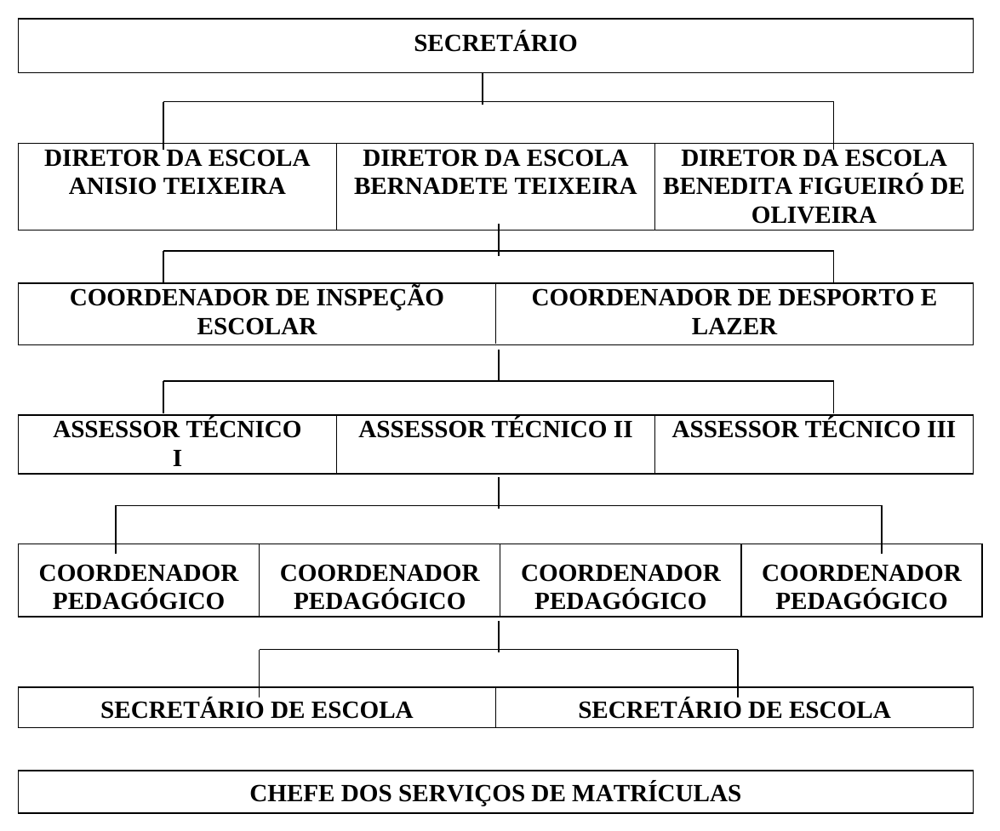
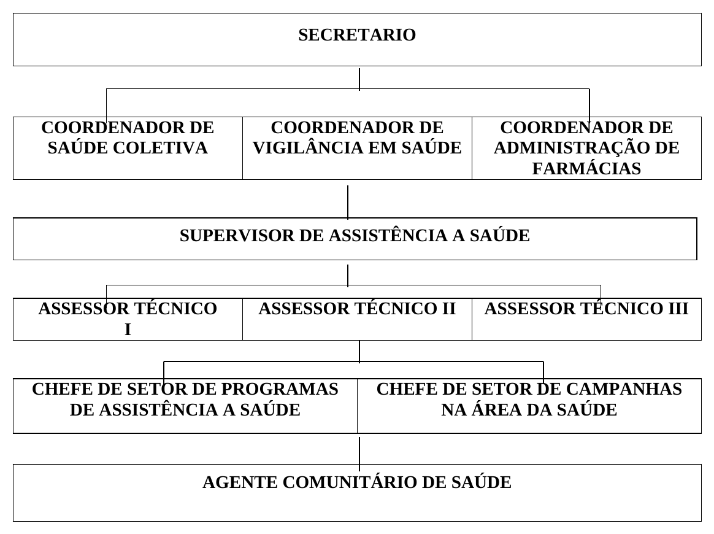
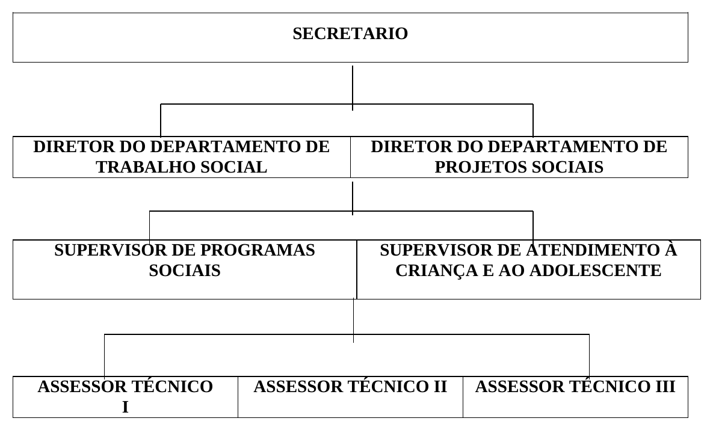

# Lei nº 638/2004

> Dispõe sobre a reorganização estrutural da Prefeitura Municipal de Batayporã-MS, e dá outras providências.

!!! warning "Texto em revisão"
    Transcrito do arquivo .doc da prefeitura, conferido com a [versão em PDF do documento, impressa do Word](../../assets/lei-638-2004/lei-638-2004.pdf) (com os anexos), e **ainda em revisão**. Esta lei não está publicada na [página de legislação da prefeitura](https://bataypora.ms.gov.br/cidadao/legislacao-municipal).

Baixar: [PDF](../../baixar/leis-ordinarias/2004/lei-638-2004.pdf){ .md-button download="lei-638-2004.pdf" } [Word (.docx)](../../baixar/leis-ordinarias/2004/lei-638-2004.docx){ .md-button download="lei-638-2004.docx" } [Texto (.txt)](../../baixar/leis-ordinarias/2004/lei-638-2004.txt){ .md-button download="lei-638-2004.txt" } [Markdown (.md)](../../baixar/leis-ordinarias/2004/lei-638-2004.md.txt){ .md-button download="lei-638-2004.md" }

!!! abstract "Índice"
    | Divisão | Assunto | Artigos |
    |---|---|---:|
    | TÍTULO I | DA FINALIDADE | [1](#art-1) |
    | TÍTULO II | DA ESTRUTURA ORGANIZACIONAL | [2](#art-2) a [4](#art-4) |
    | **TÍTULO III** | **DA FINALIDADE DAS UNIDADES INTEGRANTES DA ESTRUTURA ORGANIZACIONAL** | |
    |  **Capítulo I** | **DOS ÓRGÃOS COLEGIADOS** | |
    |   Seção Única | DOS CONSELHOS MUNICIPAIS | [5](#art-5) |
    |  **Capítulo II** | **DOS ÓRGÃOS DE ASSESSORAMENTO** | |
    |   Seção I | DO GABINETE DO PREFEITO | [6](#art-6) e [7](#art-7) |
    |  **Capítulo III** | **DOS ÓRGÃOS DE ATUAÇÃO INSTRUMENTAL** | |
    |   Seção I | DA SECRETARIA MUNICIPAL DE ADMINISTRAÇÃO, FINANÇAS E PLANEJAMENTO | [8](#art-8) |
    |  **Capítulo IV** | **DOS ÓRGÃOS DE ATUAÇÃO PROGRAMÁTICA** | |
    |   Seção I | DA SECRETARIA MUNICIPAL DE INFRA-ESTRUTURA E DESENVOLVIMENTO ECONÔMICO SUSTENTÁVEL | [9](#art-9) |
    |   Seção II | DA SECRETARIA MUNICIPAL DE EDUCAÇÃO, CULTURA, DESPORTO E LAZER | [10](#art-10) |
    |   Seção III | DA SECRETARIA MUNICIPAL DE SAÚDE | [11](#art-11) |
    |   Seção IV | DA SECRETARIA MUNICIPAL DE PROMOÇÃO SOCIAL E TRABALHO | [12](#art-12) |
    | **TÍTULO IV** | **DA CARACTERIZAÇÃO E DO FUNCIONAMENTO DOS SISTEMAS** | |
    |  Capítulo I | DA CARACTERIZAÇÃO | [13](#art-13) |
    |  **Capítulo II** | **DO FUNCIONAMENTO** | |
    |   Seção I | DO SISTEMA DE ADMINISTRAÇÃO GERAL E DE RECURSOS HUMANOS | [14](#art-14) |
    |   Seção II | DO SISTEMA DE PLANEJAMENTO FINANCEIRO | [15](#art-15) e [16](#art-16) |
    | TÍTULO V | DO PROCESSO DECISÓRIO | [17](#art-17) |
    |  Capítulo I | DO CONTROLE DE RESULTADOS | [18](#art-18) |
    |  Capítulo II | DA COORDENAÇÃO FUNCIONAL | [19](#art-19) e [20](#art-20) |
    |  Capítulo III | DA DESCENTRALIZAÇÃO DAS DECISÕES | [21](#art-21) e [22](#art-22) |
    | **TÍTULO VI** | **DAS DISPOSIÇÕES GERAIS E TRANSITÓRIAS** | |
    |  Capítulo I | DAS DISPOSIÇÕES GERAIS | [23](#art-23) a [27](#art-27) |
    |  Capítulo II | DAS DISPOSIÇÕES TRANSITÓRIAS | [28](#art-28) a [34](#art-34) |
    | **[ANEXO I](#anexo-i)** | **ORGANOGRAMA DA PREFEITURA MUNICIPAL DE BATAYPORÃ-MS** |  |
    | **[ANEXO II](#anexo-ii)** | **QUADRO DEMONSTRATIVO DE CARGOS COMISSIONADOS DA PREFEITURA MUNICIPAL DE BATAYPORÃ - MS** |  |
    | **[ANEXO III](#anexo-iii)** | **QUADRO DEMONSTRATIVO DE DISTRIBUIÇÃO DE CARGOS COMISSIONADOS** |  |

**Lei nº. 638/2004 de 16 de dezembro de 2004.**
{ .centro }

“Dispõe sobre a reorganização estrutural da Prefeitura Municipal de Batayporã-MS, e dá outras providências”.

Faço saber que a Câmara Municipal aprovou e eu, **DR. JERCÉ EUSÉBIO DE SOUZA**, PREFEITO MUNICIPAL DE BATAYPORÃ, ESTADO DE MATO GROSSO DO SUL, sanciono a seguinte Lei:

## TÍTULO I — DA FINALIDADE { .centro }

**Art. 1º** Esta Lei reorganiza a estrutura administrativa da Prefeitura Municipal de Batayporã, unidade territorial com autonomia política, administrativa e financeira, nos termos assegurados pela Constituição da República Federativa do Brasil, pela Constituição Estadual e pela lei Orgânica, com a seguinte finalidade:
{ #art-1 }

I - a proteção do patrimônio histórico-cultural do Município, observada a legislação e a ação fiscalizadora federal e estadual;

II - o desenvolvimento de programas de construção de moradias e melhoria das condições habitacionais e de saneamento básico;

III - a promoção do adequado reordenamento territorial, mediante planejamento e controle do uso, do parcelamento e da ocupação do solo urbano;

IV - a organização e a prestação, direta ou sob regime de concessão de permissão dos serviços públicos de interesse local, incluído o essencial de transporte coletivo;

V - o planejamento de suas atividades, atendendo às peculiaridades locais e aos princípios técnicos convenientes ao desenvolvimento integral da comunidade;

VI - a coordenação e a supervisão do processo de planejamento e execução de programas, voltados para o atendimento aos direitos da criança e do adolescente;

VII - a promoção de ações de combate às causas de pobreza e de fatores de marginalização, promovendo a integração social da população menos favorecida;

VIII - a proteção do meio ambiente e combate à poluição em qualquer de suas formas, preservando a flora e a fauna e estimulando a recuperação do meio ambiente depredado;

IX - o desenvolvimento de ações de saúde e assistência social à população;

X - a proteção às pessoas portadoras de deficiências;

XI - o desenvolvimento de ações que assegurem o acesso à cultura e à educação pré-escolar e ensino fundamental.

## TÍTULO II — DA ESTRUTURA ORGANIZACIONAL { .centro }

**Art. 2º** Para o cumprimento de suas finalidades, a Prefeitura Municipal de Batayporã - PMB, administrada pelo Prefeito Municipal, tem a seguinte estrutura organizacional básica;
{ #art-2 }

I - Órgãos Colegiados:

a) Conselhos Municipais.

II - Órgãos de Assessoramento:

a) Gabinete do Prefeito (GAPRE);

III - Órgãos de Atuação Instrumental:

a) Secretaria Municipal de Administração, Finanças e Planejamento (SEAFIP);

IV - Órgãos de Atuação Programática:

a) Secretaria Municipal de Infra-Estrutura, e Desenvolvimento Econômico Sustentável (SEINDES);

b) Secretaria Municipal de Educação, Cultura, Desporto e Lazer (SECDEL);

c) Secretaria Municipal de Saúde (SESAU);

d) Secretaria Municipal de Promoção Social e Trabalho (SEPROST);

**Art. 3º** A estrutura organizacional de cada órgão ou entidade integrante da Prefeitura Municipal de Batayporã compreenderá unidades administrativas, observados os seguintes níveis e respectivas nomenclaturas:
{ #art-3 }

I - Nível de Direção e Assessoramento Superior - com funções voltadas à articulação institucional ampla de suas atividades e ao gerenciamento, a orientação e supervisão dos órgãos e entidades da Administração Municipal, ocupante de Cargo de Secretário e ou equivalente, símbolo CC1-01;

II - Nível de Assessoramento - voltado às funções de apoio direto, de caráter técnico e jurídico, ao dirigente em nível de Direção Superior, símbolos CC2-1;

III - Nível de Execução Programática - representado por unidades encarregadas das funções específicas, referentes a programas, projetos e serviços de caráter permanente, nas respectivas áreas de atuação dos Órgãos Municipais, ocupante de Cargo em Comissão, símbolo CC3-01;

IV - Nível de Atuação Auxiliar - voltado às funções de apoio administrativo aos Órgãos Municipais, ocupante de Cargo em Comissão, símbolo CC4-01, CC4-02, CC4-03, CC5-01, CC5-02, CC5-03, CC5-04, CC6-01, CC6-02 E CC6-03, de acordo com a importância das atividades desenvolvidas;

V - Nível de Atuação Específica, voltado aos serviços de protocolo geral, e do programa de Agentes Comunitários de Saúde — PACS, ocupantes de Cargo em Comissão símbolo CC7-01 e CC7-02;

VI - Os funcionários efetivos nomeados para Funções de Confiança, ocuparão cargos de confiança símbolo FC1 a FC4, de acordo com a importância das atividades desenvolvidas;

VII - Os funcionários efetivos nomeados para Cargos em Comissão, deverão fazer opção pelo SUBSÍDIO correspondente ao cargo ou a remuneração originária.

**Art. 4º** A representação gráfica da estrutura organizacional básica da Prefeitura Municipal de Batayporã é a constante do Anexo I desta Lei.
{ #art-4 }

## TÍTULO III — DA FINALIDADE DAS UNIDADES INTEGRANTES DA ESTRUTURA ORGANIZACIONAL { .centro }

### CAPÍTULO I — DOS ÓRGÃOS COLEGIADOS { .centro }

#### SEÇÃO ÚNICA — DOS CONSELHOS MUNICIPAIS { .centro }

**Art. 5º** Os Conselhos Municipais têm suas finalidades e composições definidas em seus atos de criação e seus funcionamentos regulados em regimentos próprios.
{ #art-5 }

### CAPÍTULO II — DOS ÓRGÃOS DE ASSESSORAMENTO { .centro }

#### SEÇÃO I — DO GABINETE DO PREFEITO { .centro }

**Art. 6º** O Gabinete do Prefeito - GAPRE, órgão de assessoramento direto ao Prefeito Municipal, tem por finalidade:
{ #art-6 }

I - o assessoramento ao Prefeito Municipal e Vice-Prefeito, em assuntos técnicos político e administrativos pertinentes à Administração Municipal;

II - a coordenação geral do desenvolvimento de ações técnico-administrativas pertinentes à Administração municipal;

III - a articulação técnica e política com a Câmara Municipal, objetivando assegurar a consecução das metas da Administração Municipal e o atendimento as necessidades da comunidade;

IV - a integração e articulação com os órgãos da Administração Pública e organismos representativos da comunidade, para garantir a efetividade do Plano de Governo;

V - o desempenho das atividades de comunicação institucional;

VI - a supervisão das atividades relacionadas à habitação, cultura, esporte, lazer e de planejamento urbano e de meio ambiente;

VII - a supervisão dos assuntos relacionados a Guarda Municipal;

VIII - a adequação das atividades de competência municipal, através do Departamento Municipal de Trânsito, criado pela Lei nº 410/98, com observância do art. nº 333, § 2º da Lei nº 9.503/97 (Código de Trânsito Brasileiro);

IX - o fomento ao comércio, indústria e turismo;

X - o estabelecimento de diretrizes e normas relativas à regularização e assentamentos de favelas e à concessão de áreas em regime de comodato;

XI - o planejamento e a coordenação do processo de execução da Política Fundiária para a população de baixa renda do Município;

XII - a Junta de Serviço Militar – JSM;

XIII - a Unidade Municipal de Cadastro que disciplina a organização e o intercâmbio entre a Receita Federal e o INCRA e ou órgãos correlatos para a estrutura fundiária do município.

**Art. 7º** A Procuradoria Jurídica do Município, órgão de assessoramento do Gabinete do Prefeito, tem por finalidade:
{ #art-7 }

I - a representação do Município perante o contencioso administrativo;

II - o assessoramento ao Poder Executivo na interpretação, aplicação e controle das normas jurídicas;

III - o assessoramento ao Prefeito Municipal na elaboração do processo legislativo e o controle da legalidade dos atos administrativos;

IV - o controle das desapropriações;

V - o controle documental da legislação municipal;

VI - a representação judicial e extrajudicial do Município em qualquer foro ou juízo;

VII - a propositura de ação declaratória de nulidade ou de anulação de quaisquer atos, havidos como ilegais ou inconstitucionais;

VIII - o controle da apresentação dos Precatórios Judiciais, na forma do art. l00 da Constituição Federal;

IX - a execução fiscal.

### CAPÍTULO III — DOS ÓRGÃOS DE ATUAÇÃO INSTRUMENTAL { .centro }

#### SEÇÃO I — DA SECRETARIA MUNICIPAL DE ADMINISTRAÇÃO, FINANÇAS E PLANEJAMENTO { .centro }

**Art. 8º** A Secretaria Municipal de Administração, Finanças e Planejamento - SEAFIP, órgão de atuação instrumental, responsável pelo planejamento, supervisão técnica, controle e coordenação das atividades dos Sistemas de Financeiro, no âmbito do Poder Executivo Municipal, tem por finalidade:
{ #art-8 }

I - a formulação e execução da Política Tributária do Município;

II - o desempenho das atividades referentes à administração tributária, financeira e contábil;

III - a coordenação e controle prévio de aquisições de bens e serviços;

IV - a coordenação das atividades de processamento de dados;

V - cobrança extrajudicial das dívidas para com o Município;

VI - inscrição e controle da Dívida Ativa.

VII - manter atualizado o cadastro de contribuintes;

VIII - compor anualmente, com três funcionários, a Junta de Recursos Fiscais;

IX - a administração do processo de planejamento, mediante a orientação normativa e metodológica aos demais órgãos e entidades da Administração Municipal, na concepção e desenvolvimento das respectivas programações e na execução orçamentária;

X - o desempenho das atividades referentes à administração financeira e projetos;

XI - a elaboração da Proposta de Diretrizes Orçamentárias, do orçamento anual e plurianual de investimento;

XII - o acompanhamento, a coordenação e avaliação de planos, programas e projetos da Administração Municipal;

XIII - proposição de medidas que assegurem o equilíbrio orçamentário na programação e execução das ações;

XIV - o planejamento, acompanhamento, controle e avaliação de programas e projetos dos Órgãos Municipais;

XV - a administração de pessoal e de cargos, funções e empregos de qualquer natureza;

XVI - o estabelecimento das diretrizes da Política de Recursos Humanos;

XVII - a administração de materiais, serviços, bens patrimoniais móveis, da documentação produzida pela Administração Municipal;

XVIII - a coordenação, supervisão, e controle dos serviços gerais de comunicação, arquivo, protocolo, limpeza, manutenção, reprografia, portaria, vigilância e transportes;

XIX - a coordenação do processo de capacitação de recursos humanos;

XX - a organização, controle e atualização do cadastro geral de fornecedores e prestadores de serviços;

XXI - a coordenação, execução e fiscalização do processo licitatório;

### CAPÍTULO IV — DOS ÓRGÃOS DE ATUAÇÃO PROGRAMÁTICA { .centro }

#### SEÇÃO I — DA SECRETARIA MUNICIPAL DE INFRA-ESTRUTURA E DESENVOLVIMENTO ECONÔMICO SUSTENTÁVEL { .centro }

**Art. 9º** A Secretaria Municipal de Infra-Estrutura e Desenvolvimento Econômico Sustentável - SEINDES, órgão de atuação programática, tem por finalidade, no âmbito do Poder Executivo Municipal:
{ #art-9 }

I - a administração dos serviços de limpeza e iluminação pública, dos sistemas de drenagem, bem como de praças, parques e áreas verdes;

II - o planejamento, a coordenação, a execução e a avaliação de programas e projetos com vistas à construção e recuperação de obras públicas municipais e do sistema viário e rodoviário municipal;

III - o planejamento, a coordenação, a execução e a avaliação de programas e projetos com vistas à construção, reforma e recuperação de próprios do Município;

IV - a administração, controle e fiscalização de feiras livres, mercados municipais e cemitérios;

V - o acompanhamento e controle de ordenamento do uso e da ocupação do território municipal, de acordo com a legislação urbanística e ambiental;

VI - o desenvolvimento de diretrizes que assegurem o controle do sistema cartográfico e do cadastro técnico-imobiliário para embasamento das ações de planejamento fiscal e tributário do Executivo Municipal;

VII - a coordenação e execução do processo de avaliação dos imóveis rurais e urbanos do Município para fins de lançamento de tributos, desapropriações e outras finalidades de interesse da Administração Municipal;

VIII - a fiscalização de posturas urbanas estabelecidas pelo Código de Polícia Administrativa do Município;

IX - o acompanhamento e controle do patrimônio dos bens imóveis do Município;

X - o planejamento, a coordenação e fiscalização do transporte e do sistema viário do Município;

XI - a execução dos serviços de transporte por administração direta, adjudicação a outros níveis de governo ou através de terceiros;

XII - a manutenção, sinalização e a fiscalização das vias urbanas e rurais municipais;

XIII - a elaboração e execução de programas que promovam o desenvolvimento econômico do município, na agricultura, pecuária, turismo, indústria e comércio;

XIV - o controle estatístico e econômico das atividades produtivas e comerciais instaladas no município;

XV - a captação de investidores para a instalação de novas unidades produtivas, turísticas ou comerciais;

XVI - a análise, para concessão de benefícios fiscais e estruturais previstos em lei, às unidades produtivas, turísticas ou comerciais;

XVII - a coordenação de projetos especiais para o desenvolvimento do turismo no município;

XVIII - a coordenação e promoção de ações que visem à divulgação das potencialidades turísticas do município;

XIX - a elaboração e execução de projetos de preservação ambiental;

XX - a análise, aprovação e acompanhamento de projetos de instalação de novas unidades produtivas, impondo a aplicação da legislação ambiental vigente, com observância a legislação estadual e federal;

XXI - a administração e manutenção dos setores responsáveis pelo abastecimento e distribuição.

#### SEÇÃO II — DA SECRETARIA MUNICIPAL DE EDUCAÇÃO, CULTURA, DESPORTO E LAZER { .centro }

**Art. 10.** A Secretaria Municipal de Educação, Cultura, Desporto e Lazer - SECDEL, órgão de atuação programática, tem por finalidade, no âmbito do Poder Executivo Municipal:
{ #art-10 }

I - o oferecimento de oportunidades de acesso ao ensino prioritariamente, à educação infantil e ao fundamental;

II - o planejamento, a coordenação e a avaliação das atividades educacionais do Município;

III - a promoção de ações com vistas à erradicação ou minimização dos índices de analfabetismo no Município;

IV - a formulação da política Educacional do Município, em consonância com as diretrizes emanadas dos órgãos integrantes dos sistemas de ensino em nível federal e estadual;

V - o atendimento educacional especializado aos portadores de deficiência, preferencialmente, na rede regular de ensino;

VI - a administração da Rede Municipal de Ensino.

VII - a administração do programa de merenda escolar;

VIII - a elaboração de planos e a aplicação de recursos específicos da educação;

IX - a elaboração e execução de programas que estimulem a prática esportiva à população, principalmente entre os jovens;

X - a elaboração e execução de programas que proporcionem lazer e vida saudável a população;

XI - a elaboração e execução de programas que demonstrem e incentivem a fixação e a ampliação dos valores culturais, em especial os regionais;

XII - cumprir o que dispõe a Lei Complementar nº 006/2002, que regulamenta as atividades dos profissionais da Educação, de acordo com o art. 189, inciso V, da Constituição Estadual, observadas as disposições da Lei Federal n. 9.394, de 20 de dezembro de 1996;

XIII - gerenciar os recursos do FUNDEF de acordo com as normas do Ministério de Educação e Cultura.

#### SEÇÃO III — DA SECRETARIA MUNICIPAL DE SAÚDE { .centro }

**Art. 11.** A Secretaria Municipal de Saúde - SESAU, órgão de atuação programática, tem por finalidade, no âmbito do Poder Executivo Municipal:
{ #art-11 }

I - a formulação e execução da Política de Saúde que vise à redução de riscos de doenças e outros agravos, tendo como base os indicadores sócio-econômicos e culturais da população;

II - a identificação e divulgação de fatores condicionantes e determinantes de doenças;

III - a elaboração e atualização periódica do Plano Municipal de Saúde, em termos de prioridades e estratégias, em consonância com o Sistema Único de Saúde e com o Conselho Municipal de Saúde;

IV - a promoção e controle de serviços, produtos e substâncias de interesse para a saúde e meio ambiente;

V - a coordenação do processo de ações de vigilância da saúde;

VI - atendimento integral à saúde, com prioridade para as atividades preventivas, sem prejuízo dos serviços assistenciais, tratamento e promocionais,

VII - a administração e manutenção das Unidades de Saúde e da Farmácia de Distribuição.

#### SEÇÃO IV — DA SECRETARIA MUNICIPAL DE PROMOÇÃO SOCIAL E TRABALHO { .centro }

**Art. 12.** A Secretaria Municipal de Promoção Social e Trabalho - SEPROST, órgão de atuação programática, tem por finalidade, no âmbito do Poder Executivo Municipal:
{ #art-12 }

I - a definição e coordenação da Política Municipal de Assistência Social, nos termos da Lei Federal nº 8.069, de 13 de julho de 1990 e da lei Federal nº 8.742, de 07 de dezembro de 1993;

II - a elaboração e execução de projetos de atendimento, em especial às crianças carentes, idosos e suas famílias;

III - a definição e coordenação da Política Municipal do Trabalho;

IV - a elaboração e execução de projetos de capacitação e colocação profissional;

V - prestar apoio técnico-administrativo ao Conselho Tutelar.

## TÍTULO IV — DA CARACTERIZAÇÃO E DO FUNCIONAMENTO DOS SISTEMAS { .centro }

### CAPÍTULO I — DA CARACTERIZAÇÃO { .centro }

**Art. 13.** As atividades de planejamento, administração financeira, administração geral e de recursos humanos serão desenvolvidas, de forma centralizada, através dos seguintes sistemas:
{ #art-13 }

I - Sistema de Administração Geral e de Recursos Humanos;

II - Sistema de Planejamento Financeiro;

### CAPÍTULO II — DO FUNCIONAMENTO { .centro }

#### SEÇÃO I — DO SISTEMA DE ADMINISTRAÇÃO GERAL E DE RECURSOS HUMANOS { .centro }

**Art. 14.** Através dos Grupos Administrativos, a Secretaria Municipal de Administração, Finanças e Planejamento — SEAFIP- coordenará, junto aos demais órgãos, o seguinte serviços-meio:
{ #art-14 }

I - aquisição, recebimento, guarda, distribuição, controle e alienação de materiais;

II - registro, carga, tombamento, controle, manutenção e conservação de bens patrimoniais, móveis, inclusive as obras de arte e objetos decorativos;

III - aquisição, guarda, manutenção e alienação de veículos leves:

IV - reprografia, arquivo de documentação e manutenção de biblioteca;

V - acompanhamento e controle de protocolo, de tramitação de expediente, de telefonia, de portaria, de vigilância, de copa e manutenção e

conservação da limpeza predial;

VI - estabelecimento de critérios para recrutamento, seleção , admissão e cadastramento de recursos humanos, com vistas a atender a demanda dos órgãos que compõem a Prefeitura Municipal;

VII - estabelecimento de critérios para movimentação de pessoal entre os órgãos da Administração Municipal, com ciência da Secretaria de origem do servidor;

VIII - controle centralizado dos cargos em comissão e de funções gratificadas, bem como ampliação do quadro permanente;

IX - coordenação do processo de avaliação de desempenho dos servidores.

#### SEÇÃO II — DO SISTEMA DE PLANEJAMENTO FINANCEIRO { .centro }

**Art. 15.** A gestão dos recursos financeiros, orçamentários e extra-orçamentários processar-se-á sob a coordenação e orientação centralizada da Secretaria Municipal de Administração, Finanças e Planejamento — SEAFIP-.
{ #art-15 }

**Art. 16.** Cabe à Secretaria Municipal de Administração, Finanças e Planejamento — SEAFIP - assegurar o controle interno e externo da administração municipal na aplicação dos recursos financeiros a ela destinados, através de:
{ #art-16 }

I - elaboração do cronograma financeiro de desembolso para os programas e atividades da Administração Municipal;

II - programação e execução dos pagamentos devidos pela Administração Municipal;

III - auditagem nos atos financeiros;

IV - observação dos programas contidos na lei orçamentária;

V - observação das prescrições legais contidas nas legislações específicas aplicáveis aos municípios.

## TÍTULO V — DO PROCESSO DECISÓRIO { .centro }

**Art. 17.** O processo decisório, no âmbito da Administração Municipal, observará os seguintes critérios:
{ #art-17 }

I - controle de resultados;

II - coordenação funcional;

III - descentralização das decisões.

### CAPÍTULO I — DO CONTROLE DE RESULTADOS { .centro }

**Art. 18.** O controle de resultados dos programas e das ações dos Órgãos Municipais constitui responsabilidade de todos os níveis de chefia e será exercido, de forma sistemática e permanente, compreendendo:
{ #art-18 }

I - a avaliação da realização física de planos, programas e orçamentos;

II - a avaliação comparativa dos custos operacionais com os resultados obtidos;

III - o acompanhamento e controle de obras, serviços e materiais, de acordo com as especificações previstas em licitações;

IV - a otimização de tempo, de recursos financeiros, materiais e humanos, racionalizando métodos, processos e práticas de trabalho que configurem desperdício.

### CAPÍTULO II — DA COORDENAÇÃO FUNCIONAL { .centro }

**Art. 19.** A coordenação funcional na Administração Municipal tem por objetivo evitar a superposição de iniciativas, facilitar a complementaridade de esforço e desenvolver a comunicação entre Secretarias e entre estas e os servidores.
{ #art-19 }

Parágrafo único. A coordenação funcional, de que trata o ¨caput¨ deste artigo, será desenvolvida:

I - pelo Prefeito, Vice-Prefeito, Secretários Municipais e equivalentes;

II - pelos Assessores das Secretarias.

**Art. 20.** A coordenação funcional, em nível superior, cabe opinar sobre:
{ #art-20 }

I - medidas de incentivo ao desenvolvimento e fortalecimento da economia municipal;

II - diretrizes gerais dos planos de trabalho e respectiva escala de prioridades;

III - política de ação social voltada para a população de baixa renda;

IV - revisão, de acordo com a conjuntura administrativa e financeira do orçamento e da programação dos diferentes órgãos municipais;

V - conveniência ou não de endividamento através de contratação de empréstimo;

VI - alterações da política de vencimentos, de salários e de benefícios de pessoal da Administração Municipal.

Parágrafo único. As conclusões da coordenação funcional, em nível superior, poderão ter força normativa, se assim o decidir o Prefeito.

### CAPÍTULO III — DA DESCENTRALIZAÇÃO DAS DECISÕES { .centro }

**Art. 21.** Os servidores ocupantes de cargo de chefia, em todos os níveis, são responsáveis pela melhoria da qualidade dos serviços públicos e têm por atribuições:
{ #art-21 }

I - coordenar, supervisionar, controlar e avaliar a aplicação dos recursos financeiros, assegurando a racionalidade das atividades e serviços, evitando a duplicidade de ações, com vistas à consecução das metas e objetivos propostos;

II - divulgar os objetivos, metas e atividades contidas no plano de ação do órgão que chefia, com vistas ao comprometimento de todos com os propósitos estabelecidos;

III - estabelecer mecanismos de valorização do servidor, incentivando-o à participação efetiva e crítica no processo;

IV - coordenar, supervisionar, orientar e acompanhar a execução de planos, projetos e atividades, com vistas à consecução dos objetivos propostos;

V - incentivar o servidor à participação de cursos, encontros e treinamentos, com vistas à melhoria de seu desempenho.

**Art. 22.** As responsabilidades e atribuições específicas das chefias, em todos os níveis, será especificadas no regimento interno dos respectivos órgãos.
{ #art-22 }

## TÍTULO VI — DAS DISPOSIÇÕES GERAIS E TRANSITÓRIAS { .centro }

### CAPÍTULO I — DAS DISPOSIÇÕES GERAIS { .centro }

**Art. 23.** Ficam fundidas a Secretaria Municipal de Infra Estrutura – SEINE e a Secretaria Municipal de Desenvolvimento Econômico Sustentável – SEDES em Secretaria Municipal de Infra Estrutura e Desenvolvimento Econômico Sustentável – SEINDES.
{ #art-23 }

**Art. 24.** Os Fundos Municipais serão geridos da forma prevista em seus atos constitutivos.
{ #art-24 }

**Art. 25.** Os Conselhos Municipais, órgãos de assessoramento de suas respectivas secretarias afins, ficam vinculados ao Gabinete do Prefeito.
{ #art-25 }

**Art. 26.** Os Agentes Políticos, Prefeito, Vice-Prefeito, Secretários, Vereadores e os ocupantes de Cargos Comissionados passam a receber subsídio, composto de parcela única.
{ #art-26 }

**Art. 27.** Anualmente a Câmara Municipal estabelecerá os subsídios dos Vereadores, Prefeito, Vice-Prefeito, Secretários e ou equivalente;
{ #art-27 }

### CAPÍTULO II — DAS DISPOSIÇÕES TRANSITÓRIAS { .centro }

**Art. 28.** Fica o Poder Executivo autorizado a abrir Créditos Especiais no orçamento para o exercício de 2.005, no limite dos saldos disponíveis das unidades orçamentárias extintas, fusionadas, incorporadas ou transformadas.
{ #art-28 }

**Art. 29.** O Poder Executivo Municipal regulamentará, no que couber, através de Decreto, as disposições desta Lei.
{ #art-29 }

**Art. 30.** Ficam criados os cargos comissionados constantes do Anexo II desta Lei.
{ #art-30 }

**Art. 31.** A distribuição dos cargos em comissão fica estabelecida pelo constante do anexo III desta lei.
{ #art-31 }

**Art. 32.** Os Funcionários ocupantes dos cargos comissionados descritos acima, estarão sob a égide do Regime Estatutário.
{ #art-32 }

**Art. 33.** Ficam extintos todos os cargos criados pela [Lei nº 487/2001](../2001/lei-487-2001.md), de 13/02/2001 a partir de 31 de dezembro de 2004.
{ #art-33 }

**Art. 34.** Esta Lei entra em vigor a partir de primeiro de janeiro do ano de 2005, revogadas as disposições em contrário.
{ #art-34 }

Prefeitura Municipal de Batayporã-MS., aos dezesseis dias do mês de dezembro de 2004.

**Dr. Jercé Eusébio de Souza**
Prefeito Municipal
{ .centro }

Registrado em livro próprio da Secretaria de Administração, Finanças e Planejamento, e afixado em local de costume em data acima citada.

**José Antonio Frutuoso**
Secretário
{ .centro }

## ANEXO I — ORGANOGRAMA DA PREFEITURA MUNICIPAL DE BATAYPORÃ-MS { #anexo-i .centro }

## ANEXO II — QUADRO DEMONSTRATIVO DE CARGOS COMISSIONADOS DA PREFEITURA MUNICIPAL DE BATAYPORÃ - MS { #anexo-ii .centro }

| **CARGO** | **SIMBOLO** | **Nº DE CARGOS** |
|---|---|---|
| SECRETÁRIO | CC1-01 | **5** |
| CHEFE DE GABINETE | **CC1-02** | **1** |
| ASSESSOR CONTÁBIL | **CC2-01** | **1** |
| DIRETOR DO DEPARTAMENTO | CC3-01 | **10** |
| ASSESSOR TÉCNICO I | **CC4-01** | **5** |
| DIRETOR DE ESCOLA | **CC4-02** | **3** |
| COORDENADOR | **CC4-03** | **10** |
| ASSESSOR TÉCNICO II | **CC5-01** | **08** |
| SUPERVISOR | **CC5-02** | **10** |
| COORDENADOR PEDAGÓGICO | **CC5-03** | **4** |
| CHEFE DE SERVIÇOS | **CC5-04** | **2** |
| ÁSSESSOR TÉCNICO III | **CC6-01** | **13** |
| SECRETARIO DE ESCOLA | **CC6-02** | **2** |
| CHEFE DE SETOR | **CC6-03** | **3** |
| AGENTE COMUNITÁRIO DE SAÚDE | **CC7-01** | **27** |
| ENCARREGADO | **CC7-02** | **1** |
| **TOTAL DE CARGOS COMISSIONADOS** |  | **105** |

Prefeitura Municipal de Batayporã-MS., 16 de dezembro de 2004.

**Dr. Jercé Eusébio de Souza**
Prefeito Municipal
{ .centro }

## ANEXO III — QUADRO DEMONSTRATIVO DE DISTRIBUIÇÃO DE CARGOS COMISSIONADOS { #anexo-iii .centro }

**GABINETE DO PREFEITO**

<table style="width:84%;">
<colgroup>
<col style="width: 8%" />
<col style="width: 9%" />
<col style="width: 44%" />
<col style="width: 0%" />
<col style="width: 9%" />
<col style="width: 11%" />
</colgroup>
<tbody>
<tr>
<td>QUANT.</td>
<td>SIMBOLO</td>
<td>CARGO</td>
<td colspan="2">VALOR</td>
<td>SUBTOTAL</td>
</tr>
<tr>
<td>01</td>
<td>CC1-02</td>
<td>CHEFE DE GABINETE</td>
<td colspan="2">2.900,00</td>
<td>2.900,00</td>
</tr>
<tr>
<td>01</td>
<td>CC3-01</td>
<td>DIRETOR DO DEPARTAMENTO DE TRÂNSITO</td>
<td colspan="2">1.265,00</td>
<td>1.265,00</td>
</tr>
<tr>
<td>01</td>
<td>CC3-01</td>
<td>DIRETOR DO DEPARTAMENTO DA GUARDA MUNICIPAL</td>
<td colspan="2">1.265,00</td>
<td>1.265,00</td>
</tr>
<tr>
<td>01</td>
<td>CC5-04</td>
<td>CHEFE DOS SERVIÇOS DA JUNTA DE SERVIÇO MILITAR</td>
<td colspan="2">605,00</td>
<td>605,00</td>
</tr>
<tr>
<td>01</td>
<td>CC5-01</td>
<td>ASSESSOR TÉCNICO II</td>
<td colspan="2">605,00</td>
<td>605,00</td>
</tr>
<tr>
<td>01</td>
<td>CC6-03</td>
<td>CHEFE DE SETOR DA UNIDADE MUNICIPAL DE CADASTRO DO INCRA</td>
<td colspan="2">412,50</td>
<td>412,50</td>
</tr>
<tr>
<td>01</td>
<td>CC6-01</td>
<td>ASSESSOR TÉCNICO III</td>
<td colspan="2">412,50</td>
<td>412,50</td>
</tr>
<tr>
<td colspan="4">TOTAL DE CARGOS COMISSIONADOS</td>
<td colspan="2">07</td>
</tr>
<tr>
<td colspan="4">
TOTAL 
</td>
<td colspan="2">R$ 7.465,00</td>
</tr>
</tbody>
</table>

**SECRETARIA MUNICIPAL DE ADMINISTRAÇÃO, FINANÇAS E PLANEJAMENTO**

<table style="width:84%;">
<colgroup>
<col style="width: 8%" />
<col style="width: 9%" />
<col style="width: 44%" />
<col style="width: 0%" />
<col style="width: 9%" />
<col style="width: 11%" />
</colgroup>
<tbody>
<tr>
<td>QUANT.</td>
<td>SIMBOLO</td>
<td>CARGO</td>
<td colspan="2">VALOR</td>
<td>SUBTOTAL</td>
</tr>
<tr>
<td>01</td>
<td>CC1-01</td>
<td>SECRETARIO MUNICIPAL</td>
<td colspan="2">2.900,00</td>
<td>2.900,00</td>
</tr>
<tr>
<td>01</td>
<td>CC2-01</td>
<td>ASSESSOR CONTABIL</td>
<td colspan="2">2.000,00</td>
<td>2.000,00</td>
</tr>
<tr>
<td>01</td>
<td>CC4-01</td>
<td>ASSESSOR TÉCNICO I</td>
<td colspan="2">880,00</td>
<td>880,00</td>
</tr>
<tr>
<td>01</td>
<td>CC5-01</td>
<td>ASSESSOR TÉCNICO II</td>
<td colspan="2">605,00</td>
<td>605,00</td>
</tr>
<tr>
<td>01</td>
<td>CC6-01</td>
<td>ASSESSOR TÉCNICO III</td>
<td colspan="2">412,50</td>
<td>412,50</td>
</tr>
<tr>
<td>01</td>
<td>CC3-01</td>
<td>DIRETOR DO DEPARTAMENTO PESSOAL</td>
<td colspan="2">1.265,00</td>
<td>1.265,00</td>
</tr>
<tr>
<td>01</td>
<td>CC3-01</td>
<td>DIRETOR DO DEPARTAMENTO DE FINANÇAS PÚBLICAS MUNICIPAIS</td>
<td colspan="2">1.265,00</td>
<td>1.265,00</td>
</tr>
<tr>
<td>01</td>
<td>CC3-01</td>
<td>DIRETOR DO DEPARTAMENTO DE RECEITAS PÚBLICAS MUNICIPAIS</td>
<td colspan="2">1.265,00</td>
<td>1.265,00</td>
</tr>
<tr>
<td>01</td>
<td>CC4-03</td>
<td>COORDENADOR DE COMPRAS LICITAÇÃO E PATRIMONIO</td>
<td colspan="2">880,00</td>
<td>880,00</td>
</tr>
<tr>
<td>01</td>
<td>CC4-03</td>
<td>COORDENADOR DE ADMINISTRAÇÃO FINANÇAS E PLANEJAMENTO</td>
<td colspan="2">880,00</td>
<td>880,00</td>
</tr>
<tr>
<td>01</td>
<td>CC4-03</td>
<td>COORDENADOR DE CONTROLE DE ALMOXARIFADO</td>
<td colspan="2">880,00</td>
<td>880,00</td>
</tr>
<tr>
<td>01</td>
<td>CC5-02</td>
<td>SUPERVISOR DA TESOURARIA MUNICIPAL</td>
<td colspan="2">605,00</td>
<td>605,00</td>
</tr>
<tr>
<td>01</td>
<td>CC5-02</td>
<td>SUPERVISOR DE PRESTAÇÃO DE CONTAS</td>
<td colspan="2">605,00</td>
<td>605,00</td>
</tr>
<tr>
<td>01</td>
<td>CC5-02</td>
<td>SUPERVISOR DE INFORMÁTICA</td>
<td colspan="2">605,00</td>
<td>605,00</td>
</tr>
<tr>
<td>01</td>
<td>CC7-02</td>
<td>ENCARREGADO DO PROTOCOLO GERAL</td>
<td colspan="2">312,50</td>
<td>312,50</td>
</tr>
<tr>
<td colspan="4">TOTAL DE CARGOS COMISSIONADOS</td>
<td colspan="2">15</td>
</tr>
<tr>
<td colspan="4">
TOTAL 
</td>
<td colspan="2">R$ 15.360,00</td>
</tr>
</tbody>
</table>

SECRETARIA MUNICIPAL DE INFRA-ESTRUTURA E DESENVOLVIMENTO ECONOMICO SUSTENTÁVEL

<table style="width:84%;">
<colgroup>
<col style="width: 8%" />
<col style="width: 9%" />
<col style="width: 44%" />
<col style="width: 0%" />
<col style="width: 9%" />
<col style="width: 11%" />
</colgroup>
<tbody>
<tr>
<td>QUANT.</td>
<td>SIMBOLO</td>
<td>CARGO</td>
<td colspan="2">VALOR</td>
<td>SUBTOTAL</td>
</tr>
<tr>
<td>01</td>
<td>CC1-01</td>
<td>SECRETARIO MUNICIPAL</td>
<td colspan="2">2.900,00</td>
<td>2.900,00</td>
</tr>
<tr>
<td>01</td>
<td>CC3-01</td>
<td>DIRETOR DO DEPARTAMENTO DE OBRAS</td>
<td colspan="2">1.265,00</td>
<td>1.265,00</td>
</tr>
<tr>
<td>01</td>
<td>CC3-01</td>
<td>DIRETOR DO DEPARTAMENTO DE SERVIÇOS RODOVIÁRIOS</td>
<td colspan="2">1.265,00</td>
<td>1.265,00</td>
</tr>
<tr>
<td>01</td>
<td>CC3-01</td>
<td>DIRETOR DO DEPARTAMENTO DE SERVIÇOS URBANOS</td>
<td colspan="2">1.265,00</td>
<td>1.265,00</td>
</tr>
<tr>
<td>01</td>
<td>CC4-03</td>
<td>COORDENADOR DE AGRICULTURA E PECUÁRIA</td>
<td colspan="2">880,00</td>
<td>880,00</td>
</tr>
<tr>
<td>01</td>
<td>CC4-03</td>
<td>COORDENADOR DE MEIO AMBIENTE E TURISMO</td>
<td colspan="2">880,00</td>
<td>880,00</td>
</tr>
<tr>
<td>01</td>
<td>CC5-02</td>
<td>SUPERVISOR DE MANUTENÇAO DA FROTA RODOVIÁRIA</td>
<td colspan="2">605,00</td>
<td>605,00</td>
</tr>
<tr>
<td>01</td>
<td>CC5-02</td>
<td>SUPERVISOR DE SERVIÇOS RODOVIÁRIOS</td>
<td colspan="2">605,00</td>
<td>605,00</td>
</tr>
<tr>
<td>01</td>
<td>CC5-02</td>
<td>SUPERVISOR DE SERVIÇOS URBANOS</td>
<td colspan="2">605,00</td>
<td>605,00</td>
</tr>
<tr>
<td>01</td>
<td>CC5-02</td>
<td>SUPERVISOR DE FISCALIZAÇÃO DE POSTURAS MUNICIPAL</td>
<td colspan="2">605,00</td>
<td>605,00</td>
</tr>
<tr>
<td>01</td>
<td>CC4-01</td>
<td>ASSESSOR TÉCNICO I</td>
<td colspan="2">880,00</td>
<td>880,00</td>
</tr>
<tr>
<td>02</td>
<td>CC5-01</td>
<td>ASSESSOR TÉCNICO II</td>
<td colspan="2">605,00</td>
<td>1.210,00</td>
</tr>
<tr>
<td>03</td>
<td>CC6-01</td>
<td>ASSESSOR TÉCNICO III</td>
<td colspan="2">412,50</td>
<td>1.237,50</td>
</tr>
<tr>
<td colspan="4">TOTAL DE CARGOS COMISSIONADOS</td>
<td colspan="2">16</td>
</tr>
<tr>
<td colspan="4">
TOTAL 
</td>
<td colspan="2">R$ 14.202,50</td>
</tr>
</tbody>
</table>

**SECRETARIA MUNICIPAL DE EDUCAÇÃO CULTURA, DESPORTO E LAZER**

<table style="width:84%;">
<colgroup>
<col style="width: 8%" />
<col style="width: 9%" />
<col style="width: 44%" />
<col style="width: 0%" />
<col style="width: 9%" />
<col style="width: 11%" />
</colgroup>
<tbody>
<tr>
<td>QUANT.</td>
<td>SIMBOLO</td>
<td>CARGO</td>
<td colspan="2">VALOR</td>
<td>SUBTOTAL</td>
</tr>
<tr>
<td>01</td>
<td>CC1-01</td>
<td>SECRETARIO MUNICIPAL</td>
<td colspan="2">2.900,00</td>
<td>2.900,00</td>
</tr>
<tr>
<td>03</td>
<td>CC4-02</td>
<td>DIRETOR DE ESCOLAS</td>
<td colspan="2">880,00</td>
<td>2.640,00</td>
</tr>
<tr>
<td>01</td>
<td>CC4-03</td>
<td>COORDENADOR DE INSPEÇÃO ESCOLAR</td>
<td colspan="2">880,00</td>
<td>880,00</td>
</tr>
<tr>
<td>01</td>
<td>CC4-03</td>
<td>COORDENADOR DE DESPORTO E LAZER</td>
<td colspan="2">880,00</td>
<td>880,00</td>
</tr>
<tr>
<td>01</td>
<td>CC4-01</td>
<td>ASSESSOR TÉCNICO I</td>
<td colspan="2">880,00</td>
<td>880,00</td>
</tr>
<tr>
<td>02</td>
<td>CC5-01</td>
<td>ASSESSOR TÉCNICO II</td>
<td colspan="2">605,00</td>
<td>1.210,00</td>
</tr>
<tr>
<td>02</td>
<td>CC6-01</td>
<td>ASSESSOR TÉCNICO III</td>
<td colspan="2">412,50</td>
<td>825,00</td>
</tr>
<tr>
<td>04</td>
<td>CC5-03</td>
<td>COORDENADOR PEDAGÓGICO</td>
<td colspan="2">605,00</td>
<td>2.420,00</td>
</tr>
<tr>
<td>02</td>
<td>CC6-02</td>
<td>SECRETARIO DE ESCOLAS</td>
<td colspan="2">412,50</td>
<td>825,00</td>
</tr>
<tr>
<td>01</td>
<td>CC5-04</td>
<td>CHEFE DOS SERVIÇOS DE MATRICULAS</td>
<td colspan="2">605,00</td>
<td>605,00</td>
</tr>
<tr>
<td colspan="4">TOTAL DE CARGOS COMISSIONADOS</td>
<td colspan="2">18</td>
</tr>
<tr>
<td colspan="4">
TOTAL 
</td>
<td colspan="2">R$ 14.065,00</td>
</tr>
</tbody>
</table>

**SECRETARIA MUNICIPAL DE SAÚDE**

<table style="width:84%;">
<colgroup>
<col style="width: 8%" />
<col style="width: 9%" />
<col style="width: 44%" />
<col style="width: 0%" />
<col style="width: 9%" />
<col style="width: 11%" />
</colgroup>
<tbody>
<tr>
<td>QUANT.</td>
<td>SIMBOLO</td>
<td>CARGO</td>
<td colspan="2">VALOR</td>
<td>SUBTOTAL</td>
</tr>
<tr>
<td>01</td>
<td>CC1-01</td>
<td>SECRETARIO MUNICIPAL</td>
<td colspan="2">2.900,00</td>
<td>2.900,00</td>
</tr>
<tr>
<td>01</td>
<td>CC4-03</td>
<td>COORDENADOR DE SAÚDE COLETIVA</td>
<td colspan="2">880,00</td>
<td>880,00</td>
</tr>
<tr>
<td>01</td>
<td>CC4-03</td>
<td>COORDENADOR DE VIGILÂNCIA EM SAÚDE</td>
<td colspan="2">880,00</td>
<td>880,00</td>
</tr>
<tr>
<td>01</td>
<td>CC4-03</td>
<td>COORDENADOR DE ADMINISTRAÇÃO DE FARMÁCIAS</td>
<td colspan="2">880,00</td>
<td>880,00</td>
</tr>
<tr>
<td>01</td>
<td>CC5-02</td>
<td>SUPERVISOR DE ASSISTÊNCIA A SAÚDE</td>
<td colspan="2">605,00</td>
<td>605,00</td>
</tr>
<tr>
<td>01</td>
<td>CC4-01</td>
<td>ASSESSOR TÉCNICO I</td>
<td colspan="2">880,00</td>
<td>880,00</td>
</tr>
<tr>
<td>01</td>
<td>CC5-01</td>
<td>ASSESSOR TÉCNICO II</td>
<td colspan="2">605,00</td>
<td>605,00</td>
</tr>
<tr>
<td>01</td>
<td>CC6-01</td>
<td>ASSESSOR TÉCNICO III</td>
<td colspan="2">412,50</td>
<td>412,50</td>
</tr>
<tr>
<td>01</td>
<td>CC6-03</td>
<td>CHEFE DO SETOR DE PROGRAMAS DE ASSISTÊNCIA A SAÚDE</td>
<td colspan="2">412,50</td>
<td>412,50</td>
</tr>
<tr>
<td>01</td>
<td>CC6-03</td>
<td>CHEFE DE SETOR DE CAMPANHAS NA ÁREA DA SAÚDE</td>
<td colspan="2">412,50</td>
<td>412,50</td>
</tr>
<tr>
<td>27</td>
<td>CC7-01</td>
<td>AGENTE COMUNITÁRIO DE SAÚDE</td>
<td colspan="2">312,50</td>
<td>8.437,50</td>
</tr>
<tr>
<td colspan="4">TOTAL DE CARGOS COMISSIONADOS</td>
<td colspan="2">37</td>
</tr>
<tr>
<td colspan="4">
TOTAL 
</td>
<td colspan="2">R$ 17.305,00</td>
</tr>
</tbody>
</table>

**SECRETARIA MUNICIPAL DE PROMOÇÃO SOCIAL E TRABALHO**

<table style="width:86%;">
<colgroup>
<col style="width: 8%" />
<col style="width: 10%" />
<col style="width: 42%" />
<col style="width: 12%" />
<col style="width: 12%" />
</colgroup>
<tbody>
<tr>
<td>QUANT.</td>
<td>SIMBOLO</td>
<td>CARGO</td>
<td>VALOR</td>
<td>SUBTOTAL</td>
</tr>
<tr>
<td>01</td>
<td>CC1-01</td>
<td>SECRETARIO MUNICIPAL</td>
<td>2.900,00</td>
<td>2.900,00</td>
</tr>
<tr>
<td>01</td>
<td>CC3-01</td>
<td>DIRETOR DO DEPARTAMENTO DE TRABALHO SOCIAL</td>
<td>1.265,00</td>
<td>1.265,00</td>
</tr>
<tr>
<td>01</td>
<td>CC3-01</td>
<td>DIRETOR DO DEPARTAMENTO DE PROJETOS SOCIAIS</td>
<td>1.265,00</td>
<td>1.265,00</td>
</tr>
<tr>
<td>01</td>
<td>CC5-02</td>
<td>SUPERVISOR DE PROGRAMAS SOCIAIS</td>
<td>605,00</td>
<td>605,00</td>
</tr>
<tr>
<td>01</td>
<td>CC5-02</td>
<td>SUPERVISOR DE ATENDIMENTO À CRIANÇA E AO ADOLESCENTE</td>
<td>605,00</td>
<td>605,00</td>
</tr>
<tr>
<td>01</td>
<td>CC4-01</td>
<td>ASSESSOR TÉCNICO I</td>
<td>880,00</td>
<td>880,00</td>
</tr>
<tr>
<td>01</td>
<td>CC5-01</td>
<td>ASSESSOR TÉCNICO II</td>
<td>605,00</td>
<td>605,00</td>
</tr>
<tr>
<td>05</td>
<td>CC6-01</td>
<td>ASSESSOR TÉCNICO III</td>
<td>412,50</td>
<td>2.062,50</td>
</tr>
<tr>
<td colspan="4">TOTAL DE CARGOS COMISSIONADOS</td>
<td>12</td>
</tr>
<tr>
<td colspan="4">
TOTAL 
</td>
<td>R$ 10.187,50</td>
</tr>
</tbody>
</table>

| **TOTAL GERAL DE CARGOS COMISSIONADOS** | **105** |
|---|---|
| TOTAL GERAL | **R$ 78.585,00** |

Prefeitura Municipal de Batayporã-MS., 16 de dezembro de 2004.

**Dr. Jercé Eusébio de Souza**
Prefeito Municipal
{ .centro }
