# Lei nº 1100/2015

> Aprova o Plano Municipal de Educação do município de Batayporã/MS e dá outras providências.

!!! warning "Texto em revisão"
    Transcrito do arquivo .doc da prefeitura e **ainda em revisão**. Esta lei não está publicada na [página de legislação da prefeitura](https://bataypora.ms.gov.br/cidadao/legislacao-municipal); por isso não há PDF para conferir.

!!! info "Prazo prorrogado pela Lei nº 1.381/2025"
    O prazo de vigência do Plano Municipal de Educação foi prorrogado até 31 de dezembro de 2025 pela [Lei nº 1.381/2025](../2025/lei-1381-2025.md), de 3 de abril de 2025.

!!! info "Prazo prorrogado pela Lei nº 1.435/2026"
    O prazo de vigência do Plano Municipal de Educação foi prorrogado até 31 de dezembro de 2026 pela [Lei nº 1.435/2026](../2026/lei-1435-2026.md), de 14 de maio de 2026.

Baixar: [PDF](../../baixar/leis-ordinarias/2015/lei-1100-2015.pdf){ .md-button download="lei-1100-2015.pdf" } [Word (.docx)](../../baixar/leis-ordinarias/2015/lei-1100-2015.docx){ .md-button download="lei-1100-2015.docx" } [Texto (.txt)](../../baixar/leis-ordinarias/2015/lei-1100-2015.txt){ .md-button download="lei-1100-2015.txt" } [Markdown (.md)](../../baixar/leis-ordinarias/2015/lei-1100-2015.md.txt){ .md-button download="lei-1100-2015.md" }

**Lei nº. 1100/2015 de 14 de julho de 2015.**
{ .centro }

“Aprova o Plano Municipal de Educação do município de Batayporã/MS e dá outras providências”.

**ALBERTO LUIZ SÃOVESSO, PREFEITO MUNICIPAL DE BATAYPORÃ, ESTADO DE MATO GROSSO DO SUL**, no uso e gozo de suas atribuições legais,

Faz saber que a Câmara Municipal aprovou e o Poder Executivo sanciona e promulga a seguinte lei:

**Art. 1º** Fica aprovado o Plano Municipal de Educação - PME do município de Batayporã, com vigência decenal, na forma do **Anexo I**, com vistas ao cumprimento do disposto no art. 214 da Constituição Federal, em consonância com a Lei Federal nº 13.005/2014 que aprovou o Plano Nacional de Educação (PNE) e a Lei Estadual nº 4.621/2014 que aprovou o Plano Estadual de Educação (PEE – MS).
{ #art-1 }

Parágrafo único. Fica estabelecido que os quantitativos propostos nas metas e o prazo para o seu cumprimento, deverão estar em consonância com aqueles definidos pela Lei Federal nº. 13.005/2014 que aprovou o Plano Nacional de Educação (PNE) e pela Lei Estadual n.º4.621/2014 que aprovou o Plano Estadual de Educação (PEE – MS).

**Art. 2º** São diretrizes do PME:
{ #art-2 }

I - erradicação do analfabetismo;

II - universalização do atendimento escolar;

III - superação das desigualdades educacionais, com ênfase na promoção da cidadania e na erradicação de todas as formas de discriminação;

IV - melhoria da qualidade da educação;

V - formação para o trabalho e para a cidadania, com ênfase nos valores morais e éticos em que se fundamenta a sociedade;

VI - promoção do princípio da gestão democrática da educação pública;

VII - promoção humanística, científica, cultural e tecnológica do País;

VIII - estabelecimento de meta de aplicação de recursos públicos em educação como proporção do Produto Interno Bruto - PIB, que assegure atendimento às necessidades de expansão, com padrão de qualidade e equidade;

IX - valorização dos (as) profissionais da educação;

X - promoção dos princípios do respeito aos direitos humanos, à diversidade e à sustentabilidade socioambiental.

**Art. 3º** As metas e estratégias previstas no Anexo I desta Lei serão cumpridas, através do regime de colaboração entre os entes federados, no prazo de vigência da Lei Federal nº 13.005/2014, a qual aprovou o Plano Nacional de Educação (PNE) e, serão objeto de monitoramento e acompanhamento continuo e de avaliações periódicas, realizados pela Comissão Municipal de Monitoramento e Avaliação do PME de Batayporã (CMMA-PME), constituída pelo Poder Executivo e publicada em Diário Oficial do Município, com a participação, dentre outras, das seguintes instâncias:
{ #art-3 }

I - Secretaria Municipal de Educação;

II - Secretaria de Estado de Educação;

II - Comissão de Educação do Poder Legislativo;

III - Conselhos Municipais e outros órgãos fiscalizadores;

IV - Conselho Escolar;

V - Ministério Público, preferencialmente por meio da Promotoria da Infância e Juventude;

VI - Sindicato dos Trabalhadores da Educação;

VII - Associação de Pais e Mestres – APM;

VIII - Representante da Educação Básica da rede pública de ensino;

IX - Conselho Municipal de Educação;

**Art. 4º** Caberá à Administração Pública, na respectiva esfera de atuação, através de regime de colaboração, a adoção de medidas governamentais necessárias ao alcance das metas previstas neste PME.
{ #art-4 }

**Art. 5º** O Poder Executivo estabelecerá, os mecanismos necessários para o monitoramento, acompanhamento e avaliação das metas e estratégias do PME, instituindo a Comissão mencionada no art. 3º desta lei.
{ #art-5 }

**Art. 6º** Compete à Comissão Municipal de Monitoramento e Avaliação do PME (CMMA-PME):
{ #art-6 }

I - monitorar e avaliar bienalmente os resultados da educação em âmbito municipal, com base em fontes de pesquisas oficiais: INEP, IBGE, PNADE, Censo Escolar, IDEB entre outros;

II - analisar e propor políticas públicas para assegurar a implementação das estratégias e o cumprimento das metas;

III - divulgar bienalmente os resultados do monitoramento e das avaliações do cumprimento das metas e estratégias deste PME nos respectivos sites institucionais da internet, nas instituições de ensino instaladas no município e em outros meios de divulgação que a Comissão Municipal de Monitoramento e Avaliação do PME- CMMA-PME entender necessários.

**Art. 7º** O município participará, em regime de colaboração com o Estado e a União, na realização de pelo menos 2 (duas) conferências municipais, intermunicipais e estaduais de educação até o final da vigência deste plano, em atendimento ao Plano Nacional de Educação.
{ #art-7 }

Parágrafo único. As conferências mencionadas no *caput* deste artigo serão preparatórias para as Conferências Nacionais de Educação, previstas até o final da vigência do Plano Nacional de Educação (PNE), para discussão com a sociedade sobre o cumprimento das metas e, se necessário, a sua revisão.

**Art. 8º** A meta progressiva do investimento público em educação será avaliada até o primeiro semestre do quarto ano de vigência do PME, e poderá ser ampliada por meio de Lei Complementar, para atender as necessidades de cumprimento das estratégias propostas.
{ #art-8 }

**Art. 9º** O Município, na forma da Lei Nacional, deverá aprovar Leis específica para o seu Sistema de Ensino, disciplinando a gestão democrática da educação pública no respectivo âmbito de atuação, até junho de 2016, adequando à Lei Municipal nº 1.025, de 11 de setembro de 2013, já adotada com essa finalidade.
{ #art-9 }

**Art. 10.** O Município participará, em colaboração com a União, o Estado e a Secretaria de Estado de Educação, das instâncias permanentes de negociação, cooperação e pactuação para o cumprimento das metas.
{ #art-10 }

**Art. 11.** É de responsabilidade do Município, ampla divulgação do PME aprovado por esta Lei, assim como, dos resultados do acompanhamento e avaliações periódicas do PME, realizadas pela Comissão específica, com total transparência à sociedade.
{ #art-11 }

**Art. 12.** Até o final do primeiro semestre do nono ano de vigência do PME, o Poder Executivo encaminhará ao Poder Legislativo o Projeto de Lei referente ao Plano Municipal de Educação a vigorar no próximo decênio, que incluirá a análise situacional, metas e estratégias para todos os níveis e modalidades da educação.
{ #art-12 }

**Art. 13.** O PME, suas diretrizes, objetivos, metas e estratégias, serão concretizados, progressivamente, consoante previsão nas legislações orçamentárias e respeitadas a Lei Complementar Federal n.º 101, de 04 de maio de 2000, e suas alterações, e demais normas financeiras.
{ #art-13 }

§ 1º Esta lei não tem natureza orçamentária ou financeira.

§ 2º O PME estabelece normas programáticas.

**Art. 14.** Esta Lei entra em vigor na data de sua publicação.
{ #art-14 }

Prefeitura Municipal de Batayporã-MS, aos catorze dias do mês de julho de 2015.

**Alberto Luiz Sãovesso**
{ .centro }

Prefeito Municipal
{ .centro }

Registrada em livro próprio, publicado e afixado na forma da Lei.

**Anderson Alex da Silva**
{ .centro }

Secretário
{ .centro }

## ANEXO I { #anexo-i .centro }

**da Lei Municipal n.º 1100/2015 de 14 de julho de 2015**

**PLANO MUNICIPAL DE EDUCAÇÃO DE BATAYPORÃ**

**(2015 – 2025)**

**ALBERTO LUIZ SÃOVESSO**

Prefeito Municipal

**JOSÉ ANTONIO DOS SANTOS**

Vice-prefeito

**ANA MARIA DE ALMEIDA SILVA**

Secretária Municipal de Educação e Cultura

**Comissão Municipal de Adequação do Plano Municipal de Educação**

**Secretaria Municipal de Educação e Cultura - SMEC**

Ana Maria Almeida Silva

Enilze de Souza Breguedo

Kátia Pimentel Vieira de Oliveira

**Escola Estadual Jan Antonin Bata**

Simone Wrzecionek da Silveira

Cristiane Alves da Silva Farias

**Escola Estadual Braz Sinigáglia**

Anelita Monteiro da Rocha

Maria Aparecida Nantes Saldanha

Meiriele Lazarin

**Escola Municipal Benedita Figueiró de Oliveira**

Ana Lucia Pontes

Maria Glória Ramos Trachta

**Escola Municipal Anízio Teixeira da Silva**

Sonia Nantes de Lima

Vera Lucia Crivelli Correa

**Escola Municipal Professora Bernadete Teixeira**

Cleuza Maria de Oliveira Bernegozze

Léia Gomes da Cruz

**Sindicato Municipal dos Trabalhadores em Educação – SIMTED**

Edson Zopi de Moraes

Patrícia Nascimento das Neves

**Escola de Educação Especial “Luz do Amanhã”**

Alessandra Vanessa Sanches Rodrigues

Lailane Gisele dos Santos Ribeiro

**Secretaria de Estado de Educação de Mato Grosso do Sul – SED.**

Magaly Aparecida Sampaio Coelho

**Poder Executivo Municipal**

Dilmo Mathias Teixeira

Elaine Cristina Alves dos Santos de Oliveira

**Poder Legislativo Municipal**

Leonida do Amaral Trachta da Silva

Salvador Pereira

**Rotary Club de Batayporã**

Maria Iracema Dias Degani Battistetti

Luz Marina dos Santos Mariscal.

**Maria de Fátima Martins dos Santos**

Avaliadora Educacional da Rede de Assistência Técnica para a adequação ou elaboração dos planos de educação Secretaria de Articulação com os Sistemas de Ensino - SASE /MEC

**Ana Maria Almeida Silva**

Coordenação Geral - Secretaria Municipal de Educação e Cultura do Município de Batayporã

**Apoio institucional**

Ministério de Educação - MEC

Secretaria de Articulação com os Sistemas de Ensino - SASE /MEC

Diretoria de Cooperação com os Planos de Ensino - DICOPE /SASE /MEC

Conselho Nacional dos Secretários Estaduais de Educação - CONSED

União Nacional dos Dirigentes Municipais de Educação - UNDIME - MS

**Comissão de sistematização e revisão final do PME – Batayporã**

Adelaide Eduardo Barros da Silva

Claudia Macedo Garcia Ibrahim

Enilze de Souza Breguedo

Kátia Pimentel Vieira de Oliveira

Leonida do Amaral Trachta da Silva

Magaly Aparecida Sampaio Coelho

Salvador Pereira

### PALAVRAS DO PREFEITO { #palavras-do-prefeito }

Este é um momento especial, pois, estamos compartilhando com a sociedade batayporaense a elaboração do Plano Municipal de Educação sob a coordenação da Secretaria Municipal de Educação e Cultura.

Tivemos a oportunidade de discutir coletivamente o futuro da Educação em nosso município, definindo a educação que queremos. Todos nós sabemos que é muito importante a sintonia entre o governo e a sociedade na hora de pensar o futuro da educação no âmbito do município.

Quando o Poder Público implementa mecanismos de participação popular, ele está partilhando o poder político, praticando a cogestão entre governo e a comunidade.

Plano Municipal de Educação é diferente de Orçamento. É preciso ter claro que, neste momento, não se trata de discutir quanto custam as ações, e se cabem no Orçamento da Prefeitura. Ao discutir o PME com a população, pretende-se construir uma visão comum de quais são os principais desafios da cidade e, onde queremos chegar ao final de dez anos. Ou seja, é o momento em que governo e sociedade planejam o futuro da educação por meios dos programas e das ações. Quando falamos em planejar, entendemos um exercício concreto e bem objetivo – e não em longos e estéreis pensamentos teóricos. Nesse momento estamos realizando o planejamento de médio e longo prazo e ao mesmo tempo, pensando a educação de forma democrática e comprometida. Por fim, ao elencar e priorizar ações nesta área, nossa comunidade estará indicando quais áreas necessitam de mudanças e intervenções.

Agradeço a Deus por todas as dádivas recebidas e, a todos os envolvidos, que não mediram esforços para que chegássemos até aqui, e faço das palavras do ex-deputado Samuel Lima, minhas palavras. “**Educação gera conhecimento, conhecimento gera sabedoria, e, só um povo sábio pode mudar seu destino”**.

**ALBERTO LUIZ SÃOVESSO**

Prefeito Municipal

### CONSIDERAÇÕES INICIAIS { #consideracoes-iniciais }

Para muitos pode parecer demagogia, proselitismo ou até ingenuidade construir um Plano Municipal de Educação a partir da mais genuína democracia: a participação direta e constante dos cidadãos. Tal afirmação não considera propriamente questões legais, mesmo porque o processo citado é preconizado e garantido por lei, com razões que perpassam por concepções e paradigmas historicamente construídos.

Paulo Freire, já nos dizia que “é possível e necessário diminuir a distância entre o que se diz e o que se faz”, sobre necessidade de se aproximar e articular o que temos e aquilo que desejamos. Nessa circunstância, tratando-se especificamente de gestão pública educacional, digo que é preciso, acima de tudo, planejamento.

Com as ideias e ideais de Paulo Freire, reafirmados pela competência de uma equipe de elaboração forte, disciplinada e comprometida, que não hesitou em abraçar o desafio de fomentar, discutir, refletir e sistematizar o processo de construção do Plano Municipal de Educação, para ir além das circunstâncias concretas e legais. Os medos, as decepções, as incansáveis reuniões, divergências, visitas *in loco* para escrever e reescrever ideias, anseios e expectativas.

Quando falamos de participação, entendemos que significa “ser parte” e “dar parte” ao processo de construção das relações sociais. “Ser parte” é condição e “dar parte” é compromisso ético que temos como seres sociais que somos.

O Plano está tecido, mas é preciso, agora, dar-lhe corpo e vida, nos reconhecendo como seres históricos, que confiam a este Plano a materialização de nossos sonhos, projetos e intenções, para a Educação no Município de Batayporã, nos próximos 10 anos.

Nascemos para ser mais... Vivemos para ousar. Um Plano que, além do documento escrito, feito com a rigorosidade metódica necessária, é capaz de se tornar palavra/ação. Com esta compreensão, incitamos a todos(as) para comprometerem-se no monitoramento e avaliação das ações deste tão idealizado documento, porque como cita Crevelari, 2013 “ao navegar podemos questionar as ondas, podemos melhorar os barcos, só não podemos parar, pois o mar nos espera”**.** Deus nos abençoe e nos dê discernimento e sabedoria na efetivação desta missão.

**Ana Maria de Almeida Silva**

Secretária Municipal de Educação e Cultura do Município de Batayporã

### SUMÁRIO { #sumario }

- [Introdução](#introducao)
- [Meta 1 — Análise Situacional](#meta-1-analise)
- [Estratégias da Meta 1](#estrategias-meta-1)
- [Meta 2 — Análise Situacional](#meta-2-analise)
- [Estratégias da Meta 2](#estrategias-meta-2)
- [Meta 3 — Análise Situacional](#meta-3-analise)
- [Estratégias da Meta 3](#estrategias-meta-3)
- [Meta 4 — Análise Situacional](#meta-4-analise)
- [Estratégias da Meta 4](#estrategias-meta-4)
- [Meta 5 — Análise Situacional](#meta-5-analise)
- [Estratégias da Meta 5](#estrategias-meta-5)
- [Meta 6 — Análise Situacional](#meta-6-analise)
- [Estratégias da Meta 6](#estrategias-meta-6)
- [Meta 7 — Análise Situacional](#meta-7-analise)
- [Estratégias da Meta 7](#estrategias-meta-7)
- [Meta 8 — Análise Situacional](#meta-8-analise)
- [Estratégias da Meta 8](#estrategias-meta-8)
- [Meta 9 — Análise Situacional](#meta-9-analise)
- [Estratégias da Meta 9](#estrategias-meta-9)
- [Meta 10 — Análise Situacional](#meta-10-analise)
- [Estratégias da Meta 10](#estrategias-meta-10)
- [Meta 11 — Análise Situacional](#meta-11-analise)
- [Estratégias da Meta 11](#estrategias-meta-11)
- [Metas 12, 13 e 14 — Análise Situacional](#metas-12-13-14-analise)
- [Estratégias da Meta 12, 13 e 14](#estrategias-meta-12)
- [Metas 15, 16, 17 e 18 — Análise Situacional](#metas-15-16-17-18-analise)
- [Estratégias da Meta 15, 16, 17 e 18](#estrategias-meta-15)
- [Meta 19 — Análise Situacional](#meta-19-analise)
- [Estratégias da Meta 19](#estrategias-meta-19)
- [Meta 20 — Análise Situacional](#meta-20-analise)
- [Estratégias da Meta 20](#estrategias-meta-20)
- [Referências](#referencias)
- [Colaboradores](#colaboradores)

### INTRODUÇÃO { #introducao }

O Poder Executivo Municipal, por intermédio da Secretária Municipal de Educação e Cultura de Batayporã (SMEC), adotou uma metodologia participativa e democrática, envolvendo a sociedade civil organizada, instituições de ensino, da administração pública e Câmara Municipal. A elaboração deste PME (Plano Municipal de Educação) constituiu-se de instância de reflexões e decisões, por meio de varias reuniões da comissão e subcomissões que culminou com a realização do seminário para consulta pública, que proporcionaram a participação democrática para aprovação das metas e estratégias. Assim, o PME caracteriza-se como um instrumento de resposta às demandas, na área da educação pública e privada filantrópica do município de Batayporã.

Os mais antigos relatos dão conta que os primeiros a pisarem nas terras que na época pertenciam ao industrial tcheco, Jan Antonin Bata, foram sitiantes que vieram atraídos pela qualidade do solo e abundância das águas, o que originou o nome Batayporã, fruto da junção do sobrenome do fundador, Bata, com os vocábulos indígenas *y* e *porã*, oriundos da língua Guarani, sinônimos para Água Boa ou Bonita, descrição apropriada devido à abundância e a boa qualidade desse patrimônio natural.

Batayporã, faz parte da região leste do estado de Mato Grosso do Sul, com população estimada, segundo dados do último censo realizado pelo IBGE (Instituto Brasileiro de Geografia e Estatística) de 2014, em aproximadamente 11.188 habitantes, numa área de 1.828,21 km², que representa 0,51% (zero vírgula cinquenta e um) da área do Estado. Está inserido na bacia hidrográfica do Rio Paraná, tendo clima tropical, com precipitação pluviométrica anual de 1.200 a 1.500 mm em média. Dada a posição do Estado de Mato Grosso do Sul, em relação ao meridiano de Greenwich, o fuso horário registra 01 hora de diferença a menor em relação ao horário de Brasília.

Ainda, de acordo com o IBGE (2013), possui um Produto Interno Bruto (PIB), de R$ 23.410,66 mil. Conforme PNUD, (2010), o Índice de Desenvolvimento Humano Municipal (IDHM) é 0,684. O Índice de Desenvolvimento da Infância (IDI) é 0,517, conforme O Fundo das Nações Unidas para a Infância (UNICEF), 2004.

Fundamentalmente, a elaboração do PME observou o art. 206, inciso VI, da Constituição Federal, que trata do princípio da “\[...\] gestão democrática do ensino público” (BRASIL, 1988), com transparência e impessoalidade, autonomia e participação, liderança e trabalho coletivo, representatividade e competência. Nesta direção, o PME está alinhado com as metas e as estratégias definidas no Plano Nacional de Educação (PNE) e no Plano Estadual de Educação (PEE), tendo como foco central a responsabilidade constitucional do poder público para com a educação, no que tange, segundo a Constituição Federal de 1988, em seu art. 214 e o Plano Estadual de Educação, aprovado pela Lei Nº. 4.621/2014, de 22 de dezembro de 2014:

I - a erradicação do analfabetismo;

II - a universalização do atendimento escolar;

III - a superação das desigualdades educacionais;

IV - a melhoria da qualidade de ensino;

V - formação para o trabalho e para a cidadania;

VI - promoção do princípio da gestão democrática da educação;

VII - promoção humanística, científica, cultural e tecnológica do país;

VIII - estabelecimento de meta de aplicação de recursos públicos em educação como proporção do produto interno bruto, que assegure atendimento às necessidades de expansão, com padrão de qualidade e equidade;

IX - valorização dos profissionais da educação e,

X - promoção dos princípios do respeito aos direitos humanos e à sustentabilidade socioambiental.

### META 1 – EDUCAÇÃO INFANTIL { #meta-1 }

**Universalizar, até 2016, a educação infantil na pré-escola para as crianças de 4 ( quatro) anos a 5 (cinco) anos de idade e ampliar a oferta de educação infantil em creches de forma a atender, progressivamente 60% (sessenta por cento) das crianças de até 3 (três) anos até o final da vigência deste PME.**

#### ANÁLISE SITUACIONAL { #meta-1-analise }

A Educação Infantil teve início na Europa, no século XVIII, com a revolução industrial, quando as mulheres passaram a trabalhar também fora de casa. Estas, por sua vez, reivindicaram assistência aos seus filhos. Segundo Oliveira (*et al*, 2012, p.21) esse movimento chegou ao Brasil, nos meados do século XIX e, deu-se devido o aumento da migração de moradores da zona rural para a zona urbana das grandes cidades e, com a proclamação da república, fazendo surgir condições para um desenvolvimento cultural e tecnológico no país. De acordo com o RCNEI (1998, v.1, p.17) esse atendimento nasceu com o objetivo de atender exclusivamente às crianças de baixa renda, com enfoque nos cuidados físicos e de saúde, ou seja, uma concepção educacional pautada por característica assistencialista.

Nas décadas de 20 e 30 do século XX, com o aumento do fluxo dos trabalhadores imigrantes, começou a luta por melhores condições de trabalho e busca de locais adequados para a “guarda” e o atendimento das crianças durante o período de trabalho das mães. Até 1950, as poucas creches existentes fora das indústrias, eram conduzidas por entidades filantrópicas laicas ou religiosas.

Oliveira (*et al*, 2012, p.24) cita que em 1943, com a Consolidação das Leis do Trabalho (CLT), regulamentou alguns pontos sobre o atendimento dos filhos das trabalhadores, mas apenas com o objetivo de oferecerem espaço para a amamentação durante a jornada de trabalho. Essa determinação foi referendada pela Lei de Diretrizes e Bases da Educação – LDB vigente, Lei nº. 4024/61, a qual em seu artigo 23 incluiu a Educação Infantil para crianças menores de 6 (seis) anos de idade, no sistema de ensino, ministrada em escolas maternais ou jardins de infância, sob a responsabilidade do Estado. A mesma Lei, no artigo 24, responsabiliza as empresas, em parceria com o poder público, em criar e manter em seu próprio ambiente, instituições de educação infantil, para atender filhos de suas trabalhadoras, menores de 07 (sete) anos de idade.

Na prática, o resultado foi a segregação das crianças, filhos de mães operárias e de famílias de baixa renda ficavam em creches e as de classe média, em instituições denominadas “jardins de infância”, com propostas diferenciadas com vistas ao seu desenvolvimento afetivo e cognitivo. Tal divisão embasou as discussões acerca do tema à época.

No decorrer do século XX, com os avanços nos estudos de psicologia infantil, passou-se a observar a infância sob outra ótica, como etapa fundamental da formação humana, dando início a uma nova fase de conquistas para a educação infantil. A Constituição Brasileira de 1988, em seu artigo 208, estabelece este atendimento a crianças de 0 a 6 anos como dever do Estado, o que também é estabelecido pela LDBEN Lei nº 9.394/96, que reafirma este direito a creches e pré-escolas, sob a responsabilidade principal dos municípios, com apoio financeiro e técnico das esferas estadual e federal. A indissociabilidade entre o educar e o cuidar é considerada, haja vista o disposto no Referencial Curricular Nacional para Educação Infantil:

Cuidar implica no movimento em direção à necessidade do outro, que nos torna mais humanos, que nos sensibiliza e emociona. Indissociavelmente ligado ao educar, o cuidar se constitui como uma das dimensões da prática profissional do(a) professor(a) da Educação Infantil. E como prática profissional que se exerce junto a outras pessoas, envolvendo, portanto, relações sociais, o trabalho docente – já a partir da Educação Infantil – se caracteriza como prática social. (BRASIL, 2006, p.35).

Para a sociedade brasileira, ela representa hoje uma etapa educacional de suma relevância, uma vez que, constitui o início da educação escolar da criança. Ratificada pelo crescimento nos investimentos, bem como, no aprofundamento de estudos científicos sobre o desenvolvimento infantil e reconhecimento dos seus direitos, desde os primeiros anos de vida. Afirmado de que, o aprendizado se dá desde o nascimento, preparando a criança para a inserção num mundo capitalista globalizado.

A educação infantil em Batayporã, segundo arquivos oficiais da rede estadual de ensino, em 27 de setembro de 1980, a Escola Jan Antonin Bata, através do professor Amaury Valdo Ribeiro, diretor à época, solicitou autorização para o funcionamento da educação infantil, ora incumbência do governo estadual, a qual teve sua autorização de funcionamento, para o ano posterior. Funcionando em uma de suas dependências, atendendo a crianças na faixa etária de 6 (seis) anos de idade. As primeiras professoras do então chamado pré-escolar: Maria Christina Fontanetti Ribeiro, Maria do Rosário de Almeida e Odete Sãovesso Faria.

Na rede municipal de ensino, a educação infantil iniciou com atendimentos a este público no ano de 1983, atendendo 47 (quarenta e sete) crianças da faixa etária de 4 (quatro) a 5 (cinco) anos, abrigadas no Salão Paroquial, anexo à Paróquia Santo Antonio de Pádua. À época, um projeto executado em parceria com o governo estadual denominado “Mobral”, sob responsabilidade das professoras: Laudicéia Chambó Picinin e Vera Lúcia Alves Caldeira.

Em 1985, o Pré-Escolar da rede municipal, deixou de funcionar no Salão Paroquial, sendo transferido para a Escola Estadual Braz Sinigáglia, em instalações físicas recém construídas que incluíam salas de aulas, banheiros e pátio, através de uma parceria entre o Estado (disponibilização do espaço) e município (construção do prédio), que recebera o nome de “Conjunto Pré-Escolar Tio Patinhas”.

Em 1986, com a criação da Escola Professora Bernadete Teixeira, pelo Decreto de nº 07, datado de 28 de fevereiro, os atendimentos da educação infantil foram expandidos à zona rural do município. A maioria dos alunos era oriunda do Estado do Paraná, filhos de famílias agricultoras que vieram trabalhar como arrendatários na Fazenda São Luiz, hoje assentamento rural de mesmo nome. Em 1988, a grande demanda ensejou a construção de 02 novas salas de aula. Em 1989, passou a funcionar a Educação Infantil, no período matutino com 15(quinze) crianças.

Em 1991, após disputa judicial com fazendeiros que resultou no despejo de muitas famílias, a maior parte dos alunos passou a residir na zona urbana do município, na Vila José Mustafá, esvaziando a escola, que permaneceu com apenas 01 sala de aula multisseriada de 1ª a 4ª séries, atendendo as poucas famílias que lá permaneceram. Ainda em 1991, a Sala João Batista, que funcionava no acampamento do Movimento dos Trabalhadores Rurais Sem Terra (MST), passou a utilizar as dependências da escola Professora Bernadete Teixeira.

Através do Decreto 10/98, foi criada a Escola Municipal de Pré e 1º Grau Anízio Teixeira da Silva – Polo, e a sala “Professora Bernadete Teixeira”. Finalmente, após a oficialização do Assentamento São Luiz, e a fixação das famílias em seus lotes, a demanda por vagas voltou a crescer, o que resultou na criação da Escola Municipal Professora Bernadete Teixeira.

Devido à grande demanda na área urbana e a necessidade de expansão, deu-se início ao projeto da creche municipal, inaugurada em 1990, com atendimentos socioassistenciais, sob a responsabilidade da Secretaria Municipal de Assistência Social, com o intuito principal de atender aos filhos das mães trabalhadoras.

No ano de 1998, iniciou-se o processo de desativação da Educação Infantil junto à Rede Estadual de Ensino, através da Resolução/SED nº. 1.222, de 11 de fevereiro de 1998, reorientando a demanda existente para a municipalização desta etapa de ensino. Para atendimento dessa demanda, em 1999, o Decreto 026/99, cria a Escola Municipal Benedita Figueiró de Oliveira, situada a Rua Levino Lopes da Silva, que começa a oferecer a educação infantil (de 0 a 6 anos) nos períodos matutino e vespertino. Além da educação infantil, esta oferecia também o ensino fundamental, anos iniciais que, a partir, do ano de 2001, deixou de oferecer, para atender apenas a educação infantil. Isso levou a rede municipal de ensino a centralizar a oferta do ensino fundamental na zona urbana na Escola Municipal Anízio Teixeira da Silva, possibilitando a Escola Municipal Benedita Figueiró de Oliveira – Polo, o atendimento da crescente demanda da educação infantil. Devido a grande procura desta etapa de ensino e, visando a melhoria da qualidade dos atendimentos prestados, foi criada uma extensão para esta escola, através do Decreto nº 012/2000 a qual recebeu a atual denominação pelo Decreto nº 047/2002.

Em 2002, a educação infantil se expande para atendimento de inclusão por meio da Associação dos Pais e Amigos dos Excepcionais de Batayporã, APAE, com a Escola de Educação Especial Luz do Amanhã. Na época e, nos dias atuais, atende uma média de 4 (quatro) crianças na educação infantil.

Atualmente, o município conta com três escolas de atendimento a educação infantil de 0 (zero) a 5 (cinco) anos. Os dados de matrícula na educação infantil, conforme gráfico a seguir, apresenta baixa oscilação nos últimos 4 anos, haja vista, a mobilidade populacional do município, como também o controle de natalidade existente. Percebe-se que a procura de matrícula na educação infantil é maior na faixa etária de 0 (zero) a 3 (três) anos; isto implica na afirmativa de que este público é atendido em período integral (até 7 horas).

**Gráfico 01 – Matrículas na Educação Infantil.**

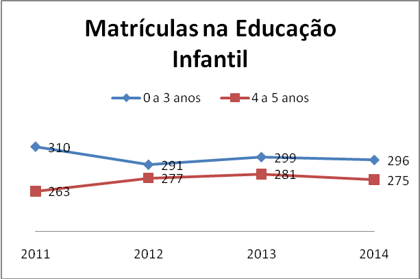

Fonte: Gráfico elaborado a partir de dados do Educacenso

Para o atendimento a esse público de crianças, o município conta com um quadro de servidores com níveis de escolaridade diversos, conforme especificados no quadro abaixo. Além destes, a rede municipal de educação dispõe de estagiários, graduandos em Pedagogia, os quais têm a função de profissionais de apoio junto às salas de aula com crianças de Atendimentos Educacionais Especializados (AEE), crianças com deficiência, transtornos globais do desenvolvimento e altas habilidades ou superdotação, assegurando também a educação bilíngue para crianças surdas e a transversalidade da educação especial na educação infantil.

Quadro 01 – Servidores em educação infantil por escolaridade.

<table>
<colgroup>
<col style="width: 27%" />
<col style="width: 12%" />
<col style="width: 12%" />
<col style="width: 9%" />
<col style="width: 13%" />
<col style="width: 13%" />
<col style="width: 12%" />
</colgroup>
<tbody>
<tr>
<td colspan="7" style="text-align: center;"><strong>Escolaridade dos servidores da Educação Infantil</strong></td>
</tr>
<tr>
<td style="text-align: left;"></td>
<td style="text-align: left;">Especialização</td>
<td style="text-align: left;">Graduação</td>
<td style="text-align: left;">Ensino Médio</td>
<td style="text-align: left;">Ensino Fundamental (completo)</td>
<td style="text-align: left;">Ensino Fundamental (incompleto)</td>
<td style="text-align: left;">Alfabetizado</td>
</tr>
<tr>
<td style="text-align: left;">Corpo docente</td>
<td style="text-align: center;">23</td>
<td style="text-align: center;">10</td>
<td style="text-align: center;">00</td>
<td style="text-align: center;">00</td>
<td style="text-align: center;">00</td>
<td style="text-align: center;">00</td>
</tr>
<tr>
<td style="text-align: left;">Corpo técnico administrativo</td>
<td style="text-align: center;">05</td>
<td style="text-align: center;">07</td>
<td style="text-align: center;">14</td>
<td style="text-align: center;">03</td>
<td style="text-align: center;">08</td>
<td style="text-align: center;">07</td>
</tr>
<tr>
<td style="text-align: left;">Auxiliares da educação infantil (atendentes)</td>
<td style="text-align: center;">01</td>
<td style="text-align: center;">09</td>
<td style="text-align: center;">11</td>
<td style="text-align: center;"></td>
<td style="text-align: center;"></td>
<td style="text-align: center;"></td>
</tr>
</tbody>
</table>

Quadro elaborado a partir de dados fornecidos pelas instituições de educação infantil de Batayporã (2015).

No que tange o atendimento da demanda de crianças de 0 (zero) a 5 (cinco) anos na educação infantil, o município de Batayporã encontra-se, comparado com o estado, além da oferta, o que não significa que o mesmo não possua estratégias para melhoria no aumento deste atendimento chegando a 100% (cem por cento)como meta.

**Gráfico 02 – Percentual da população de 0 a 5 anos de idade que frequenta a escola.**

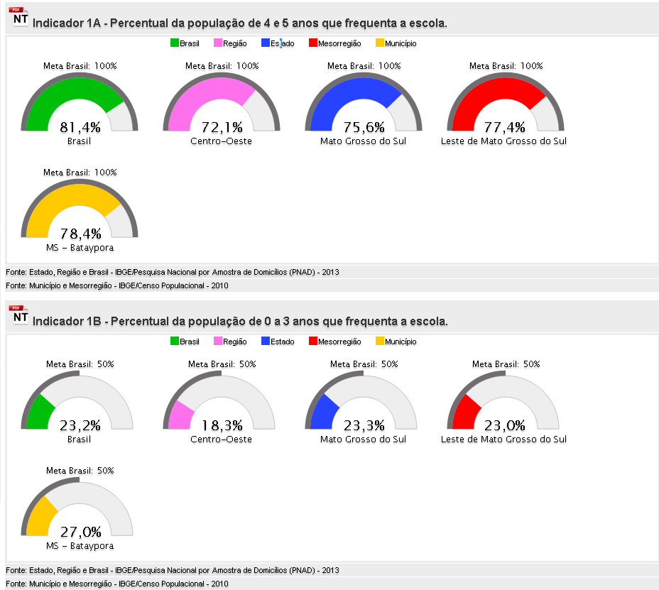

Em análise da situação do município diante da necessidade do cumprimento da meta (gráfico 2, acima) para a educação infantil e do princípio da obrigatoriedade, determinada pela Emenda Constitucional nº 59, de 11 de novembro de 2009, que prevê a matrícula obrigatória de 4 (quatro) a 17 (dezessete) anos de idade, há a necessidade de determinarmos estratégias para execução do disposto na meta estabelecida.

#### ESTRATÉGIAS DA META 1 { #estrategias-meta-1 }

1.  atender até 2016, em regime de colaboração com a União e o Estado, 100% (cem por cento) da demanda manifesta para educação infantil, na faixa etária de 4 a 5 anos;

2.  atender 40% (quarenta por cento) da demanda manifesta para creche, no prazo de três anos, 50% (cinquenta por cento) até 2020 e, progressivamente atingir 60% (sessenta por cento) até o final de vigência do PME, segundo padrão nacional de qualidade, considerando as peculiaridades locais do município;

3.  garantir que, ao final da vigência deste PME, seja inferior a 10% (dez por cento) a diferença entre as taxas de frequência à educação infantil, das crianças de até 3 (três) anos, oriundas do quinto de renda familiar per capita mais elevado e as do quinto de renda familiar per capita mais baixo.

4.  realizar, periodicamente, em regime de colaboração com: Secretaria Municipal de Saúde e com o Conselho Tutelar, CRAS (Centro de Referência da Assistência Social) e CREAS (Centro de Referência Especializado de Assistência Social) e outras instituições, levantamento da demanda, por creche, para a população de até 3 (três) anos, como forma de planejar a oferta e verificar o atendimento da demanda manifesta, preservando o direito de opção da família;

5.  divulgar, no início de cada ano letivo, em parceria com as Secretarias Municipais de Saúde e Assistência Social, o direito à universalização da Pré-Escola, visando garanti-lo;

6.  estabelecer, até o segundo ano de vigência do PME, normas, procedimentos e prazos para definição de mecanismos de consulta pública da demanda das famílias por creches;

7.  equipar, em regime de colaboração com a União e o Estado, os Centros de Educação Infantil com mobiliário, materiais pedagógicos e equipamentos suficientes e adequados para essa faixa etária;

8.  efetuar no prazo de três anos de vigência do PME, por meio de articulação do gestor municipal com as esferas federal e estadual, a reforma física dos centros de educação infantil, respeitando as normas de acessibilidade e estabelecendo prioridades;

9.  participar do regime de colaboração do programa nacional de reestruturação das escolas;

10. aplicar, em regime de colaboração com a União e Estado, nas escolas de educação infantil avaliação nacional, a ser realizada a cada 2 (dois) anos, com base em parâmetros nacionais de qualidade, a fim de aferir a infraestrutura física, o quadro de pessoal, as condições de gestão, os recursos pedagógicos, a situação de acessibilidade, entre outros indicadores relevantes.

11. incentivar a formação inicial e continuada dos(as) professores(as) da educação infantil, proporcionando, progressivamente, o atendimento por docentes com formação superior;

12. prover de professores, progressivamente até 2024, consoante a capacidade dos Município, as salas de educação infantil para o atendimento à criança com duração de, no mínimo, de 4 horas para o turno parcial e 7 horas para o tempo integral;

13. proporcionar, através de regime de colaboração com a União e Estado, progressivamente até 2018, que o atendimento na educação infantil seja realizado nos dois períodos (parcial e integral) por professores graduados;

14. estimular a formação continuada dos(as) demais profissionais/trabalhadores da educação infantil;

15. estimular a formação continuada dos técnicos de setores responsáveis pela educação infantil da Secretaria Municipal de Educação e Cultura, sem prejuízo do funcionamento da Secretaria Municipal de Educação;

16. promover anualmente, a partir de 2016, Encontro Municipal de Educadores responsáveis por cuidar e educar crianças de zero a cinco anos;

17. propiciar, em colaboração com os entes federados, durante a vigência do plano, formação continuada dos profissionais da educação sobre os direitos das crianças; o enfrentamento da violência contra crianças e as questões étnico-raciais e geracionais;

18. realizar em parceria com as IES (Instituição de Educação Superior) públicas, a articulação entre pós-graduação, núcleos de pesquisa e cursos de formação para profissionais da educação, de modo a proporcionar a elaboração de currículos e propostas pedagógicas que incorporem os avanços de pesquisas ligadas ao processo de ensino e aprendizagem e às teorias educacionais no atendimento da população de 0 (zero) a 5 (cinco) anos;

19. atender, caso haja, populações do campo e das comunidades indígenas e quilombolas na educação infantil, nas respectivas comunidades, por meio do redimensionamento da distribuição territorial da oferta, limitando a nucleação de escolas e o deslocamento de crianças, de forma a atender às especificidades dessas comunidades, garantindo consulta prévia e informada;

20. assegurar, em salas de educação infantil, o número mínimo de crianças com deficiência, transtornos globais do desenvolvimento e altas habilidades ou superdotação e professor de apoio, previsto na legislação;

21. aplicar em caráter complementar, programas de orientação e apoio às famílias, por meio da articulação das áreas de educação, saúde e assistência social, com foco no desenvolvimento integral das crianças de até 3 (três) anos de idade, prevendo a estimulação essencial como estratégia de desenvolvimento educacional;

22. preservar as especificidades da educação infantil na organização das instituições públicas e privadas, garantindo o atendimento da criança de 0 (zero) a 5 (cinco) anos em estabelecimentos que atendam a parâmetros nacionais de qualidade, e a articulação com a etapa escolar seguinte, visando ao ingresso da criança de 6 (seis) anos de idade no ensino fundamental;

23. fortalecer e fiscalizar o acompanhamento e o monitoramento do acesso e da permanência das crianças na educação infantil, em especial dos beneficiários de programas de transferência de renda, em colaboração com as famílias e com os órgãos públicos de assistência social, saúde e proteção à infância;

24. promover, em articulação com a União e o Estado, a busca ativa de crianças em idade correspondente à educação infantil, em parceria com órgãos públicos de assistência social, saúde e proteção à infância, preservando o direito de opção da família em relação às crianças de até 3 (três) anos;

25. realizar, periodicamente, em regime de colaboração com outras instituições, levantamento da demanda manifesta para educação infantil em pré-escolas, como forma de planejar e verificar o atendimento;

26. ampliar o acesso à educação infantil em tempo integral, para todas as crianças de 0 (zero) a 5 (cinco) anos, conforme estabelecido nas Diretrizes Curriculares Nacionais para a Educação Infantil;

27. garantir a oferta da pré-escola em período integral em 80% (oitenta por cento) até 2020 e, ampliar para as crianças de 0 (zero) a 3 (três) anos, em 100% (cem por cento) até o final da vigência deste PME;

28. viabilizar o funcionamento, tanto do sistema municipal de ensino, quanto do conselho municipal de educação, considerando que a eles compete a normatização da educação infantil;

29. fomentar o processo de eleição colegiada e o funcionamento dos colegiados nos centros de educação infantil da rede pública, bem como, seu devido funcionamento;

30. avaliar, reelaborar e implantar, no prazo de dois anos de vigência deste PME as Propostas Pedagógicas da educação infantil, bem como adequar periodicamente de acordo com as suas especificidades e,

31. buscar a conclusão, inclusive com equipamentos, CEINF, até 2018, em regime de colaboração com a União e o Estado, para atender as demandas manifestas.

### META 2 - ENSINO FUNDAMENTAL { #meta-2 }

**Universalizar o ensino fundamental de 09 (nove) anos para toda a população de 6 (seis) a 14 (quatorze) anos e garantir que pelo menos 95% (noventa e cinco por cento) dos alunos concluam essa etapa na idade recomendada, até o último ano de vigência deste PME.**

#### ANÁLISE SITUACIONAL { #meta-2-analise }

Segundo a LDBEN, Lei nº 9.394/96, em seus artigos 6 e 32, o ensino fundamental é a segunda etapa da Educação Básica, com matrícula obrigatória para crianças a partir dos seis anos de idade e com duração de nove anos de escolaridade. Gratuito na escola pública e, com o dever de ser embasado no conceito de qualidade. Por ser uma construção histórica, conforme versa as diretrizes curriculares nacionais da educação básica (2013, p. 106-107, *apud*. CAMPOS, 2008), perpassa pelos movimentos sociais que reivindicavam a qualidade da educação entre os anos 70 e 80, de fato que historicamente, estava muito presa às condições básicas de funcionamento das escolas, porque seus participantes, pouco escolarizados, tinham dificuldade de perceber as nuanças dos projetos educativos que as instituições de ensino desenvolviam.

Ainda de acordo com as citadas diretrizes, na década de 90 do século XX, sob o argumento de que o Brasil investia muito na educação e, gastava mal, prevaleceram preocupações com a eficácia e a eficiência das escolas. Assim, a atenção voltou-se, predominantemente, para os resultados por elas obtidos quanto ao rendimento dos estudantes, deixando em segundo plano a superação das desigualdades educacionais.

A Constituição de 1988, a LDBEN Lei nº 9.394/96 e o Estatuto da Criança e do Adolescente – ECA trouxeram avanços na educação básica, entre os quais pode-se citar a garantia de acesso à escola pública e gratuita perto da residência do aluno.

Em 2005, a Lei nº. 11.114, de 16 de maio de 2005, alterou o artigo 32 da LDBEN Lei nº 9.394/96, tornando obrigatória a matrícula de crianças de 6 anos de idade, posteriormente em 2006, através da Lei nº. 11.274, de 06 de fevereiro de 2006, a duração do ensino fundamental foi ampliada para 9 anos, alterando a faixa etária atendida para de 6 a 14 anos.

Em 2009, com a Emenda Constitucional nº. 59, de 11 de novembro de 2009, com o intuito de universalizar a educação básica, fixou o período compreendido entre os 4 e 17 anos de idade como garantido para acesso à educação básica (educação infantil na etapa da pré-escola, ensino fundamental e ensino médio). O cumprimento dessa determinação foi aprazado para o ano de 2016.

No município, o ensino fundamental é ofertado em 5 (cinco) escolas, das quais 2 (duas) são da rede municipal, 2 (duas) da rede estadual e 01(uma) da rede privada.

Como histórico do ensino fundamental em nosso município, a rede estadual de ensino conta com as escolas Braz Sinigáglia e Jan Antonin Bata. A Escola Estadual Jan Antonin Bata foi criada pelo Decreto nº 2.069 de 04 de março de 1955, publicado no Diário Oficial nº 12.881, de 10 de março de 1955, sendo denominada em homenagem ao fundador do município. Em 1965, o Decreto nº. 813, de 12 de fevereiro de 1969 deu origem ao Ginásio Estadual de Batayporã, o qual, em 31 de janeiro de 1974, no Governo de José Manoel Fontanilhas Fragelli foi integrado ao Grupo Escolar de Batayporã, passando a ser denominada Escola Estadual de 1º Grau Jan Antonin Bata. Através do Decreto n° 2.518, de 14 de março de 1975, publicado no Diário Oficial n° 16.798, de 10 de março de 1975, foi elevado o nível da escola, ao então denominado 2° grau, sendo a expressão acrescida ao nome. A Resolução nº. 998 de 14 de dezembro de 1994 autorizou a Educação de Pré-Escolar; passou então a ser denominada EEPEPSG – Escola Estadual de Pré-Escolar de 1º e 2º graus Jan Antonin Bata. Em 1998, pelo Decreto nº. 9.104, de 12 de junho de 1998, publicado no Diário Oficial nº. 4.770, de 13 de junho de 1998, passou a denominar-se Escola Estadual Jan Antonin Bata.

A Escola Estadual Braz Sinigáglia funciona no mais antigo prédio escolar do município, haja vista que, anterior ao decreto de sua criação, no local que hoje se tem a referida escola, funcionava a Escola Jan Antonin Bata. Isso ocorreu em meados de 1982, iniciando o ano escolar em 1984. Esta foi criada pelo Decreto nº 2.519, de 15 de maio de 1984, assinado pelo Secretário de Estado de Educação, Leonardo Nunes da Cunha, e o Governador Wilson Barbosa Martins. Esta escola passou a ser denominada: Escola Estadual de Pré-Escolar, 1º e 2º Graus Braz Sinigáglia, em homenagem ao professor e Delegado Regional de Educação e Cultura da 19ª DREC (Delegacia Regional de Educação e Cultura) que havia se dedicado ardorosamente à educação batayporaense.

A rede municipal de ensino conta com 2 (duas) escolas: Escola Municipal Anízio Teixeira da Silva, localizada na zona urbana e, teve sua criação em 1986, através da Lei nº. 70/86 com o nome de Escola Municipal Rural de 1º Grau José Bonifácio – Polo. Em 1988, pelo Decreto nº. 10/98, de 18 de fevereiro de 1998, teve sua nomenclatura alterada para Escola Municipal de Pré-Escolar e 1º Grau Anízio Teixeira da Silva. Com o decreto 26/99, de 6 de abril de 1999, alterou sua denominação para Escola Municipal Anízio Teixeira da Silva. A escola está localizada no Centro Educacional Municipal “João Eugênio Rosa”, situado na região central do município.

A Escola Municipal Professora Bernadete Teixeira, localizada na zona rural deste município, foi criada pelo Decreto nº 7/86 de 28 de fevereiro de 1986, denominada Escola Rural Municipal de 1º Grau Professora Bernadete Teixeira. No decorrer do tempo, a mesma sofreu varias alterações em sua nomenclatura atendendo as legislações então vigentes. Em 2002, a referida escola passou a denominar Escola Municipal Professora Bernadete Teixeira, por meio do Decreto 46/2002 de 25 de junho de 2002.

A rede privada de ensino conta com a Escola de Educação Especial Luz do Amanhã, mantida pela APAE (Associação de Pais e Amigos dos Excepcionais), criada em 28 de fevereiro de 2002, através da Deliberação CEE/MS nº 7.800, de 11 de dezembro de 2005. Anterior a essa data, a escola funcionou regularmente sob seu estatuto e regimentos internos. Hoje a escola é autorizada através da Deliberação CEE/MS nº. 9.908, de 11 de dezembro de 2012 e conta com fontes de financiamentos, tais como: FUNDEB, SAC/FEAS e Subvenção Social. Presta atendimentos em seus diferentes níveis, etapas e modalidades de educação escolar: Educação Infantil (Estimulação Precoce - Pré I e II), Ensino Fundamental (1º e 2º anos), Programas Pedagógicos Específicos (Condutas Típicas, Competência de Vida, Educação Profissional), prevendo-se a flexibilização curricular, recursos e procedimentos específicos para cada caso em quantitativos conforme o quadro a seguir.

Para atendimento ao ensino fundamental, Batayporã conta com o quadro de servidores a seguir:

Quadro 01 – Servidores no Ensino Fundamental por escolaridade.

<table style="width:100%;">
<colgroup>
<col style="width: 21%" />
<col style="width: 13%" />
<col style="width: 13%" />
<col style="width: 13%" />
<col style="width: 13%" />
<col style="width: 13%" />
<col style="width: 13%" />
</colgroup>
<tbody>
<tr>
<td colspan="7" style="text-align: center;"><strong>Escolaridade dos funcionários do Ensino Fundamental</strong></td>
</tr>
<tr>
<td style="text-align: left;"></td>
<td style="text-align: left;"><blockquote>

Especialização

</blockquote></td>
<td style="text-align: left;"><blockquote>

Graduação

</blockquote></td>
<td style="text-align: left;"><blockquote>

Ensino Médio

</blockquote></td>
<td style="text-align: left;"><blockquote>

Ensino Fundamental (completo)

</blockquote></td>
<td style="text-align: left;"><blockquote>

Ensino Fundamental (incompleto)

</blockquote></td>
<td style="text-align: left;"><blockquote>

Alfabetizado

</blockquote></td>
</tr>
<tr>
<td style="text-align: left;">Corpo docente</td>
<td style="text-align: center;">44</td>
<td style="text-align: center;">39</td>
<td style="text-align: center;">00</td>
<td style="text-align: center;">00</td>
<td style="text-align: center;">00</td>
<td style="text-align: center;">00</td>
</tr>
<tr>
<td style="text-align: left;">Técnico administrativo</td>
<td style="text-align: center;">10</td>
<td style="text-align: center;">13</td>
<td style="text-align: center;">24</td>
<td style="text-align: center;">03</td>
<td style="text-align: center;">07</td>
<td style="text-align: center;">07</td>
</tr>
</tbody>
</table>

Fonte: elaborado a partir de dados fornecidos pelas instituições de Ensino de Batayporã (2015).

O quadro e os gráficos abaixo apresentam os dados de Batayporã com relação ao atendimento, matrícula e acesso à escola na etapa do ensino fundamental, entre os anos de 2012 a 2014:

Quadro 2: Relação dos alunos matriculados, frequentes e não frequentes

| **ANO**  | **MATRICULADOS** | **FREQUENTES** | **NÃO FREQUENTES** |
|----------|:----------------:|:--------------:|:------------------:|
| **2012** |       1929       |      1721      |        206         |
| **2013** |       2015       |      1883      |        132         |
| **2014** |       1970       |      1875      |         95         |

**Gráfico 2: Relação dos alunos matriculados, frequentes e não frequentes**

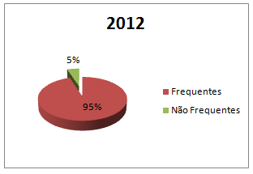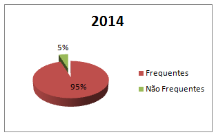

Fonte: Quadro e gráfico elaborados a partir de dados do Educacenso 2014

Segundo o PEE (2014), recentemente aprovado, hoje no Brasil, 93,8% (noventa e três, vírgula oito por cento) das crianças e adolescentes frequentam o ensino fundamental, havendo, porém, muitos desafios no que tangem a igualdade de condições de acesso e qualidade dos serviços ofertados às populações consideradas vulneráveis socialmente: de campo, grupos étnico-raciais, pessoas com deficiência, jovens e adultos em privação de liberdade, entre outros.

Ao analisar o quadro e gráficos acima nota-se que no município há um quantitativo de 95% (noventa e cinco por cento) de crianças e adolescentes que frequentam o ensino fundamental, em contrapartida 5% (cinco por cento) não frequentam a escola, perfazendo 54 (cinquenta e quatro) estudantes. Estendendo essa faixa etária para 16 anos, podemos citar de acordo com o indicador 2B do SIMEC (gráficos 3 e 4), que em Batayporã 45,7% (quarenta e cinco vírgula sete por cento) das pessoas com essa idade não concluíram o ensino fundamental. Verifica-se que além dos 5% (cinco por cento) que evadem, uma boa parcela dos alunos matriculados encontra-se em distorção idade série, as quais segundo os dados do Qedu[^1] (2013) atingem percentuais de: 24% (vinte e quatro por cento) para os 5 primeiros anos do ensino fundamental e 43% (quarenta e três por cento) para os anos finais desta etapa de ensino.

**Gráfico 3: Percentual da população do Brasil, do estado de Mato Grosso do Sul e de Batayporã com idade compreendida de 6 a 14 anos que frequentam a escola.**

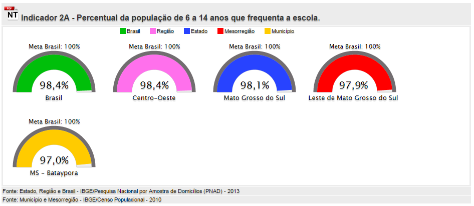

**Gráfico 4: Percentual da população do Brasil, do estado de Mato Grosso do Sul e de Batayporã com idade de 16 anos que concluíram o ensino fundamental.**

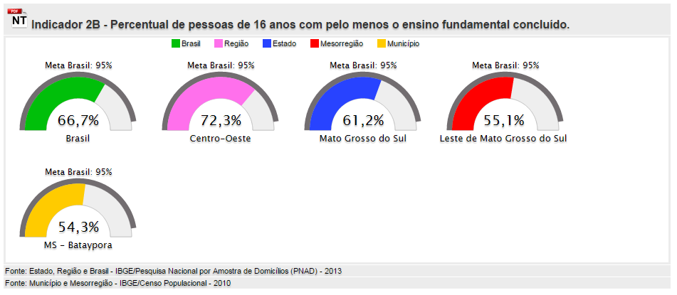

Assim, para garantir que pelo menos 95% (noventa e cinco por cento) dos alunos matriculados concluam a etapa do ensino fundamental na idade recomendada (14 anos), são elencadas as estratégias a seguir.

#### ESTRATÉGIAS DA META 2 { #estrategias-meta-2 }

2.1 participar em articulação com os demais entes federados, da elaboração da proposta curricular de direitos e objetivos de aprendizagem e desenvolvimento para os(as) alunos(as) do ensino fundamental, até o 2º ano de vigência deste PME;

2.2 participar do pacto entre os entes federados, para a implantação dos direitos e objetivos de aprendizagem e desenvolvimento que configurarão a base nacional comum curricular do ensino fundamental;

2.3 criar, a partir do 1º ano de vigência deste PME, mecanismos para assegurar a permanência e a aprendizagem dos estudantes do ensino fundamental, favorecendo o fluxo escolar;

2.4 promover ações permanentes de acompanhamento individualizado para que pelo menos 95% (noventa e cinco) dos estudantes concluam esta etapa de ensino na idade recomendada, considerando as habilidades e competências necessárias, até o final da vigência do PME;

2.5 criar uma equipe municipal intersetorial em parceria com as áreas de Saúde e Assistência Social, Conselho Tutelar e Ministério Público, entre outros, o acompanhamento individualizado e o monitoramento de acesso e permanência na escola, identificando motivos de ausência, baixa frequência e abandono dos estudantes, até 2024;

2.6 promover estratégias que estimulem a participação da família do(a) estudante com auxilio de profissionais dos órgãos públicos de assistência social, saúde e proteção à infância, adolescência e juventude;

2.7 fortalecer, até o final da vigência do PME, o acompanhamento e o monitoramento do acesso, da permanência e do aproveitamento escolar dos beneficiários de programas de transferência de renda, bem como das situações de discriminação, preconceitos e violências na escola, visando ao estabelecimento de condições adequadas para o sucesso escolar dos(as) alunos(as), em colaboração com as famílias e com órgãos públicos de assistência social, saúde e proteção à infância, adolescência e juventude;

2.8 proporcionar que os mecanismos fortalecidos e criados pelo estado para o acompanhamento e o monitoramento do acesso, da permanência e do aproveitamento escolar dos(as) beneficiários(as) de programas de transferência de renda, sejam de fato realizados;

2.9 realizar, constantemente, a busca ativa de crianças e adolescentes fora da escola, em parceria com órgãos públicos de Assistência Social, Saúde e Proteção à infância, adolescência e juventude, entre outros;

2.10 implantar salas de reforço com profissionais devidamente qualificados;

2.11 oferecer a formação continuada, em serviço, aos profissionais do ensino fundamental para utilização das novas tecnologias educacionais e de práticas pedagógicas inovadoras;

2.12 criar condições técnicas e pedagógicas para a utilização das tecnologias educacionais inovadoras nas práticas pedagógicas e realizar o acompanhamento das atividades;

2.13 desenvolver, a partir do 2º ano de vigência deste PME, tecnologias pedagógicas que combinem, de maneira articulada, a organização do tempo e das atividades didáticas entre a escola e o ambiente comunitário, considerando as especificidades da educação especial, das comunidades do campo e demais especificidades que surjam;

2.14 proporcionar a capacitação de profissionais, que realizarão juntamente com a unidade escolar, o acompanhamento e o monitoramento do estudante e, com órgãos públicos decidir qual a melhor medida ou medidas para atender estes estudantes;

2.15 propiciar que os professores recebam orientações sobre como trabalhar com os estudantes que estão sendo monitorados por profissionais especializados e outros órgãos públicos;

2.16 buscar, em regime de colaboração com os entes federados, de maneira progressiva até 2024, recursos específicos para que todos os professores sejam capacitados ao uso das tecnologias assistivas;

2.17 disciplinar, no âmbito dos sistemas de ensino, a organização flexível do trabalho pedagógico, incluindo adequação do calendário escolar de acordo com a realidade local, a identidade cultural e as condições climáticas da região, a partir do segundo ano de vigência deste PME;

2.18 promover, durante a vigência deste PME, a integração das escolas com instituições e movimentos culturais, a fim de proporcionar a oferta regular de atividades culturais para a livre fruição dos estudantes dentro e fora dos espaços escolares, assegurando ainda que as escolas se tornem polos de criação e difusão cultural;

2.19 promover e estimular a realização constante de atividades artístico-culturais pelos alunos, incentivando o envolvimento da comunidade;

2.20 incentivar, constantemente, a participação dos pais ou responsáveis no acompanhamento das atividades escolares dos filhos por meio de reuniões sistemáticas que visem ao estreitamento das relações entre as escolas e as famílias;

2.21 auxiliar as demais instituições públicas, na solução de casos de pais que não acompanham de forma efetiva o desenvolvimento dos filhos na escola;

2.22 promover, independentemente do número de estudantes, a oferta do ensino fundamental nas comunidades rurais, com todos os recursos necessários para o desenvolvimento do trabalho pedagógico;

2.23 promover a formação de profissionais itinerantes para atendimento a alunos, em suas comunidades, que apresentem necessidades especiais, caso haja demanda;

2.24 desenvolver formas alternativas de oferta do ensino fundamental, garantida a qualidade, para atender aos filhos e filhas de profissionais que se dedicam a atividades de caráter itinerante, caso haja demanda;

2.25 propiciar a oferta, a partir do segundo ano de vigência deste PME, de atividades extracurriculares de incentivo aos(as) estudantes e de estímulo ao desenvolvimento de habilidades, inclusive preparatórios para certames e concursos públicos, levando em consideração as especificidades locais;

2.26 estimular a promoção, a partir da vigência deste PME, de atividades de desenvolvimento e estímulo a habilidades esportivas nas escolas, interligadas a um plano de disseminação do desporto educacional e de desenvolvimento esportivo estadual e nacional, através de parceria com a Secretaria de Esporte e Lazer;

2.27 implementar programas de identificação e ações que promovam o desenvolvimento das habilidades esportivas, e incentivá-las através de bolsas de estudo, em regime de colaboração com os demais entes federativos;

2.28 promover formação continuada aos profissionais da educação, com temário sobre violência, a fim de reduzir a discriminação e o preconceito das relações sociais;

2.29 promover parceria com o Projeto Saúde na Escola (PSE), voltada para educadores(as) e alunos(as) sobre a promoção da saúde, prevenção das DSTs/Aids, combate ao alcoolismo e ao uso de drogas;

2.30 implantar sala de reforço no contra turno que atenda o aluno do ensino fundamental de forma que ele possa acompanhar a turma regular em que esteja inserido;

2.31 implantar, em parceria com entes federados, programas de correção de fluxo;

2.32 construir, em regime de cooperação com os demais entes federados, salas destinadas a bibliotecas, professores, direção, auditórios e outros, de modo a atender as necessidades das unidades de ensino, bem como a manutenção das que existem;

2.33 possibilitar o atendimento a um número de alunos por turma de maneira que permita um ensino de qualidade, obedecido ao estabelecido em legislação em vigente;

2.34 estimular as formações continuadas aos profissionais da educação para que estes possam atender as necessidades dos estudantes;

2.35 garantir a implementação real e eficiente de mecanismos para o acompanhamento individualizado dos(as) estudantes do ensino fundamental, por meio de reforço escolar e acompanhamento psicopedagógico;

2.36 proporcionar o atendimento psicológico para alunos e familiares, em parceria com órgãos públicos de assistência social, saúde e proteção a infância, adolescência e juventude, entre outros.

### META 03 – ENSINO MÉDIO { #meta-3 }

**Universalizar, até 2016, o atendimento escolar para toda a população de 15 a 17 anos e elevar, até o final do período de vigência deste PME, a taxa líquida de matrículas no ensino médio para 85%.**

#### ANÁLISE SITUACIONAL { #meta-3-analise }

O ensino médio, considerado a última etapa da educação básica, em conformidade com art. 35 da LDBEN, Lei nº 9.394/96, tem por finalidades propiciar ao estudante prosseguimento de estudos; preparação básica para o trabalho e o exercício da cidadania; seu aprimoramento como pessoa humana, bem como a compreensão dos fundamentos científico-tecnológicos. Para o alcance dessas finalidades destaca-se uma nova concepção de ensino nesta etapa de educação, por sua vez a Resolução CNE/CEB nº 04/2010 versa que:

os currículos deverão ser flexíveis, com diferentes alternativas, para que os jovens tenham a oportunidade de escolher o percurso formativo que atenda seus interesses, necessidades e aspirações, para que se assegure a permanência dos jovens na escola, com proveito, até a conclusão da Educação Básica. (Art.26, § 3º do inciso IV – Resolução CNE/CEB nº 04/2010).

Assim, há de considerar que a universalização do atendimento escolar nesta etapa de ensino, perpassa pela garantia não só do acesso, mas da permanência deste jovem na escola e com proveito neste estudo.

A oferta do ensino médio no Brasil encontra-se organizada da seguinte forma: regular ou propedêutico, ensino médio normal/magistério, integrada a educação profissional (no ensino regular e na educação de jovens e adultos) e a educação de jovens e adultos (EJA).

Atualmente, Batayporã oferece, nesta etapa, o ensino médio regular ou propedêutico e a educação de jovens e adultos (EJA). A Escola Estadual Jan Antonin Bata oferece nos turnos matutino e noturno o ensino médio regular e, a Escola Estadual Braz Sinigáglia, o ensino médio regular nos turnos matutino e noturno a educação de jovens e adultos, na etapa do ensino médio.

As tabelas a seguir objetivam a apresentação dos demonstrativos e do comparativo de atendimento ao acesso dos jovens nesta etapa de ensino no Brasil e em Batayporã.

**Tabela 1 – Comparação de matrículas por modalidade de Ensino Médio – Brasil, 2011 e 2012.**

<table>
<colgroup>
<col style="width: 40%" />
<col style="width: 14%" />
<col style="width: 14%" />
<col style="width: 14%" />
<col style="width: 14%" />
</colgroup>
<tbody>
<tr>
<td rowspan="2" style="text-align: center;">Modalidades de Ensino Médio</td>
<td colspan="4" style="text-align: center;">Matricula/Ano</td>
</tr>
<tr>
<td style="text-align: center;">2011</td>
<td style="text-align: center;">2012</td>
<td style="text-align: center;">Diferença 2011 - 2012</td>
<td style="text-align: center;">Variação 2011 - 2012</td>
</tr>
<tr>
<td style="text-align: center;">Ensino Médio</td>
<td style="text-align: left;"> 8.400.689</td>
<td style="text-align: left;">8.376.852 </td>
<td style="text-align: left;">-23.837 </td>
<td style="text-align: left;">-0,1 </td>
</tr>
<tr>
<td style="text-align: center;">Ensino Médio Regular</td>
<td style="text-align: left;">7.978.224</td>
<td style="text-align: left;">7.944.741</td>
<td style="text-align: left;">-33.483</td>
<td style="text-align: left;">-0,4 </td>
</tr>
<tr>
<td style="text-align: center;">Ensino Médio Normal – Magistério</td>
<td style="text-align: left;">164.752</td>
<td style="text-align: left;">133.566</td>
<td style="text-align: left;">-31.186</td>
<td style="text-align: left;">-18,9 </td>
</tr>
<tr>
<td style="text-align: center;">Ensino Médio Integrado</td>
<td style="text-align: left;">257.713</td>
<td style="text-align: left;">298.545</td>
<td style="text-align: left;">40.832</td>
<td style="text-align: left;">15,8</td>
</tr>
<tr>
<td style="text-align: center;">Ensino Médio EJA</td>
<td style="text-align: left;">1.322.422</td>
<td style="text-align: left;">1.309.871</td>
<td style="text-align: left;">-12.551</td>
<td style="text-align: left;">-0,95 </td>
</tr>
<tr>
<td style="text-align: center;">Ensino Médio Integrado EJA</td>
<td style="text-align: left;">41.971</td>
<td style="text-align: left;">35.993</td>
<td style="text-align: left;">-5.978</td>
<td style="text-align: left;">-1,4</td>
</tr>
<tr>
<td style="text-align: center;">Ensino Médio TOTAL</td>
<td style="text-align: left;">9.739.716</td>
<td style="text-align: left;">9.739.716</td>
<td style="text-align: left;">9.739.716</td>
<td style="text-align: left;">-0,24</td>
</tr>
</tbody>
</table>

Fonte: Dados retirados do PEE de Mato Grosso do Sul (2013)

De acordo com PEE (2014) a Tabela 1 apresenta dados sobre essa diversificação da oferta no Brasil. O ensino médio, com 8.376.852 alunos matriculados em 2012, compreende o ensino médio de caráter regular destinado aos estudantes da idade obrigatória, em que se concentra a maioria das matrículas, ou seja, quase 8 milhões; o Ensino Médio Normal/Magistério e o ensino médio integrado à educação profissional. Além desses, o ensino médio também é oferecido na modalidade educação de jovens e adultos (EJA) e no ensino médio integrado à EJA (PROEJA).

**Tabela 2 – Comparação de matriculas por modalidade de Ensino Médio – 2011 a 2014 nas escolas do município de Batayporã**

<table>
<colgroup>
<col style="width: 54%" />
<col style="width: 11%" />
<col style="width: 11%" />
<col style="width: 11%" />
<col style="width: 11%" />
</colgroup>
<tbody>
<tr>
<td rowspan="2" style="text-align: center;">Modalidades de Ensino Médio</td>
<td colspan="4" style="text-align: center;">Matricula – Ano</td>
</tr>
<tr>
<td style="text-align: left;">2011</td>
<td style="text-align: left;">2012</td>
<td style="text-align: left;">2013</td>
<td style="text-align: left;">2014</td>
</tr>
<tr>
<td style="text-align: center;">Ensino Médio</td>
<td style="text-align: left;"> </td>
<td style="text-align: left;"> </td>
<td style="text-align: left;"> </td>
<td style="text-align: left;"> </td>
</tr>
<tr>
<td style="text-align: center;">Ensino Médio Regular</td>
<td style="text-align: left;">537</td>
<td style="text-align: left;">503</td>
<td style="text-align: left;">535</td>
<td style="text-align: left;">499</td>
</tr>
<tr>
<td style="text-align: center;">Ensino Médio Normal – Magistério</td>
<td style="text-align: left;"> </td>
<td style="text-align: left;"> </td>
<td style="text-align: left;"> </td>
<td style="text-align: left;"> </td>
</tr>
<tr>
<td style="text-align: center;">Ensino Médio Integrado</td>
<td style="text-align: left;"> </td>
<td style="text-align: left;"> </td>
<td style="text-align: left;"> </td>
<td style="text-align: left;"> </td>
</tr>
<tr>
<td style="text-align: center;">Ensino Médio EJA</td>
<td style="text-align: left;">120</td>
<td style="text-align: left;">124</td>
<td style="text-align: left;">121</td>
<td style="text-align: left;">127</td>
</tr>
<tr>
<td style="text-align: center;">Ensino Médio Integrado EJA</td>
<td style="text-align: left;"> </td>
<td style="text-align: left;"> </td>
<td style="text-align: left;"> </td>
<td style="text-align: left;"> </td>
</tr>
<tr>
<td style="text-align: center;">Ensino Médio TOTAL</td>
<td style="text-align: left;">657</td>
<td style="text-align: left;">627</td>
<td style="text-align: left;">656</td>
<td style="text-align: left;">626</td>
</tr>
</tbody>
</table>

Fonte: Dados fornecidos pelas escolas Escola Estadual Jan Antonin Bata e Escola Estadual Braz Sinigáglia – Educacenso 2014

A Tabela 2 apresesenta dados referentes a matrícula no ensino médio no município de Batayporã, compreendendo os anos de 2011 a 2014. Estes dados demostram que entre os anos de 2011 a 2014 houve declíneo no número de matriculas no ensino médio regular. Podemos considerar como fator causador a migração de uma parte de estudantes matriculados no ensino médio regular, para a EJA – etapa do ensino médio. A distorção idade-série é um fator relevante nesta etapa de ensino. Assim, neste contexto, os estudantes optam em matricular-se na EJA. Há de considerar também aqueles que concluem o ensino fundamental e não retornam para prosseguimento de estudos.

Quando comparado a Tabela 1 – Comporação de matriula por modalidades de Ensino Médio –Brasil com a Tabela 2 Comparação de matriculas por modalidade de Ensino Médio – 2011 a 2014 nas Escolas do município de Batayporã, observa-se que este declinio no ingresso desta etapa de ensino no município de Batayporã acampanhou a estatística a nível nacional.

A abordagem a seguir, apresenta a oferta e a demanda atendida no Brasil, em Mato Grosso do Sul e em Batayporã nas redes de ensino. Os gráficos 1 e 2 apresentam o percentual da população de 15 a 17 anos que frequenta a escola e a taxa de escolarização líquida no ensino médio na mesma faixa etária.

**Gráfico 1 – Percentual da população de 15 a 17 anos que frequenta a escola (nacional, estadual e municipal).**

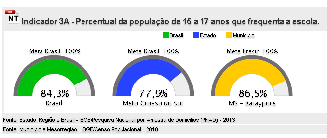

**Gráfico 2 – Taxa líquida de matrícula no ensino médio de 15 a 17 anos (nacional, estadual e municipal).**

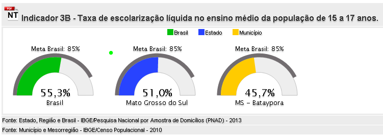

Em análise aos Gráficos 1 e 2, há grande disparidade entre o total de número de matrículas de jovens na faixa etária de 15 a 17 anos entre os quais efetivamente frequentam a escola. Dados retirados do site [http://www.foradaescolanaopode.org.br](http://www.foradaescolanaopode.org.br/) apontam que no município de Batayporã, do total de 658 (seiscentos e cinquenta e oito) alunos nesta faixa etária e escolaridade, apenas 88 (oitenta e oito) encontram-se fora da escola, o que vem afirmar o indicador do Gráfico 2 no que tange ao percentual da população de 15 a 17 anos que frequenta a escola no município. Nesta análise, tanto os gráficos como a tabela, demonstram que, assim como as demais esferas estadual e federal, no município de Batayporã o número de matrículas do ensino médio, sofreu uma queda significativa. Temos como meta, diminuir esse número, quando atingir 85% (oitenta e cinco por cento) da população em questão.

**Gráfico 3 – Número de matrículas na etapa final do ensino fundamental em todas as redes de Ensino de MS do ano de 2007 a 2013, e população de 10 a 14 anos (Censo 2010, IBGE).**

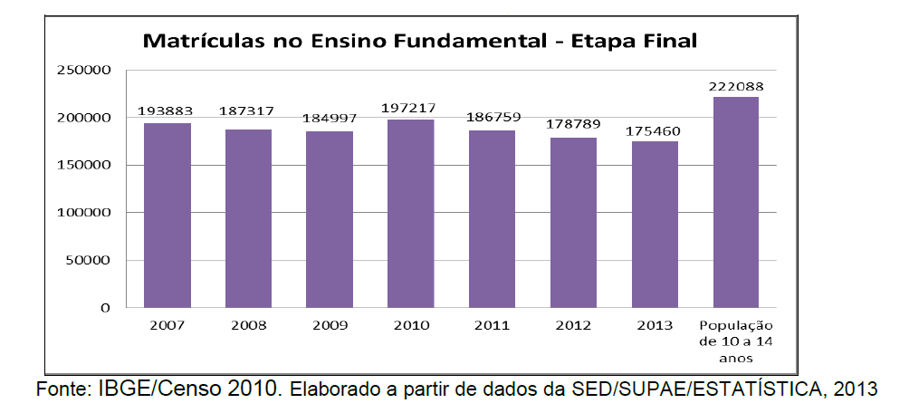

**Gráfico 4 - Número de matrículas no ensino médio em todas as redes de ensino de MS do ano de 2007 a 2013, e população de 15 a 17 anos. (Censo 2010, IBGE)**

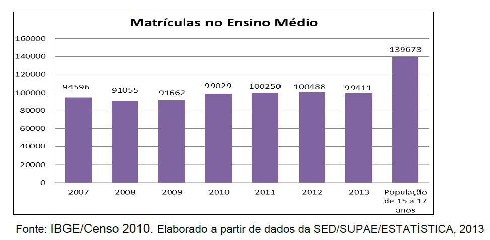

Os Gráficos 3 e 4 apresentam o número de matrículas nos anos finais do ensino fundamental e no ensino médio no estado, revelando a discrepância do número de estudantes matriculados em relação à população com idade adequada para a etapa de ensino. Nesse sentido, nota-se que, em 2013, 21% (vinte e um por cento) de estudantes ainda estavam fora do ensino fundamental e aproximadamente 29% (vinte e nove por cento) de estudantes do ensino médio, fora desta etapa de ensino.

**Gráfico 5 – Número de matrículas realizadas em todas as redes de ensino de MS, no último ano do ensino fundamental até o final do ensino médio, de 2007 a 2013.**

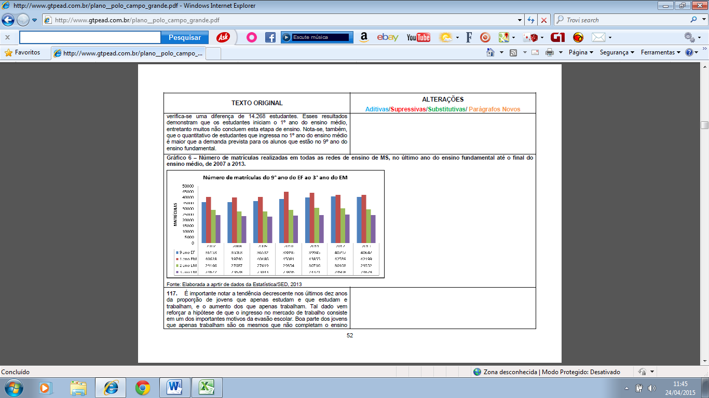

O gráfico acima apresenta a progressão de matriculados do 9º ano do ensino fundamental ao 3º ano do ensino médio. Em análise, verifica-se que, em 2012, havia 40.797 (quarenta mil, setecentos e noventa e sete) estudantes matriculados no 9º ano do ensino fundamental e, em 2013, 42.199 (quarenta e nove mil, cento e noventa e nove) no 1º ano. Porém, se compararmos o número de matrículas no 9º ano do ensino fundamental de 2010 com o número de matrículas do 3º ano do ensino médio de 2013, verifica-se uma diferença negativa de 14.268 estudantes. Esses resultados demonstram que os estudantes iniciam o 1º ano do ensino médio, entretanto muitos não concluem esta etapa de ensino. Nota-se, também, que o quantitativo de estudantes que ingressa no 1º ano do ensino médio é maior que a demanda prevista para os alunos que estão no 9º ano do ensino fundamental. Porém, há de se destacar que as causas que levam a esse declínio, a não conclusão do ensino médio, se dá pela escolha entre estudo e trabalho. Afirma, o PEE/MS

É importante notar a tendência decrescente de evasão nos últimos dez anos da proporção de jovens que apenas estudam e dos que estudam e trabalham, e o aumento dos que apenas trabalham. Tal dado vem reforçar a hipótese de que o ingresso no mercado de trabalho consiste em um dos motivos que mais influencia na evasão escolar. Boa parte dos jovens que apenas trabalham é aquela que não completa o ensino médio. (PEE, 2014, p.29)

Enfatizando, os dados do Censo 2010, há cerca de 3,8 milhões de estudantes fora do processo de escolarização em todo o país. Estima-se que parte desta população, especificamente, 1.728.015 (um milhão, setecentos e vinte e oito mil e quinze), são jovens de 15 (quinze) a 17 (dezessete) anos, os quais deveriam estar frequentando a etapa final da educação básica, ou seja, o ensino médio.

**Gráfico 6 – Número de matrículas realizadas em todas as redes de ensino de Batayporã , no último ano do ensino fundamental até o final do ensino médio, de 2011 a 2014.**

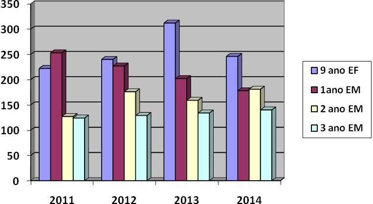

Fonte: Elaborado a partir de dados das secretarias das Escolas Estaduais Jan Antonin Bata e Braz Sinigáglia.

O Gráfico 06 apresenta dados sobre os números de matrículas realizadas na rede estadual de ensino da cidade de Batayporã, compreendendo os anos de 2011 a 2014, no último ano do ensino fundamental até o final do ensino médio. Este vem confirmar o cenário apresentado nos gráficos acima, uma vez que o município de Batayporã apresenta um declínio considerável de matrículas referentes à conclusão do ensino fundamental e do ensino médio.

Apresentam a seguir o movimento e rendimento escolar do ensino médio em Mato Grosso do Sul e no município de Batayporã, através do Quadro 1 do PEE/MS e Tabela 3.

Quadro 1 (PEE/MS)Movimento e Rendimento escolar do ensino médio em Mato Grosso do Sul

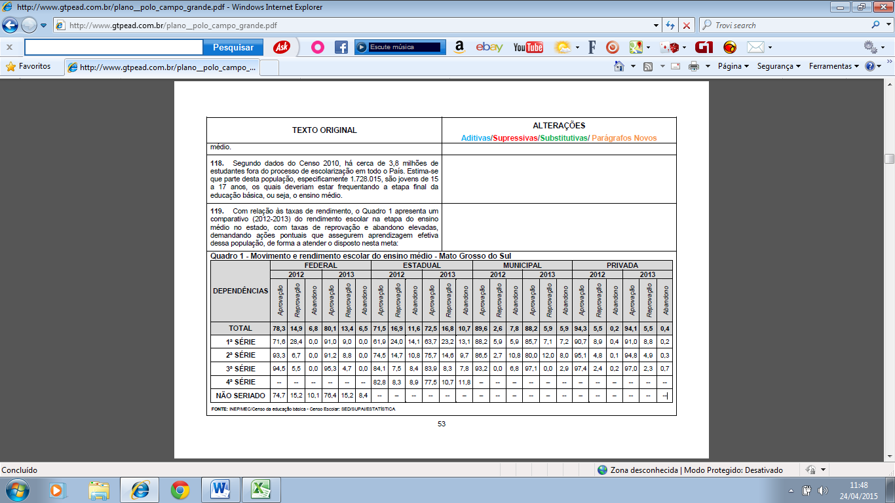

O Quadro 1 (PEE/MS), demonstra dados do estado de Mato Grosso do Sul, apontando que em 2013, a taxa de distorção idade-série era de 31,8% (trinta e um vírgula oito por cento), o que evidencia a necessidade de estabelecer estratégias para a redução dessas taxas a fim de se conseguir elevar, para 85% (oitenta e cinco por cento), a taxa líquida de matrículas no ensino médio, até o final do período de vigência do PEE-MS (2014, p.29 e 30).

Tabela 3 Movimento e Rendimento escolar do ensino médio no município de Batayporã

<table style="width:90%;">
<colgroup>
<col style="width: 28%" />
<col style="width: 31%" />
<col style="width: 27%" />
<col style="width: 2%" />
</colgroup>
<tbody>
<tr>
<td colspan="4" style="text-align: center;">Movimento e rendimento escolar do Ensino Médio - Município de Batayporã – 2012</td>
</tr>
<tr>
<td style="text-align: center;">Aprovação</td>
<td style="text-align: center;">Reprovação</td>
<td style="text-align: center;">Abandono</td>
<td style="text-align: center;"></td>
</tr>
<tr>
<td style="text-align: center;">92,60%</td>
<td style="text-align: center;">2,50%</td>
<td colspan="2" style="text-align: center;">4,9</td>
</tr>
</tbody>
</table>

Fonte: [http://pdeinterativo.mec.gov.br](http://pdeinterativo.mec.gov.br/)

Em comparação com o Quadro 1 (p.29 da Meta 03 do PEE/MS) e Tabela 3, em análise das taxas de Aprovação, Reprovação e Abandono do município de Batayporã estão acima das médias federal e estadual, ficando apenas atrás da rede privada de ensino.

Ao analisar os números coletados nas secretarias das escolas estaduais do município, Escola Estadual Braz Sinigáglia e Escola Estadual Jan Antonin Bata, observa-se que no ensino médio nos anos de 2011 a 2014 dos 1º, 2º e 3º anos, as taxas de reprovação vem oscilando, conforme tabela a seguir.

Tabela 4 Taxa de Reprovação dos anos de 2011 a 2014 no município de Batayporã

<table style="width:100%;">
<colgroup>
<col style="width: 13%" />
<col style="width: 11%" />
<col style="width: 10%" />
<col style="width: 11%" />
<col style="width: 10%" />
<col style="width: 11%" />
<col style="width: 10%" />
<col style="width: 11%" />
<col style="width: 10%" />
</colgroup>
<tbody>
<tr>
<td style="text-align: center;"></td>
<td colspan="2" style="text-align: center;"><strong>2011</strong></td>
<td colspan="2" style="text-align: center;"><strong>2012</strong></td>
<td colspan="2" style="text-align: center;"><strong>2013</strong></td>
<td colspan="2" style="text-align: center;"><strong>2014</strong></td>
</tr>
<tr>
<td style="text-align: center;"></td>
<td style="text-align: center;">AP</td>
<td style="text-align: center;">RP</td>
<td style="text-align: center;">AP</td>
<td style="text-align: center;">RP</td>
<td style="text-align: center;">AP</td>
<td style="text-align: center;">RP</td>
<td style="text-align: center;">AP</td>
<td style="text-align: center;">RP</td>
</tr>
<tr>
<td style="text-align: center;"><strong>1º ANO</strong></td>
<td style="text-align: center;">134</td>
<td style="text-align: center;">28</td>
<td style="text-align: center;">139</td>
<td style="text-align: center;">22</td>
<td style="text-align: center;">123</td>
<td style="text-align: center;">16</td>
<td style="text-align: center;">106</td>
<td style="text-align: center;">23</td>
</tr>
<tr>
<td style="text-align: center;"><strong>2º ANO</strong></td>
<td style="text-align: center;">94</td>
<td style="text-align: center;">25</td>
<td style="text-align: center;">101</td>
<td style="text-align: center;">04</td>
<td style="text-align: center;">105</td>
<td style="text-align: center;">09</td>
<td style="text-align: center;">110</td>
<td style="text-align: center;">19</td>
</tr>
<tr>
<td style="text-align: center;"><strong>3º ANO</strong></td>
<td style="text-align: center;">78</td>
<td style="text-align: center;">11</td>
<td style="text-align: center;">91</td>
<td style="text-align: center;">05</td>
<td style="text-align: center;">101</td>
<td style="text-align: center;">03</td>
<td style="text-align: center;">96</td>
<td style="text-align: center;">11</td>
</tr>
<tr>
<td style="text-align: center;"><strong>TOTAL</strong></td>
<td style="text-align: center;">306</td>
<td style="text-align: center;">64</td>
<td style="text-align: center;">331</td>
<td style="text-align: center;">31</td>
<td style="text-align: center;">329</td>
<td style="text-align: center;">28</td>
<td style="text-align: center;">312</td>
<td style="text-align: center;">51</td>
</tr>
<tr>
<td colspan="9" rowspan="2" style="text-align: center;">
Reprovação 2011 – 29,9%

Reprovação 2012 – 9,36%

Reprovação 2013 – 8,51%

Reprovação 2014 – 16,3%
</td>
</tr>
<tr>
</tr>
</tbody>
</table>

Fonte: [http://pdeinterativo.mec.gov.br](http://pdeinterativo.mec.gov.br/)

O município de Batayporã, validando as estratégias apontadas a seguir, objetiva alcançar a meta estabelecida nacionalmente.

#### ESTRATÉGIAS DA META 3 { #estrategias-meta-3 }

3.1 Participar das discussões nacionais sobre o programa nacional de renovação do ensino médio, a fim de incentivar práticas pedagógicas com abordagens interdisciplinares estruturadas pela relação entre teoria e prática, por meio de currículos escolares que organizem, de maneira flexível e diversificada, conteúdos obrigatórios e eletivos articulados em dimensões como ciência, trabalho, linguagens, tecnologia, cultura e esporte;

3.2 participar, em regime de colaboração com os entes federados e ouvida a sociedade mediante consulta pública nacional, da elaboração da proposta de direitos e objetivos de aprendizagem e desenvolvimento para os(as) alunos(as) de ensino médio, com vistas a garantir formação básica comum;

3.3 participar do pacto entre os entes federados, para a implantação dos direitos e objetivos de aprendizagem e desenvolvimento que configurarão a base nacional comum curricular do ensino médio;

3.4 realizar, em articulação com os órgãos competentes, busca ativa da população de 15 a 17 anos que se encontra fora da escola, a partir da vigência deste PME;

3.5 realizar acompanhamento individualizado do(a) estudante com rendimento escolar defasado, visando à correção de fluxo do ensino fundamental, por meio de adoção de práticas como reforço escolar no contraturno, estudos de recuperação e progressão parcial, de forma a reposicionar esse aluno em sua série/ano, compatível com sua idade, até o final da vigência deste PME;

3.6 realizar campanhas e/ou divulgar, nos meios de comunicação, informações aos adolescentes, jovens e adultos, na etapa do ensino médio, sobre os cursos gratuitos integrados à educação profissional, durante a vigência deste PME;

3.7 estruturar e fortalecer o acompanhamento e o monitoramento do acesso e da permanência dos(as) jovens beneficiários(as) de programas de transferência de renda, no ensino médio, quanto à frequência, ao aproveitamento escolar e à interação com o coletivo, bem como das situações de discriminação, preconceitos e violências, práticas irregulares de exploração do trabalho, consumo de drogas, gravidez precoce, em colaboração com as famílias e com os órgãos públicos de assistência social, saúde e proteção à adolescência e juventude;

3.8 oferecer programas de educação e de cultura para a população, urbana e do campo, na faixa etária de 15 a 17 anos, e de adultos, com qualificação social e profissional para aqueles que estejam fora da escola e com defasagem no fluxo escolar, na vigência de PME;

3.9 firmar parcerias e convênios com as secretarias, fundações de cultura e outras instituições culturais, destinando vagas em cursos e oficinas para estudantes na faixa etária de 15 a 20 anos, visando à qualificação social e profissional, durante a vigência deste PME;

3.10 implementar políticas de prevenção à evasão escolar, motivada por preconceito ou quaisquer forma de discriminação, criando rede de proteção contra formas associadas de exclusão, durante a vigência deste PME;

3.11 incentivar, nas escolas, a criação de uma cultura de respeito e aceitação do outro como princípio educativo, e a partir do qual serão construídas, no coletivo, as regras de convivência social, a partir da vigência deste PME;

3.12 oferecer cursos que possibilitem o domínio da linguagem da informática;

3.13 estimular a participação de estudantes do ensino médio nos cursos das áreas tecnológicas e cientificas, na vigência deste PME e,

3.14 propiciar condições de fruição de bens e espaços culturais, bem como incentivar a realização de atividades artístico-culturais pelos(as) estudantes, com envolvimento da comunidade, na vigência deste PME.

### META 4 - EDUCAÇÃO ESPECIAL { #meta-4 }

**Universalizar, para a população de 4 (quatro) a 17 (dezessete) anos com deficiência, transtornos globais do desenvolvimento e altas habilidades ou superdotação, o acesso à educação básica e ao atendimento educacional especializado, preferencialmente na rede regular de ensino, com a garantia de sistema educacional inclusivo, de salas de recursos multifuncionais, classes, escolas ou serviços especializados, públicos ou conveniados.**

#### ANÁLISE SITUACIONAL { #meta-4-analise }

A Constituição Federal de 1988 em seu artigo 208, inciso III estabelece o direito das pessoas com deficiências a receberem atendimento educacional especializado preferencialmente na rede regular de ensino. Sendo assim, são propostas duas questões: o direito à educação e o direito de receber esta educação, sempre que possível, junto com as demais pessoas nas escolas regulares. A Lei nº 12.796/2013 define as pessoas com deficiência como crianças, jovens e adultos que apresentam transtornos globais do desenvolvimento e altas habilidades ou superdotação,

Em Batayporã, num passado recente, os atendimentos as pessoas com necessidades educacionais especiais, eram realizados em Nova Andradina, pela entidade parceira Escola de Educação Especial Raio de Sol, mantida pela Associação de Amigos dos Excepcionais – APAE de Nova Andradina. Em contrapartida à parceria, que beneficiava em média 25 (vinte e cinco) alunos, era oferecido pelo município, transporte escolar e cedência de professores de seu quadro.

Consta nos registros da rede estadual de ensino, que a partir de 1985, iniciou-se atendimento a estes, em classe especial. Em 1993, através de legislação específica, iniciaram-se os atendimentos em classes especiais, sendo uma classe para atendimento a alunos com deficiência auditiva (D.A), na Escola Estadual Braz Sinigáglia e uma classe especial para atendimento a alunos com deficiência mental (D.M), na Escola Estadual Jan Antonin Bata.

Buscando avançar na educação especial, um grande e aguardado passo foi dado pelo município, com o funcionamento da Escola de Educação Especial Luz do Amanhã, mantida pela Associação de Pais e Amigos dos Excepcionais – APAE de Batayporã, em 28 de fevereiro de 2002. Anseio antigo das famílias atendidas, a APAE como é popularmente conhecida, é fruto de uma parceria entre a entidade e o município, que adquiriu o imóvel e disponibilizou na época, a cedência de professores e servidores administrativos de seu quadro de servidores.

Hoje, a escola conta com fontes de financiamentos, tais como: FUNDEB, SAC/FEAS e Subvenção Social e presta atendimentos nos diferentes níveis, etapas e modalidades de educação escolar: educação infantil (Estimulação Precoce - Pré I e II), ensino fundamental (1º e 2º anos), programas pedagógicos específicos (Condutas Típicas, Competência de Vida, Educação Profissional), prevendo-se a flexibilização curricular, recursos e procedimentos específicos para cada caso em quantitativos conforme o quadro a seguir

Abaixo quadro de matrículas na Escola de Educação Especial Luz do Amanhã nos últimos anos:

|   | **2008** | **2009** | **2010** | **2011** | **2012** | **2013** | **2014** |
|----------------------|:-----:|:-----:|:-----:|:-----:|:-----:|:----:|:----:|
| Educação Infantil | 08 | 11 | 08 | 05 | 05 | 06 | 04 |
| Ensino Fundamental | 16 | 17 | 28 | 07 | 12 | 06 | 19 |
| Retidos | 15 | 17 | 22 | 07 | 16 | 08 | 18 |
| Aprovados (Inclusos) | 01 | \- | 06 | 05 | 01 | 01 | 01 |
| Transferidos | 07 | 12 | 05 | 04 | 05 | 03 | 08 |

Fonte: Quadro elaborado a partir de dados do Educacenso 2014

Para o atendimento a este público, a Escola de Educação Especial Luz do Amanhã, conta com um quantitativo de 20 (vinte) funcionários distribuídos entre corpo docente e técnico administrativo, conforme o abaixo especificado:

<table style="width:99%;">
<colgroup>
<col style="width: 17%" />
<col style="width: 15%" />
<col style="width: 12%" />
<col style="width: 11%" />
<col style="width: 14%" />
<col style="width: 14%" />
<col style="width: 14%" />
</colgroup>
<tbody>
<tr>
<td colspan="7" style="text-align: center;"><strong>Quadro Funcional da Escola de Educação Especial Luz do Amanhã</strong></td>
</tr>
<tr>
<td style="text-align: left;"></td>
<td style="text-align: left;">Especialização</td>
<td style="text-align: left;">Graduação</td>
<td style="text-align: left;">Ensino Médio</td>
<td style="text-align: left;">Ensino Fundamental (completo)</td>
<td style="text-align: left;">Ensino Fundamental (incompleto)</td>
<td style="text-align: left;">Alfabetizado</td>
</tr>
<tr>
<td style="text-align: left;">Corpo docente</td>
<td style="text-align: center;">12</td>
<td style="text-align: center;">02</td>
<td style="text-align: center;">00</td>
<td style="text-align: center;">00</td>
<td style="text-align: center;">00</td>
<td style="text-align: center;">00</td>
</tr>
<tr>
<td style="text-align: left;">Técnico administrativo</td>
<td style="text-align: center;">02</td>
<td style="text-align: center;">00</td>
<td style="text-align: center;">01</td>
<td style="text-align: center;">00</td>
<td style="text-align: center;">00</td>
<td style="text-align: center;">03</td>
</tr>
</tbody>
</table>

Fonte: Quadro elaborado a partir de dados fornecidos pela Escola de Educação Especial Luz do Amanhã

O município também dispõe de, 2 (duas) salas de recursos multifuncionais que desenvolvem o Atendimento Educacional Especializado (AEE). Destas, uma funciona na Escola Jan Antonin Bata e atende a 44 (quarenta e quatro) alunos do ensino fundamental, dos turnos matutino e vespertino, matriculados na rede estadual de ensino. Tais atendimentos são embasados por laudos médicos e/ou pareceres técnicos pedagógicos que têm como responsáveis as professoras lotadas nas respectivas salas, sob a coordenação do Núcleo de Educação Especial - NUESP. A outra sala de recursos multifuncionais funciona na Escola Municipal Anízio Teixeira da Silva e presta atendimento aos alunos da rede municipal de ensino. Atualmente atende 34 (trinta e quatro) alunos da educação infantil e do ensino fundamental do 1º ao 5º ano, com laudos médicos e/ou pareceres técnicos pedagógicos.

Atendendo a estes alunos em classes comuns, a rede municipal conta com 11 profissionais de apoio (graduandos em pedagogia) e 4 professores de apoio (que atuam junto ao professor regente), orientados pela professora responsável pela sala de recursos multifuncionais. Registra-se, que atualmente a rede estadual dispõe de 1 (um) professor de apoio.

Também registramos alguns avanços no que tange a inclusão em salas de aulas regulares comuns, tendo em vista que em 2010, a Escola Municipal Anízio Teixeira da Silva, recebeu adaptações para receber um aluno cadeirante oriundo da Escola de Educação Especial Luz do Amanhã e, a partir de então, atendendo a acessibilidade disposta na Deliberação CEE/MS nº. 7828/2005. Todas as escolas da rede municipal de ensino estão em processo de adequação, construindo rampas de acesso, banheiros e salas de aula adaptados com portas alargadas, barras de apoios laterais e piso antiderrapante. A rede estadual conta com banheiro adaptado, à espera de recursos necessários para atender a demanda.

Com base em nossa história recente e nos documentos e legislações que fundamentam a política de inclusão das pessoas com deficiência no ensino comum, em Batayporã o atendimento à educação inclusiva encontra-se em processo de organização, visando atender a demanda e os direitos a todos com qualidade de condições, visto por meio do gráfico abaixo ilustrado, que demonstra ainda um percentual de 31,4% (trinta e um vírgula quatro por cento) para atingir a meta de universalização.

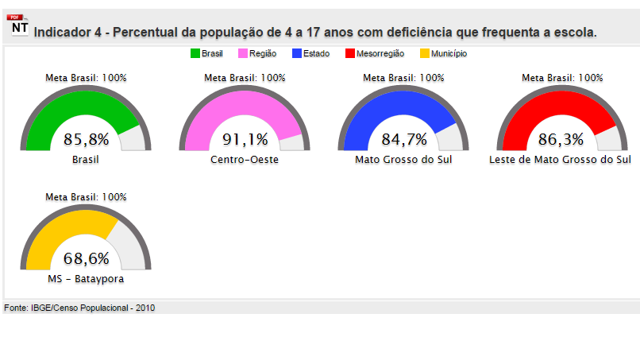

Para atingir a meta proposta, seguem as estratégias:

#### ESTRATÉGIAS DA META 4 { #estrategias-meta-4 }

4.1 Promover reunião semestral com as redes estadual, municipal, particular filantrópica de ensino para avaliar o cumprimento da estratégia 4.1 do PNE que versa sobre os repasses do FUNDEB, referentes às matrículas dos estudantes dos AEEs (Atendimentos Educacionais Especializados), durante a vigência deste plano;

4.2 atender, até o sexto ano de vigência deste PME, em parceria com instituições públicas ou privadas, a universalização do atendimento escolar à demanda manifesta pelas famílias de crianças de 0 (zero) a 3 (três) anos com deficiência, transtornos globais do desenvolvimento e altas habilidades ou superdotação, observado o que dispõe a LDBEN Lei nº 9.394/96 que estabelece as diretrizes e bases da educação nacional;

4.3 implantar até o terceiro ano de vigência do PME, salas de recursos multifuncionais, de forma a atender a demanda e assegurar a formação continuada dos professores para o atendimento educacional especializado em todas as escolas das redes de ensino;

4.4 estimular, a partir do primeiro ano de vigência do PME, atendimento educacional especializado em salas de recursos multifuncionais, escolas ou serviços especializados, públicos ou conveniados, nas formas complementar e suplementar, a todos (as) alunos(as) com deficiência, transtornos globais do desenvolvimento e altas habilidades ou superdotação, matriculados na rede pública de educação básica, conforme necessidade identificada por meio de avaliação especializada, ouvidos a família e o aluno;

4.5 implantar, até o terceiro ano de vigência deste PME, centros multidisciplinares de apoio, pesquisa e assessoria, articulados com instituições acadêmicas e integrados por profissionais das áreas de saúde, assistência social, pedagogia e psicologia, para apoiar o trabalho dos(as) professores da educação básica com os(as) alunos(as) com deficiência, transtornos globais do desenvolvimento e altas habilidades ou superdotação;

4.6 promover com apoio de programas suplementares do Estado e da União, a acessibilidade nas instituições públicas e privadas filantrópicas, para garantir o acesso e a permanência dos(as) alunos(as) com deficiência por meio da adequação arquitetônica, com prévia consulta as área envolvidas, da oferta de transporte acessível e da disponibilização de material didático próprio e de recursos de tecnologia assistiva;

4.7 assegurar que, no contexto escolar, em todas as etapas, níveis e modalidades de ensino, seja feita a identificação dos(as) alunos(as) com altas habilidades ou superdotação, a partir do primeiro ano de vigência deste PME;

4.8 garantir educação bilíngue, em Língua Brasileira de Sinais – LIBRAS, como primeira língua e, na modalidade escrita da Língua Portuguesa como segunda língua, aos(às) alunos(as) surdos e com deficiência auditiva de 0 (zero) a 17 (dezessete) anos, através de professor mediador em LIBRAS, bem como a adoção do Sistema Braille de leitura para cegos e surdo-cegos, a partir da vigência deste PME;

4.9 promover a oferta de educação inclusiva, vedada a exclusão do ensino regular sob alegação de deficiência e promovida à articulação pedagógica entre o ensino regular e o atendimento educacional especializado, a partir do primeiro ano de vigência deste PME;

4.10 acompanhar e monitorar o acesso à escola e ao atendimento educacional especializado, bem como a permanência e o desenvolvimento escolar dos(as) alunos(as) com deficiência, transtornos globais do desenvolvimento e altas habilidades ou superdotação, juntamente com o combate às situações de discriminação, preconceito e violência, com vistas ao estabelecimento de condições adequadas para o sucesso educacional, em colaboração com as famílias e com os órgãos públicos de assistência social, saúde e proteção à infância, à adolescência e à juventude, a partir da vigência deste PME;

4.11 criar, em articulação com órgãos e instituições educacionais, programas de superação a situações de discriminação contra estudantes com deficiências, transtornos globais do desenvolvimento e altas habilidades ou superdotação promovendo a eliminação de barreiras comportamentais, pedagógicas, arquitetônicas e de comunicações, a partir do primeiro ano de vigência do PME;

4.12 desenvolver, a partir da vigência deste PME, pesquisas voltadas para o desenvolvimento de metodologias, materiais didáticos, equipamentos e recursos de tecnologia assistiva, com vistas à promoção do ensino e da aprendizagem, bem como das condições de acessibilidade dos(as) estudantes com deficiência, transtornos globais do desenvolvimento e altas habilidades ou superdotação;

4.13 promover, a partir da vigência deste PME, a articulação intersetorial entre órgãos e políticas públicas de saúde, assistência social e direitos humanos, em parceria com as famílias, com o fim de desenvolver modelos de atendimento voltados à continuidade do atendimento escolar, na educação de jovens e adultos, das pessoas com deficiência e transtornos globais do desenvolvimento com idade superior à faixa etária de escolarização obrigatória, de forma a assegurar a atenção integral ao longo da vida;

4.14 ampliar a partir do primeiro ano de vigência deste PME, as equipes de profissionais da educação para atender a demanda do processo de escolarização dos (das) estudantes com deficiência, transtornos globais do desenvolvimento e altas habilidades ou superdotação, promovendo a oferta de professores(as) do atendimento educacional especializado, audiodescritores, profissionais de apoio ou auxiliares, tradutores(as) e intérpretes de LIBRAS, guias-intérpretes para surdos-cegos, professores de LIBRAS, e professores bilíngues;

4.15 avaliar e supervisionar, mediante instrumento de avaliação nacional, o funcionamento de instituições públicas e privadas que prestam atendimento a alunos com deficiência, transtornos globais do desenvolvimento e altas habilidades ou superdotação;

4.16 subsidiar, com dados da realidade do município, a formulação de políticas que atendam as especificidades educacionais de estudantes com deficiência, transtornos globais de desenvolvimento e altas habilidades ou superdotação;

4.17 colaborar, quando solicitado, com os órgãos de pesquisa, demografia e estatística competentes na formulação de questionários para obtenção de informação detalhada sobre o perfil das pessoas com deficiência, transtornos globais do desenvolvimento e altas habilidades ou superdotação de 0 (zero) a 17 (dezessete) anos;

4.18 incentivar e apoiar o acesso e permanência dos acadêmicos oriundos do município, ao ensino superior, a inclusão nos cursos de licenciatura e nos demais cursos de formação para profissionais da educação, inclusive em nível de pós-graduação, dos referenciais teóricos, das teorias de aprendizagem e dos processos de ensino e aprendizagem relacionados ao atendimento educacional de alunos com deficiência, transtornos globais do desenvolvimento e altas habilidades ou superdotação, durante toda a vigência deste PME;

4.19 realizar, a partir do segundo ano de vigência deste PME, parcerias com instituições comunitárias, confessionais ou filantrópicas sem fins lucrativos, conveniadas com o poder público, visando a ampliar as condições de apoio ao atendimento escolar integral das pessoas com deficiência, transtornos globais do desenvolvimento e altas habilidades ou superdotação matriculadas nas redes públicas e privadas filantrópicas de ensino e,

4.20 participar, em articulação com as Instituições de Ensino Superior (IES) de estudos e pesquisas em quaisquer níveis, visando à produção de conhecimento sobre educação especial, para subsidiar a formação de políticas que atendam as especificidades educacionais de estudantes com deficiências, transtornos globais do desenvolvimento e altas habilidades ou superdotação que requeiram medidas de AEE, a partir do segundo ano de vigência deste PME.

### META 5 – ALFABETIZAÇÃO { #meta-5 }

**Alfabetizar, com aprendizagem adequada, todas as crianças, no máximo, até o final do 3º (terceiro) ano do ensino fundamental.**

#### ANÁLISE SITUACIONAL { #meta-5-analise }

A obrigatoriedade do ensino primário ou fundamental, no Brasil, se deu a partir da Constituição de 1934, a qual determinou a duração de 4 (quatro) anos, ampliando para 8 (oito) anos esta etapa de ensino, mediante a Carta Constitucional promulgada em 1967. Consequentemente, a Lei nº 5.692/71 modificou a estrutura do ensino, unificando o curso primário e o ginásio em um único curso, denominado 1º grau, com duração de 8 (oito) anos; o ensino de 2º grau tornou-se também profissionalizante. (Diretrizes Curriculares Nacionais da Educação Básica, 2013, p. 108).

Neste percurso de mudanças na educação nacional, após duas décadas do século XX, a Lei nº 9.394/96, revoga a Lei nº 5.692/71, reestruturando os níveis da educação básica. Assim, o 1º grau passa a ser denominado ensino fundamental e, o 2º grau a ensino médio.

Conseguinte, a Lei nº 11.274, de 6 de fevereiro de 2006, altera a redação da LDBEN Lei nº 9.394/96, dispondo sobre a duração de 9 (nove) anos para o ensino fundamental, com matrícula obrigatória a partir dos 6 (seis) anos de idade, e, concedendo aos sistemas de ensino o prazo até 2009 para que procedessem as devidas adequações. Com a Resolução CNE/CEB nº 7, de 14 de dezembro de 2010, em seu art. 23, o ensino fundamental de 9 (nove) anos foi assegurado a todos. Destes, os 3 (três) primeiros anos são destinados à alfabetização, que de acordo com seu art. 30 devem assegurar:

I - a alfabetização e o letramento;

II - o desenvolvimento das diversas formas de expressão, incluindo o aprendizado da Língua Portuguesa, a Literatura, a Música e demais artes, a Educação Física, assim como o aprendizado da Matemática, da Ciência, da História e da Geografia;

III - a continuidade da aprendizagem, tendo em conta a complexidade do processo de alfabetização e os prejuízos que a repetência pode causar no ensino fundamental como um todo e, particularmente, na passagem do primeiro para o segundo ano de escolaridade e deste para o terceiro.

Segundo Soares (2003) na década de 40 do século XX, para ser considerado alfabetizado, havia a prerrogativa de que o sujeito assinasse seu próprio nome. Posteriormente, na década de 50, mediante algumas modificações socioculturais e econômicas, isto não bastaria, pois para ser considerado alfabetizado*,* o sujeito teria de ser capaz de ler e escrever um bilhete simples, ou seja, capaz de não só saber ler e escrever, mas de já exercer uma prática de leitura e escrita. Conforme apontam Maciel, Monteiro e Baptista (2009), nas últimas décadas do século citado, apenas ler e escrever um bilhete simples não mais bastava para considerar o sujeito alfabetizado, o que levou alguns estudiosos a empregarem o termo “letramento” designando o estado ou a condição que cada indivíduo passa a ter da aquisição da língua escrita.

Salientando os autores acima citados, Soares (1998) afirma que o letramento é o resultado da ação efetiva de ensinar e aprender as práticas sociais da leitura e da escrita, sendo que aprender a ler e escrever significa adquirir uma tecnologia, a de codificar em língua escrita e decodificar a língua e propriedade.

Nesse sentido, se fez necessário investir na formação de professores alfabetizadores, pois, seu trabalho é determinante no processo de alfabetização. Como uma forma de subsidiar o trabalho efetivo do professor contemporâneo, implantou-se por meio das políticas públicas educacionais o Pacto Nacional da Alfabetização na Idade Certa (PNAIC), através da portaria nº 867, de 4 de julho de 2012, com o objetivo de reafirmar e ampliar o compromisso previsto no Decreto n.º 6.094/2007. Ao aderir o PNAIC, o ente federado, assume o compromisso de atuar em quatro frentes em suas redes de ensino: a) formação dos professores alfabetizadores; b) fornecimento de materiais didático pedagógicos; c) avaliação da alfabetização; e d) gestão, mobilização e controle social.

Em 2012, de acordo com Plano Estadual de Educação de Mato Grosso do Sul (2014, p.40) o governo federal enviou ao congresso nacional a Medida Provisória nº 586, que dispõe sobre o apoio técnico e financeiro da União aos entes federados. Todos os municípios de Mato Grosso do Sul aderiram ao PNAIC por meio do Plano de Ações Articuladas (PAR). Em Batayporã, o programa conta com a participação de 19 (dezenove) professores atendendo atualmente 603 (seiscentos e três) alunos.

Para avaliar este processo de alfabetização, são utilizados os resultados das avaliações elaboradas pelo Instituto Nacional de Estudos e Pesquisas (INEP), por meio da provinha Brasil para as crianças matriculadas no segundo ano do ensino fundamental das escolas públicas, e da Avaliação Nacional da Alfabetização (ANA) que avalia estudantes do 3º ano do ensino fundamental e, por meio de avaliações internas realizadas nas instituições de ensino.

Em Batayporã, o município conta com cinco escolas que atendem o ensino de alfabetização. Vinculadas à rede estadual de ensino, a escolas: Escola Estadual Braz Sinigáglia e Escola Estadual Jan Antonin Bata; à rede municipal de ensino as escolas: Escola Municipal Anízio Teixeira da Silva e Escola Municipal Professora Bernadete Teixeira, e a rede privada de ensino, a Escola de Educação Especial Luz do Amanhã, mantida pela Associação de Pais e Amigos dos Excepcionais - APAE.

Para atender a demanda, o município dispõe do quantitativo de 110 (cento e dez) profissionais que atuam nas escolas supracitadas nas turmas de alfabetização, conforme demonstra quadro abaixo**:**

**Quadro 01 – Escolaridade dos servidores do ensino da alfabetização.**

<table style="width:97%;">
<colgroup>
<col style="width: 20%" />
<col style="width: 12%" />
<col style="width: 12%" />
<col style="width: 12%" />
<col style="width: 12%" />
<col style="width: 12%" />
<col style="width: 12%" />
</colgroup>
<tbody>
<tr>
<td colspan="7" style="text-align: center;"><strong>Escolaridade dos funcionários da Alfabetização</strong></td>
</tr>
<tr>
<td style="text-align: left;"></td>
<td style="text-align: left;"><blockquote>

Especialização

</blockquote></td>
<td style="text-align: left;"><blockquote>

Graduação

</blockquote></td>
<td style="text-align: left;"><blockquote>

Ensino Médio

</blockquote></td>
<td style="text-align: left;"><blockquote>

Ensino Fundamental (completo)

</blockquote></td>
<td style="text-align: left;"><blockquote>

Ensino Fundamental (incompleto)

</blockquote></td>
<td style="text-align: left;"><blockquote>

Alfabetizado

</blockquote></td>
</tr>
<tr>
<td style="text-align: left;">Corpo docente</td>
<td style="text-align: left;">23</td>
<td style="text-align: left;">09</td>
<td style="text-align: left;">00</td>
<td style="text-align: left;">00</td>
<td style="text-align: left;">00</td>
<td style="text-align: left;">00</td>
</tr>
<tr>
<td style="text-align: left;">Técnico administrativo</td>
<td style="text-align: left;">10</td>
<td style="text-align: left;">17</td>
<td style="text-align: left;">34</td>
<td style="text-align: left;">03</td>
<td style="text-align: left;">10</td>
<td style="text-align: left;">04</td>
</tr>
</tbody>
</table>

Fonte: Dados fornecidos pelas secretarias das escolas municipais: Escola Municipal Anízio Teixeira da Silva e Escola Municipal Professora Bernadete Teixeira; escolas estaduais: Escola Estadual Braz Sinigáglia e Escola Estadual Jan Antonin Bata e Escola de Educação Especial Luz do Amanhã (2015).

As escolas acima mencionadas, atualmente atendem 603 (seiscentos e três) alunos matriculados nos 03 (três) primeiros anos do ensino fundamental, conforme quadro a seguir. Pode-se observar que houve uma pequena queda no número de matrículas atuais, isso se deve, em parte, ao controle de natalidade e a migração de famílias para outras localidades em busca de melhores condições socioeconômicas.

Quadro 2- Resultado anual do número de alunos matriculados e desistentes:

| **Ano** | **Alunos matriculados** | **Alunos desistentes** |
|:-------:|:-----------------------:|:----------------------:|
|  2013   |           667           |           05           |
|  2014   |           660           |           03           |
|  2015   |           603           |           --           |

Fonte: Dados fornecidos pelas secretarias das escolas municipais: Escola Municipal Anízio Teixeira da Silva e Escola Municipal Professora Bernadete Teixeira; escolas estaduais: Escola Estadual Braz Sinigáglia e Escola Estadual Jan Antonin Bata e escola particular filantrópica: Escola de Educação Especial Luz do Amanhã (2015).

O município adota algumas estratégias de busca ativa que contribuem tanto com a permanência do aluno em sala de aula, quanto com o desenvolvimento da aprendizagem das crianças que apresentam dificuldades.

Em parceria com o Conselho Tutelar de Batayporã, as escolas desenvolvem o trabalho de detecção e localização dos alunos faltosos, encaminhando nomes e endereços aos conselheiros, que por sua vez, atuam na identificação, *in loco,* dos motivos da ausência destes alunos e, de forma conjunta com as famílias, na medida do possível, os retornam para a escola.

O município conta com salas de recursos multifuncionais que atendem as crianças com alguma deficiência diagnosticada por laudo médico e/ou parecer técnico pedagógico. Especificamente, a rede municipal conta com sala de reforço que atende as crianças com dificuldades na aprendizagem, além de acompanhamento psicológico e psicopedagógico, bem como, o acompanhamento pedagógico[^2], uma atividade oferecida pelo Programa Mais Educação.

Mesmo dispondo das ações acima, observa-se na rede, um contingente preocupante, ao considerar o número de reprovas e evasão escolar, resultando na taxa de distorção idade-série como demonstra o quadro a seguir:

Quadro 3- Resultado anual do número de alunos matriculados e distorção idade-série:

| **Ano** | **Alunos matriculados** | **Alunos distorção idade-série** |
|:-------:|:-----------------------:|:--------------------------------:|
|  2015   |           603           |                79                |

Fonte: Dados fornecidos pelas secretarias das escolas municipais: Escola Municipal Anízio Teixeira da Silva e Escola Municipal Professora Bernadete Teixeira; escolas estaduais: Escola Estadual Braz Sinigáglia e Escola Estadual Jan Antonin Bata e escola particular filantrópica: Escola de Educação Especial Luz do Amanhã (2015).

O quadro abaixo faz um comparativo entre os níveis de aprendizagem da alfabetização nas esferas municipal e estadual.

**Quadro 4 – Resultados da ANA no ano 2013 - Distribuição dos alunos das escolas por nível de proficiência em leitura.**

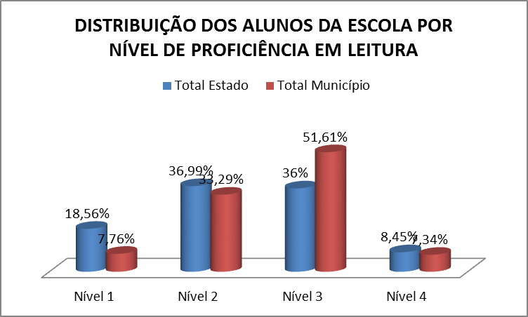

Fonte:http://simec.mec.gov.br/sispacto2/sispacto2.php?modulo=principal/orientadorestudo/orientadorestudo&acao=A&aba=verresultadosana&tpacodigoescola=50013173

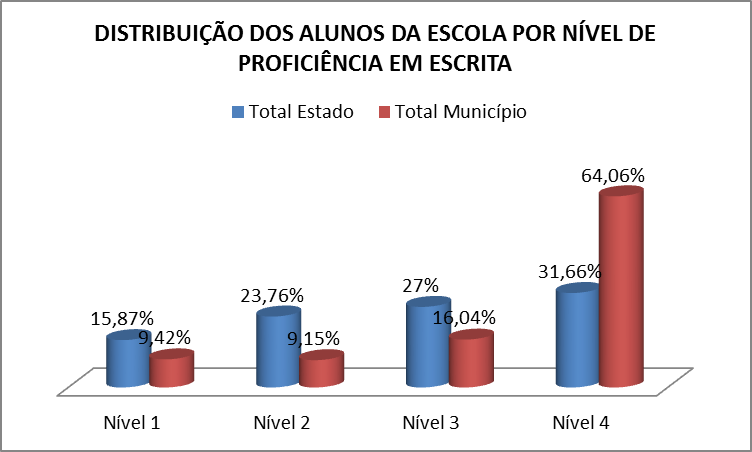

Fonte:http://simec.mec.gov.br/sispacto2/sispacto2.php?modulo=principal/orientadorestudo/orientadorestudo&acao=A&aba=verresultadosana&tpacodigoescola=50013173

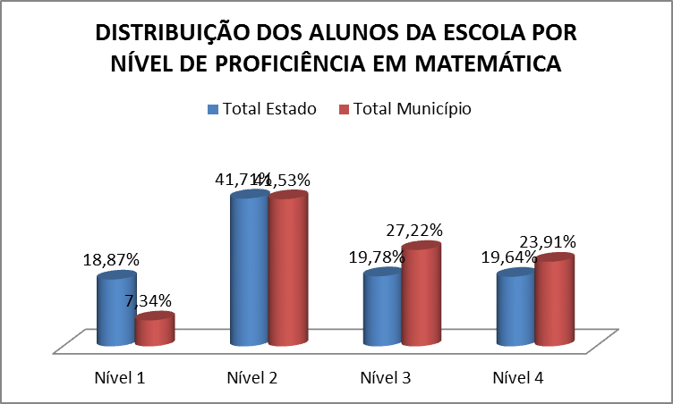

Fonte:http://simec.mec.gov.br/sispacto2/sispacto2.php?modulo=principal/orientadorestudo/orientadorestudo&acao=A&aba=verresultadosana&tpacodigoescola=50013173

De acordo com os quadros demonstrativos dos resultados da avaliação ANA em relação com o quadro estipulado no PEE, fica clara a necessidade de elevar o nível de proficiência dos alunos do 1º ao 3º ano do ensino fundamental, em língua portuguesa e matemática. Diante da análise e, conscientes do desafio de cumprir com a meta de alfabetizar com aprendizagem adequada, nosso município propõe as estratégias a seguir elencadas:

#### ESTRATÉGIAS DA META 5 { #estrategias-meta-5 }

5.1 implementar nos anos iniciais do ensino fundamental no município, estratégias didático-metodológicas desenvolvidas na pré-escola;

5.2 aplicar metodologias específicas pertinentes à faixa etária da alfabetização respeitando o ritmo de aprendizagem de cada criança;

5.3 ofertar, em jornada ampliada, reforço escolar, em turno contrário, para alunos do 1º ao 3º ano que apresentem dificuldades de aprendizagem, com acompanhamento de professores, considerando os resultados das avaliações realizadas;

5.4 implantar e implementar ações de acompanhamento da aprendizagem, trabalho por agrupamento e clima de interação nas salas de aula, para que 100% (cem por cento) das crianças estejam alfabetizadas, com aprendizagem adequada, ao concluírem o 3º ano desta etapa de ensino, até o ano de 2024;

5.5 propiciar a participação nas avaliações anuais, aplicadas pelo INEP, aos alunos do 3º ano do ensino fundamental;

5.6 criar, na vigência deste PME, projetos de intervenção na aprendizagem, considerando os resultados das avaliações aplicadas;

5.7 promover acesso às tecnologias educacionais para a alfabetização de crianças, assegurada a diversidade de métodos e propostas pedagógicas, embasadas em pesquisas atualizadas, fundamentadas na Ciência da Leitura, bem como, o acompanhamento dos resultados nos sistemas de ensino em que forem aplicadas, devendo ser disponibilizadas, preferencialmente, como recursos educacionais abertos;

5.8 criar, durante a vigência deste PME, ambiente educacional virtual para hospedagem de experiências exitosas de métodos e propostas pedagógicas, utilizando as tecnologias educacionais na alfabetização, bem como disponibilizar o resultado da aplicação destes instrumentos;

5.9 utilizar recursos tecnológicos em quantidade suficiente à demanda das unidades, com acesso a internet banda larga de qualidade para utilização das tecnologias educacionais inovadoras nas práticas pedagógicas que assegurem a alfabetização e o letramento, e favoreçam a melhoria do fluxo escolar e a aprendizagem das crianças, segundo as diversas abordagens metodológicas, e que haja nas redes de ensino profissionais da educação qualificados para o desempenho da sua função no campo pedagógico e tecnológico;

5.10 promover a formação aos profissionais da educação para alfabetizar crianças do campo e populações itinerantes, e, quando houver, povos indígenas, quilombolas, das águas, e fronteiriços;

5.11 propiciar o funcionamento adequado da escola do campo no mínimo de 1º ao 3º ano ensino fundamental a fim de preservar sua identidade, e a sua integridade física, independentemente do quantitativo de alunos atendendo aos artigos 17, 53 e 58 e inciso 5º do Estatuto da Criança e do Adolescente (ECA) e demais normas vigentes;

5.12 fornecer, na vigência do PME, materiais didáticos, de apoio pedagógico específicos para a alfabetização de crianças do campo e, quando houver, indígenas, povos das águas, quilombolas populações itinerantes e fronteiriças, incluindo a inserção de recursos tecnológicos;

5.13 realizar, na vigência deste PME, a formação inicial e continuada de professores alfabetizadores envolvendo os profissionais das redes municipal e estadual com a utilização de novas tecnologias educacionais e de práticas pedagógicas inovadoras;

5.14 incentivar, durante a vigência deste PME, articulação entre a secretaria de educação e as universidades públicas que ofereçam cursos de graduação, pós-graduação em lato sensu e stricto sensu e cursos de formação continuada para professores alfabetizadores;

5.15 apoiar a alfabetização das pessoas com deficiência, considerando as suas especificidades, inclusive a alfabetização bilíngue de pessoas surdas, sem estabelecimento de terminalidade temporal;

5.16 viabilizar professor de apoio nas salas de alfabetização que possuam estudantes com deficiência, caso o grau desta exija.

### META 6 - EDUCAÇÃO EM TEMPO INTEGRAL { #meta-6 }

**Implantar e implementar gradativamente educação em tempo integral em, no mínimo, 65% das escolas públicas, de forma a atender, pelo menos, 25% dos(as) alunos(as) da educação básica.**

#### ANÁLISE SITUACIONAL { #meta-6-analise }

Importantes marcos legais colaboraram para o início da Educação Integral no Brasil, a começar pela Constituição Federal de 1988, nos artigos 205, 206 e 227; no Estatuto da Criança e do Adolescente (Lei nº 9.089/1991); na Lei de Diretrizes e Bases (Lei nº 9.394/96), nos artigos 34 e 87; no Plano Nacional de Educação (Lei nº 10.172/01) e no Fundo Nacional de Manutenção e Desenvolvimento do Ensino Básico e de Valorização do Magistério (Lei nº 11.494/2007).

Por sua vez, a Lei nº 10.172, de 9 de janeiro de 2001, que instituiu o Plano Nacional de Educação (PNE), retoma e valoriza a Educação Integral como possibilidade de formação integral da pessoa. Os PNEs de 2001 e 2014 acentuam esta ideia, quanto ao do texto da LDBEN (Lei nº 9.394/96), ao apresentarem a educação em tempo integral como objetivo do ensino fundamental e, também, da educação infantil. Assim, o PEE- MS (2014, *apud*, Resolução CNE/CEB nº 7/2010) apresenta como meta, a ampliação progressiva da jornada escolar para um período de, pelo menos, 7 horas diárias, além de promover a participação das comunidades na gestão das escolas, incentivando o fortalecimento e a instituição de Conselhos Escolares.

A educação integral exige o fomento de uma política pública que terá de enfrentar dois grandes desafios: infraestrutura e articulação com o projeto político pedagógico, por meio de uma política ampla, com certa flexibilidade para que as escolas adequem seu modelo à comunidade local, oferecendo formação aos seus colaboradores. Com base em tais pressupostos e, considerando o que for criado em cada escola, em cada rede de ensino, com a participação dos educadores, educandos e da comunidade, estes deverão contribuir com a ampliação dos tempos e os espaços de formação de nossas crianças, adolescentes e jovens na perspectiva de que o acesso à educação pública seja complementado pelos processos de permanência e aprendizagem

A Educação Integral no município de Batayporã teve inicio no ano de 2013 por meio de adesão ao programa Mais Educação, que ocorre em junho de cada ano e tem sua aplicabilidade num período de dez meses. Em 2013, o programa atendeu 245 (duzentos e quarenta e cinco) alunos em duas escolas da rede municipal, Escola Municipal Anízio Teixeira da Silva e Escola Municipal Professora Bernadete Teixeira, com os seguintes macrocampos/atividades: Comunicação, uso de Mídias e Cultura Digital e Tecnológica/Tecnologias Educacionais; Cultura, Artes e Educação Patrimonial/Canto Coral; Cultura, Artes e Educação Patrimonial/Artesanato Popular; Cultura, Artes e Educação Patrimonial/Percussão; Esporte e Lazer/Esporte na Escola/atletismo e Múltiplas Vivências Esportivas (basquete, futebol, futsal, handebol, voleibol, xadrez) e Acompanhamento Pedagógico (obrigatório) Alfabetização e Letramento.

Em 2014, algumas alterações foram realizadas nas atividades desenvolvidas no programa, que passou a oferecer na escola urbana: artesanato, canto e coral, atletismo e letramento. Na escola rural, Letramento, Canto e Coral, Atletismo e Canteiros Sustentáveis, perfazendo um total de 386 (trezentos e oitenta e seis) alunos participantes. Registra-se que, mesmo com as atividades desenvolvidas, nosso município não atingiu a meta nacional, uma vez que não atendemos 25% (vinte e cinco por cento) da demanda, pois não houve participação da rede estadual de ensino neste processo. Para esse fim, estabelecemos as estratégias elencadas abaixo:

#### ESTRATÉGIAS DA META 6 { #estrategias-meta-6 }

6.1 Ampliar, progressivamente durante a vigência do PME, em consonância com os planos Nacional e Estadual, a jornada dos professores para que possam atuar em uma única escola de tempo integral;

6.2 viabilizar para que a partir de 2020, as escolas que atendem em tempo integral, atinjam 100% (cem por cento) dos alunos matriculados;

6.3 ampliar até 2024, o atendimento em tempo integral, dos atuais 50% (cinquenta por cento) para, no mínimo 65% (sessenta e cinco por cento) das escolas públicas;

6.4 manter o atendimento ao aluno em 7 (sete) horas;

6.5 instituir e desenvolver, em regime de colaboração com a União e o Estado, programa de construção de escolas com padrão arquitetônico e de mobiliário adequado para atendimento, em tempo integral;

6.6 participar, em parceria com a União e o Estado, de programa nacional de ampliação e reestruturação para aproveitamento do espaço, contemplando a instalação de quadras poliesportivas, laboratórios, inclusive de informática, espaços para atividades culturais, bibliotecas, auditórios, cozinhas, refeitórios, banheiros, sala de jogos e outros equipamentos;

6.7 utilizar os materiais didáticos produzidos pelos entes federados, na execução das atividades desenvolvidas dentro do programa Mais Educação;

6.8 participar dos cursos de formação de recursos humanos para atuação na educação em tempo integral, na vigência do PME;

6.9 promover atendimento articulado com os diferentes espaços educativos, culturais e esportivos e com equipamentos públicos, como centros comunitários, bibliotecas, praças, parques, museus, teatros, cinemas, planetários e outros;

6.10 estimular a oferta de atividades voltadas à ampliação da jornada escolar de alunos (as) matriculados (as) nas escolas da rede pública de educação básica por parte das entidades privadas de serviço social vinculadas ao sistema sindical, de forma concomitante e em articulação com a rede pública de ensino;

6.11 orientar a aplicação da gratuidade de que trata o art. 13 da Lei nº 12.101, de 27 de novembro de 2009, em atividades de ampliação da jornada escolar de alunos(as) das escolas da rede pública de educação básica, de forma concomitante e em articulação com a rede pública de ensino;

6.12 possibilitar a oferta de educação de tempo integral, com base em consulta prévia e informada, às escolas de campo, considerando as peculiaridades locais;

6.13 ofertar a educação em tempo integral para pessoas com deficiência, transtornos globais do desenvolvimento e altas habilidades ou superdotação, na faixa etária de 4 (quatro) a 17 (dezessete) anos, assegurando atendimento educacional especializado complementar e suplementar ofertado em salas de recursos multifuncionais da própria escola ou em instituições especializadas e,

6.14 prever, na proposta pedagógica da escola medidas para otimizar o tempo de permanência dos(as) aluno(as) na escola, direcionando a expansão da jornada para o efetivo trabalho escolar, combinando com atividades recreativas, esportivas e culturais.

### META 7 – QUALIDADE NA EDUCAÇÃO { #meta-7 }

**Fomentar a qualidade da educação básica em todas as etapas e modalidades, com melhoria do fluxo escolar e da aprendizagem de modo a atingir as médias nacionais para o IDEB**

#### ANÁLISE SITUACIONAL { #meta-7-analise }

A Educação Básica de qualidade é um direito assegurado pela Constituição Federal de 1988, especificamente em seu art. 206 e pelo Estatuto da Criança e do Adolescente Lei nº 8.069 de 13 de julho de 1990. O princípio de qualidade deve servir de base para o ensino a ser ministrado no País. Segundo as diretrizes curriculares nacionais da educação básica (2013, p.4) é o alicerce indispensável e condição primeira para o exercício pleno da cidadania e o acesso aos direitos sociais, econômicos, civis e políticos. Enfatiza a LDBEN Lei nº 9.394/96 em que a educação deve proporcionar o desenvolvimento humano na sua plenitude, em condições de liberdade e dignidade, respeitando e valorizando as diferenças.

Com vistas a esse padrão de qualidade, é proposto para a educação brasileira atingir os índices de desenvolvimento da educação básica, como posto no quadro abaixo:

Quadro 01 – Médias nacionais para o IDEB

| **IDEB** | **2015** | **2017** | **2019** | **2021** |
|:-----------------------------:|:---------|:---------|:---------|:---------|
| **Anos iniciais do ensino do ensino fundamental** | 5,2 | 5,5 | 5,7 | 6,0 |
| **Anos finais do ensino fundamental** | 4,7 | 5,0 | 5,2 | 5,5 |
| **Ensino Médio** | 4,3 | 4,7 | 5,0 | 5,2 |

Fonte: <http://www.observatoriodopne.org.br/metas-pne/7-aprendizado-adequado-fluxo-adequado/dossie-localidades>

A LDBEN Lei nº 9.394/96, art. 4º, define como padrão mínimo de qualidade a variedade e quantidade mínimas, por aluno, de insumos indispensáveis ao desenvolvimento do processo de ensino-aprendizagem.

Conforme o PEE/MS (2014, p.49, *apud*, CONAE/BRASIL, 2014) a educação de qualidade é aquela que contribui com a formação dos estudantes nos aspectos culturais, antropológicos, econômicos e políticos, para o desempenho de seu papel de cidadão no mundo, tornando-se, assim, uma qualidade referenciada no social. Para tanto, é fundamental atentar para as demandas da sociedade, como parâmetro para o desenvolvimento das atividades educacionais, não apenas da aprendizagem, mas também das variáveis que, dentre outras, a viabilizam:

\- os impactos das desigualdades sociais;

\- os contextos culturais nos quais se realizam os processos de ensino e de aprendizagem;

\- a qualificação, os salários e a carreira dos(as) professores(as);

\- as condições físicas e equipamentos das instituições educativas;

\- o tempo diário de permanência do(a) estudante na instituição;

\- a gestão;

\- os currículos e as expectativas de aprendizagem;

\- os projetos políticos pedagógicos e,

\- o número de estudantes por professor(a).

Entre vários indicadores de qualidade propostos nas metas do PNE Lei nº 13.005/2014, ressalta-se em seu art. 11, que a União, em colaboração com os estados, o Distrito Federal e os municípios, coordenará o Sistema Nacional de Avaliação da Educação Básica (IDEB), que “constituirá fonte de informação para a avaliação da qualidade da educação básica e para a orientação das políticas públicas desse nível de ensino”.

Em Batayporã, tendo em vista o número total de alunos matriculados, que segundo consulta no endereço eletrônico [http://www.observatoriodopne.org.br](http://www.observatoriodopne.org.br/), especificamente no documento Observatório do PNE (2015) em 2014 foi de 2.978 (dois mil, novecentos e setenta e oito) alunos, distribuídos nas três etapas da educação básica e modalidades, visualiza como posto nos quadros abaixo (2 e 3) um quantitativo de equipamentos de modo a atender a demanda compreendida.

Quadro 2 - Computadores existentes nas escolas do município

<table style="width:96%;">
<colgroup>
<col style="width: 45%" />
<col style="width: 8%" />
<col style="width: 8%" />
<col style="width: 8%" />
<col style="width: 8%" />
<col style="width: 8%" />
<col style="width: 8%" />
</colgroup>
<tbody>
<tr>
<td rowspan="2" style="text-align: left;">DEPENDÊNCIAS</td>
<td colspan="2" style="text-align: left;">Estadual</td>
<td colspan="2" style="text-align: left;">Municipal</td>
<td colspan="2" style="text-align: left;">Privada</td>
</tr>
<tr>
<td style="text-align: left;">2014</td>
<td style="text-align: left;">2015</td>
<td style="text-align: center;">2014</td>
<td style="text-align: center;">2015</td>
<td style="text-align: left;">2014</td>
<td style="text-align: left;">2015</td>
</tr>
<tr>
<td style="text-align: left;">Computador para uso administrativo</td>
<td style="text-align: left;">09</td>
<td style="text-align: left;">09</td>
<td style="text-align: center;">13</td>
<td style="text-align: center;">12</td>
<td style="text-align: left;">02</td>
<td style="text-align: left;">04</td>
</tr>
<tr>
<td style="text-align: left;">Computador para uso dos alunos</td>
<td style="text-align: left;">44</td>
<td style="text-align: left;">36</td>
<td style="text-align: center;">15</td>
<td style="text-align: center;">13</td>
<td style="text-align: left;">06</td>
<td style="text-align: left;">10</td>
</tr>
<tr>
<td style="text-align: left;">Com acesso a internet</td>
<td style="text-align: left;">40</td>
<td style="text-align: left;">32</td>
<td style="text-align: center;">28</td>
<td style="text-align: center;">25</td>
<td style="text-align: left;">08</td>
<td style="text-align: left;">12</td>
</tr>
<tr>
<td style="text-align: left;">Sem acesso a internet</td>
<td style="text-align: left;">04</td>
<td style="text-align: left;">04</td>
<td style="text-align: center;">-</td>
<td style="text-align: center;">-</td>
<td style="text-align: left;">-</td>
<td style="text-align: left;">-</td>
</tr>
<tr>
<td style="text-align: left;">Com internet banda larga</td>
<td style="text-align: left;">40</td>
<td style="text-align: left;">32</td>
<td style="text-align: center;">28</td>
<td style="text-align: center;">25</td>
<td style="text-align: left;">06</td>
<td style="text-align: left;">12</td>
</tr>
<tr>
<td style="text-align: left;">Sem internet banda larga</td>
<td style="text-align: left;">04</td>
<td style="text-align: left;">04</td>
<td style="text-align: center;">-</td>
<td style="text-align: center;">-</td>
<td style="text-align: left;">-</td>
<td style="text-align: left;">-</td>
</tr>
</tbody>
</table>

Fonte: Dados fornecidos pelas secretarias das escolas: Escola Municipal Anízio Teixeira da Silva, Escola Municipal Professora Bernadete Teixeira; Escola Estadual Braz Sinigáglia e Escola Estadual Jan Antonin Bata; Escola de Educação Especial Luz do Amanhã.

Quadro 3 Equipamentos existentes nas escolas do município

<table style="width:100%;">
<colgroup>
<col style="width: 42%" />
<col style="width: 10%" />
<col style="width: 8%" />
<col style="width: 8%" />
<col style="width: 10%" />
<col style="width: 8%" />
<col style="width: 10%" />
</colgroup>
<tbody>
<tr>
<td rowspan="2" style="text-align: left;">DEPENDÊNCIAS</td>
<td colspan="2" style="text-align: left;">Estadual</td>
<td colspan="2" style="text-align: left;">Municipal</td>
<td colspan="2" style="text-align: left;">Privada</td>
</tr>
<tr>
<td style="text-align: left;">2014</td>
<td style="text-align: left;">2015</td>
<td style="text-align: left;">2014</td>
<td style="text-align: left;">2015</td>
<td style="text-align: left;">2014</td>
<td style="text-align: left;">2015</td>
</tr>
<tr>
<td style="text-align: left;">Aparelho de televisão</td>
<td style="text-align: left;">15</td>
<td style="text-align: left;">15</td>
<td style="text-align: left;">11</td>
<td style="text-align: left;">11</td>
<td style="text-align: left;">02</td>
<td style="text-align: left;">02</td>
</tr>
<tr>
<td style="text-align: left;">Videocassete</td>
<td style="text-align: left;">-</td>
<td style="text-align: left;">-</td>
<td style="text-align: left;">02</td>
<td style="text-align: left;">02</td>
<td style="text-align: left;">01</td>
<td style="text-align: left;">01</td>
</tr>
<tr>
<td style="text-align: left;">Aparelho de DVD</td>
<td style="text-align: left;">03</td>
<td style="text-align: left;">03</td>
<td style="text-align: left;">10</td>
<td style="text-align: left;">10</td>
<td style="text-align: left;">02</td>
<td style="text-align: left;">02</td>
</tr>
<tr>
<td style="text-align: left;">Antena parabólica</td>
<td style="text-align: left;">01</td>
<td style="text-align: left;">01</td>
<td style="text-align: left;">02</td>
<td style="text-align: left;">02</td>
<td style="text-align: left;">01</td>
<td style="text-align: left;">01</td>
</tr>
<tr>
<td style="text-align: left;">Copiadora</td>
<td style="text-align: left;">03</td>
<td style="text-align: left;">04</td>
<td style="text-align: left;">06</td>
<td style="text-align: left;">05</td>
<td style="text-align: left;">01</td>
<td style="text-align: left;">01</td>
</tr>
<tr>
<td style="text-align: left;">Retroprojetor</td>
<td style="text-align: left;">02</td>
<td style="text-align: left;">02</td>
<td style="text-align: left;">02</td>
<td style="text-align: left;">02</td>
<td style="text-align: left;">01</td>
<td style="text-align: left;">01</td>
</tr>
<tr>
<td style="text-align: left;">Impressora</td>
<td style="text-align: left;">03</td>
<td style="text-align: left;">03</td>
<td style="text-align: left;">08</td>
<td style="text-align: left;">08</td>
<td style="text-align: left;">03</td>
<td style="text-align: left;">04</td>
</tr>
<tr>
<td style="text-align: left;">Aparelho de som</td>
<td style="text-align: left;">03</td>
<td style="text-align: left;">03</td>
<td style="text-align: left;">06</td>
<td style="text-align: left;">06</td>
<td style="text-align: left;">03</td>
<td style="text-align: left;">04</td>
</tr>
<tr>
<td style="text-align: left;">Projetor multimídia (data show)</td>
<td style="text-align: left;">02</td>
<td style="text-align: left;">01</td>
<td style="text-align: left;">05</td>
<td style="text-align: left;">05</td>
<td style="text-align: left;">01</td>
<td style="text-align: left;">01</td>
</tr>
<tr>
<td style="text-align: left;">Fax</td>
<td style="text-align: left;">01</td>
<td style="text-align: left;">01</td>
<td style="text-align: left;">-</td>
<td style="text-align: left;">-</td>
<td style="text-align: left;">01</td>
<td style="text-align: left;">01</td>
</tr>
<tr>
<td style="text-align: left;">Máquina fotográfica/ filmadora</td>
<td style="text-align: left;">01</td>
<td style="text-align: left;">01</td>
<td style="text-align: left;">03</td>
<td style="text-align: left;">04</td>
<td style="text-align: left;">01</td>
<td style="text-align: left;">02</td>
</tr>
<tr>
<td style="text-align: left;">Lousa digital</td>
<td style="text-align: left;">01</td>
<td style="text-align: left;">01</td>
<td style="text-align: left;">01</td>
<td style="text-align: left;">01</td>
<td style="text-align: left;">-</td>
<td style="text-align: left;">-</td>
</tr>
</tbody>
</table>

Fonte: Dados fornecidos pelas secretarias das escolas: Escola Municipal Anízio Teixeira da Silva, Escola Municipal Professora Bernadete Teixeira; Escola Estadual Braz Sinigáglia e Escola Estadual Jan Antonin Bata; Escola de Educação Especial Luz do Amanhã.

Nos quadros 2 e 3 supracitados percebe-se uma pequena redução no quantitativo de computadores e outras tecnologias de apoio ao processo de ensino aprendizagem, nas escolas públicas do município. Embora, como cita o PEE/MS (2014, p. 52) os elementos relacionados à infraestrutura sejam fundamentais para assegurar o acesso de todos os cidadãos que se relacionam com a escola, para o exercício do trabalho docente, para o processo ensino e aprendizagem, tais elementos por si só não asseguram a permanência e o sucesso, com qualidade, dos alunos no processo educativo.

Como posto, é preciso constatar se o ensino e aprendizagem estão de fato ocorrendo em Batayporã. Assim no quadro 4 é possível ter um panorama do rendimento escolar total do ensino fundamental e do ensino médio referente ao ano de 2013, e, cuja análise observa um número significativo em relação à taxa de reprova e de abandono, por conseguinte infere-se a necessidade de estabelecer propostas específicas para dirimir tais desafios.

**Quadro 4 - Rendimento escolar do ensino fundamental e médio do município**

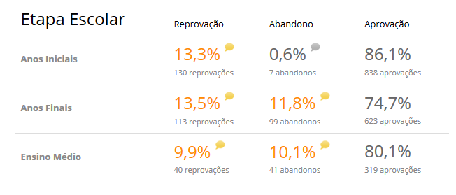

Fonte: <http://www.qedu.org.br/cidade/541-bataipora/taxas-rendimento>

Além destes fatores expostos, há outra preocupação nesse contexto, que é a taxa de distorção idade-série nas etapas do ensino fundamental e ensino médio.

**Quadro 05 - Taxa de distorção idade-série – 2014 - Batayporã**
{ .centro }

<table style="width:97%;">
<colgroup>
<col style="width: 32%" />
<col style="width: 32%" />
<col style="width: 32%" />
</colgroup>
<tbody>
<tr>
<td colspan="3" style="text-align: center;"><strong>Distorção Idade-Série %</strong></td>
</tr>
<tr>
<td style="text-align: center;">Anos iniciais do ensino fundamental</td>
<td style="text-align: center;">Anos finais do ensino fundamental</td>
<td style="text-align: center;">Ensino médio</td>
</tr>
<tr>
<td style="text-align: center;">21,2</td>
<td style="text-align: center;">47,4</td>
<td style="text-align: center;">27,3</td>
</tr>
</tbody>
</table>

Fonte:<http://www.observatoriodopne.org.br/metas-pne/7-aprendizado-adequado-fluxo-adequado/dossie-localidades>

Os quadros 4 e 5 apresentam um retrato da real situação do município em relação as taxas de reprovação, de abandono e de distorção idade-série, visto por seus índices elevados, principalmente, nos anos finais do ensino fundamental e no ensino médio. De acordo com o PEE/MS (2014) esses dados devem remeter os gestores escolares e os sistemas de ensino a uma profunda reflexão e tomada de decisão, com vistas à correção do fluxo, à permanência do estudante na escola e ao êxito na aprendizagem, ou seja, além de permanecer na escola, há o preocupante de garantir a efetiva aprendizagem dos estudantes.

Deste modo, segundo o PEE/MS (2014, p.54), considerando o IDEB como indicador objetivo para a verificação do cumprimento das metas do PNE, o MEC definiu, até 2021, projeções com metas intermediárias para todos os estados e municípios, procurando atingir as seguintes médias: 6,0 nos anos iniciais do ensino fundamental, 5,5 nos anos finais do ensino fundamental, e 5,2 no ensino médio. Para atingir esse patamar, cada sistema deve evoluir segundo pontos de partida distintos, exigindo esforço maior daqueles que partem em pior situação, com um objetivo implícito de redução da desigualdade educacional.

Quadro 06 – IDEB Observado e Metas Projetadas das etapas do ensino fundamental e do ensino médio de Batayporã

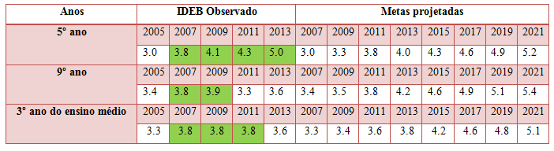

Fonte:<http://www.observatoriodopne.org.br/metas-pne/7-aprendizado-adequado-fluxo-adequado/dossie-localidades>

Em análise do quadro 06, verifica-se que, em Batayporã, o resultado do IDEB observado nos anos iniciais do ensino fundamental foi 5,0 mantendo-se em escala ascendente, superando o resultado das metas projetadas para os referidos anos e, sinalizando a possibilidade de, em 2021, a educação do município ultrapassar a meta projetada para esta etapa de ensino.

Entretanto, para os anos finais do ensino fundamental e do ensino médio os resultados não foram tão satisfatórios, uma vez que ficaram abaixo das metas projetadas para 2013, indicando um preocupante declínio na trajetória da melhoria da aprendizagem, ensejando intervenções eficazes e pontuais que corrijam tais índices.

Visto através do prisma do IDEB o PEE/MS (2014, p.55) ressalta que, apesar da contribuição do IDEB para um panorama da situação educacional básica no país, ele não pode ser considerado como único referencial de qualidade da educação no Brasil. É preciso pensar em uma política de avaliação sistêmica que seja entendida como um processo contínuo e que contribua para o desenvolvimento dos sistemas de ensino e do processo de ensino e aprendizagem.

Nesse sentido, em 2003, Mato Grosso do Sul criou o seu próprio sistema de avaliação denominado Sistema de Avaliação da Educação Básica do Estado de Mato Grosso do Sul (SAEMS), com o objetivo de avaliar a qualidade do ensino e da aprendizagem, o qual vem sendo permanentemente aperfeiçoado. Seu foco recai sobre as disciplinas de língua portuguesa e matemática do ensino fundamental e do ensino médio, da rede estadual de ensino. Em 2013, o SAEMS avaliou 72.308 (setenta e dois mil, trezentos e oito) estudantes dos três anos do ensino médio das escolas estaduais do MS, nas disciplinas de língua portuguesa (leitura e produção de texto) e matemática. Também a rede municipal de educação, em 2011 criou o seu próprio sistema de avaliação denominado projeto Diagnosticando a Aprendizagem, em parceria com graduandos do curso de pedagogia da UNIESP – Nova Andradina, avaliando especificamente a qualidade do ensino e da aprendizagem nas disciplinas de língua portuguesa e matemática, dos alunos do 1º ao 5º ano.

Diante da análise situacional do município, conclui-se que as altas taxas relacionadas ao fracasso escolar, observadas nos quadros anteriores apresentados, evidenciam que só estar na escola não basta, é preciso que as crianças e adolescentes desenvolvam-se no processo de ensino e aprendizagem, além de que concluam a escolarização na idade recomendada. Porquanto, como refere o PEE-MS (2014, p.56) “reprovar não pode ser aceitável e muito menos fazer parte da rotina da escola”. Assim fica evidente a necessidade de criar estratégias para que haja o cumprimento da meta pretendida.

#### ESTRATÉGIAS DA META 7 { #estrategias-meta-7 }

7.1 Estabelecer e implantar, mediante pactuação interfederativa, diretrizes pedagógicas para a educação básica e a base nacional comum dos currículos, com direitos e objetivos de aprendizagem e desenvolvimento dos estudantes para cada ano do ensino fundamental e médio, respeitada a diversidade, observando a realidade de cada localidade e subsidiando as dificuldades de cada região;

7.2 assegurar que:

7.2.1 no quinto ano de vigência deste PME, pelo menos 70% (setenta por cento) dos alunos do ensino fundamental e do ensino médio tenham alcançado nível suficiente de aprendizado em relação aos direitos e objetivos de aprendizagem e desenvolvimento de seu ano de estudo, e 50% (cinquenta por cento) pelo menos, o nível desejável e que isso seja medido por meio de avaliações internas em cada instituição de ensino, por medidas diretas de intervenção;

7.2.2 no último ano de vigência do PME, todos os estudantes do ensino fundamental e do ensino médio tenham alcançado nível suficiente de aprendizado em relação aos direitos e objetivos de aprendizagem e desenvolvimento de seu ano de estudo e 80% (oitenta por cento), pelo menos, o nível desejável.

7.3 reduzir as taxas de reprovação, abandono e distorção idade/série, no ensino fundamental e no ensino médio em 50% (cinqüenta por cento) nos primeiros cinco anos e em 80% (oitenta por cento) até o final da vigência deste PME, com parceria da família, Conselho Tutelar, Centro de Referência Especializado de Assistência Social (CREAS), Centro de Referência de Assistência Social (CRAS), Conselho Municipal dos Direitos da Criança e do Adolescente (CMDCA), atendimento psicológico e psicopedagógico em todas as instituições de ensino;

7.4 constituir, em regime de colaboração com os entes federados, um conjunto de indicadores de avaliação institucional com base no perfil do alunado e do corpo de profissionais da educação, nas condições de infraestrutura das escolas, nos recursos pedagógicos disponíveis, nas características da gestão e em outras dimensões relevantes, até o segundo ano de vigência deste PME;

7.5 promover anualmente, a autoavaliação das escolas de educação básica, por meio da constituição de instrumentos de avaliação que orientem as dimensões a serem fortalecidas, destacando-se a elaboração de planejamento estratégico, a melhoria contínua da qualidade educacional, a formação continuada dos profissionais dos(das) profissionais de educação e o aprimoramento da gestão democrática;

7.6 formalizar e executar os planos de ações articuladas, dando cumprimento às metas de qualidade estabelecidas para a educação básica e às estratégias de apoio técnico e financeiro voltadas à melhoria da gestão educacional, à formação de professores e profissionais de serviços e apoio escolares, à ampliação e ao desenvolvimento de recursos pedagógicos e à melhoria e expansão da infraestrutura física da rede escolar, como bibliotecas, auditórios e laboratórios, com acessibilidade entre outros;

7.7 aplicar os instrumentos nacionais de avaliação da qualidade do ensino fundamental e do ensino médio, bienalmente, na vigência do PME;

7.8 aplicar os instrumentos de avaliação estaduais e nacional, bienalmente, considerando as especificidades e a diversidade sociocultural nas etapas do ensino fundamental e do ensino médio, englobando todas as áreas de conhecimento na avaliação dos anos finais do ensino fundamental, na vigência do PME;

7.9 utilizar os resultados das avaliações nacionais e estaduais pelos sistemas de ensino e pelas escolas para a melhoria de seus processos e práticas pedagógicas, durante a execução do PME;

7.10 acompanhar e divulgar, bienalmente, os resultados pedagógicos dos indicadores do sistema estadual de avaliação da educação básica nas páginas eletrônicas das instituições de ensino;

7.11 apoiar a incorporação do exame nacional do ensino médio (ENEM) ao sistema de avaliação da educação básica; propondo ações para a evolução dos resultados;

7.12 desenvolver, em parceria com os entes federados, indicadores específicos de avaliação da qualidade da educação especial, bem como da qualidade da educação bilíngue para surdos e surdocegos;

7.13 orientar, acompanhar e avaliar as políticas das redes públicas de ensino, a fim de atingir as metas do IDEB, reduzindo pela metade, até 2024, a diferença entre as escolas com os menores índices e a média nacional, de forma a garantir equidade da aprendizagem;

7.14 proporcionar, até o 3º ano de vigência deste PME, estruturas necessárias e promover a utilização das tecnologias educacionais para todas as etapas da educação básica, com incentivo às práticas pedagógicas inovadoras, visando à melhoria do fluxo escolar e da aprendizagem, com acompanhamento dos resultados;

7.15 propiciar qualidade dos recursos tecnológicos que garantam a utilização dos *softwares* livres, por meio das ferramentas disponíveis na internet, com equipamentos em número suficiente para atender a demanda, que acompanhem o desenvolvimento tecnológico com profissionais capacitados técnico e pedagogicamente e suporte técnico adequado, até o terceiro ano de vigência deste PME;

7.16 ofertar transporte gratuito, acessível e seguro para todos(as) os(as) estudantes da educação do campo e, caso haja, populações fronteiriças, comunidades quilombolas e indígenas, e povos das águas, mediante renovação e padronização integral da frota de veículos, de acordo com as especificações definidas pelo órgão competente, e financiamento compartilhado, visando reduzir a evasão escolar e o tempo médio de deslocamento da casa até a escola e vice-versa, até o terceiro ano de vigência deste PME;

7.17 desenvolver propostas alternativas de atendimento escolar para as populações do campo e, caso haja fronteiriças, quilombolas, indígenas e povos das águas, que considerem as especificidades culturais e locais, e as boas práticas nacionais e internacionais, nos três primeiros anos de vigência deste PME;

7.18 universalizar, até o terceiro ano de vigência deste PME, o acesso à rede mundial de computadores em banda larga de alta velocidade, em número suficiente de equipamentos para atender a demanda, em todas as unidades de educação básica;

7.19 ampliar, até o quinto ano de vigência do PME, a relação computador/aluno nas escolas da rede púbica de educação básica, promovendo a utilização pedagógica das tecnologias da informação e da comunicação; contando com profissionais nas salas de tecnologias educacionais capacitados que deem suporte técnico e pedagógico;

7.20 propiciar e fortalecer a participação da comunidade escolar no planejamento, na aplicação e no controle de recursos advindos da transferência direta de recursos financeiros às escolas, visando à ampliação da transparência e ao efetivo desenvolvimento da gestão democrática, após um ano de vigência do PME;

7.21 aprimorar o atendimento ao(à) estudante em todas as etapas da educação básica, por meio de programas suplementares de material didático escolar, transporte, alimentação e assistência à saúde;

7.22 proporcionar, em todas as escolas públicas e privadas filantrópicas de educação básica, o acesso à energia elétrica, ao abastecimento de água, ao esgoto sanitário e ao manejo de resíduos sólidos, nos dois primeiros anos do PME;

7.23 implantar, implementar e assegurar o acesso dos(as) estudantes a espaços para a prática esportiva, bens culturais e artísticos, bibliotecas, equipamentos e laboratórios de ensino, em até dois anos após a aprovação do PME;

7.24 assegurar, nos espaços dos prédios escolares e entornos, a acessibilidade às pessoas com deficiência, ou mobilidade reduzida, a partir do primeiro ano de vigência deste PME, contando com a parceria do setor municipal de trânsito e secretaria de obras;

7.25 participar de programa nacional de reestruturação e aquisição de equipamentos para escolas públicas, visando à equalização regional das oportunidades educacionais;

7.26 implantar e implementar as bibliotecas escolares, considerando sobretudo a aquisição de acervos bibliográficos acessíveis e atualizados periodicamente, a partir do primeiro ano de vigência deste PME;

7.27 adquirir equipamentos e recursos tecnológicos, com apoio da União, em número suficiente que atenda a demanda, para utilização pedagógica em todas as escolas públicas da educação básica, assegurada sua manutenção e atualização;

7.28 criar mecanismos para implementação das condições necessárias à universalização das bibliotecas, com acesso a internet em banda larga, no primeiro ano de vigência deste PME;

7.29 participar, em regime de colaboração com a União e demais entes federados, das discussões para a definição dos parâmetros mínimos de qualidade dos serviços da educação básica, a serem utilizados como referência para infraestrutura das escolas, recursos pedagógicos, entre outros insumos relevantes, e como instrumento para adoção de medidas para a melhoria da qualidade do ensino;

7.30 informatizar integralmente a gestão das escolas públicas e da secretaria municipal de educação e cultura, até o terceiro ano de aprovação do PME;

7.31 implementar programa de formação inicial e continuada para o pessoal técnico da secretaria municipal de educação e cultura, até o 3º ano de vigência deste PME;

7.32 implantar e desenvolver, até o segundo ano de vigência do PME, políticas de prevenção e combate à violência nas escolas, com capacitação dos profissionais da educação para atuarem em ações preventivas anuais, junto aos(às) estudantes na detecção das causas como: violência doméstica e sexual, questões étnico raciais, e respeito as diferenças e combate a todos os tipos de violência e discriminação, para a adoção das providências adequadas, promovendo a cultura de paz e um ambiente escolar dotado de segurança para a comunidade;

7.33 promover a formação continuada dos profissionais da educação incluindo gestores e servidores da secretaria de educação e cultura sobre: os direitos humanos, educação sexual, promovendo a saúde e prevenção das DSTs/Aids, alcoolismo e drogas, questões étnico raciais, geracionais, situações das pessoas com deficiência, na vigência do PME;

7.34 elaborar e distribuir, anualmente, em parceria com os órgãos competentes, material didático para educadores(as), estudantes(as) e pais e/ou responsáveis sobre: direitos humanos, educação sexual, a saúde e prevenção das DST/sAids, alcoolismo e drogas, questões étnico raciais e geracionais;

7.35 implementar políticas de inclusão com vistas à permanência nas escolas das crianças, adolescentes e jovens que se encontrem em regime de liberdade assistida e em situação de rua, assegurando os direitos da criança e do(a) adolescente; e que o diálogo se estabeleça entre a escola e os órgãos que atendem estas crianças (Conselho Tutelar/CREAS/CRAS);

7.36 contribuir para a implementação das respectivas diretrizes curriculares nacionais, por meio de ações colaborativas com fóruns de educação para a diversidade étnico racial, conselhos escolares, movimento social negro, lideranças educacionais indígenas e com a sociedade civil, na vigência deste PME;

7.37 consolidar, até o terceiro ano de vigência do PME, a oferta, com qualidade social, da educação escolar à população do campo e, caso haja, povos das águas, comunidades fronteiriças, populações tradicionais, populações itinerantes e comunidades indígenas e quilombolas, respeitando a articulação entre os ambientes escolares e comunitários, assegurando:

7.37.1 o desenvolvimento sustentável e a preservação da identidade cultural dessas populações;

7.37.2 a participação da comunidade na definição do modelo de organização pedagógica e de gestão das instituições, consideradas as práticas socioculturais e as formas particulares de organização do tempo;

7.37.3 a oferta bilíngue da educação infantil e dos anos iniciais do ensino fundamental, em língua materna das comunidades indígenas e em língua portuguesa;

7.37.4 a reestruturação e a aquisição de equipamentos;

7.37.5 a oferta de programa para a formação inicial e continuada de profissionais da educação e,

7.37.6 o atendimento em educação especial.

7.38 promover a formação continuada dos profissionais da educação sobre os direitos humanos, educação sexual e questões étnico-raciais, a partir do terceiro ano de vigência do PME;

7.39 apoiar a formação de gestores e servidores da secretaria municipal de educação e cultura sobre educação sexual, considerando as questões étnico-raciais, geracionais e a situação das pessoas com deficiência;

7.40 elaborar e distribuir, em parcerias com os órgãos competentes, materiais didáticos referentes a direitos humanos;

7.41 elaborar e implementar políticas de inclusão com vistas à permanência na escola dos adolescentes e jovens que se encontrem em regime de liberdade assistida e em situação de rua, assegurando os princípios da Lei n.º 8.069, de 13 de julho de 1990 – Estatuto da Criança e do Adolescente;

7.42 incluir conteúdos da história e culturas: afro-brasileiras, indígenas, sul-mato-grossense e batayporaense nos currículos, e implementar ações educacionais no município, nos termos da Lei nº 10.639, de 9 de janeiro de 2003, e da Lei nº 11.645, de 10 de março de 2008;

7.43 contribuir para a implementação das respectivas diretrizes curriculares nacionais, por meio de ações colaborativas com fóruns de educação para a diversidade étnico-racial, conselhos escolares, equipes pedagógicas e com a sociedade civil, até o terceiro ano de vigência deste PME;

7.44 desenvolver currículos e propostas pedagógicas específicas para a educação escolar do campo e, caso haja, povos das águas, comunidades indígenas e quilombolas, incluindo os conteúdos culturais correspondentes às respectivas comunidades, produzindo e disponibilizando materiais didáticos específicos, inclusive para os(as) alunos(as) com deficiência, até o terceiro ano de vigência do PME;

7.45 articular, na vigência deste PME, a educação formal com experiências de educação popular e cidadã, por meio da mobilização das famílias e dos setores da sociedade civil com o propósito de que a educação seja assumida como responsabilidade de todos os cidadãos até o quinto ano de vigência deste PME;

7.46 ampliar o controle social sobre o cumprimento das políticas públicas educacionais, até o quinto ano de vigência do PME;

7.47 promover a articulação dos programas da área da educação, de âmbito local, com os de outras áreas como saúde, trabalho e emprego, assistência social, esporte e cultura, possibilitando a criação de redes de apoio integral às famílias, em especial nas áreas de maior vulnerabilidade social, como condição para a melhoria da qualidade educacional, até o quinto ano de vigência do PME;

7.48 universalizar, mediante articulação entre os órgãos responsáveis pelas áreas da saúde e da educação, o atendimento aos estudantes da rede escolar pública de educação básica, por meio de ações de prevenção, promoção e atenção à saúde, durante a vigência do PME;.

7.49 estabelecer ações efetivas especificamente voltadas para a promoção, prevenção, atenção e atendimento à saúde e à integridade física, mental e emocional dos profissionais da educação, como condição para a melhoria da qualidade educacional, durante a vigência do PME;

7.50 fortalecer, com a colaboração técnica e financeira da União e do Estado, em articulação com o sistema nacional de avaliação da educação básica, o sistema municipal de avaliação da educação básica, com participação por adesão, das escolas públicas, para orientar e redimensionar as políticas públicas e as práticas pedagógicas, com o fornecimento das informações às escolas e à sociedade, nos três primeiros anos de vigência do PME;

7.51 participar, em articulação com os entes federados, de programa de formação de professores e alunos para consolidar política de preservação da memória nacional e estadual e municipal;

7.52 divulgar a toda a comunidade escolar, o produto deste PME, durante toda a sua vigência;

7.53 manter as propostas pedagógicas das escolas atualizadas, atentando para o cumprimento dos parâmetros de qualidade nelas estabelecidos e,

7.54 concentrar esforços em parceria, com a família, CMDCA, Conselho Tutelar, CREAS/CRAS, Agentes Comunitários de Saúde, Assistência Social, Ministério Público, Juizado da Infância e da Juventude, Polícia Militar, Igrejas e Sociedade Civil para reduzir as taxas de reprovação, abandono e distorção idade/série, durante todo o período de vigência deste PME.

### META 8 – ESCOLARIDADE MÉDIA { #meta-8 }

**Elevar a escolaridade média da população de 18 a 29 anos, de modo a alcançar, no mínimo, 12 anos de estudo até o último ano de vigência deste Plano, para as populações do campo e dos 25% mais pobres, e igualar a escolaridade média entre negros e não negros.**

#### ANÁLISE SITUACIONAL { #meta-8-analise }

De acordo com a proposta curricular da educação de jovens e adultos (BRASIL, 2001, p.20) esta modalidade de educação surgiu no Brasil, na década de 30, século XX, para atender a parcela da população brasileira que não teve acesso à escolarização na idade própria, impossibilitados pela necessidade de sobrevivência e a não oferta de ensino para todos. Essa modalidade de ensino fez-se necessária em virtude das transformações pelas quais a sociedade brasileira passava. Fatores como o processo de industrialização e o crescimento da população urbana, impulsionaram a ampliação da educação elementar, pelo governo federal, traçando diretrizes educacionais para todo país, estendendo o ensino aos adultos, mais especificamente na década de 40.

Ainda referenciando as diretrizes (2010, p.25), com o golpe militar em 1964, os programas de alfabetização e educação popular, que haviam até então se multiplicado, foram vistos como uma ameaça à ordem, sendo, então, criados programas assistencialistas e conservadores a exemplo do Movimento Brasileiro de Alfabetização (MOBRAL), implantado de forma massiva, porém superficial, fruto de uma sociedade de época, vazio de todo sentido crítico e problematizador, ou seja, sua função era levar o adulto analfabeto a participar de benefícios de uma sociedade "moderna". Porém, havia algumas experiências isoladas de alfabetização com propostas mais críticas, vinculadas a movimentos populares.

Com o início da abertura política, dos anos de 1980, emergiram os movimentos sociais e, com isso, as experiências acima, foram ampliando-se e os projetos de alfabetização se desdobraram em turma de pós-alfabetização, extinguindo-se o MOBRAL. Em substituição a este, foi criada a Fundação Nacional para Educação de Jovens e Adultos - FUNDAÇÃO EDUCAR, que objetivava apoiar financeira e tecnicamente as iniciativas de governos, entidades civis e empresas a ela conveniadas.

Com a Constituição Federal de 1988, em seu artigo 6º e a LDBEN Lei nº 9.394/96, art. 4º, a educação tornou-se um princípio e uma exigência tão básica para a vida cidadã e a vida ativa que ela se tornou direito do cidadão e dever do Estado. Deste modo a Lei de Diretrizes e Bases da Educação Nacional Lei nº 9.394/96 em seu art. 37, deixa claro que os sistemas de ensino assegurarão gratuitamente aos jovens e aos adultos, que não puderam efetuar os estudos na idade regular oportunidades educacionais apropriadas.

Em conformidade com a Constituição Federal de 1988 e Emenda Constitucional nº 59/2009, a educação de jovens e adultos é uma modalidade de ensino que tem como objetivo oportunizar aos jovens e adultos a partir dos 18 anos de idade a escolarização e/ou a complementação dos estudos, nas etapas do ensino fundamental e do ensino médio; promover a formação dos jovens e adultos, considerando os eixos-formadores do ensino fundamental e do ensino médio, científico-cultural, político-econômico e tecnológico; proporcionar uma educação de jovens e adultos com práticas didático pedagógicas específicas, garantindo a continuidade dos estudos e elevação da escolaridade.

Em Batayporã a rede pública de ensino oportuniza aos jovens, adultos e idosos a escolarização e/ou complementação dos seus estudos no âmbito da educação básica, na modalidade da educação de jovens e adultos, nas etapas do ensino fundamental e ensino médio.

Para assegurar esse atendimento, o município conta com o Projeto EJA voltado a jovens, adultos e idosos. O mesmo encontra-se em funcionamento desde 2005 na rede estadual de ensino e, na rede municipal de ensino, funciona as fases 1 e 2 do ensino fundamental, desde o ano de 2013, na Escola Municipal Anízio Teixeira da Silva. Registra-se que, anterior ao ano de 2013, a rede municipal de ensino, nesta mesma escola, oferecia o Ensino Regular Noturno, atendendo a alfabetização de Jovens e Adultos.

Batayporã também contempla o Programa Brasil Alfabetizado, programa do Governo Federal, em parceria com os Estados e Municípios, que tem como objetivo contribuir para a universalização do ensino fundamental, apoiando as ações de alfabetização de jovens, adultos com 15 anos ou mais.

Para atender esse público da EJA, Batayporã conta um quadro de funcionários com características especiais que refletem permanentemente sobre sua prática a fim de atender as especificidades dessa modalidade de ensino.

Quadro 01 – Servidores educação de jovens e adultos

<table style="width:100%;">
<colgroup>
<col style="width: 21%" />
<col style="width: 13%" />
<col style="width: 13%" />
<col style="width: 13%" />
<col style="width: 13%" />
<col style="width: 13%" />
<col style="width: 13%" />
</colgroup>
<tbody>
<tr>
<td colspan="7" style="text-align: center;"><strong>Escolaridade dos funcionários da EJA</strong></td>
</tr>
<tr>
<td style="text-align: left;"></td>
<td style="text-align: left;"><blockquote>

Especialização

</blockquote></td>
<td style="text-align: left;"><blockquote>

Graduação

</blockquote></td>
<td style="text-align: left;"><blockquote>

Ensino Médio

</blockquote></td>
<td style="text-align: left;"><blockquote>

Ensino Fundamental (completo)

</blockquote></td>
<td style="text-align: left;"><blockquote>

Ensino Fundamental (incompleto)

</blockquote></td>
<td style="text-align: left;"><blockquote>

Alfabetizado

</blockquote></td>
</tr>
<tr>
<td style="text-align: left;">Corpo docente</td>
<td style="text-align: center;">09</td>
<td style="text-align: center;">05</td>
<td style="text-align: center;">00</td>
<td style="text-align: center;">00</td>
<td style="text-align: center;">00</td>
<td style="text-align: center;">00</td>
</tr>
<tr>
<td style="text-align: left;">Técnico administrativo</td>
<td style="text-align: center;">03</td>
<td style="text-align: center;">03</td>
<td style="text-align: center;">01</td>
<td style="text-align: center;">00</td>
<td style="text-align: center;">03</td>
<td style="text-align: center;">00</td>
</tr>
</tbody>
</table>

Fonte: Dados fornecidos pelas escolas – Escola Municipal Anízio Teixeira da Silva, Escola Estadual Braz Sinigáglia e Escola Estadual Jan Antonin Bata (2015).

**Quadro 02 - Atendimento a Educação de Jovens e Adultos – 1ª e 2ª fases do ensino fundamental**

|                               | 2011 | 2012[^3] | 2013 | 2014 | 2015 |
|-------------------------------|:-----|:---------|:-----|:-----|:-----|
| Número de alunos matriculados | 47   | \*       | 40   | 48   | 22   |
| Número de alunos evadidos     | 06   | \*       | 07   | 14   | \-   |
| Número de alunos retidos      | 10   | \*       | 11   | 09   | \-   |
| Número de alunos aprovados    | 16   | \*       | 22   | 24   | \-   |
| Número de alunos transferidos | 15   | \*       | \-   | 01   | \-   |

Fonte: Dados estatísticos fornecidos pela secretaria da Escola Municipal Anízio Teixeira da Silva (2015)

**Quadro 03 - Atendimento a Educação de Jovens e Adultos – 3ª e 4ª fases do ensino fundamental**

|                               | 2012 | 2013 | 2014 | 2015 |
|-------------------------------|:-----|:-----|:-----|:-----|
| Número de alunos matriculados |      | 23   | 15   | 80   |
| Número de alunos evadidos     |      | \-   | 05   | \-   |
| Número de alunos retidos      |      | \-   | \-   | \-   |
| Número de alunos aprovados    |      | \-   | 10   | \-   |
| Número de alunos transferidos |      | \-   | \-   | 01   |

Fonte: Dados estatísticos fornecidos pela secretaria da Escola Estadual Braz Sinigáglia a partir do Educacenso (2015)

**Quadro 04 - Atendimento a Educação de Jovens e Adultos – Ensino Médio 1ª e 2ª fases**

|                               | 2012 | 2013 | 2014 | 2015 |
|-------------------------------|:-----|:-----|:-----|:-----|
| Número de alunos matriculados | 108  | 41   | 67   | 66   |
| Número de alunos evadidos     |      | \-   | 25   | \-   |
| Número de alunos retidos      |      | \-   | \-   | \-   |
| Número de alunos aprovados    |      | \-   | 40   | \-   |
| Número de alunos transferidos | 01   | \-   | 02   | 01   |

Fonte: Dados estatísticos fornecidos pela secretaria da Escola Estadual Braz Sinigáglia a partir do Educacenso (2015)

**Quadro 05 - Atendimento a Educação de Jovens e Adultos – Brasil Alfabetizado**

|                               | 2012 | 2013 | 2014 | 2015 |
|-------------------------------|:-----|:-----|:-----|:-----|
| Número de alunos matriculados | 165  | \-   | 80   | \-   |
| Número de alunos evadidos     | 33   | \-   | 30   | \-   |
| Número de alunos retidos      |      | \-   | \-   | \-   |
| Número de alunos aprovados    | 126  | \-   | 50   | \-   |
| Número de alunos transferidos | 06   | \-   | \-   | \-   |

Fonte: Dados estatísticos fornecidos pela Secretaria Municipal de Educação e Cultura de Batayporã (2015)

Ao considerar o objetivo desta meta, que é elevar a escolaridade média da população de 18 (dezoito) a 29 (vinte nove) anos, os dados a seguir no gráfico 01 (SIMEC-2013) representa a escolaridade média dessa população deste município em relação a meta proposta, ficando evidente a necessidade do cumprimento de elevar o índice de 8,2 para 12 anos, posto uma defasagem de 3,8 pontos, como observado no gráfico 01.

**Gráfico 1** - **Escolaridade média da população de 18 a 29 anos de idade (em anos de estudo) nacional, estadual e municipal.**

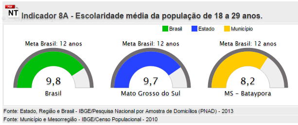

Segundo o PEE/MS (2014, p.60-61) as diferenças socioeconômicas, associadas às de etnia, evidenciam uma das facetas das estruturas que precisam ser pensadas na distribuição das oportunidades educativas. Pesquisas nacionais apontam que jovens de distintas categorias étnicas e sociais contam com diferentes níveis de possibilidade de alcançar melhores resultados; na média, segundo o IPEA, quase metade de todos eles ainda está retida no ensino fundamental e no ensino médio (57% de pretos/pardos e 29% de brancos) e as probabilidades de sucesso são baixas e também desiguais.

A diferença entre a escolaridade média da população negra e da população não negra, de 18 a 29 anos, no Brasil, conforme Gráfico 2, é de 92,2% (noventa e dois vírgula dois por cento) (IBGE/PNAD 2012), em Mato Grosso do Sul, é de 92,3%, (noventa e dois vírgula três por cento) em Batayporã-MS essa diferença entre a escolaridade média da população negra da população não negra de 18 (dezoito) a 29 (vinte e nove) anos é de 81,9% (oitenta e um virgula nove por cento) conforme dados do IBGE-2013 (Gráfico 2). A meta nacional é igualar a escolaridade média entre negros e não negros (100%) até o final da vigência deste Plano.

**Gráfico 2 – Diferença entre a escolaridade média da população negra e da população não negra de 18 a 29 anos (nacional, estadual e municipal)**

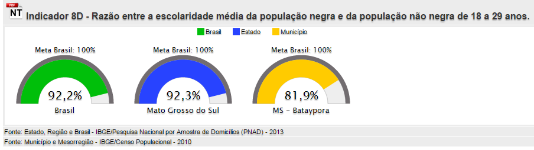

Ainda citando o PEE/MS (2014, p.61) é importante ressaltar que várias políticas públicas foram bem sucedidas ao aumentar a oferta escolar, ao reduzir as disparidades geográficas e ao franquear o acesso a oportunidades educativas aos grupos sociais mais pobres.

Segundo o IBGE/PNAD (2012), a escolaridade média, em anos de estudo, da população 25% (vinte e cinco por cento) mais pobres, de 18 (dezoito) a 29 (vinte e nove) anos, no Brasil, conforme Gráfico 3 é de 8 anos, igual à de Mato Grosso do Sul, porém, em Batayporã, de acordo com a pesquisa IBGE/PNAD (2013) a escolaridade média é de 6,4% (seis virgula quatro por cento). A meta nacional para 2024 é alcançar, no mínimo, 12 anos de estudo até o último ano de vigência deste Plano, conforme gráfico 3.

**Gráfico 3 – Escolaridade média da população de 18 a 29 anos de idade entre os 25% mais pobres (em anos de estudo) nacional, estadual e municipal**

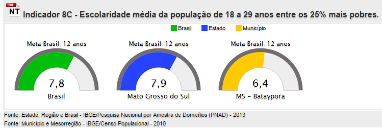

Conforme o IBGE (2010), a população rural do município de Batayporã é de 2.607 (duas mil, seiscentos e sete) pessoas e de acordo IBGE/PNAD (2013), a escolaridade média em anos de estudo dessa faixa etária considerada é de 7,2 anos.

**Gráfico 4 – Escolaridade média da população de 18 a 29 anos de idade residente em área rural (nacional, estadual e municipal)**

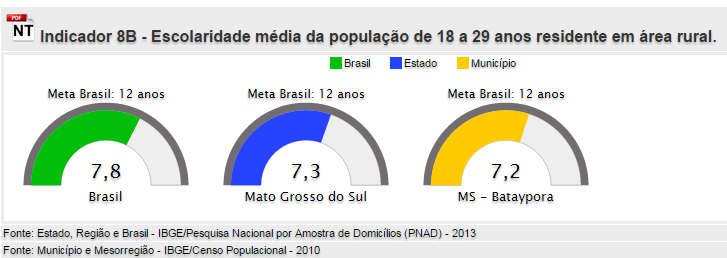

Para que o município de Batayporã, atinja a meta proposta nacionalmente, de 12 anos de escolaridade média para população compreendida na faixa etária de 18 a 29 anos, propõe as seguintes estratégias:

#### ESTRATÉGIAS DA META 8 { #estrategias-meta-8 }

8.1 Implantar e participar de programas com metodologia diferenciada, com o acompanhamento pedagógico individualizado, recuperação e progresso parcial, priorizando estudantes com rendimento escolar defasado, visando à continuidade da escolarização de forma a concluir seus estudos;

8.2 implantar e ampliar a oferta da educação de jovens e adultos nas fases iniciais, inclusive na área rural, quando houver demanda;

8.3 viabilizar a população considerada a continuidade da educação através de cursos de educação de jovens e adultos;

8.4 implantar e participar de programas específicos para ampliar o atendimento da população compreendida;

8.5 divulgar e incentivar, continuamente, a participação em exames gratuitos de certificação da conclusão dos ensinos fundamental e médio;

8.6 criar posto de atendimento temporário, a partir de 2016, para tornar acessíveis as inscrições aos exames de certificação junto à parcela da população não frequente as instituições de ensino;

8.7 aderir aos programas gratuitos de formação profissional técnica articulados pelo Estado, em diversas áreas, de acordo com a realidade local;

8.8 promover o monitoramento contínuo, garantindo o acesso e a permanência à escola;

8.9 promover e ampliar progressivamente, a busca ativa de jovens evadidos do âmbito escolar pertencentes aos segmentos populacionais considerados e,

8.10 ofertar o transporte escolar à população considerada.

### META 9 – ALFABETIZAÇÃO E ANALFABETISMO { #meta-9 }

**Elevar para 95% a taxa de alfabetização da população com 15 ou mais de idade até 2015 e, até o final da vigência do PME, erradicar o analfabetismo absoluto e reduzir em 50% a taxa de analfabetismo funcional.**

#### ANÁLISE SITUACIONAL { #meta-9-analise }

Segundo o Instituto Paulo Montenegro[^4] (INAF, 2015), nos últimos anos, o conceito de analfabetismo sofreu várias mudanças. Em 1958 a UNESCO (Organização das Nações Unidas para Educação, Ciência e Cultura) definia como analfabeto um indivíduo que não conseguisse ler ou escrever algo simples e como alfabetizado o que demonstrasse tais habilidades em enunciados simples relacionados à sua vida diária.

Duas décadas mais tarde, a mesma UNESCO adotou o conceito de alfabetismo funcional como sendo a pessoa capaz de utilizar a leitura e a escrita, além de habilidades matemáticas para fazer frente às demandas de seu contexto social e utilizá-las para continuar aprendendo e se desenvolvendo ao longo da vida. Entretanto, uma pessoa que, mesmo sabendo ler e escrever frases simples, não possui as habilidades necessárias para satisfazer as demandas do seu dia a dia e se desenvolver pessoal e profissionalmente, é descrita, segundo a UNESCO, uma analfabeta funcional.

Assim uma das metas deste PME é que até 2024 se consiga erradicar esse analfabetismo funcional ou absoluto, visto que esse direito já está previsto na Constituição Federal de 1988, art. 214.

Segundo dados do IBGE (2012), em Batayporã, o número total de pessoas com 15 anos ou mais que apresentavam analfabetismo ficou em torno de 1.335 pessoas, perfazendo um total de 18,3% (dezoito vírgula três por cento). Em 2013 o SIMEC apresentou um resultado positivo, tendo em vista a diminuição desse índice, para 12,5% (doze vírgula cinco) como observado no gráfico 1.

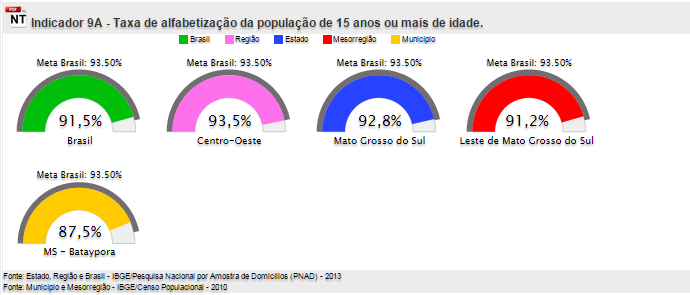

O PEE/MS (2014, p. 65) considera dados extraídos do IBGE/PNAD 2012, segundo o qual o Brasil apresentava a taxa de alfabetização de 91,3% (noventa e um, vírgula três por cento) da população de 15 anos ou mais de idade, e Mato Grosso do Sul, de 93% (nove e três por cento) que corresponde a 1.848.608 pessoas. Portanto, o estado em 2012 encontrava-se em situação favorável para o cumprimento da meta nacional estabelecida, ensejando a proposição da meta de 95% (noventa e cinco por cento) de pessoas alfabetizadas até 2024. Nesta perspectiva acata a meta proposta pelo estado, faltando assim alfabetizar um percentual de 7,5% (sete, vírgula cinco por cento) da população de 15 anos (quinze) ou mais de idade.

Além dessa população que necessita ser alfabetizada, o município apresenta uma preocupação com aqueles que ainda não atingiram uma alfabetização com proficiência desejada, ou seja, os que são considerados analfabetos funcionais.

Conforme exposto no Gráfico 2, o índice de analfabetismo funcional em Batayporã é de 35,7% (trinta e cinco, vírgula sete por cento) da população de 15 (quinze) anos ou mais, o qual segundo a meta proposta deve ser reduzido em 50% (cinquenta por cento), que significa um percentual de 17,85% (dezessete vírgula oitenta e cinco por cento).

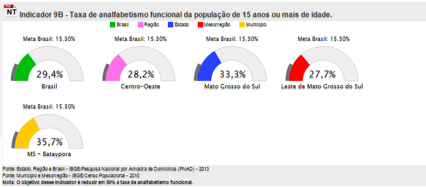

Diante do acima exposto, dos padrões mínimos exigidos para uma alfabetização satisfatória e visando contribuir para o cumprimento da meta, o município propõe as estratégias a seguir.

#### ESTRATÉGIAS DA META 9 { #estrategias-meta-9 }

9.1 Formular e implementar políticas de erradicação do analfabetismo, em parceria com instituições da sociedade civil organizada, empresas locais e outros até 2024;

9.2 realizar, chamadas públicas regulares para educação de jovens e adultos, em regime de colaboração entre as secretarias municipais e em parceria com organizações da sociedade civil;

9.3 realizar levantamento da população de jovens e adultos fora da escola, a partir dos 18 (dezoito) anos de idade, com vistas à implantação diversificada de políticas públicas, em parceria com órgãos competentes, na vigência deste PME;

9.4 assegurar a oferta gratuita da EJA a todos que não tiveram acesso à educação básica na idade própria, utilizando-se, também, da educação a distância, até 2024;

9.5 implementar ações de alfabetização de jovens e adultos, garantindo a continuidade da escolarização básica, a partir da vigência deste PME;

9.6 colaborar com os estudos e pesquisas sobre a população da EJA, em parceria com as IES públicas e fóruns de educação, para subsidiar as políticas para essa modalidade, a partir da vigência deste PME;

9.7 apoiar e acompanhar o programa nacional de transferência de renda para jovens e adultos que frequentarem regularmente as aulas e apresentarem rendimento escolar em cursos de alfabetização;

9.8 realizar exames específicos que permitam aferir o grau de alfabetização de jovens com mais de 15 (quinze) anos de idade, no ensino fundamental, e de 18 (dezoito), no ensino médio, com vistas à promoção de avanços ou nivelamento, a partir da vigência deste PME;

9.9 realizar formação continuada dos professores de EJA, incentivando a permanência desses profissionais nessa modalidade;

9.10 desenvolver e apoiar, técnica e financeiramente, projetos inovadores de EJA, com a utilização da educação à distância, que atendam às necessidades específicas desses estudantes, em parceria com instituições da sociedade civil organizada, na vigência do PME;

9.11 promover a articulação com empresas públicas e privadas para oferta das ações de alfabetização e programas permanentes de EJA nessas empresas, com o apoio das tecnologias de informação e comunicação e da educação a distância e a flexibilidade na oferta de acordo com o ritmo do estudante, no prazo de dois anos de vigência deste PME;

9.12 implementar, durante a vigência do PME, programas de capacitação tecnológica da população de jovens e adultos, direcionados para os segmentos com baixos níveis de escolarização formal;

9.13 propiciar a execução dos cursos de EJA em horários alternativos, ofertados pelos entes federados de acordo com a demanda local, de forma que os estudantes possam retomar e prosseguir os seus estudos;

9.14 exercer, continuamente, controle social e fiscalização sobre a qualidade dos cursos de EJA, por meio de avaliação institucional interna e externa;

9.15 estabelecer padrões mínimos de qualidade para os cursos de EJA, nas etapas do ensino fundamental e do ensino médio, no prazo de dois anos de vigência deste PME;

9.16 acompanhar e monitorar o acesso e a permanência dos jovens e adultos nos cursos de EJA, nas etapas do ensino fundamental e do ensino médio;

9.17 fomentar, na vigência do PME, o acesso dos estudantes de EJA ao ensino superior;

9.18 associar os recursos e metodologias da educação a distância, atendendo os padrões de qualidade e a legislação vigente, na oferta de cursos de EJA, a partir da vigência deste PME e,

9.19 promover cursos específicos em parceria com os entes federados para a oferta de formação para professores de EJA, incluindo a educação a distância;

### META 10 – EJA INTEGRADA À EDUCAÇÃO PROFISSIONAL { #meta-10 }

**Oferecer, no mínimo, 25% das matrículas de educação de jovens e adultos na forma integrada à educação profissional, nos ensinos fundamental e médio.**

#### ANÁLISE SITUACIONAL { #meta-10-analise }

A LDBEN Lei nº 9.394/96 define, no seu art. 1º, § 2º, que “a educação escolar deverá vincular-se ao mundo do trabalho e à prática social”. Essa educação “tem por finalidade o pleno desenvolvimento do educando, seu preparo para o exercício da cidadania e sua qualificação para o trabalho”, e apresenta como um de seus princípios a “vinculação entre a educação escolar, o trabalho e as práticas sociais” (art. 3º, inciso XI). Dessa Lei, Seção V,, intitulada “da Educação de Jovens e Adultos”, determina em seu art. 37, § 3º, que: “a educação de jovens e adultos deverá articular-se, preferencialmente, com a educação profissional”. Anteriormente a LDBEN Lei nº 9.394/96, a Constituição Federal de 1988, no art. 227, já mencionava “os direitos à educação, à saúde, e ao trabalho, \[...\] os direitos sociais à educação e à profissionalização”.

Segundo o PEE/MS (2014, p.69) um dos maiores desafios da modalidade EJA é sua enorme diversidade; sua área de atuação abarca desde a alfabetização de adultos até o ensino médio. Seu público prioritário inclui desde os idosos da zona rural aos jovens das pequenas e grandes cidades, as minorias étnico-raciais, as pessoas com deficiência e a população privada de liberdade.

O PEE/MS (*ibdem*) menciona que para suprir essa demanda, é necessário oferecer a essas populações programas integrados que garantam formação básica, qualificação profissional inicial e desenvolvimento de experiências de participação cidadã.

D1essa forma, o dilema sobre o papel da escola de formar para a cidadania e para o trabalho produtivo, provoca discussão sobre uma proposta curricular na perspectiva da formação integrada no sentido de superar a dicotomia trabalho manual/trabalho intelectual.

Essa discussão resultou na promulgação do Decreto n.º 5.154, de 23 de julho de 2004 sendo considerado o marco dessas discussões, prevendo que uma das formas de articulação entre a educação profissional técnica de nível médio e a educação básica fosse de forma integrada, contemplando formação geral e formação profissional unificadas.

Deste modo, com o Decreto nº 5.478/2005, foi instituída a modalidade PROEJA (Programa Nacional de Integração da Educação Profissional com a Educação Básica na Modalidade da Educação de Jovens e Adultos), substituído pelo Decreto nº 5.840, de 13 de julho de 2006, que introduz novas diretrizes que ampliam a abrangência do primeiro PROEJA a partir da inclusão da oferta de cursos de EJA para o público do ensino fundamental.

Neste contexto, é fundamental saber como acontece essa integração, seja na seleção e na organização curricular, no projeto pedagógico ou nos processos educativos.

Para Ciavatta (2005), a ideia de formação integrada sugere superar o ser humano dividido historicamente pela divisão social do trabalho, entre a ação de executar e a ação de pensar, dirigir ou planejar. Assegura a autora que a formação humana perpassa por:

\[...\] garantir ao adolescente, ao jovem e ao adulto trabalhador o direito a uma formação completa para a leitura do mundo e para a atuação como cidadão pertencente a um país, integrado dignamente à sua sociedade política. Formação que nesse sentido, supõe a compreensão das relações sociais subjacentes a todos os fenômenos (CIAVATTA, 2005, p.85).

De acordo com o pensamento da autora, a educação integrada com vista à formação completa do cidadão, vem ao encontro da proposta do programa PROEJA, o qual em Mato Grosso do Sul, de acordo com o PEE (2014), é ofertado desde o ano de 2008 na rede estadual de ensino (REE) e, desde 2010, na rede federal de ensino (RFE), concentrados no município de Campo Grande, com os cursos Técnicos em Comércio, Eventos e Eletrônica, atendendo um percentual de 2,4, incluindo o Projovem Urbano.

Com base neste quantitativo fica evidente a insuficiência de investimentos nessa política, o que justifica a ausência de oferta da modalidade específica no município. Mas tendo em vista a duração deste plano, são estabelecidas algumas estratégias para colaborar com o cumprimento da meta proposta em nível nacional, bem como efetivar algumas ações que sejam passíveis de atendimento no município.

#### ESTRATÉGIAS META 10 { #estrategias-meta-10 }

10.1 Executar os programas ofertados pelos entes federados na modalidade de educação de jovens e adultos do ensino fundamental, oferecendo no mesmo espaço, a formação profissional inicial, com estímulo à conclusão dessa etapa, em parceria com a comunidade local e instituições que atuam no mundo do trabalho, a partir da vigência deste PME;

10.2 oportunizar o acesso as iniciativas oriundas das esferas governamentais para as matrículas da educação de jovens e adultos com a educação profissional, em cursos planejados, inclusive na modalidade educação à distância, de acordo com as características do público da educação de jovens e adultos e considerando as especificidades das populações itinerantes e do campo;

10.3 participar da formação inicial de docentes para atuação nos cursos de EJA integrada à educação profissional, na vigência do PME;

10.4 participar dos cursos presenciais e à distância de formação continuada aos docentes que atuam na educação de jovens e adultos integrada à educação profissional, a partir dos cursos ofertados pelos entes federados;

10.5 prover as escolas que oferecem EJA com condições materiais, infraestrutura adequada e recursos financeiros, oriundos dos programas específicos, até o término da vigência do PME e,

10.6 proporcionar o transporte escolar para os jovens e adultos que frequentem a educação de jovens e adultos, integrada a educação profissional em instituições que ofereçam essa modalidade, tanto em âmbito municipal para os alunos do campo e intermunicipal.

### META 11 – EDUCAÇÃO PROFISSIONAL TÉCNICA DE NÍVEL MÉDIO { #meta-11 }

**Triplicar as matrículas da educação profissional técnica de nível médio, assegurando a qualidade da oferta e pelo menos 50% da expansão no segmento público.**

#### ANÁLISE SITUACIONAL { #meta-11-analise }

Segundo as diretrizes curriculares nacionais da educação básica (2013, p.206) a evolução tecnológica e as lutas sociais têm modificado as relações no mundo do trabalho. Devido a essas tensões, atualmente, não se admite mais a existência de trabalhadores que desempenhem apenas tarefas mecânicas. O uso das tecnologias de comunicação e da informação tem transformado o trabalho em algo menos sólido. Já convivemos com diversas formas de trabalhos, feitos em rede, feitos em casa, com ou sem carteira assinada e trabalho no mundo virtual. Vivenciamos também, a valorização de profissões que não geram produtos industriais, tais como artes, saúde, comunicação, educação e lazer.

Na sociedade contemporânea, as transformações no mundo do trabalho e o avanço tecnológico são muito rápidos, demandando uma educação voltada para o desenvolvimento humano, cultural, científico, e também profissional, de modo que adquiram condições para enfrentar as exigências do mercado de trabalho.

Assim espera-se que o mundo do trabalho avance na direção de relações trabalhistas mais justas e com maior qualificação. Para tanto, a LDBEN Lei nº 9.394/96, especificamente em seus art. 39 a 42 e o art. 22 da Constituição Federal, consagram a educação profissional e tecnológica entre os níveis e as modalidades de educação e ensino, situando-a na confluência de dois dos direitos fundamentais do cidadão: o direito à educação e o direito ao trabalho, garantidos no art. 227 da Constituição Federal como direito à profissionalização, a ser garantido com absoluta prioridade.

Em Mato Grosso do Sul, como cita o PEE/MS (2014, p. 74) a oferta da educação profissional técnica de nível médio se dá na rede estadual de ensino (REE), no Instituto Federal de Mato Grosso do Sul (IFMS), e, através do Serviço Nacional de Aprendizagem Industrial (SENAI) e do Serviço Nacional de Aprendizagem Comercial (SENAC), bem como em algumas instituições da iniciativa privada.

Cabe ressaltar que a realidade quando vista sob a ótica dos pequenos municípios, essa oferta se torna ainda mais restrita ou inexistente. Culminando com essa situação, o município de Batayporã encontra-se aquém ao esperado pela meta proposta, haja vista que não há oferta desta modalidade no município, e a aplicabilidade da mesma só ocorrerá diante de parcerias com os entes federados. Atualmente esse atendimento ocorre no polo de Nova Andradina, no campus do IFMS (Instituto Federal de Mato Grosso do Sul), com os cursos Técnicos, em informática e agropecuária.

Para atingir esse objetivo no município, há que se organizar políticas públicas, voltadas a um currículo escolar com perspectiva de superação das técnicas isoladas e minimizadas de uma visão ideológica e funcional à produção na escala do conhecimento. Deste modo com o propósito de atingir a meta proposta até o final da vigência deste plano, o município propõe as estratégias abaixo elencadas.

#### ESTRATÉGIAS DA META 11 { #estrategias-meta-11 }

11.1. Utilizar das parcerias estabelecidas pelos entes federados de ensino para o desenvolvimento da educação profissional técnica de nível médio, com vistas à ofertar matrículas, a partir do primeiro ano de vigência deste PME;

11.2. solicitar aos entes federados a oferta da educação profissional técnica de nível médio na rede pública estadual de ensino, por meio de cursos voltados às demandas municipais, a partir da vigência do PME;

11.3 solicitar aos entes federados a oferta de cursos de educação profissional técnica de nível médio, na modalidade educação à distância, com a finalidade de ofertar e democratizar o acesso à educação profissional pública e gratuita, com padrão de qualidade, a partir do primeiro ano de vigência deste PME;

11.4. apoiar a expansão do estágio na educação profissional técnica de nível médio, preservando-se seu caráter pedagógico integrado ao itinerário formativo do(a) estudante, visando à formação de qualificações próprias da atividade profissional, à contextualização curricular e ao desenvolvimento da juventude, na vigência do PME;

11.5 implantar programa de avaliação da qualidade da educação profissional técnica de nível médio nas instituições integrantes do Sistema Estadual de Ensino, quando houver implantação deste no município;

11.6 oferecer, caso haja oferta, pelos entes federados de cursos de ensino médio gratuito integrado à educação profissional para as populações do campo, e educação especial, por meio de projetos específicos, incluindo a educação à distância, com vistas a atender os interesses e as necessidades dessas populações;

11.7 apoiar os programas da união de assistência estudantil, para os estudantes residentes no município que se deslocam para os polos regionais, para sua permanência e a conclusão de cursos de educação profissional técnica de nível médio, a partir do primeiro ano de vigência do PME e,

11.8 propiciar o deslocamento aos polos regionais por meio de transporte escolar, a partir do primeiro ano de vigência do PME.

### METAS 12, 13 e 14 – EDUCAÇÃO SUPERIOR { #metas-12-13-14 }

**Meta 12: Elevar a taxa bruta de matrícula na educação superior para 50% e a taxa líquida para 33% da população de 18 a 24 anos, assegurada a qualidade da oferta e expansão para, pelo menos, 40% das novas matrículas, no segmento público.**

**Meta 13: Elevar a qualidade da educação superior pela ampliação da proporção de mestres e doutores do corpo docente em efetivo exercício no conjunto do sistema de educação superior para 75%, sendo, do total, no mínimo, 35% doutores.**

**Meta 14: Elevar gradualmente o número de matrículas na pós-graduação *stricto sensu*, de modo a atingir a titulação anual de 60.000 mestres e 25.000 doutores.**

#### ANÁLISE SITUACIONAL { #metas-12-13-14-analise }

A educação superior caracteriza-se como um dos níveis da educação formal brasileira, a qual é regulamentada pela Constituição Federal de 1988 e pela LDBEN 9.394/96 em seu artigo 8° que define responsabilidades da União, dos Estados, do Distrito Federal e dos Municípios.

De acordo com o PEE/MS (2014, p. 79), é na Constituição Federal de 1988 que a educação superior no Brasil, ofertada nas universidades tem destaque. Por meio da luta dos educadores e da sociedade, fica garantido a todos os brasileiros, na forma da lei, o acesso a todos os níveis de ensino e, em especial, à educação superior, para a produção de conhecimento científico.

Dessa forma, a partir de 1995, a expansão de vagas ocorre com mais veemência e tem como característica principal a interiorização, visando ofertar a um número maior de pessoas uma diversidade de cursos, presenciais e a distância, com os cuidados de incorporar as peculiaridades de cada região, assim como diminuir as desigualdades de oferta existentes no País.

Em Mato Grosso do Sul, como citado no PEE (2014), houve expansão no número de instituições de educação superior no estado, tanto públicas quanto privadas, com destaque para a abertura de novos campi de instituições públicas no interior.

Quadro 01 com as Instituições Públicas de Educação Superior do Estado de Mato Grosso do Sul, número de cursos, vagas e localização em 2013.

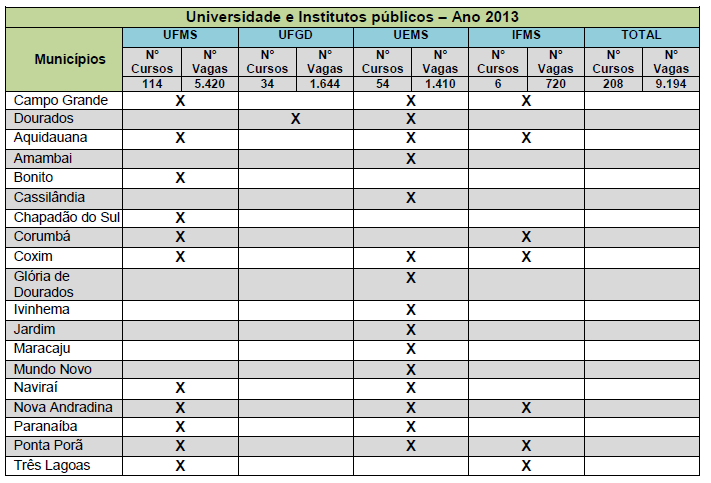

Fonte: PEE/MS (2014, *apud*. INEP/MEC. 2014)

Quadro 2 - Distribuição de Faculdades e Institutos de Educação Superior, privadas, por município, número de cursos e vagas ofertados em Mato Grosso do Sul - 2013.

<table>
<colgroup>
<col style="width: 27%" />
<col style="width: 24%" />
<col style="width: 23%" />
<col style="width: 24%" />
</colgroup>
<tbody>
<tr>
<td><strong>Instituição</strong></td>
<td><strong>Unidade/Cidades</strong></td>
<td><strong>Nº de cursos</strong></td>
<td><strong>Nº de vagas</strong></td>
</tr>
<tr>
<td>Universitário da Grande Dourados (UNIGRAN)</td>
<td>Dourados</td>
<td>33</td>
<td>595</td>
</tr>
<tr>
<td>Faculdade Campo Grande (FCG)</td>
<td>Campo Grande</td>
<td>28</td>
<td>3.300</td>
</tr>
<tr>
<td>Faculdade de Administração de Chapadão do Sul (FACHASUL)</td>
<td>Chapadão do Sul</td>
<td>2</td>
<td>200</td>
</tr>
<tr>
<td>Faculdade de Administração de Fátima do Sul (FAFS)</td>
<td>Fátima do Sul</td>
<td>4</td>
<td>640</td>
</tr>
<tr>
<td>Faculdade de Administração de Nova Andradina (FANA)</td>
<td>Nova Andradina</td>
<td>1</td>
<td>125</td>
</tr>
<tr>
<td>Faculdade de Administração de Nova Andradina – FANOVA</td>
<td>Nova Andradina</td>
<td>2</td>
<td>200</td>
</tr>
<tr>
<td>Faculdade de Amambai (FIAMA)</td>
<td>Amambaí</td>
<td>3</td>
<td>300</td>
</tr>
<tr>
<td>Faculdade de Ciências Contábeis de Naviraí (FACINAV)</td>
<td>Naviraí</td>
<td>1</td>
<td>60</td>
</tr>
<tr>
<td>Faculdade de Ciências Contábeis de Nova Andradina – FACINAN (FACINAN)</td>
<td>Nova Andradina</td>
<td>3</td>
<td>400</td>
</tr>
<tr>
<td>Faculdade de Educação de Nova Andradina (FENA)</td>
<td>Nova Andradina</td>
<td>1</td>
<td>100</td>
</tr>
<tr>
<td>Faculdade de Letras de Nova Andradina (FALENA)</td>
<td>Nova Andradina</td>
<td colspan="2">Nenhum curso registrado</td>
</tr>
<tr>
<td>Faculdade de Pedagogia (ANAEC)</td>
<td>Nova Andradina</td>
<td>1</td>
<td>150</td>
</tr>
<tr>
<td>Faculdade de Ponta Porã (FAP)</td>
<td>Ponta Porã</td>
<td>5</td>
<td>380</td>
</tr>
<tr>
<td>Faculdade de Selvíria (FAZ)</td>
<td>Selvíria</td>
<td>3</td>
<td>300</td>
</tr>
<tr>
<td>Faculdade de Tecnologia de Nova Andradina</td>
<td>Nova Andradina</td>
<td>3</td>
<td>250</td>
</tr>
<tr>
<td>Faculdade de Tecnologia de Ponta Porã (FATEP)</td>
<td>Ponta Porã</td>
<td>1</td>
<td>100</td>
</tr>
<tr>
<td>Faculdade de Tecnologia SENAI Campo Grande</td>
<td>Campo Grande</td>
<td>3</td>
<td>120</td>
</tr>
<tr>
<td>Faculdade de Turismo de Nova Andradina (FATUR)</td>
<td>Nova Andradina</td>
<td colspan="2">Nenhum registro encontrado</td>
</tr>
<tr>
<td>Faculdade Mato Grosso do Sul (FACSUL)</td>
<td>Campo Grande</td>
<td>19</td>
<td>2.500</td>
</tr>
<tr>
<td>Faculdade Salesiana de Santa Teresa (FSST)</td>
<td>Corumbá</td>
<td>6</td>
<td>410</td>
</tr>
<tr>
<td>Faculdades Integradas de Naviraí (FINAV)</td>
<td>Naviraí</td>
<td>4</td>
<td>443</td>
</tr>
<tr>
<td>Faculdades Integradas de Paranaíba (FIPAR)</td>
<td>Paranaíba</td>
<td>7</td>
<td>860</td>
</tr>
<tr>
<td>Faculdades Integradas de Ponta Porã (FIP)</td>
<td>Ponta Porã</td>
<td>4</td>
<td>300</td>
</tr>
<tr>
<td>Faculdades Integradas de Três Lagoas (AEMS)</td>
<td>Três Lagoas</td>
<td>42</td>
<td>6.140</td>
</tr>
<tr>
<td>Faculdades MAGSUL (FAMAG)</td>
<td>Ponta Porã</td>
<td>5</td>
<td>340</td>
</tr>
<tr>
<td>Faculdade Teológica Batista Ana Wollerman (FTBAW)</td>
<td>Dourados</td>
<td>1</td>
<td>100</td>
</tr>
<tr>
<td>Faculdade UNIGRAN Capital (UNIGRAN Capital)</td>
<td>Campo Grande</td>
<td>11</td>
<td>1.520</td>
</tr>
<tr>
<td>Instituto de Ensino Superior da FUNLEC (IESF)</td>
<td>Campo Grande</td>
<td>7</td>
<td>820</td>
</tr>
<tr>
<td>Instituto de Ensino Superior da FUNLEC (IESF)</td>
<td>Bonito</td>
<td>2</td>
<td>150</td>
</tr>
<tr>
<td>Universidade Católica Dom Bosco (UCDB)</td>
<td>Campo Grande</td>
<td>46</td>
<td>6.690</td>
</tr>
<tr>
<td>Faculdade Anhangüera de Dourados (FAD)</td>
<td>Dourados</td>
<td>9</td>
<td>1.530</td>
</tr>
<tr>
<td>Faculdade Superior de Ribas do Rio Pardo (FASURP)</td>
<td>Ribas do Rio Pardo</td>
<td>1</td>
<td>160</td>
</tr>
<tr>
<td>Faculdades Integradas de Cassilândia (FIC)</td>
<td>Cassilândia</td>
<td>8</td>
<td>648</td>
</tr>
<tr>
<td>Faculdade de Educação de Costa Rica (FECRA)</td>
<td>Costa Rica</td>
<td>3</td>
<td>320</td>
</tr>
<tr>
<td>Centro Universitário Anhanguera de Campo Grande</td>
<td>Campo Grande</td>
<td>28</td>
<td>4.680</td>
</tr>
<tr>
<td>Faculdades Integradas de Rio Verde (FIRVE)</td>
<td>Rio Verde</td>
<td>1</td>
<td>70</td>
</tr>
<tr>
<td>Faculdade Estácio de Sá de Campo Grande (FESCG)</td>
<td>Campo Grande</td>
<td>22</td>
<td>2.580</td>
</tr>
<tr>
<td>Universidade Anhanguera - UNIDERP</td>
<td>Campo Grande</td>
<td>55</td>
<td>239.435</td>
</tr>
<tr>
<td colspan="2"><strong>Total Geral</strong></td>
<td>375</td>
<td>276.916</td>
</tr>
</tbody>
</table>

Fonte: PEE (2014, *apud*. INEP/MEC. 2014)

Batayporã apresenta um bom desenvolvimento na educação básica, o que demonstra que o poder público investe nesta etapa da educação. Estima-se que o desenvolvimento educacional e cultural reflete a preocupação com a qualidade de vida dos cidadãos batayporaenses. Prosseguimento de estudos é fundamental para a consolidação da mobilidade social e, por conseguinte, a melhoria da vida dos nossos cidadãos. Partindo desta visão, o ensino superior pode contribuir com o desenvolvimento deste município. Portanto, o poder público deve ter a preocupação em desenvolver estratégias de incentivar as Instituições de Ensino Superior (IES), observando a contribuição que as mesmas oferecem à formação profissional de qualidade, com vistas à inserção do cidadão no mercado de trabalho, bem como estimulam a formação crítica, tornando o cidadão capaz de discernir com maior independência as informações que dizem respeito aos seus interesses, direitos e deveres, sejam eles individuais ou políticos.

Registra-se que, mesmo que o município não oferte o ensino superior, boa parte de sua população em idade adequada procura dar prosseguimento aos estudos em cidades circunvizinhas. Parte desta demanda vem sendo assistida especialmente na cidade de Nova Andradina, pela proximidade entre os municípios, bem como pelo fato desta vir se consolidando como polo estudantil, contando com instituições públicas e privadas, nas modalidades presenciais e à distância. Além destes, parte da demanda se desloca para outras localidades, dentro e fora do estado.

Neste contexto, os munícipes e o poder público, necessitam conscientizar-se de seus respectivos papéis, na busca por investimentos para implantação, fortalecimento e permanência no ensino superior.

Visando colaborar com os cumprimentos das metas 12, 13, e 14, propõe as estratégias a seguir.

#### ESTRATÉGIAS DA META 12 { #estrategias-meta-12 }

12.1 Colaborar com as agências fomentadoras e financiadoras de pesquisa, o mapeamento da demanda de formação de pessoal de nível superior, prioritariamente para a formação de professores(as) para a educação básica, sobretudo nas áreas com déficit de profissionais em áreas específicas;

12.2 divulgar o Fundo de Financiamento ao Estudante da Educação Superior (FIES) nas escolas de educação básica que ofertam a etapa do ensino médio regular e ou EJA, na vigência do PME;

12.3 incentivar parcerias com instituições públicas e privadas para a oferta de estágio curricular, como parte integrante da formação na educação superior;

12.4 incentivar a participação proporcional de grupos historicamente desfavorecidos na educação superior, inclusive mediante a adoção de políticas afirmativas, na forma da lei;

12.5 divulgar programas e ações de incentivo à mobilidade estudantil e docente em cursos de graduação e pós-graduação, em âmbito local, nacional e internacional, tendo em vista o aprimoramento da formação de nível superior, a partir da vigência do PME;

12.6 colaborar com as agências fomentadoras e financiadoras de pesquisa, o mapeamento da demanda de formação de pessoal de nível superior, destacadamente no que se refere à formação nas áreas de ciências e matemática, considerando as necessidades do desenvolvimento regional e nacional, a inovação tecnológica e a melhoria da qualidade da educação básica, a partir da vigência deste PME;

12.7 buscar parcerias visando fortalecer políticas públicas para a expansão da oferta da educação à distância, junto à Universidade Aberta do Brasil (UAB) e Institutos Federais nos municípios do estado, de acordo com a sua especificidade;

12.8 aderir às políticas educacionais para oferta de cursos tecnológicos em instituições públicas sediadas em municípios de pequeno porte, a partir da vigência do PME;

12.9 apoiar junto as IES públicas, a criação de curso de Pedagogia bilíngue para atendimento de surdos e de indígenas, a partir da vigência deste PME e,

12.10 fornecer transporte escolar para os estudantes de nível superior num raio de até 300 km de distância de Batayporã, com itinerário de ida e volta, considerando a oferta dos cursos existentes nos municípios mais próximos.

#### ESTRATÉGIAS DA META 13 { #estrategias-meta-13 }

13.1 Estimular a participação de estudantes no Exame Nacional de Desempenho de Estudantes (ENADE).

#### ESTRATÉGIAS DA META 14 { #estrategias-meta-14 }

14.1 Estimular a participação das mulheres nos cursos de pós-graduação *stricto sensu*, em particular aqueles ligados às áreas de Engenharia, Matemática, Física, Química, Informática e outros no campo das ciências;

14.2 participar das políticas de promoção e financiamento de intercâmbio científico e tecnológico, nacional e internacional, entre as instituições de ensino, pesquisa e extensão do estado com as demais instituições brasileiras e estrangeiras, na vigência do PME;

14.3 enfatizar e colaborar com as iniciativas de pesquisa no que for solicitado ao município e,

14.4 incentivar, adequando o PCCR, a matrícula nos cursos de pós graduação *stricto sensu*, de modo a elevar o índice de mestres e doutores, contribuindo com a meta nacional, na vigência do PME.

### METAS 15, 16, 17 e 18 VALORIZAÇÃO DOS PROFISSIONAIS DO MAGISTÉRIO { #metas-15-16-17-18 }

**Meta 15: garantir, em regime de colaboração entre a entre a União, os estados, o Distrito Federal e os municípios, no prazo de um ano de vigência deste PME, política nacional de formação dos profissionais da educação de que tratam os incisos I, II e III do *caput* do art. 61 da Lei nº 9.394, de 20 de dezembro de 1996, assegurado que todos(as) os(as) professores(as) da educação básica possuam formação específica de nível superior, obtida em curso de licenciatura na área de conhecimento em que atuam.**

**Meta 16: formar, em nível de pós-graduação, 80% dos(as) professores(as) da educação básica, até o último ano de vigência deste PME, e garantir a todos(as) os(as) profissionais da educação básica formação continuada em sua área de atuação, considerando as necessidades, demandas e contextualizações dos sistemas de ensino.**

**Meta 17: valorizar os(as) profissionais do magistério das redes públicas de educação básica de forma a equiparar seu rendimento médio ao dos(as) demais profissionais com escolaridade equivalente, até o final do sexto ano de vigência deste PME.**

**Meta 18: assegurar, no prazo de dois anos, a existência de Planos de Carreira para os(as) profissionais da educação básica e superior pública e, para o Plano de Carreira dos(as) profissionais da educação básica pública, tomar como referência o piso salarial nacional profissional, definido em Lei federal, nos termos do inciso VIII do art. 206 da Constituição Federal.**

#### ANÁLISE SITUACIONAL { #metas-15-16-17-18-analise }

Conforme promulgou a Lei nº 12.014, de 6 de agosto de 2009, em seu art. 61, consideram-se profissionais da educação escolar básica os que, nela estando em efetivo exercício e tendo sido formados em cursos reconhecidos, são:

I - professores habilitados em nível médio ou superior para a docência na educação infantil e nos ensinos fundamental e médio;

II - trabalhadores em educação portadores de diploma de pedagogia, com habilitação em administração, planejamento, supervisão, inspeção e orientação educacional, bem como com títulos de mestrado ou doutorado nas mesmas áreas e,

III - trabalhadores em educação, portadores de diploma de curso técnico ou superior em área pedagógica ou afim.

Tendo como base o que versa a lei ora citada, três eixos principais emergem como alicerçadores deste diagnóstico:

a) Formação de profissionais da educação (Metas 15 e 16);

b) condições de trabalho e valorização profissional (Meta 17) e,

c) carreira, salário e remuneração (Meta 18).

No que tange a formação de professores, segundo o PEE-MS (2014, p. 91) esta deve ser acessível, sólida, versátil, de qualidade, específica e articulada as demandas profissionais, com formação continuada periódica e autonomia para a atuação profissional, além de recursos suficientes para o bom desempenho do trabalho**.** A LDBEN Lei nº 9.394/96, em seu artigo 62, estabelece que o professor seja habilitado em nível de licenciatura, como pré-requisito mínimo, ao desempenho da atividade docente.

Sob este aspecto, o quadro abaixo, revela o panorama do corpo docente em efetivo trabalho neste município.

Quadro 01: Porcentagem de professores da Educação Básica com curso superior

<table style="width:100%;">
<colgroup>
<col style="width: 11%" />
<col style="width: 15%" />
<col style="width: 10%" />
<col style="width: 20%" />
<col style="width: 10%" />
<col style="width: 18%" />
<col style="width: 12%" />
</colgroup>
<tbody>
<tr>
<td style="text-align: center;"><strong>Ano</strong></td>
<td colspan="2" style="text-align: center;"><strong>Com superior</strong></td>
<td colspan="2" style="text-align: center;"><strong>Sem licenciatura</strong></td>
<td colspan="2" style="text-align: center;"><strong>Com licenciatura</strong></td>
</tr>
<tr>
<td style="text-align: center;"><strong>2007</strong></td>
<td style="text-align: center;">80,7%</td>
<td style="text-align: center;">109</td>
<td style="text-align: center;">3%</td>
<td style="text-align: center;">4</td>
<td style="text-align: center;">77,8%</td>
<td style="text-align: center;">105</td>
</tr>
<tr>
<td style="text-align: center;"><strong>2008</strong></td>
<td style="text-align: center;">91,9%</td>
<td style="text-align: center;">125</td>
<td style="text-align: center;">1,5%</td>
<td style="text-align: center;">2</td>
<td style="text-align: center;">90,4%</td>
<td style="text-align: center;">123</td>
</tr>
<tr>
<td style="text-align: center;"><strong>2009</strong></td>
<td style="text-align: center;">89,2%</td>
<td style="text-align: center;">116</td>
<td style="text-align: center;">0,8%</td>
<td style="text-align: center;">1</td>
<td style="text-align: center;">88,5%</td>
<td style="text-align: center;">115</td>
</tr>
<tr>
<td style="text-align: center;"><strong>2010</strong></td>
<td style="text-align: center;">90,9%</td>
<td style="text-align: center;">120</td>
<td style="text-align: center;">1,5%</td>
<td style="text-align: center;">2</td>
<td style="text-align: center;">89,4%</td>
<td style="text-align: center;">118</td>
</tr>
<tr>
<td style="text-align: center;"><strong>2011</strong></td>
<td style="text-align: center;">91,2%</td>
<td style="text-align: center;">125</td>
<td style="text-align: center;">0,7%</td>
<td style="text-align: center;">1</td>
<td style="text-align: center;">90,5%</td>
<td style="text-align: center;">124</td>
</tr>
<tr>
<td style="text-align: center;"><strong>2012</strong></td>
<td style="text-align: center;">95,9%</td>
<td style="text-align: center;">117</td>
<td style="text-align: center;">2,5%</td>
<td style="text-align: center;">3</td>
<td style="text-align: center;">93,4%</td>
<td style="text-align: center;">114</td>
</tr>
<tr>
<td style="text-align: center;"><strong>2013</strong></td>
<td style="text-align: center;">95,8%</td>
<td style="text-align: center;">137</td>
<td style="text-align: center;">2,8%</td>
<td style="text-align: center;">4</td>
<td style="text-align: center;">93%</td>
<td style="text-align: center;">133</td>
</tr>
</tbody>
</table>

Fonte: [http://www.observatoriodopne.org.br](http://www.observatoriodopne.org.br/)

Analisando os dados demonstrados no quadro anterior, o município de Batayporã, conta com um número relevante de professores da educação básica com formação em nível superior. Porém, destes há uma grande parcela de profissionais que possuem formação diversa a sua atuação, conforme demonstram os quadros 2 e 3.

Em análise dos dados estatísticos do município, percebe-se um grande percentual de professores da educação básica com formação em nível superior. Destes, porém, muitos com formação diversa à sua área de atuação, como mostram os quadros a seguir, que tem por base os quantitativos de professores atuantes nos anos finais do ensino fundamental e no ensino médio.

Quadro 2: Porcentagem de professores dos anos finais do Ensino Fundamental que possuem licenciatura na área em que atuam

<table style="width:92%;">
<colgroup>
<col style="width: 6%" />
<col style="width: 7%" />
<col style="width: 4%" />
<col style="width: 9%" />
<col style="width: 5%" />
<col style="width: 11%" />
<col style="width: 6%" />
<col style="width: 24%" />
<col style="width: 13%" />
</colgroup>
<tbody>
<tr>
<td style="text-align: center;"><strong>Ano</strong></td>
<td colspan="2" style="text-align: center;"><strong>Total</strong></td>
<td colspan="2" style="text-align: center;"><strong>Com superior</strong></td>
<td colspan="2" style="text-align: center;"><strong>Com licenciatura</strong></td>
<td colspan="2" style="text-align: center;"><strong>Com licenciatura na área em que atua</strong></td>
</tr>
<tr>
<td style="text-align: center;"><strong>2009</strong></td>
<td style="text-align: center;">100%</td>
<td style="text-align: center;">47</td>
<td style="text-align: center;">87,2%</td>
<td style="text-align: center;">41</td>
<td style="text-align: center;">29,8%</td>
<td style="text-align: center;">14</td>
<td style="text-align: center;">4,3%</td>
<td style="text-align: center;">2</td>
</tr>
<tr>
<td style="text-align: center;"><strong>2010</strong></td>
<td style="text-align: center;">100%</td>
<td style="text-align: center;">55</td>
<td style="text-align: center;">94,5%</td>
<td style="text-align: center;">52</td>
<td style="text-align: center;">50,9%</td>
<td style="text-align: center;">28</td>
<td style="text-align: center;">3,6%</td>
<td style="text-align: center;">2</td>
</tr>
<tr>
<td style="text-align: center;"><strong>2011</strong></td>
<td style="text-align: center;">100%</td>
<td style="text-align: center;">80</td>
<td style="text-align: center;">98,8%</td>
<td style="text-align: center;">79</td>
<td style="text-align: center;">97,5%</td>
<td style="text-align: center;">78</td>
<td style="text-align: center;">40%</td>
<td style="text-align: center;">32</td>
</tr>
<tr>
<td style="text-align: center;"><strong>2012</strong></td>
<td style="text-align: center;">100%</td>
<td style="text-align: center;">47</td>
<td style="text-align: center;">100%</td>
<td style="text-align: center;">47</td>
<td style="text-align: center;">95,7%</td>
<td style="text-align: center;">45</td>
<td style="text-align: center;">61,7%</td>
<td style="text-align: center;">29</td>
</tr>
<tr>
<td style="text-align: center;"><strong>2013</strong></td>
<td style="text-align: center;">100%</td>
<td style="text-align: center;">49</td>
<td style="text-align: center;">100%</td>
<td style="text-align: center;">49</td>
<td style="text-align: center;">95,9%</td>
<td style="text-align: center;">47</td>
<td style="text-align: center;">63,3%</td>
<td style="text-align: center;">31</td>
</tr>
</tbody>
</table>

Fonte: <http://www.observatoriodopne.org.br/>

Quadro 3: Porcentagem de professores do Ensino Médio que possuem licenciatura na área em que atuam

<table style="width:92%;">
<colgroup>
<col style="width: 6%" />
<col style="width: 7%" />
<col style="width: 4%" />
<col style="width: 9%" />
<col style="width: 5%" />
<col style="width: 11%" />
<col style="width: 6%" />
<col style="width: 24%" />
<col style="width: 13%" />
</colgroup>
<tbody>
<tr>
<td style="text-align: center;"><strong>Ano</strong></td>
<td colspan="2" style="text-align: center;"><strong>Total</strong></td>
<td colspan="2" style="text-align: center;"><strong>Com superior</strong></td>
<td colspan="2" style="text-align: center;"><strong>Com licenciatura</strong></td>
<td colspan="2" style="text-align: center;"><strong>Com licenciatura na área em que atua</strong></td>
</tr>
<tr>
<td style="text-align: center;"><strong>2009</strong></td>
<td style="text-align: center;">100%</td>
<td style="text-align: center;">23</td>
<td style="text-align: center;">100%</td>
<td style="text-align: center;">23</td>
<td style="text-align: center;">34,8%</td>
<td style="text-align: center;">8</td>
<td style="text-align: center;">17,4%</td>
<td style="text-align: center;">4</td>
</tr>
<tr>
<td style="text-align: center;"><strong>2010</strong></td>
<td style="text-align: center;">100%</td>
<td style="text-align: center;">29</td>
<td style="text-align: center;">100%</td>
<td style="text-align: center;">29</td>
<td style="text-align: center;">34,5%</td>
<td style="text-align: center;">10</td>
<td style="text-align: center;">10,3%</td>
<td style="text-align: center;">3</td>
</tr>
<tr>
<td style="text-align: center;"><strong>2011</strong></td>
<td style="text-align: center;">100%</td>
<td style="text-align: center;">37</td>
<td style="text-align: center;">100%</td>
<td style="text-align: center;">37</td>
<td style="text-align: center;">97,3%</td>
<td style="text-align: center;">36</td>
<td style="text-align: center;">51,4%</td>
<td style="text-align: center;">19</td>
</tr>
<tr>
<td style="text-align: center;"><strong>2012</strong></td>
<td style="text-align: center;">100%</td>
<td style="text-align: center;">35</td>
<td style="text-align: center;">100%</td>
<td style="text-align: center;">35</td>
<td style="text-align: center;">97,1%</td>
<td style="text-align: center;">34</td>
<td style="text-align: center;">62,9%</td>
<td style="text-align: center;">22</td>
</tr>
<tr>
<td style="text-align: center;"><strong>2013</strong></td>
<td style="text-align: center;">100%</td>
<td style="text-align: center;">34</td>
<td style="text-align: center;">100%</td>
<td style="text-align: center;">34</td>
<td style="text-align: center;">88,2%</td>
<td style="text-align: center;">30</td>
<td style="text-align: center;">61,8%</td>
<td style="text-align: center;">21</td>
</tr>
</tbody>
</table>

Fonte: <http://www.observatoriodopne.org.br/>

Portanto, ao estabelecer uma comparação entre os profissionais com habilitação na área de atuação do ensino fundamental e ensino médio, detecta-se maior porcentagem de profissionais que atuam no ensino médio sem formação na área.

Segundo a LDBEN Lei nº 9.394/96, art. 44, § 3º a educação superior também compreende os programas de mestrado e doutorado, cursos de especialização, aperfeiçoamento e outros, abertos a candidatos diplomados em cursos de graduação e que atendam às exigências das instituições de ensino. Assim, a realidade local, indica que pouco mais da metade do quantitativo total de professores atuantes no município, nas redes estadual e municipal, são titulados especialistas, o que motivou a alteração da meta proposta pelo PEE- MS de 60% (sessenta por cento) para 80% (oitenta por cento).

**Quadro 4: Porcentagem de professores da Educação Básica com Pós-Graduação**

**Tipo de pós-graduação**
{ .centro }

<table style="width:96%;">
<colgroup>
<col style="width: 13%" />
<col style="width: 10%" />
<col style="width: 3%" />
<col style="width: 13%" />
<col style="width: 6%" />
<col style="width: 6%" />
<col style="width: 13%" />
<col style="width: 3%" />
<col style="width: 10%" />
<col style="width: 13%" />
</colgroup>
<tbody>
<tr>
<td colspan="2">Ano</td>
<td colspan="3">Especialização</td>
<td colspan="3">Mestrado</td>
<td colspan="2">Doutorado</td>
</tr>
<tr>
<td style="text-align: center;"><strong>2007</strong></td>
<td colspan="2">41,5%</td>
<td>56</td>
<td colspan="2">0%</td>
<td>0</td>
<td colspan="2">0%</td>
<td>0</td>
</tr>
<tr>
<td style="text-align: center;"><strong>2008</strong></td>
<td colspan="2">66,9%</td>
<td>91</td>
<td colspan="2">1,5%</td>
<td>2</td>
<td colspan="2">0%</td>
<td>0</td>
</tr>
<tr>
<td style="text-align: center;"><strong>2009</strong></td>
<td colspan="2">60%</td>
<td>78</td>
<td colspan="2">0%</td>
<td>0</td>
<td colspan="2">0%</td>
<td>0</td>
</tr>
<tr>
<td style="text-align: center;"><strong>2010</strong></td>
<td colspan="2">53,8%</td>
<td>71</td>
<td colspan="2">0,8%</td>
<td>1</td>
<td colspan="2">0%</td>
<td>0</td>
</tr>
<tr>
<td style="text-align: center;"><strong>2011</strong></td>
<td colspan="2">51,1%</td>
<td>70</td>
<td colspan="2">1,5%</td>
<td>2</td>
<td colspan="2">0%</td>
<td>0</td>
</tr>
<tr>
<td style="text-align: center;"><strong>2012</strong></td>
<td colspan="2">58,2%</td>
<td>71</td>
<td colspan="2">0,8%</td>
<td>1</td>
<td colspan="2">0%</td>
<td>0</td>
</tr>
<tr>
<td style="text-align: center;"><strong>2013</strong></td>
<td colspan="2">53,8%</td>
<td>77</td>
<td colspan="2">0%</td>
<td>0</td>
<td colspan="2">0%</td>
<td>0</td>
</tr>
</tbody>
</table>

Fonte: <http://www.observatoriodopne.org.br/>

Buscando atingir o percentual supracitado é preciso que a formação continuada seja atrelada a melhoria das condições de trabalho e a valorização profissional. Valorização essa disposta na meta 17: “valorizar os(as) profissionais do magistério das redes públicas de educação básica de forma a equiparar seu rendimento médio ao dos(as) demais profissionais com escolaridade equivalente, até o final do sexto ano de vigência deste PME”.

Como fator preponderante no que se refere à valorização deste profissional e em atendimento a meta 18 é preciso que o PCCR (Planos de Cargo, Carreira e Remuneração) sejam avaliados e/ou reformulados de acordo com as necessidades apresentadas. De modo a assegurar como princípio da carreira o piso salarial nacional profissional definido em lei federal, nos termos do inciso VIII do art. 206 da Constituição Federal.

#### ESTRATÉGIAS DA META 15 { #estrategias-meta-15 }

15.1 Realizar o diagnóstico anual das necessidades de formação de profissionais da educação para que as instituições públicas de educação atendam a demanda existente nas escolas, durante a vigência deste PME;

15.2 incentivar os profissionais da educação básica quando da oferta de vagas para acesso aos cursos de licenciatura e pós-graduação nas IES públicas, a partir do 2º ano de vigência do plano;

15.3 fortalecer as parcerias entre as instituições públicas de educação básica e os cursos de licenciatura, para que os acadêmicos realizem atividades complementares, atividades de extensão e estágios nas escolas, visando ao aprimoramento da formação dos profissionais que atuarão no magistério da educação básica;

15.4 criar, em ambiente virtual de aprendizagem, um banco de cursos de formação continuada, de forma que os profissionais da educação possam se capacitar constantemente, em cursos à distância, a partir do segundo ano de vigência deste PME;

15.5 desenvolver programas específicos para a formação de profissionais da educação para as escolas do campo e para a educação especial a partir do segundo ano de vigência deste PME;

15.6 executar, programas específicos para formação de profissionais da educação para as escolas do campo e para a educação especial, a partir do 1º ano de vigência deste PME;

15.7 diagnosticar as demandas de formação inicial e continuada de professores que lecionam nas escolas do campo, visando à construção de um projeto de educação que considere as especificidades do campo, durante a vigência deste plano;

15.8 incentivar os professores que atuam nas escolas do município, em área diversa daquela de sua formação, a buscarem junto as IES públicas, a formação adequada à sua atuação;

15.9 participar, em regime de colaboração entre os entes federados, da construção da política nacional de formação continuada para os profissionais da educação de outros segmentos que não os do magistério;

15.10 incentivar os professores de idiomas das escolas públicas de educação básica para que realizem estudos de imersão e aperfeiçoamento;

15.11 participar das formações docentes para a educação profissional valorizando a experiência prática, por meio da oferta, na rede estadual de ensino, de cursos de educação profissional voltados à complementação e certificação didático pedagógica de profissionais experientes;

15.12 incentivar, por meio de regime de colaboração entre União, Estados e Municípios, que, durante a vigência do plano 100% (cem por cento) dos professores de educação infantil e de ensino fundamental (em todas as modalidades) possuam formação específica de nível superior, de licenciatura plena e em sua área de concurso/atuação;

15.13 incentivar, por meio de regime de colaboração entre União, estados e municípios, que, até 2017, todos os professores de ensino médio possuam formação específica de nível superior, obtida em curso de licenciatura plena nas áreas de conhecimento em que atuam e,

15.14 incluir, em articulação com as IES públicas, nos currículos de formação profissional de nível médio e superior, conhecimentos sobre educação das pessoas com necessidades especiais, na perspectiva da integração social.

#### ESTRATÉGIAS DA META 16 { #estrategias-meta-16 }

16.1 Participar em parceria com as IES públicas e privadas de cursos presenciais e/ou à distância, em calendários diferenciados, que facilitem e garantam, aos(as) docentes em exercício, a formação continuada nas diversas áreas de ensino, a partir do primeiro ano de vigência do PME;

16.2 oferecer e participar junto com as IES públicas e privadas a oferta, na sede e/ou fora dela, de cursos de formação continuada, presenciais e/ou à distância, com calendários diferenciados, para educação especial, gestão escolar, educação de jovens e adultos, educação infantil, educação escolar indígena, educação no campo e, caso houver, educação escolar quilombola, a partir do primeiro ano de vigência do PME;

16.3 promover com os entes federados a oferta de formação continuada, presencial ou à distância, aos profissionais de educação, oferecendo-lhes cursos de aperfeiçoamento, inclusive nas novas tecnologias da informação e da comunicação, voltados para a prática educacional, a partir do primeiro ano de vigência do PME;

16.4 oferecer, a partir das parcerias estabelecidas entre as IES e o estado, formação continuada de professores(as) concursados(as) e convocados(as) para atuarem no atendimento educacional especializado, a partir do primeiro ano de vigência do PME;

16.5. oferecer a partir das parcerias estabelecidas entre as IES e o estado, a formação continuada de docentes em todas as áreas de ensino, idiomas, LIBRAS, braille, artes, música e cultura, no prazo de dois anos da implantação do PME;

16.6 repassar acervo de obras didáticas e paradidáticas e de literatura, e programa específico de acesso a bens culturais, incluindo obras e materiais produzidos em LIBRAS e em braille, também em formato digital, sem prejuízo de outros, a serem disponibilizados para os(as) docentes da rede pública da educação básica, a partir do segundo ano de vigência deste PME;

16.7 estimular o acesso aos portais criados pelos entes federados e criar um portal no âmbito municipal e mantê-lo;

16.8 incentivar os profissionais da educação cursos de pós-graduação *stricto sensu,* a partir do primeiro ano de vigência do PME, sem prejuízo do funcionamento da rede de ensino;

16.9 fortalecer a formação dos professores e das professoras das escolas públicas de educação básica, por meio das ações do Plano Nacional do Livro e Leitura e de programa nacional de disponibilização de recursos para acesso a bens culturais pelo magistério público, a serem implementados pelo governo federal;

16.10 oferecer a partir das parcerias estabelecidas entre as IES e o estado, a oferta de cursos de especialização, presenciais e/ou à distância, voltados para a formação de pessoal para as diferentes áreas de ensino e, em particular, para a educação do campo, educação especial, gestão escolar, educação de jovens e adultos e educação infantil;

16.11 oferecer em parceria com os entes federados formação inicial e continuada do pessoal técnico e administrativo, a partir do primeiro ano de vigência do PME e,

16.12 propiciar a formação inicial e continuada em nível médio do pessoal técnico e administrativo, e em nível superior desses profissionais, na vigência do PME.

#### ESTRATÉGIAS DA META 17 { #estrategias-meta-17 }

17.1 Constituir no primeiro ano de vigência do PME, fórum com representações de órgãos públicos, de trabalhadores(as) da educação e de segmentos da sociedade civil, para acompanhamento da atualização do valor do piso salarial nacional dos profissionais do magistério público da educação básica;

17.2 criar um comitê, para diagnósticos, estudos, pesquisas, debates, acompanhamento, proposições e consultas referentes à valorização dos profissionais da educação, a partir do segundo ano de vigência do PME;

17.3 buscar a valorização salarial, com ganhos reais, para além das reposições de perdas salariais e inflacionárias, e a meta de equiparação, até o final da vigência deste PME, com a média salarial de profissionais da educação de outros entes federativos, de mesmo nível de escolaridade e carga horária;

17.4 implantar programas de saúde específicos para os profissionais da educação, sobretudo relacionados à voz, visão, problemas vasculares, ergonômicos e psicológicos, a partir da vigência do PME;

#### ESTRATÉGIAS DA META 18 { #estrategias-meta-18 }

18.1 Estruturar as redes públicas de educação básica, de modo que, até o início do terceiro ano de vigência deste PME, 90% (noventa por cento), no mínimo, dos profissionais do magistério e 50% (cinquenta por cento), no mínimo, dos profissionais da educação não docentes, sejam ocupantes de cargos de provimento efetivo e estejam em exercício nas redes escolares a que se encontrem vinculados;

18.2 criar mecanismos de acompanhamento dos profissionais ingressantes por meio de concurso público, a fim de fundamentar, com base em avaliação documentada, a decisão pela efetivação após o estágio probatório, até o final do primeiro ano de vigência do PME;

18.3 prever, nos Planos de Cargos, Carreiras e Remunerações dos(as) profissionais da educação do município, licenças remuneradas e incentivos para qualificação profissional, inclusive em nível de pós-graduação *stricto sensu*, a partir do primeiro ano de vigência deste PME;

18.4 participar, anualmente, em regime de colaboração com o governo federal, do censo dos (as) profissionais da educação básica de outros segmentos que não os do magistério;

18.5 considerar as especificidades socioculturais das escolas do campo no provimento de cargos efetivos para essas escolas;

18.6 fiscalizar os repasses do governo federal e estadual para o cumprimento dos PCCRs (Planos de Cargos, Carreiras e Remunerações) na vigência do plano;

18.7 instituir, no município, comissões permanentes de profissionais da educação dos sistemas de ensino, para subsidiar os órgãos competentes na elaboração, reestruturação e implementação dos Planos de Cargos, Carreiras e Remunerações;

18.8 oferecer, aos docentes iniciantes, cursos de aprofundamento de estudos na sua área de atuação, com destaque para os conteúdos e as metodologias de ensino, na vigência do PME;

18.9 promover mediante a necessidade, a recomposição e estabilização do quadro de pessoal da secretaria municipal de educação e cultura com a criação de banco de professor;

18.10 promover a realização, levantamento e divulgação das vagas puras existentes e das cedências dos profissionais do magistério e dos profissionais não docentes para decidir a realização de concursos, a partir do primeiro de vigência deste PME;

18.11 regulamentar as cedências de pessoal do magistério e dos demais cargos de provimento efetivo, no primeiro ano de vigência do PME;

18.12. adequar a jornada docente, com avanços para flexibilização por área, espaços e tempos, para formação e projetos, com acompanhamento dos(as) gestores(as), na vigência do PME;

18.13 definir diretrizes, estabelecendo padrões, regulamentações e orientações aos profissionais da educação sobre o desenvolvimento na carreira, durante a vigência do PME;

18.14 viabilizar a implementação de Planos de Cargos, Carreiras e Remunerações, para os(as) profissionais do magistério da rede pública municipal, observados os critérios estabelecidos na Lei n.º 11.738, de 16 de julho de 2008, com implantação gradual do cumprimento da jornada de trabalho em um único estabelecimento escolar, na vigência do PME;

18.15 criar critérios específicos no Plano de Cargos, Carreiras e Remunerações, com política salarial fundamentada em titulação, experiência, qualificação e desempenho, visando valorizar o profissional de educação, na vigência do PME e,

18.16 aumentar, no Plano de Cargos, Carreiras e Remunerações, aos docentes da rede pública municipal, que atuam na educação básica, o percentual do incentivo remuneratório por titulação: especialização, mestrado e doutorado, durante a vigência do PME.

### META 19 – GESTÃO DEMOCRÁTICA { #meta-19 }

**Assegurar condições, no prazo de dois anos, para a efetivação da gestão democrática da educação, associada a critérios técnicos de mérito e desempenho e à consulta pública à comunidade escolar, no âmbito das escolas públicas prevendo recursos e apoio técnico da União.**

#### ANÁLISE SITUACIONAL { #meta-19-analise }

Gestão democrática e democratização do ensino são assuntos emergentes e amplamente discutidos no meio educacional , em cumprimento ao inciso VI do artigo 206 da Constituição Federal e a no artigo 14 da LDBEN Lei nº 9.394/96, que estabelece que os sistemas de ensino definirão as normas da gestão democrática do ensino público na educação básica, de acordo com as suas peculiaridades e conforme os seguintes princípios:

I - participação dos profissionais da educação na elaboração do projeto pedagógico da escola;

II - participação das comunidades escolar e local em conselhos escolares ou equivalentes.

Assim de acordo com o PEE (2014), gestão democrática e gestão participativa são termos que, embora não se restrinjam ao campo educacional, fazem parte da luta de educadores e movimentos sociais organizados em defesa de um projeto de educação pública de qualidade social e democrática. A gestão democrática da educação envolve a efetivação de mecanismos e processos de participação, entendidos como base para o desenvolvimento das instituições e dos sistemas de ensino.

Deste modo, define-se como gestão democrática, uma gestão de autoridade compartilhada, a ser implementada com ações vinculadas a mecanismos, tais como: Sistema Escolar, Conselho Escolar, Conselho Municipal de Educação, Plano Municipal de Educação, eleição para diretores de escola, construção democrática do Projeto Político Pedagógico e autonomia para gestão dos recursos. Cabe ressaltar que para efetivar essas ações, Bordignon (2005, p.33), coloca que “tal empreitada coletiva é tarefa primordial da educação, que só será verdadeira educação se for emancipadora, se levar à autonomia, à construção de sujeitos. Enquanto for processo de formatação (de objetos), inculcador do discurso do outro, será processo alienante, heteronômico”.

Em Batayporã, contudo, os processos de democratização encontram-se ainda insipientes, o que demonstra um longo caminho a ser percorrido para a efetivação da gestão democrática. Nesta perspectiva democrática, percebe-se a necessidade de existir a integração entre todos os segmentos que compõem a educação, o que caracteriza uma dinâmica participativa envolvendo toda comunidade e, coloca a gestão democrática como mais um desafio a ser enfrentado no período de vigência deste plano.

Com vistas à consolidação da gestão democrática da educação é que se propõem as estratégias a seguir.

#### ESTRATÉGIAS DA META 19 { #estrategias-meta-19 }

19.1 Criar mecanismos de participação dos pais na avaliação de docentes e gestores escolares, na vigência deste PME;

19.2 efetivar o funcionamento do Conselho Municipal de Educação como instrumento de participação e fiscalização na gestão escolar e educacional, até o segundo ano de vigência deste plano;

19.3 proporcionar a participação em reuniões e em cursos de formação continuada ofertados aos conselheiros do Conselho Municipal de Educação, Conselho de Acompanhamento e Controle Social do FUNDEB, Conselho de Alimentação Escolar e dos demais conselhos de acompanhamento de políticas públicas, com vistas ao bom desempenho de suas funções, até o segundo ano de vigência deste plano;

19.4 buscar, através de cooperação com os demais entes federados no prazo de três anos de vigência deste PME, recursos financeiros e espaço físico adequado para as reuniões desses conselhos e fóruns de educação, com mobiliário, equipamentos, materiais de consumo e meios de transporte;

19.5 constituir e efetivar o fórum municipal de educação, composto por órgãos e instituições representativas da sociedade civil organizada e dos movimentos sociais, para discussão das políticas educacionais, coordenação das conferências municipais e elaboração ou adequação dos planos municipais de educação, durante a vigência deste plano;

19.6 fortalecer as associações de pais assegurando-lhes espaços adequados e condições de funcionamento nas escolas e fomentar a sua articulação com os conselhos escolares, a partir do primeiro ano de vigência deste PME;

19.7 proporcionar o funcionamento dos conselhos escolares, como instrumentos de participação e fiscalização da gestão escolar e educacional, inclusive por meio de programas de formação de conselheiros, assegurando condições de funcionamento autônomo, durante a vigência deste PME;

19.8 propiciar a participação e a consulta de profissionais da educação, estudantes e pais na formulação das propostas pedagógicas, currículos escolares, planos de gestão escolar e regimentos escolares, a partir do segundo ano de vigência deste PME;

19.9 implantar os processos de autonomia pedagógica, administrativa e de gestão financeira nos estabelecimentos públicos de ensino, a partir do segundo ano de vigência deste PME;

19.10 participar de programas nacionais de formação de diretores e gestores escolares, bem como da prova nacional específica, a fim de subsidiar a definição de critérios objetivos para o provimento das funções;

19.11 implementar e regulamentar a Lei Municipal nº 1025/2013, de 11 de setembro de 2013, para o funcionamento do Sistema Municipal de Ensino e disciplinar a gestão democrática da educação pública, a partir do primeiro ano de vigência do PME;

19.12 elaborar normas que orientem o processo de implantação e implementação da gestão democrática, com a participação da comunidade escolar, a partir do primeiro ano de vigência do PME e,

19.13 incentivar a participação de diretores e gestores escolares nos cursos ofertados em formação continuada e/ou de pós-graduação, a partir do primeiro ano de vigência deste PME.

### META 20 – FINANCIAMENTO DA EDUCAÇÃO { #meta-20 }

**Ampliar o investimento público em educação pública de forma a atingir, no mínimo, o patamar de 7% do Produto Interno Bruto (PIB) do País no 5º ano de vigência deste PME e, no mínimo, o equivalente a 10% do PIB ao final do decênio.**

#### ANÁLISE SITUACIONAL { #meta-20-analise }

A Constituição Federal de 1988 prevê a descentralização de tarefas da União para os Estados e Municípios, que de forma colaborativa, gerenciam e legislam sobre a Educação de sua competência de atuação. Dessa maneira, a descentralização da gestão educacional foi reafirmada pela LDBEN Lei n° 9.394/96, e enfatizada posteriormente por meio da Emenda Constitucional nº. 14, de 1996, que definiu as responsabilidades educacionais dos três níveis de governo regulamentando o FUNDEF - Fundo de Manutenção e Desenvolvimento do Ensino Fundamental e Valorização do Magistério, e a partir de 2007, com a Lei nº 11.494, de 20 de junho de 2007 criou o FUNDEB - Fundo de Manutenção e Desenvolvimento da Educação Básica e de Valorização dos Profissionais da Educação.

Os recursos da educação no município são das esferas Federal, Estadual e Municipal, de acordo com a Constituição Federal, art. 212, que contempla que a União aplicará, anualmente, nunca menos de 18% (dezoito por cento), e os Estados, o Distrito Federal e os Municípios 25% (vinte e cinco por cento) no mínimo da receita resultante de impostos, compreendida a proveniente de transferências, na manutenção e desenvolvimento do ensino.

Essa transferência é composta de impostos, taxas, contribuições, transferências correntes, dívidas ativas e outras receitas; considerando que as transferências correntes ficam retidas 20% (vinte por cento) nas esferas Federal e Estadual, e o valor que devolve ao município fica vinculado a quantidade de alunos matriculados na educação básica, os quais são repasses específicos ao FUNDEB - Fundo de Manutenção e Desenvolvimento da Educação Básica e de Valorização dos Profissionais da Educação.

A Lei complementar nº 101, de 4 de maio de 2000, estabelece normas de finanças públicas voltadas para a responsabilidade na gestão fiscal, com amparo no Capítulo II do Título VI da Constituição Federal.

A responsabilidade na gestão fiscal pressupõe a ação planejada e transparente, em que se previnem riscos e corrigem desvios capazes de afetar o equilíbrio das contas públicas, mediante o cumprimento de metas de resultados entre receitas e despesas e a obediência a limites e condições no que tange a renúncia de receita, geração de despesas com pessoal, da seguridade social e outras, dívidas consolidadas e mobiliárias, operações de crédito, inclusive por antecipação de receita, concessão de garantia e inscrição em restos a pagar.

A Lei de Responsabilidade Fiscal exige o equilíbrio das contas públicas, a partir do entendimento de que as metas devem apresentar resultados positivos entre receitas e despesas. Os constantes investimentos tendem aumentar as despesas e, em contrapartida, há que se buscar mecanismos para incrementar a receita, racionalizando custos e direcionando os recursos para o cumprimento dos índices institucionais, especialmente na área da Educação.

Durante muito tempo, a maioria dos municípios teve a função de mero aplicador dos recursos recebidos do Estado e da União. Com o implemento de emendas constitucionais que versam sobre a transferência de responsabilidades financeiras para os municípios, mantendo a mesma base arrecadatória destes, os municípios viram-se obrigados a buscar alternativas administrativas para concretizar suas metas econômicas e sociais.

As disposições desta Lei Complementar obrigam a União, os Estados, o Distrito Federal e os Municípios, nas referências:

I - à União, aos Estados, ao Distrito Federal e aos Municípios, estão compreendidos:

a) o Poder Executivo, o Poder Legislativo, neste abrangidos os Tribunais de Contas, o Poder Judiciário e o Ministério Público;

b) as respectivas administrações diretas, fundos, autarquias, fundações e empresas estatais dependentes;

O município de Batayporã, atento ao enorme compromisso de honrar o cumprimento das metas fiscais e atender a demanda educacional, desenvolve continuamente atividades que privilegiem a arrecadação dos tributos a ela atrelados tais como:

- Lançamento e distribuição de carnês de IPTU (Imposto Predial Territorial Urbano), Alvarás e ISSQN (Imposto sobre Serviços de Qualquer Natureza) nos primeiros meses do ano com incentivos para pagamento à vista;

- Ampla divulgação das datas de vencimento e facilidade de pagamento pela rede bancária;

- Entrega a domicílio dos carnês remanescentes;

- Monitoramento da cobrança da Dívida Ativa através de notificações, parcelamentos e cobrança judicial;

- ITBI (Imposto sobre Transferência de Bens Imóveis);

- Retenção do correspondente IRRF (Imposto de Renda Retido na Fonte) e,

- Campanha de emplacamento de veículos no Município para aumento do IPVA (Imposto sobre Propriedades de Veículos Auto Motores).

Os recursos, com os quais o município conta para manutenção e desenvolvimento da educação básica, são aqueles previstos no orçamento e são representados pela vinculação das receitas institucionais, estas, tidas como um mínimo a ser investido conforme a tabela abaixo exemplifica.

Tabela 1 - Recursos públicos destinados à educação 2010 a 2014

<table style="width:97%;">
<colgroup>
<col style="width: 16%" />
<col style="width: 15%" />
<col style="width: 15%" />
<col style="width: 15%" />
<col style="width: 15%" />
<col style="width: 15%" />
</colgroup>
<tbody>
<tr>
<td>Títulos orçamentários</td>
<td>2010</td>
<td>2011</td>
<td>2012</td>
<td>2013</td>
<td>2014</td>
</tr>
<tr>
<td>IPTU</td>
<td>92.732,26</td>
<td>90.679,13</td>
<td>90.648,87</td>
<td>106.679,03</td>
<td>229.159,42</td>
</tr>
<tr>
<td>ITBI</td>
<td>575.182,55</td>
<td>270.401,46</td>
<td>203.846,79</td>
<td>1.540.935,58</td>
<td>425.987,26</td>
</tr>
<tr>
<td>ISS</td>
<td>457.118,76</td>
<td>483.592,05</td>
<td>509.560,23</td>
<td>682.096,61</td>
<td>765.783,06</td>
</tr>
<tr>
<td>Receita Patrimonial</td>
<td>81.366,84</td>
<td>103.720,70</td>
<td>25.918,34</td>
<td>146.197,17</td>
<td>236.194,06</td>
</tr>
<tr>
<td>Cota parte do FPM</td>
<td>6.641.119,68</td>
<td>7.919.630,33</td>
<td>8.146.740,77</td>
<td>8.315.023,11</td>
<td>9.373.273,53</td>
</tr>
<tr>
<td>
Transferências

financeiras LC 87/96
</td>
<td>26.567,52</td>
<td>26.603,64</td>
<td>28.126,44</td>
<td>30.425,64</td>
<td>31.737,72</td>
</tr>
<tr>
<td>Cota parte de ICMS</td>
<td>4.838.213,87</td>
<td>5.678.694,56</td>
<td>6.446.644,73</td>
<td>8.273.246,35</td>
<td>8.923.587,52</td>
</tr>
<tr>
<td>Cota parte de IPVA</td>
<td>271.532,12</td>
<td>323.511,76</td>
<td>374.289,05</td>
<td>446.770,04</td>
<td>505.130,92</td>
</tr>
<tr>
<td>Cota parte de IPI-exportação</td>
<td>30.741,64</td>
<td>48.872,02</td>
<td>54.564,91</td>
<td>65.189,61</td>
<td>92.640,59</td>
</tr>
<tr>
<td>Outras receitas correntes</td>
<td>1.063.790,84</td>
<td>904.045,42</td>
<td>1.059.172,19</td>
<td>770.958,99</td>
<td>581.270,33</td>
</tr>
<tr>
<td>Receitas de dívida ativa tributária</td>
<td>43.036,18</td>
<td>35.366,27</td>
<td>41.986,50</td>
<td>99.304.04</td>
<td>80.520,56</td>
</tr>
<tr>
<td>Convênios</td>
<td>324.682,00</td>
<td>586.210,00</td>
<td>364.740,00</td>
<td>281.360,00</td>
<td>371.529,09</td>
</tr>
<tr>
<td>Salário educação</td>
<td>113.935,77</td>
<td>129.414,09</td>
<td>150.577,35</td>
<td>205.454,89</td>
<td>210.840,73</td>
</tr>
<tr>
<td>Transferência FNDE para a merenda escolar-PNAE</td>
<td>82.140,27</td>
<td>94.914,00</td>
<td>107.016,00</td>
<td>125.500,00</td>
<td>146.232,00</td>
</tr>
<tr>
<td>Programa Nacional de apoio ao Transporte escolar- PNATE</td>
<td>93.965,85</td>
<td>89.638,08</td>
<td>80.299,62</td>
<td>78.698,97</td>
<td>52.762,48</td>
</tr>
<tr>
<td>Receitas do FUNDEB</td>
<td>2.476.035,52</td>
<td>2.699.511,35</td>
<td>2.910.657,86</td>
<td>3.334.127,47</td>
<td>3.823.691,60</td>
</tr>
</tbody>
</table>

Fonte: Setor de Contabilidade da Prefeitura Municipal de Batayporã (2015)

Tabela 2- Despesas da educação 2010 a 2014

| Despesas | 2010 | 2011 | 2012 | 2013 | 2014 |
|------------|------------|------------|------------|------------|------------|
| FUNDEB 60% | 2.124.553,21 | 2.434.947,24 | 2.534.768,55 | 2.822.748,78 | 2.581.181,81 |
| FUNDEB 40% | 362.292,41 | 261.918,03 | 395.221,14 | 403.373,36 | 1.403.968,43 |
| Total do FUNDEB | 2.486.845,62 | 2.696.865,27 | 2.929.989,69 | 3.226.122,14 | 3.985.150,24 |
| Ensino Fundamental | 2.919.123,94 | 2.734.776,20 | 3.134.528,35 | 3.817.111,73 | 3.306.743,75 |
| Educação Infantil | 157.497,33 | 446.032,33 | 101.191,11 | 42.818,42 | 1.516.012,96 |

Fonte: Setor de Contabilidade da Prefeitura Municipal de Batayporã (2015)

Tabela 3- Percentuais das despesas do FUNDEB 2010 a 2014

| Despesas                     | 2010   | 2011   | 2012   | 2013   | 2014   |
|------------------------------|--------|--------|--------|--------|--------|
| Despesas com professores 60% | 85,80% | 89,58% | 84,33% | 84,66% | 64,77% |
| Demais despesas 40%          | 14,20% | 10,42% | 15,67% | 15,34% | 35,23% |
| Total das despesas           | 100%   | 100%   | 100%   | 100%   | 100%   |

Fonte: Setor de Contabilidade da Prefeitura Municipal de Batayporã (2015)

Tabela 4- Total aplicado na Educação Infantil e Ensino Fundamental 2010 a 2014

| Aplicação | 2010 | 2011 | 2012 | 2013 | 2014 |
|------------|------------|------------|------------|------------|------------|
| Ensino Fundamental | 4.388.331,52 | 4.246.732,39 | 4.796.592,30 | 5.642.304,91 | 6.965.609,29 |
| Educação Infantil | 1.175.135,37 | 1.630.941,41 | 1.369.116,87 | 1.443.747,38 | 1.539.596,96 |
| Total gerado aplicado | 5.563.466,89 | 5.877.673,80 | 6.165.709,15 | 7.086.052,29 | 8.505.206,25 |

Fonte: Setor de Contabilidade da Prefeitura Municipal de Batayporã (2015)

Da receita total do FUNDEB, o município destina para os pagamentos de salários dos professores da educação básica, o correspondente a 60% (sessenta por cento), e o restante que corresponde a 40% (quarenta por cento) para os pagamentos de salários dos servidores, aquisição de equipamentos e materiais de consumo, didáticos, despesas com energia, água, telefones, construção, ampliação, reformas e adequações de salas da área da educação básica e manutenção da frota do transporte escolar municipal.

Além dos 25% (vinte e cinco por cento) da receita proveniente dos impostos, geralmente complementado pelo retorno do FUNDEB e do salário educação, o município recebe outras transferências voluntárias por meio de programas suplementares para a garantia da educação, em material ou em dinheiro, a saber: PNLD (Programa Nacional do Livro Didático, PDDE (Programa dinheiro Direto na Escola), PNAE (Programa Nacional de Alimentação Escolar), PNATE (Programa Nacional de Transporte Escolar), Brasil Carinhoso, PEJA (Programa de Educação de Jovens e adultos), Mais Educação e PETE (Programa Estadual de Apoio ao Transporte Escolar).

Para cumprir a meta proposta que visa ampliar o investimento público em educação pública de forma a atingir, no mínimo, o patamar de 7% (sete por cento) do Produto Interno Bruto (PIB) do País no 5º ano de vigência deste PME e, no mínimo, o equivalente a 10% (dez por cento) do PIB ao final do decênio**,** são propostas as estratégias a seguir.

#### ESTRATÉGIAS DA META 20 { #estrategias-meta-20 }

20.1 buscar, observando as políticas de colaboração entre os entes federados, fontes de financiamento permanentes e sustentáveis para todos os níveis, etapas e modalidades da educação básica, com vistas a atender suas demandas educacionais de acordo com o padrão de qualidade nacional, na vigência do PME;

20.2 participar do regime de colaboração entre os entes federados e cumprir determinações para atingir o percentual de 10% (dez por cento) do PIB até 2024;

20.3 aplicar, na íntegra, os percentuais mínimos de recursos vinculados para a educação e promover a ampliação de verbas de outras fontes de financiamento no atendimento das demandas da educação básica e suas modalidades, com garantia de padrão de qualidade, conforme determina a Constituição Federal;

20.4 consolidar as bases da política de financiamento, acompanhamento e controle social da educação pública, em todos os níveis, etapas e modalidades, por meio da ampliação do investimento público em educação pública em relação ao PIB, com incrementos obrigatórios a cada ano, proporcionais ao que faltar para atingir a meta estabelecida até o final da vigência do PME, de forma a alcançar, no mínimo e progressivamente, os seguintes percentuais em relação ao PIB: 6,7% até 2015; 7% até 2017; 8% até 2019; 9% até 2022; e 10% até 2024;

20.5 buscar recursos financeiros, em regime de colaboração entre os entes federados, que apoiem a ampliação e qualificação das matrículas em creches e pré-escolas, subsidiado pelo assessoramento técnico do Estado para a construção, ampliação e reforma dos prédios, implementação de equipamentos, materiais didáticos e mobiliários específicos e o desenvolvimento de políticas de formação inicial e continuada aos(às) profissionais da educação infantil, a partir da vigência deste PME;

20.6 destinar recursos, com exclusividade, e assegurar, obrigatoriamente, o atendimento da demanda da educação infantil na rede pública de educação, até o ano de 2016;

20.7 assegurar as matrículas em educação especial, ofertadas por organizações filantrópicas, comunitárias e confessionais, parceiras do poder público, e sua contabilização para fins de financiamento com recursos públicos da educação básica, na vigência do PME;

20.8 promover a construção, ampliação e reestruturação das unidades escolares em consonância com as normas da ABNT e capacitar os(as) profissionais para atender a demanda da educação inclusiva, na vigência do PME;

20.9 assegurar financiamento, em regime de colaboração com a União e Estado, para políticas e estratégias de solução de problemas do transporte escolar, enfrentados principalmente pelo município, em relação ao gerenciamento e pagamento de despesas, na vigência do PME;

20.10 assegurar, nas escolas públicas municipais, incentivo financeiro para promover a realização e a participação em atividades artístico-culturais pelos(as) estudantes, incentivando o envolvimento da comunidade;

20.11 assegurar e efetivar o financiamento para a promoção de atividades de desenvolvimento e estímulo a habilidades esportivas nas escolas, interligadas a um plano de disseminação do desporto educacional e de desenvolvimento esportivo municipal, estadual e nacional, a partir da vigência deste PME;

20.12 buscar, em regime de colaboração entre os entes federativos*,* recursos, no prazo de três anos a partir da vigência deste PME, para financiar programas de acompanhamento da aprendizagem com profissionais formados na área, para estudantes com dificuldades de aprendizagem e/ou distorção idade-série;

20.13 apoiar ações para a distribuição dos recursos entre as instituições públicas federais e estadual de ensino superior, capazes de garantir o volume de recursos financeiros necessários para que as atividades de ensino, de pesquisa e extensão dos cursos de graduação e pós-graduação, resultem em educação com padrão de qualidade;

20.14 assegurar que a transferência de recursos públicos a instituições privadas filantrópicas, nos termos do artigo 213 da Constituição Federal, seja obrigatoriamente vinculada ao plano de expansão da oferta pública no respectivo nível, etapa ou modalidade de educação, na vigência do PME;

20.15 aperfeiçoar e ampliar os mecanismos de acompanhamento e fiscalização da arrecadação da contribuição social do salário-educação;

20.16 aplicar 50% (cinquenta por cento) das verbas transferidas pelo governo federal do Fundo Social do Pré-Sal, *royalties* e participações especiais, referentes ao petróleo e à produção mineral, em manutenção e desenvolvimento da educação pública;

20.17 aplicar 50% (cinqüenta por cento) das verbas transferidas do Fundo Social do Pré-Sal, royalties e participações especiais, referentes ao petróleo e à produção mineral, em salários dos profissionais da educação pública;

20.18 fortalecer os mecanismos e os instrumentos que assegurem, nos termos do parágrafo único do artigo 48 da Lei Complementar Federal nº 101, de 4 de maio de 2000, a transparência e o controle social na utilização dos recursos públicos aplicados em educação, especialmente mediante a realização de audiências públicas, a criação de portais eletrônicos de transparência e a capacitação dos membros de conselhos de acompanhamento e controle social do FUNDEB, com a colaboração entre o Ministério da Educação, as secretarias de educação dos estados e dos municípios e os Tribunais de Contas da União, do estado e controle interno do município;

20.19 propiciar que a secretaria municipal de educação seja unidade orçamentária, em conformidade com o artigo 69 da LDBEN Lei nº 9.394/96, com a garantia de que o(a) dirigente municipal de educação seja o(a) ordenador(a) de despesas e gestor(a) pleno dos recursos educacionais, com o devido acompanhamento, controle e fiscalização de suas ações pelos respectivos conselhos de acompanhamento, controle interno do município e pelo Tribunal de Contas, a partir da vigência do PME;

20.20 articular, com os órgãos competentes, a descentralização e a desburocratização na elaboração e na execução do orçamento, no planejamento e no acompanhamento das políticas educacionais do município, de forma a favorecer o acesso da comunidade local e escolar aos dados orçamentários, com transparência na utilização dos recursos públicos da educação, a partir da vigência do PME;

20.21 consolidar e fortalecer o Conselho Municipal de Educação como órgão autônomo, com dotação orçamentária e autonomia financeira e de gestão, plurais, constituído de forma paritária, com ampla representação social, e com funções consultivas, deliberativas, normativas e fiscalizadoras nos seus respectivos sistemas, na vigência do PME;

20.22 criar mecanismos que incentivem a população a participar de discussões, por meio de audiências públicas com a sociedade organizada, sobre as receitas financeiras educacionais, por ocasião da aprovação dos planos orçamentários, de forma que o(a) secretário(a) de municipal de educação, no âmbito de suas atribuições, juntamente com a Câmara Municipal, demonstrem os recursos educacionais advindos das esferas federal e estadual, dos impostos e taxas municipais e alíquotas sociais e suas respectivas aplicações, a partir da vigência do PME;

20.23 reivindicar ao governo federal a complementação do Custo Aluno-Qualidade inicial (CAQi), quando comprovadamente necessário, a partir do segundo ano da vigência deste PME;

20.24 buscar, em regime de colaboração com os demais entes federados, recursos financeiros que possibilitem a execução das metas e estratégias estabelecidas neste PME, na sua vigência e,

20.26 proporcionar frota própria de veículos de transporte para atender os serviços da Secretaria Municipal de Educação e Cultura e das Escolas Municipais, a partir da vigência do PME.

### REFERÊNCIAS { #referencias }

BORDIGNON, Genuíno**. Desafios da gestão democrática da educação: nos sistemas de ensino e nas escolas públicas.** In: Desafios da gestão democrática da educação. BRASIL. Salto para o Futuro. Brasília: MEC, 2005. Disponível em: <http://www2.ifrn.edu.br/ppi/lib/exe/fetch.php?media=textos:03_gestao_democratica_textos.pdf>. Acesso em: 23 de maio de 2015.

BRASIL. **Constituição da República Federativa do Brasil de 1988**. Promulgada em 5 de outubro de 1988, Brasília, 1988.

\_\_\_\_\_\_\_. **Educação para Jovens e Adultos: Ensino Fundamental: Proposta Curricular - 1º segmento** / coordenação e texto final (de) Vera Maria Masagão Ribeiro; — São Paulo: Ação Educativa; Brasília: MEC, 2001. 239p.

BRASIL. MEC/CNE (2009). Câmara de Educação Básica. Parecer nº 20, de 9 de dezembro de 2009. **Fixa as Diretrizes Curriculares nacionais para a Educação Infantil. Brasília**: CNE, 2009.

\_\_\_\_\_\_. **Lei n.º 9.394**, **de 20 de dezembro de 1996.** Fixa as Diretrizes e Bases da Educação Nacional. Brasília, DF: Senado, 1996.

\_\_\_\_\_\_. **Emenda Constitucional nº 14, de 12 de setembro de 1996.** Modifica os artigos 34, 208, 211 e 212 da Constituição Federal e dá nova redação ao artigo 60 do Ato das Disposições Constitucionais Transitórias. Brasília: Senado, DF, 1996.

\_\_\_\_\_\_. **Decreto nº 5.478, de 24 de junho de 2005.** Institui, no âmbito das instituições federais de educação tecnológica, o Programa de Integração da Educação Profissional ao Ensino Médio na Modalidade de Educação de Jovens e Adultos - PROEJA. Revogado pelo Decreto nº 5.840 de 2006. Brasília, DF, 2005. 115

**\_\_\_\_\_\_\_. Lei n.º 11.114, de 16 de maio de 2005**. Altera os arts. 6º, 30, 32 e 87 da Lei nº 9.394, de 20 de dezembro de 1996, com o objetivo de tornar obrigatório o início do ensino fundamental. Brasília, DF, 2005.

\_\_\_\_\_\_. **Lei n.º 11.274**, **de 6 de fevereiro de 2006.** Altera a redação dos arts. 29, 30, 32 e 87 da Lei no 9.394, de 20 de dezembro de 1996, que estabelece as diretrizes e bases da educação nacional, dispondo sobre a duração de 9 (nove) anos para o ensino fundamental, com matrícula obrigatória a partir dos 6 (seis) anos de idade. Brasília, DF: Senado, 2006.

\_\_\_\_\_\_. **Decreto n.º 5.840, de 13 de julho de 2006**. Revoga o Decreto 5.478/2005 e Institui, no âmbito federal, o Programa Nacional de Integração da Educação Profissional com a Educação Básica na Modalidade de Educação de Jovens e Adultos - PROEJA, e dá outras providências. Brasília, DF, 2006.

\_\_\_\_\_\_. **Emenda Constitucional nº 53, de 19 de dezembro de 2006 -** Dá nova redação aos arts. 7º, 23, 30, 206, 208, 211 e 212 da Constituição Federal e ao art. 60 do Ato das Disposições Constitucionais Transitórias. Congresso Nacional. Brasília. DF: Senado, 2006.

\_\_\_\_\_\_. **Decreto n.º 6.096, de 24 de abril de 2007**. Institui o Programa de Apoio a Planos de Reestruturação e Expansão das Universidades Federais – REUNI. Brasília, DF, 2007.

\_\_\_\_\_\_. **Decreto n.º 6.094, de 24 de abril de 2007** – Plano de Metas Compromisso Todos pela Educação, Brasília, DF, 2007.

\_\_\_\_\_\_. **Lei n.º 11.494**, **de 20 de junho de 2007**. Regulamenta o Fundo de Manutenção e Desenvolvimento da Educação Básica e de Valorização dos Profissionais da Educação - FUNDEB, de que trata o art. 60 do Ato das Disposições Constitucionais Transitórias; altera a Lei n.o 10.195, de 14 de fevereiro de 2001; revoga dispositivos das Leis n.o 9.424, de 24 de dezembro de 1996, n.º 10.880, de 9 de junho de 2004, e n.º 10.845, de 5 de março de 2004; e dá outras providências. Brasília, DF: Senado, 2007.

\_\_\_\_\_\_. **Decreto nº 6.091, de 24 de abril de 2007.** Define e divulga os parâmetros anuais de operacionalização do Fundo de Manutenção e Desenvolvimento da Educação Básica e de Valorização dos Profissionais da Educação - FUNDEB, para o exercício de 2007. Brasília, DF, 2007.

\_\_\_\_\_\_. **Emenda Constitucional n.º 59, de 11 de novembro de 2009.** Acrescenta § 3º ao art. 76 do Ato das Disposições Constitucionais Transitórias para reduzir, anualmente, a partir do exercício de 2009, o percentual da Desvinculação das Receitas da União incidente sobre os recursos destinados à manutenção e desenvolvimento do ensino de que trata o art. 212 da Constituição Federal, dá nova redação aos incisos I e VII do art. 208, de forma a prever a obrigatoriedade do ensino de quatro a dezessete anos e ampliar a abrangência dos programas suplementares para todas as etapas da educação básica, e dá nova redação ao § 4º do art. 211 e ao § 3º do art. 212 e ao caput do art. 214, com a inserção neste dispositivo de inciso VI. Brasília, DF: Senado, 2009.

\_\_\_\_\_\_. **Decreto nº 7.611**, **de 17 de novembro de 2011.** Dispõe sobre a educação especial, o atendimento educacional especializado e dá outras providências. Brasília, DF, 2011.

\_\_\_\_\_\_. **Lei n.º 13.005, de 25 de junho de 2014.** Aprova o Plano Nacional de Educação. Brasília, DF: Senado, 2014.

\_\_\_\_\_\_. Conselho Nacional de Educação. **Parecer CNE/CEB n.º 20, de 11 de novembro de 2009.** Revisão das Diretrizes Curriculares para a Educação Infantil. Brasília, DF, 2009.

\_\_\_\_\_\_. Conselho Nacional de Educação. **Resolução CNE/CEB nº 5, de 17 de dezembro de 2009.** Institui as Diretrizes Curriculares para a Educação Infantil. Brasília, DF, 2009.

\_\_\_\_\_\_. Conselho Nacional de Educação. **Resolução CNE/CEB n.º 4, de 13 de julho de 2010.** Define Diretrizes Curriculares Nacionais Gerais para a Educação Básica. Brasília, DF, 2010.

\_\_\_\_\_\_. Conselho Nacional de Educação. **Resolução CNE/CEB n.º 6, de 20 de outubro de 2010**. Define Diretrizes Operacionais para a matrícula no Ensino Fundamental e na Educação Infantil. Brasília, DF, 2010.

\_\_\_\_\_\_. Conselho Nacional de Educação. **Resolução CNE/CEB n.º 7, de 14 de dezembro de 2010.** Fixa Diretrizes Curriculares Nacionais para o Ensino Fundamental de 9 (nove) anos.Brasília, DF, 2010.

\_\_\_\_\_\_. Ministério da Educação. **Referencial Curricular Nacional para a Educação Infantil**. 1998.

\_\_\_\_\_\_. Ministério da Educação. **Portaria nº 867, de 4 de julho de 2012**. Institui o Pacto Nacional pela Alfabetização na Idade Certa e as ações do Pacto e define suas diretrizes gerais. Brasília, DF, 2012.

\_\_\_\_\_\_. Ministério da Educação. **Portaria nº 1.140, de 22 de novembro de 2013**. Institui o Pacto Nacional pelo Fortalecimento do Ensino Médio e define suas diretrizes gerais, forma, condições e critérios para a concessão de bolsas de estudo e pesquisa no âmbito do ensino médio público, nas redes estaduais e distrital de educação. Brasília, DF, 2013.

\_\_\_\_\_\_. Ministério da Educação. Fórum Nacional de Educação. **Documento-Referência da Conferência Nacional de Educação – CONAE 2014**. Brasília, DF, 2014.

CIAVATTA, M. **A formação integrada: a escola e o trabalho com lugares de memória e de identidade.** In: FRIGOTTO, Gaudêncio; CIAVATTA, Maria; RAMOS, Marise (Org.) Ensino médio integrado: concepções e contradições. São Paulo: Cortez, 2005.

DECLARAÇÃO MUNDIAL SOBRE EDUCAÇÃO PARA TODOS. Plano de Ação para Satisfazer as Necessidades Básicas de Aprendizagem. **Conferência Mundial sobre Educação para Todos.** Jomtien, Tailândia, 1990.

FRIGOTTO, G. (org) **Trabalho e Conhecimento: Dilemas na educação do trabalhador**. São Paulo: Cortez, 1987.

MACIEL, Francisca Izabel Pereira; MONTEIRO, Sara Mourão; BAPTISTA, Mônica Correia. **A criança de 6 anos, a linguagem escrita e o Ensino Fundamental de Nove Anos.** Belo Horizonte. UFMG/FaE/CEALE,2009.

MATO GROSSO DO SUL. **Lei n.º 4.621, de 22 de dezembro de 2014.** Aprova o Plano Estadual de Educação. Campo Grande, MS, 2014.

Ministério da Educação. Secretaria de Educação Básica. Diretoria de Currículos e Educação integral. **Manual Operacional de Educação Integral**. Brasília/DF. 2014.4 p. **Material obtido ou consultado na WEB.**Educação integral: um caminho para a qualidade e a equidade na educação pública. 2015. Disponível em: <http://www.todospelaeducacao.org.br//arquivos/biblioteca/educacao_integral___um_caminho_para_a_qualidade_e_a_equidade_na_educacao_publica_digital.pdf> acesso em: 14 de mai. 2015.

OLIVEIRA, Zilma ramos; et al. **O trabalho do professor na Educação Infantil**. São Paulo: Biruta, 2012.

SOARES, Magda. **Letramento e alfabetização: as muitas facetas.** Universidade Federal de Minas Gerais, Centro de Alfabetização, Leitura e Escrita, 2003.

SOARES, Magda. **Letramento: um tema em três gêneros**. Belo Horizonte: Autêntica, 1998.

**Sites consultados:**

http://www.ibge.gov.br

http://www.inep.gov.br/educacenso

http://www.ideb.inep.gov.br

http://www.qedu.org.br

http://www.observatoriodopne.org.br

http://simec.mec.gov.br/pde/graficopne.php

http://www.todospelaeducacao.org.br

http://www.deolhonosplanos.org.br

http://pne.mec.gov.br/

http://www.fetems.org.br

### COLABORADORES { #colaboradores }

Adelaide Eduardo Barros da Silva

Aparecida Teixeira Pires Regner

Claudia Macedo Garcia Ibrahim

Glaucia Patrícia Bravin de Sá

José Cícero Alves

Ilza Rodrigues Trevizzani Fiumari

Marcia Cristina Monteiro Moraes

Maria Helena Mustafá da Costa

Maria Sonia Gomes da Cruz Rodrigues

Sonia da Fonseca Trindade Galiego

[^1]: <http://www.qedu.org.br/cidade/541-bataipora/distorcao-idade-serie?dependence=0&localization=0&stageId=initial_years&year=2013>

[^2]: A atividade tem por objetivo a articulação entre o currículo e as atividades pedagógicas propostas pelo PME. Essa atividade será realizada com duração de uma hora e meia, diariamente, sendo mediado por um monitor orientador de estudos, que seja preferencialmente um estudante de graduação ou das Licenciaturas vinculando ao PIBID (Programa Institucional de Bolsa de Iniciação a docência), ou ainda, estudantes de graduação com estágio supervisionado.

[^3]: Por falta de demanda, não houve funcionamento no ano de 2012

[^4]: <http://www.ipm.org.br/ipmb_pagina.php?mpg=4.01.00.00.00&ver=por>
