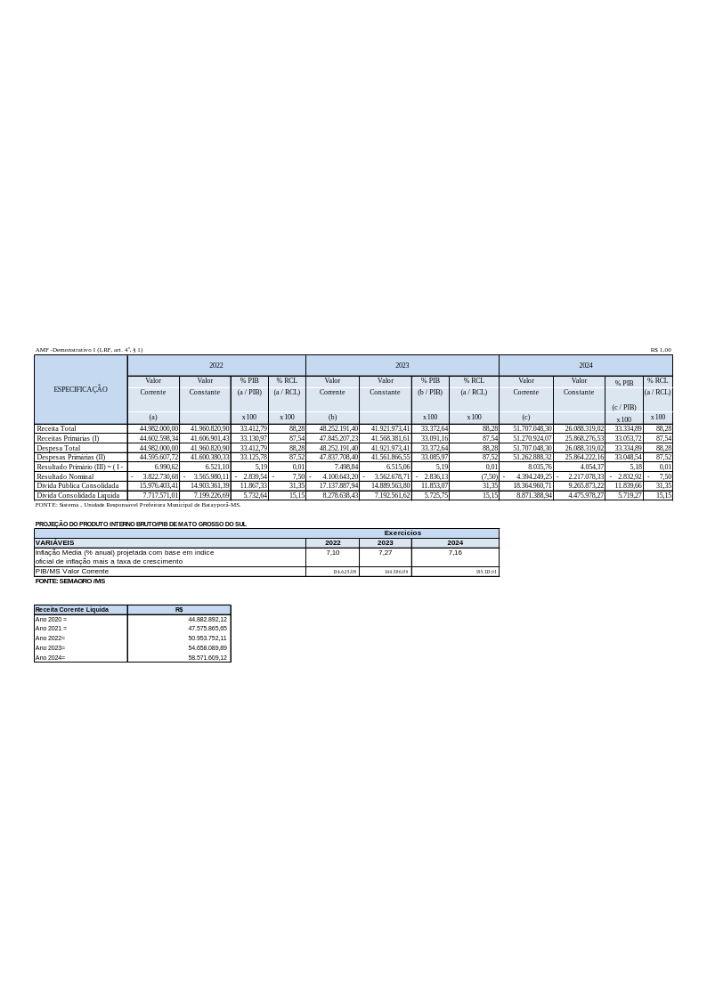
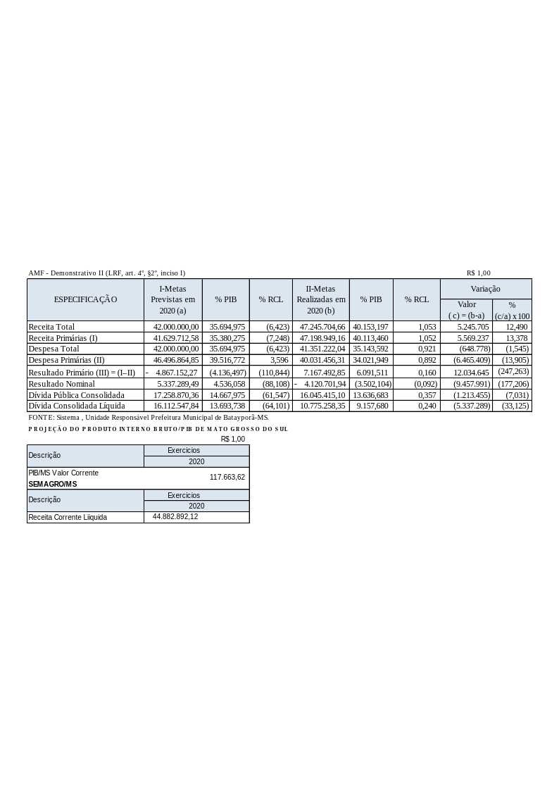
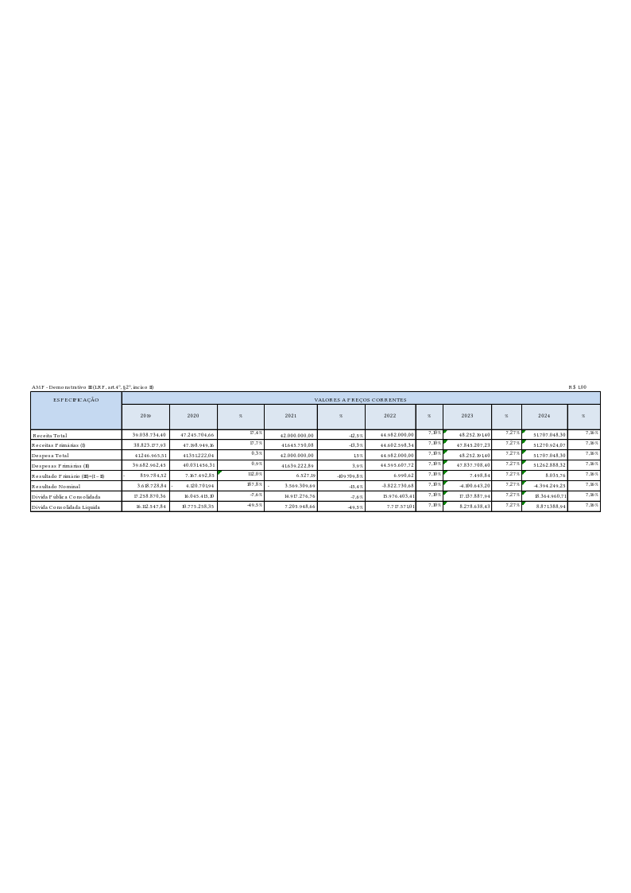
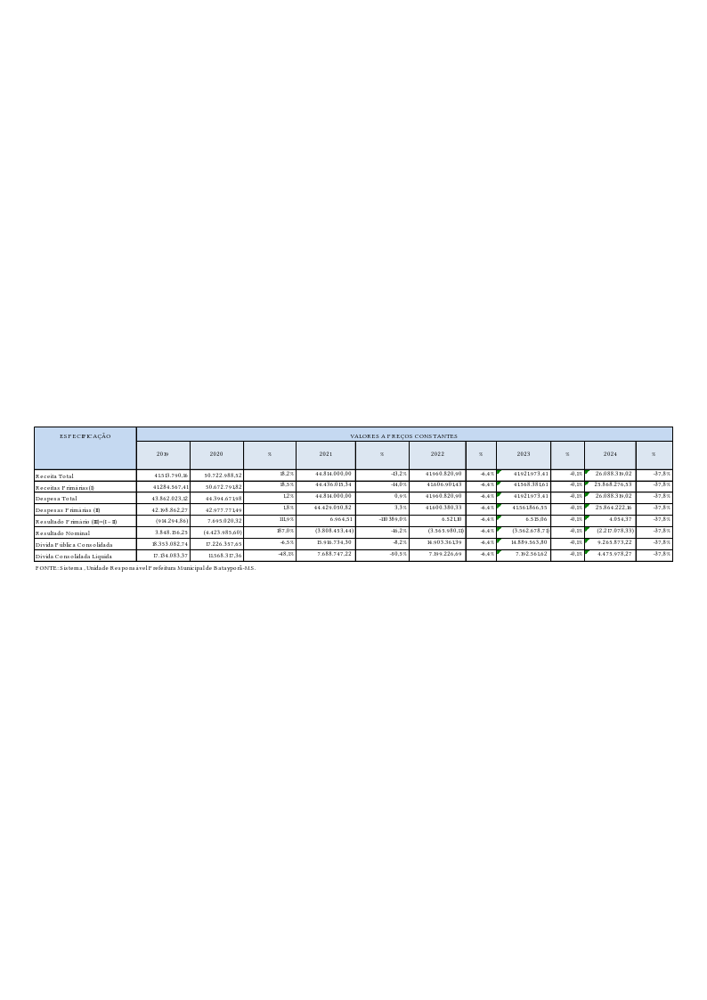
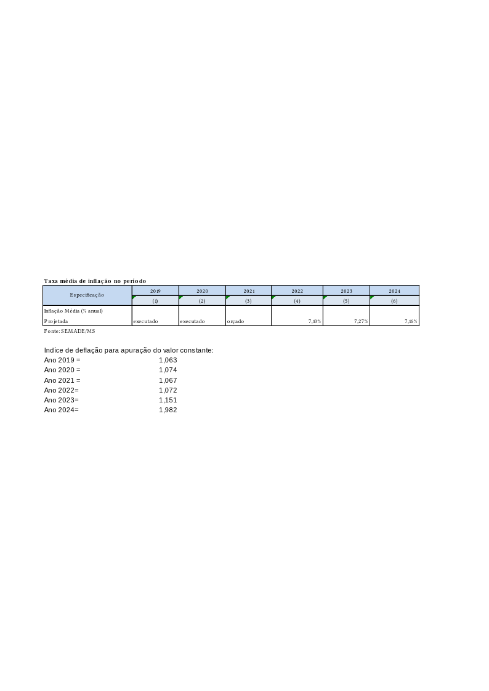
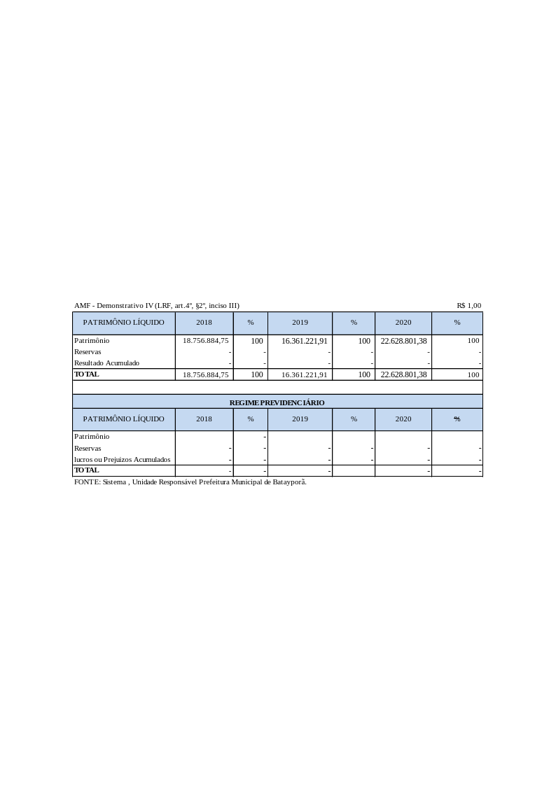
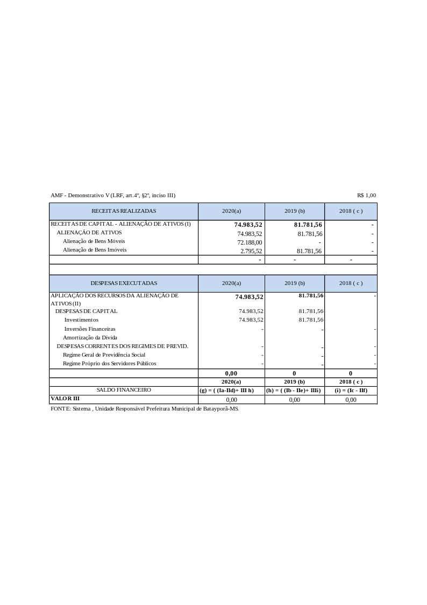
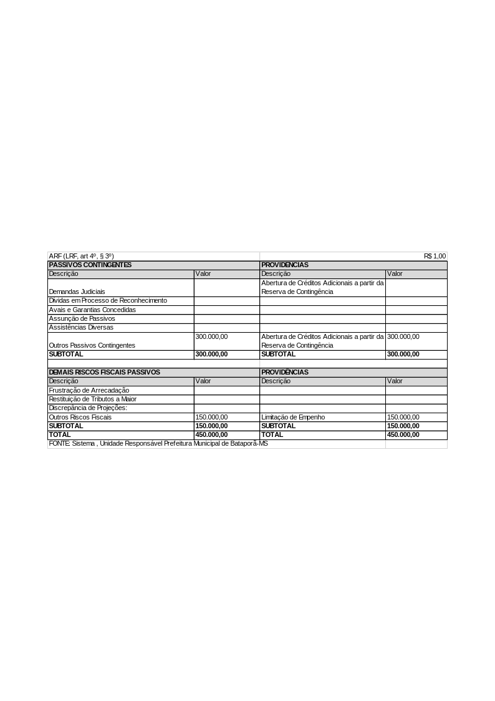

# Lei nº 1254/2021

> Dispõe sobre as diretrizes para a elaboração da Lei Orçamentária do Exercício de 2022, e dá outras providências.

!!! warning "Texto em revisão"
    Transcrito do arquivo .doc da prefeitura, conferido com a [versão em PDF da prefeitura](../../assets/lei-1254-2021/lei-1254-2021.pdf), e **ainda em revisão**. Esta lei não está publicada na [página de legislação da prefeitura](https://bataypora.ms.gov.br/cidadao/legislacao-municipal).

Baixar: [PDF](../../baixar/leis-ordinarias/2021/lei-1254-2021.pdf){ .md-button download="lei-1254-2021.pdf" } [Word (.docx)](../../baixar/leis-ordinarias/2021/lei-1254-2021.docx){ .md-button download="lei-1254-2021.docx" } [Texto (.txt)](../../baixar/leis-ordinarias/2021/lei-1254-2021.txt){ .md-button download="lei-1254-2021.txt" } [Markdown (.md)](../../baixar/leis-ordinarias/2021/lei-1254-2021.md.txt){ .md-button download="lei-1254-2021.md" }

!!! abstract "Índice"
    | Divisão | Assunto | Artigos |
    |---|---|---:|
    |  | Disposições iniciais | [1](#art-1) |
    | Capítulo I |  | [2](#art-2) a [4](#art-4) |
    | Capítulo II |  | [5](#art-5) a [10](#art-10) |
    | Capítulo III |  | [11](#art-11) a [14](#art-14) |
    | Capítulo IV |  | [15](#art-15) a [24](#art-24) |
    | Capítulo V |  | [25](#art-25) a [27](#art-27) |
    | Capítulo VI |  | [28](#art-28) e [29](#art-29) |
    | Capítulo VII |  | [30](#art-30) a [34](#art-34) |
    | Capítulo VIII |  | [35](#art-35) a [37](#art-37) |
    | Capítulo IX |  | [38](#art-38) a [40](#art-40) |
    | Capítulo X |  | [41](#art-41) |
    | Capítulo XI |  | [42](#art-42) |
    | Capítulo XII |  | [43](#art-43) a [47](#art-47) |
    | Capítulo XIII |  | [48](#art-48) a [50](#art-50) |
    | Capítulo XIV |  | [51](#art-51) a [58](#art-58) |

**Lei nº. 1.254, de 12 de julho de 2021.**
{ .centro }

“Dispõe sobre as diretrizes para a elaboração da Lei Orçamentária do Exercício de 2022, e dá outras providências”.

O PREFEITO MUNICIPAL DE BATAYPORÃ, ESTADO DE MATO GROSSO DO SUL, no uso das atribuições lhe são conferidas pela Legislação em vigor;

Faz saber que a Câmara Municipal aprovou e o Poder Executivo sanciona e promulga a seguinte Lei:

**Das Disposições Preliminares**

**Art. 1º** São estabelecidas em cumprimento ao disposto no § 2°, do art. 165 da Constituição Federal, lei orgânica municipal e Lei Complementar n° 101/2000, as diretrizes orçamentárias do Município de Batayporã-MS, para 2022, compreendendo:
{ #art-1 }

I - As prioridades e metas da administração pública municipal;

II - A estrutura e organização dos orçamentos;

III - As diretrizes específicas para o Poder Legislativo;

IV - As diretrizes gerais para elaboração e execução dos Orçamentos do Município e suas alterações;

V - As diretrizes do orçamento fiscal e da seguridade social;

VI - Os limites e condições para expansão das despesas obrigatórias de caráter continuado;

VII - As disposições relativas às despesas com pessoal e encargos sociais;

VIII - As disposições sobre alterações na legislação tributária do Município;

IX - As disposições de caráter supletivo sobre a execução dos orçamentos;

X - As regras para o equilíbrio entre a receita e a despesa;

XI - As limitações de empenho;

XII - As transferências de recursos;

XIII - As disposições relativas à dívida pública municipal e as disposições gerais.

### CAPÍTULO I { .centro }

**Das Prioridades e Metas da Administração Pública Municipal**

**Art. 2º** As prioridades e metas da Administração Pública Municipal para o Exercício de 2022, atendidas as despesas que constituem obrigação constitucional ou legal do Município e as de funcionamento dos órgãos e entidades que integram os orçamentos fiscais e da seguridade social, são as constantes do Art. 3º desta lei, as quais terão precedência na alocação dos recursos na lei orçamentária de 2022, não se constituindo, porém, em limite à programação de despesas.
{ #art-2 }

**Art. 3º** Constituem prioridades da Administração Municipal a serem contempladas na sua programação orçamentária:
{ #art-3 }

I - A modernização da administração pública municipal através da informatização dos serviços e de um esforço persistente de redução dos custos operacionais e da racionalização dos gastos, conforme prescrições contidas na Lei Complementar n° 101/00 e suas alterações posteriores (Lei de Responsabilidade Fiscal);

II - O estímulo ao desenvolvimento dos recursos humanos, promovendo a capacitação e a valorização profissional dos servidores, visando ganhos de produtividade, redução de custos e otimização dos serviços públicos;

III - Uma programação social efetiva, priorizando sobretudo a população de baixa renda no acesso a serviços básicos de saúde, habitação, do apoio a programas que concorram para a geração de maiores oportunidades de emprego e do estímulo à parceria com a iniciativa privada e a sociedade organizada;

IV - Promover ações de incentivos as atividades esportivas, culturais e do turismo nas manifestações populares e difusão do folclore do município, em parceria com as entidades públicas e privadas, proporcionando aos munícipes o desenvolvimento social, físico e intelectual;

V - Manutenção dos programas de educação básica do município, priorizando o ensino infantil e fundamental, oferecendo aos alunos distribuição de merenda de boa qualidade, transporte escolar, melhorias das escolas municipais, bem como a valorização e capacitação do magistério e profissionais de educação e outros incentivos educacionais que objetivem a melhoria da educação em nosso município;

VI - Implantação de uma política agrícola de valorização ao produtor rural, visando o apoio à produção familiar, ao pequeno produtor rural, incentivo ao associativismo, programa de diversificação das atividades rurais com objetivo de incentivar seu desenvolvimento social e econômico;

VII - A implantação de uma infraestrutura básica de atendimento à população, priorizando a manutenção e estruturação do sistema viário, transporte urbano e rural, drenagem, iluminação pública, saneamento, pavimentação de vias urbanas e outras obras complementares;

VIII - O incentivo às ações voltadas para a preservação, recuperação, conservação do meio ambiente e o uso racional dos recursos naturais renováveis, priorizando ações educativas;

IX - Manutenção, restauração e conservação de edificações públicas integrantes do patrimônio municipal e construção de novas unidades;

X - Desenvolver programas que estimulem a instalação de novos empreendimentos, em especial comércios e indústrias, além dos prestadores de serviços;

XI - Desenvolver e aplicar o plano de destinação de resíduos sólidos.

**Art. 4º** Constituem metas fiscais da Administração para inclusão na sua programação orçamentária as que estão contempladas nos anexos da presente lei.
{ #art-4 }

### CAPÍTULO II { .centro }

**Da Estrutura e Organização dos Orçamentos**

**Art. 5º** As categorias de programação de que trata esta Lei, serão identificadas no projeto de Lei Orçamentária por Funções, Subfunções, Programas, Atividades e Projetos, órgão concedente e Organizações da Sociedade Civil.
{ #art-5 }

Parágrafo único. Para efeito desta Lei, entende-se por:

I - Função, o maior nível de agregação das diversas áreas de despesa que competem ao setor público;

II - Subfunção, representa uma partição da função, visando a agregar determinado subconjunto de despesa do setor público;

III - Programa, um instrumento de organização da ação governamental visando à concretização dos objetivos pretendidos, sendo mensurados por indicadores estabelecidos no plano plurianual;

IV - Atividade, um instrumento de programação para alcançar o objetivo de um programa, envolvendo um conjunto de operações que se realizam de modo contínuo e permanente, das quais resulta um produto necessário à manutenção da ação de governo;

V - Projeto, um instrumento de programação para alcançar o objetivo de um programa, envolvendo um conjunto de operações, limitadas no tempo, das quais resulta um produto que concorre para a expansão ou aperfeiçoamento da ação de governo;

VI - Concedente, o órgão ou a entidade da administração pública direta ou indireta responsável pela transferência de recursos financeiros, inclusive os decorrentes de descentralização de créditos orçamentários; e

VII - Organizações da Sociedade Civil as entidades privadas, com os quais o município pactue a transferência de recursos financeiros, inclusive quando decorrentes da descentralização de créditos orçamentários.

**Art. 6º** Os orçamentos fiscais e da seguridade social, referentes aos poderes do Município, seus fundos e órgãos da administração direta, indireta e fundações criadas e mantidas pelo poder público municipal, discriminarão as despesas por unidade orçamentária, detalhada por categoria de programação, segundo exigências da Lei n° 4.320/64.
{ #art-6 }

**Art. 7º** Na lei orçamentária, a discriminação da despesa, quanto à sua natureza, far-se-á, por categoria econômica, grupo de natureza da despesa e modalidade de aplicação.
{ #art-7 }

§ 1º As despesas de cada Unidade Orçamentária serão discriminadas por projeto/atividade e classificadas por:

I - Função, Subfunção e Programa;

II - Grupos de Despesa;

III - Elemento de Despesa.

§ 2º Os Grupos de Despesa a que se refere o inciso II, deste artigo, são os seguintes:

I - Pessoal e Encargos Sociais – 1;

II - Juros e Encargos da Dívida – 2;

III - Outras Despesas Correntes – 3;

IV - Investimentos – 4;

V - Inversões Financeiras – 5; e

VI - Amortização da Dívida – 6.

§ 3º Cada programa identificará as ações necessárias para atingir os seus objetivos, sob a forma de atividades e projetos, especificando os respectivos valores, bem como as unidades orçamentárias responsáveis pela realização da ação.

§ 4º Os conceitos e as especificações dos Grupos de Despesa são os constantes do Manual de Contabilidade Aplicada ao Setor Público.

§ 5º Os conceitos e especificações das Fontes de Receita, são os constantes do Manual de Contabilidade Aplicada ao Setor Público.

§ 6º Cada atividade e projeto identificará a Função, a Subfunção e o Programa aos quais se vinculam.

**Art. 8º** O projeto de Lei Orçamentária que o Poder Executivo encaminhará à Câmara Municipal, será constituído de:
{ #art-8 }

I - Mensagem;

II - Texto da lei;

III - Quadros orçamentários consolidados;

IV - Anexo dos orçamentos fiscais e da seguridade social, discriminando receita e despesa na forma definida na Lei Federal n° 4.320/64;

V - Quadro indicativo da legislação que norteia a arrecadação da receita.

Parágrafo único. Os quadros orçamentários a que se refere o inciso III deste artigo, incluindo os complementos referenciados no Art. 22, inciso III, da Lei n° 4.320, de 17 de março de 1964, são os seguintes:

I - Evolução da receita e despesa, segundo as categorias econômicas;

II - Resumo das receitas e despesas dos orçamentos fiscais e da seguridade social, isolada e conjuntamente, por categoria econômica;

III - Receita e despesa, dos orçamentos fiscais e da seguridade social, isolada e conjuntamente, segundo categorias econômicas, conforme o Anexo I da Lei n° 4.320/64 e suas alterações;

IV - Despesas dos orçamentos fiscais e da seguridade social, isolada e conjuntamente segundo a função, subfunção e programa;

V - Demonstrativo que evidencie a programação no orçamento fiscal, dos recursos destinados à manutenção e ao desenvolvimento do ensino, de forma a caracterizar o cumprimento do disposto no art. 212 da Constituição Federal e demais normas legais;

VI - Demonstrativo que evidencie a programação no Orçamento da Seguridade Social, dos recursos destinados à Saúde em cumprimento ao disposto no inciso III, §2º do art. 198 da Constituição Federal e demais normas legais;

VII - A evolução da receita nos três últimos anos, a execução provável para 2021 e a estimada para 2022.

**Art. 9º** O enquadramento dos projetos e atividades na classificação funcional-programática, deverá observar os objetivos específicos de cada aplicação, independente da unidade a que estiverem vinculados.
{ #art-9 }

**Art. 10.** As despesas e as receitas dos orçamentos fiscais e da seguridade social, bem como do conjunto dos dois orçamentos serão apresentados de forma sintética e agregada, evidenciando o déficit ou o superávit corrente e o total de cada um dos orçamentos.
{ #art-10 }

### CAPÍTULO III { .centro }

**Das Diretrizes Específicas para o Poder Legislativo**

**Art. 11.** total da despesa do Poder Legislativo Municipal, incluídos os subsídios dos Vereadores, será no percentual de 7% (sete por cento), relativo ao somatório da receita tributária e das transferências previstas no §5° do Art. 153 e nos artigos 158 e 159 da Constituição Federal, efetivamente realizado no exercício anterior, conforme regra contida em norma fixada pelo Tribunal de Contas do Estado.
{ #art-11 }

**Art. 12.** duodécimo devido à Câmara Municipal será repassado até o dia 20 (vinte) de cada mês, nos termos do inciso II, § 2° do art. 29-A da Constituição Federal.
{ #art-12 }

**Art. 13.** A despesa total com a folha de pagamento do Poder Legislativo, incluídos os gastos com subsídios dos Vereadores, não poderá ultrapassar a 70% (setenta por cento) de sua receita, de acordo com o estabelecido no §1º do art. 29-A da Constituição Federal.
{ #art-13 }

**Art. 14.** Poder Legislativo encaminhará sua proposta orçamentária ao Poder Executivo, para fins de consolidação, até o final do mês de julho do corrente ano.
{ #art-14 }

### CAPÍTULO IV { .centro }

**Das Diretrizes Gerais para a Elaboração e Execução dos Orçamentos do Município e suas alterações**

**Art. 15.** A elaboração do projeto, a aprovação e a execução da Lei Orçamentária de 2022 deverão ser realizados de modo a evidenciar a transparência da gestão fiscal, observando-se o princípio da publicidade e permitindo-se o amplo acesso da sociedade a todas as informações.
{ #art-15 }

**Art. 16.** A alocação dos créditos orçamentários será feita diretamente à unidade orçamentária responsável pela execução das ações correspondentes.
{ #art-16 }

**Art. 17.** Na programação da despesa serão vedados:
{ #art-17 }

I - O início de programas ou projetos não incluídos na lei orçamentária anual;

II - Consignar na lei orçamentária projetos com a mesma finalidade em mais de uma Unidade Orçamentária, crédito com finalidade imprecisa ou com dotação ilimitada.

III - A vinculação da receita de impostos a órgãos, fundos ou despesas, nos termos do inciso IV do art. 167 da Constituição Federal.

**Art. 18.** Além das prioridades referidas no artigo 3°, a Lei de Diretrizes Orçamentárias somente admite a inclusão de novos projetos e despesas obrigatórias de duração continuada no orçamento, se:
{ #art-18 }

I - Tiverem sido adequadamente atendidos os projetos já iniciados;

II - Tiverem sido contempladas as despesas de conservação do patrimônio público;

III - No caso de no exercício houver excesso de arrecadação;

IV - Tiverem perfeitamente definidas suas fontes de custeio.

Parágrafo único. A programação de novos projetos dependerá de prévia comprovação de sua viabilidade técnica, econômica e financeira.

**Art. 19.** A lei orçamentária somente contemplará dotação para investimento com duração superior a um exercício financeiro, se ele estiver contido no Plano Plurianual ou em lei que autorize sua inclusão.
{ #art-19 }

**Art. 20.** As previsões de receita para o exercício de 2022, e eventual reestimativa pelo Poder Legislativo, deverão estar em consonância às disposições do artigo 12 da Lei de Responsabilidade Fiscal.
{ #art-20 }

**Art. 21.** É vedada a aplicação de recursos decorrentes da alienação de bens e direitos que integram o patrimônio público para o financiamento de despesa corrente, salvo se destinada por lei aos regimes de previdência social, geral e próprio dos servidores públicos.
{ #art-21 }

**Art. 22.** É obrigatória a destinação de recursos para compor a contrapartida de empréstimos e para pagamento de amortização, juros e outros encargos da dívida municipal, observados os cronogramas financeiros das respectivas operações.
{ #art-22 }

**Art. 23.** É obrigatória a inclusão no orçamento, de recursos necessários ao pagamento de débitos oriundos de sentenças transitadas em julgado, constantes de precatórios judiciários, apresentados até 1º de julho, conforme determina o Art. 100 da Constituição Federal.
{ #art-23 }

**Art. 24.** A Lei Orçamentária, destinará:
{ #art-24 }

I - Para a manutenção e desenvolvimento do ensino, o percentual mínimo de 25% (vinte e cinco por cento) da receita resultante de impostos na forma prevista no art. 212 da Constituição Federal e Lei Orgânica Municipal;

II - Em ações e serviços públicos de saúde não menos de 15% (quinze por cento) da receita oriunda de impostos, em conformidade com o inciso III, do § 2º do Art. 198 da Constituição Federal.

### CAPÍTULO V { .centro }

**Das Diretrizes dos Orçamentos Fiscais e da Seguridade Social**

**Art. 25.** s recursos ordinários do Município, somente poderão ser programados para atender despesas de capital, depois de atendidas despesas com pessoal e encargos sociais, serviços da dívida e outras despesas de custeio administrativo e operacional, precatórios judiciais, bem como a contrapartida de convênios e de programas financiados e aprovados por lei específica.
{ #art-25 }

Parágrafo único. Na fixação da programação da despesa deverão ser observadas as prioridades constantes do artigo 3° desta Lei.

**Art. 26.** Orçamento da Seguridade Social, compreenderá as dotações destinadas a atender às ações de saúde, previdência e assistência social e contará, dentre outros, com recursos provenientes:
{ #art-26 }

I - Das contribuições sociais previstas na Constituição;

II - Das receitas diretamente arrecadadas pelos órgãos, entidades e fundos que integram o orçamento de que trata este artigo;

III - Das receitas transferidas do Orçamento Fiscal do Município.

**Art. 27.** A Lei Orçamentária conterá reserva de contingência de no mínimo 0,5% (meio por cento) da receita corrente líquida, destinada ao atendimento de passivos contingentes e outros riscos, além de eventos fiscais imprevistos, inclusive para abertura de créditos adicionais destinados ao reforço de dotações que se revelarem insuficientes para atender suas finalidades.
{ #art-27 }

Parágrafo único. Para efeito desta Lei entende-se como eventos e riscos fiscais imprevistos, entre outros, as despesas necessárias ao funcionamento e manutenção dos serviços públicos e da estrutura da administração pública municipal, não orçadas, ou orçadas a menor, e as decorrentes de criação, expansão ou aperfeiçoamento de ações governamentais, imprescindíveis às necessidades do Poder Público.

### CAPÍTULO VI { .centro }

**Limites e Condições para Expansão das**

**Despesas Obrigatórias de Caráter Continuado**

**Art. 28.** A criação, expansão ou aperfeiçoamento de ação governamental que acarrete aumento de despesas de caráter continuado, deverá ser acompanhado de estimativa do impacto orçamentário-financeiro no exercício em que deva entrar em vigor e nos dois subsequentes.
{ #art-28 }

**Art. 29.** Para efeito do disposto no § 3º art. 16, da Lei Complementar nº 101, de 04/05/00, são consideradas despesas irrelevantes, aquelas decorrentes de ação governamental nova, cujo impacto orçamentário-financeiro num exercício não exceda o valor para dispensa de licitação, fixado na Lei de Licitações.
{ #art-29 }

### CAPÍTULO VII { .centro }

**Das Disposições Relativas às Despesas com Pessoal e Encargos Sociais**

**Art. 30.** A despesa com pessoal ativo, inativo, pensionista e encargos sociais do Executivo não poderá exceder, no exercício, ao limite de 54% (cinquenta e quatro por cento) das respectivas receitas correntes líquidas (RCL), na forma do disposto na alínea “b” do inciso III do art. 20 da Lei Complementar n.º 101 de 04/05/00.
{ #art-30 }

§ 1º Entende-se por receita corrente líquida o somatório das receitas tributárias, de contribuição, patrimoniais, industriais, agropecuárias, de serviços, transferências correntes e outras receitas correntes, deduzidas:

I - Contribuições dos servidores para o custeio de seu sistema de previdência e assistência social;

II - Compensação Financeira entre Regimes de Previdência;

III - Dedução de Receita para Formação do FUNDEB.

§ 2º A receita corrente líquida será apurada somando-se as receitas arrecadadas no mês em referência e nos onze meses anteriores, excluídas as duplicidades.

**Art. 31.** A verificação do cumprimento do limite estabelecido no art. 30 será realizada ao final de cada semestre.
{ #art-31 }

**Art. 32.** Na hipótese de a despesa de pessoal exceder a 95% (noventa e cinco por cento) do limite de que trata o art. 30 desta lei, aplicar-se-á o disposto no parágrafo único do artigo 22 da Lei Complementar n.º 101/00.
{ #art-32 }

**Art. 33.** No exercício de 2022, a realização de horas extras, quando a despesa houver extrapolado 95% (noventa e cinco por cento) dos limites referidos no art. 30 desta Lei, somente poderá ocorrer quando for ao atendimento de relevantes interesses públicos, devidamente justificados pela autoridade competente.
{ #art-33 }

Parágrafo único. A autorização para a realização de serviços extraordinários, no âmbito do Poder Executivo, nas condições estabelecidas no caput deste artigo, é de exclusiva competência do Prefeito Municipal ou por autoridade por ele delegada.

**Art. 34.** Fica autorizada a realização de concursos públicos para todos os Poderes, desde que:
{ #art-34 }

I - Atendam os dispositivos do artigo 169 da Constituição Federal e limites estabelecidos na Lei Complementar nº 101, de 04 de maio de 2000;

II - Sejam para suprir deficiências de mão-de-obra ou ampliação de serviços básicos do município.

### CAPÍTULO VIII { .centro }

**Das Disposições sobre Alterações na Legislação Tributária**

**Art. 35.** A estimativa da receita que constará do projeto de Lei Orçamentária para o Exercício de 2022 contemplará medidas de aperfeiçoamento da administração dos tributos municipais, com vistas à expansão de base de tributação e consequentes aumento das receitas próprias.
{ #art-35 }

**Art. 36.** A estimativa da receita citada no artigo anterior levará em consideração, adicionalmente, o impacto de alteração na legislação tributária, observadas a capacidade econômica do contribuinte e a justa distribuição de renda, com destaque para:
{ #art-36 }

I - Atualização e/ou revisão da planta genérica de valores do município;

II - Revisão, atualização ou adequação da legislação sobre Imposto Predial e Territorial Urbano, suas alíquotas, forma de cálculo, condições de pagamento, descontos e isenções;

III - Revisão da legislação sobre o uso do solo, com redefinição dos limites da zona urbana municipal;

IV - Revisão da legislação sobre as taxas pelo exercício do poder da polícia;

V - Revisão das isenções dos tributos municipais, para manter o interesse público e a justiça fiscal.

Parágrafo único. Com o objetivo de estimular o desenvolvimento econômico e cultural do Município, o Poder Executivo encaminhará projetos de lei de incentivos ou benefícios de natureza tributária, cuja renúncia de receita poderá alcançar os montantes dimensionados no Anexo de Metas Fiscais, já consideradas no cálculo do resultado primário.

**Art. 37.** s tributos lançados e não arrecadados, inscritos em dívida ativa, cujos custos para a cobrança sejam superiores ao crédito tributário, poderão ser cancelados, mediante autorização em lei, não se constituindo como renúncia de receita para efeito do disposto no art. 14, §3º da Lei Complementar n. º 101, de 04.05.2000.
{ #art-37 }

### CAPÍTULO IX { .centro }

**Das Disposições de Caráter Supletivo sobre Execução dos Orçamentos**

**Art. 38.** A proposta orçamentária do Município para 2022, será encaminhada a Câmara Municipal, pelo Poder Executivo, até 31 de Agosto de 2021 ou no prazo definido pela Lei Orgânica Municipal.
{ #art-38 }

**Art. 39.** A Lei Orçamentária Anual definirá o percentual em que o Poder Executivo ficará autorizado a abrir créditos especiais e adicionais suplementares e os remanejamentos, as transposições e as transferências de recursos de uma categoria de programação para outra ou de um órgão para outro, utilizando os recursos previstos no art.43 da Lei nº 4.320/64.
{ #art-39 }

Parágrafo único. As autorizações contempladas no caput deste artigo são extensivas às dotações orçamentárias consignadas ao Poder Legislativo e às programações orçamentárias dos fundos e dos órgãos da administração indireta.

**Art. 40.** É vedada a realização de despesa ou a assunção de obrigações que excedam os créditos orçamentários ou adicionais, ou quaisquer procedimentos que viabilizem a execução de despesa sem a comprovada e suficiente disponibilidade de dotação orçamentária.
{ #art-40 }

### CAPÍTULO X { .centro }

**Das Regras para o Equilíbrio entre a Receita e a Despesa**

**Art. 41.** Para o estabelecimento do equilíbrio entre as receitas e as despesas serão adotadas as regras de acompanhamento da execução orçamentária por via dos relatórios explicitados na Lei Complementar nº 101/00.
{ #art-41 }

### CAPÍTULO XI { .centro }

**Das Limitações de Empenhos**

**Art. 42.** s critérios e formas de limitação de empenho são os referidos no art. 9º da Lei Complementar n.º 101/00, ficando o Poder Executivo por ato próprio, responsável pela reprogramação dos empenhos, nos limites do comportamento da receita, excluídas as despesas que constituem obrigação constitucional ou legal de execução.
{ #art-42 }

### CAPÍTULO XII { .centro }

**Das Transferências de Recursos**

**Art. 43.** É vedada a destinação de recursos a título de subvenções sociais para entidades privadas, ressalvadas aquelas sem fins lucrativos, que exerçam atividade de natureza continuada nas áreas de assistência social, saúde, educação e cultura, e que preencham uma das seguintes condições:
{ #art-43 }

I - Sejam de atendimento direto ao público, de forma gratuita, nas áreas de assistência social, cultura, saúde ou educação, e estejam registradas no Órgão Municipal através de Conselhos Municipais;

II - Atendam ao disposto no art. 204 da Constituição Federal.

§ 1º Para habilitar-se ao recebimento de subvenções sociais, a entidade privada sem fins lucrativos deverá apresentar declaração de funcionamento regular nos últimos dois anos, emitida no exercício, pelos Conselhos Municipais quando necessário e comprovando ainda a regularidade do mandato de sua diretoria.

§ 2º As entidades privadas beneficiadas, a qualquer título, submeter-se-ão à fiscalização do Poder Concedente com a finalidade de verificar o cumprimento de metas e objetivos para os quais receberam recursos.

**Art. 44.** Orçamento Municipal poderá consignar recursos para financiar serviços de sua responsabilidade a serem executados por entidades de direito privado, mediante convênios, contratos, ajustes e outros instrumentos legais, desde que sejam da conveniência do Município e tenham demonstrado padrões de eficiência no cumprimento dos objetivos determinados.
{ #art-44 }

**Art. 45.** Não poderão ser destinados recursos para atender despesas com:
{ #art-45 }

I - Clubes e associações de servidores ou quaisquer outras entidades congêneres, excetuadas as creches e escolas para o atendimento escolar, as entidades assistenciais de natureza educacionais, saúde e assistência social;

II - Pagamento, a qualquer título, a servidor da Administração Direta ou Indireta por serviços de consultoria ou assistência técnica ou qualquer serviço ligado à administração municipal.

**Art. 46.** As transferências de recursos financeiros destinados a subvenções sociais, contribuições e auxílios, no que couber, obedecerão às regras estipuladas nos capítulos V e VI da Lei Complementar n.º 101/00.
{ #art-46 }

**Art. 47.** As despesas de competência de outros entes da Federação só serão assumidas pela Administração Municipal quando firmados por convênios, acordos ou ajustes e previstos recursos na lei orçamentária, conforme dispõe o Art. 62 da Lei Complementar nº 101/00 – LRF.
{ #art-47 }

Parágrafo único. As despesas de outros entes da Federação somente poderão ocorrer em situações que envolvam claramente o atendimento de interesses locais.

### CAPÍTULO XIII { .centro }

**Disposições Relativas à Dívida Pública Municipal**

**Art. 48.** A Lei Orçamentária garantirá recursos para pagamento da despesa decorrente de débitos refinanciados, inclusive com a previdência social.
{ #art-48 }

**Art. 49.** projeto de Lei Orçamentária poderá incluir, na composição da receita total do Município, recursos provenientes de operação de crédito, respeitados os limites estabelecidos no artigo 167, inciso III da Constituição Federal.
{ #art-49 }

**Art. 50.** A Lei Orçamentária Anual poderá autorizar a realização de operação de crédito por antecipação de receita, conforme disposto no art. 38, da Lei Complementar n.º 101/2000.
{ #art-50 }

### CAPÍTULO XIV { .centro }

**Das Disposições Gerais**

**Art. 51.** Poder executivo, de acordo com o § 3° do art. 12 da LRF, encaminhará à Câmara Municipal, no mínimo, trinta dias antes do encaminhamento de sua proposta orçamentária a estimativa das receitas para o exercício subsequente, inclusive da receita corrente líquida e da metodologia de cálculo.
{ #art-51 }

**Art. 52.** As propostas de modificações ao projeto de lei orçamentária, serão apresentadas, no que couber, com a forma, o nível de detalhamento, os demonstrativos e as informações estabelecidas para o orçamento, nesta Lei.
{ #art-52 }

**Art. 53.** A classificação da estrutura programática para 2022 poderá sofrer alterações para a adequação ao Plano de Contas Único da Administração Pública Federal regulamentado pela Secretaria do Tesouro Nacional - STN, do Ministério da Fazenda e pelo Tribunal de Contas do Estado de Mato Grosso Sul - TCE-MS.
{ #art-53 }

**Art. 54.** Se o Projeto de Lei Orçamentária não for devolvido para sanção até o encerramento da sessão legislativa, a programação dele constante poderá ser executada mediante créditos especiais ou suplementares, com prévia e específica autorização legislativa, para o atendimento exclusivamente das seguintes despesas:
{ #art-54 }

I - Pessoal e encargos sociais;

II - Pagamento de benefícios previdenciários;

III - Pagamento do serviço da dívida; e.

IV - Pagamento de precatórios e ordens judiciais

**Art. 55.** A Lei Orçamentária Anual, evidenciará as Receitas e Despesas de cada uma das Unidades Gestoras, identificadas com o respectivo código, especificando aquelas vinculadas a fundos e aos Orçamentos Fiscais e da Seguridade Social, desdobradas conforme as funções especificadas nesta Lei e nos anexos da Lei 4320/64.
{ #art-55 }

**Art. 56.** ente não ficara escuso da responsabilidade de estabelecer metas fiscais para o exercício financeiro de 2022, mesmo na ocorrência de calamidade, ressaltando que poderá ser dispensado de cumprir as metas fixadas e poderá ser inserido uma previsão para a atualização das metas orçamentárias.
{ #art-56 }

**Art. 57.** A previsão das receitas e a fixação das despesas para 2022 serão orçadas a preços correntes.
{ #art-57 }

**Art. 58.** Esta lei entrará em vigor na data de sua publicação.
{ #art-58 }

Batayporã-MS, 12 de julho de 2021.

**Germino da Roz Silva**
{ .centro }

Prefeito Municipal
{ .centro }

Publicado e afixado na forma da Lei.

**Gabriel Boffo da Rocha**
{ .centro }

Secretário Municipal de Administração Finanças e Planejamento
{ .centro }

**Anexo de Metas e Prioridades**

**PODER EXECUTIVO**

<table style="width:61%;">
<colgroup>
<col style="width: 61%" />
</colgroup>
<tbody>
<tr>
<td style="text-align: center;"><strong>GABINETE DO PREFEITO, SECRETARIA DE GOVERNO E PRODUCADORIA JURÍDICA</strong> </td>
</tr>
<tr>
<td style="text-align: center;"><ul>
<li>
Dar suporte jurídico e orientações jurídicas; 
</li>
</ul></td>
</tr>
<tr>
<td style="text-align: center;"><ul>
<li>
Assessoria completa do Gabinete do Prefeito; 
</li>
</ul></td>
</tr>
<tr>
<td style="text-align: center;"><ul>
<li>
Desenvolver atividades de consultoria e assessoramento jurídicos; 
</li>
</ul></td>
</tr>
<tr>
<td style="text-align: center;"><ul>
<li>
Prestar assessoria as Secretarias e Departamentos Municipais; 
</li>
</ul></td>
</tr>
<tr>
<td style="text-align: center;"><ul>
<li>
Emissão de pareceres sobre requerimentos de servidores e terceiros com interesses voltados ao Município; 
</li>
</ul></td>
</tr>
<tr>
<td style="text-align: center;"><ul>
<li>
Representar o Município judicial e extrajudicialmente, recebendo citações, intimações e notificações judiciais; 
</li>
</ul></td>
</tr>
<tr>
<td style="text-align: center;"><ul>
<li>
Elaborar defesas e prestar informações ao Ministério Público e ao Tribunal de Contas do Estado;  
</li>
</ul></td>
</tr>
<tr>
<td style="text-align: center;"><ul>
<li>
Defender em juízo os interesses da Administração; 
</li>
</ul></td>
</tr>
<tr>
<td style="text-align: center;"><ul>
<li>
Realizar cobranças judiciais de dívida ativa; 
</li>
</ul></td>
</tr>
<tr>
<td style="text-align: center;"><ul>
<li>
Edição de Decretos e Portarias, no entanto atualmente a confecção de tais atos administrativos estão sob a responsabilidade da Secretaria Municipal de Administração, por força de Lei, sendo que a revisão final e encaminhamento para publicação em Diário Oficial do Município ocorre via procuradoria, por meio eletrônico. 
</li>
</ul></td>
</tr>
</tbody>
</table>

<table style="width:61%;">
<colgroup>
<col style="width: 61%" />
</colgroup>
<tbody>
<tr>
<td style="text-align: center;"><strong>ÁREA DE ADMINISTRAÇÃO, PLANEJAMENTO/GESTÃO</strong> </td>
</tr>
<tr>
<td style="text-align: center;"><ul>
<li>
Qualificar as Áreas de Administração Municipal, visando a sua valorização e a qualidade dos serviços prestados a população;  
</li>
</ul></td>
</tr>
<tr>
<td style="text-align: center;"><ul>
<li>
Assegurar a aquisição de equipamentos e materiais permanentes visando à otimização dos serviços prestados a população; 
</li>
</ul></td>
</tr>
<tr>
<td style="text-align: center;"><ul>
<li>
Garantir a execução orçamentária visando uma Gestão Pública eficiente; 
</li>
</ul></td>
</tr>
<tr>
<td style="text-align: center;"><ul>
<li>
Promover a reestruturação e modernização do [Estatuto dos Servidores Públicos](../../estatuto-servidores/lc-003-2001.md) e Magistério;
</li>
</ul></td>
</tr>
<tr>
<td style="text-align: center;"><ul>
<li>
Promover a reestruturação e modernização do Plano de Cargos, Carreiras e Remuneração – PCCR;
</li>
</ul></td>
</tr>
<tr>
<td style="text-align: center;"><ul>
<li>
Criar critérios de meritocracias para valorizar os servidores.
</li>
</ul></td>
</tr>
</tbody>
</table>

<table style="width:61%;">
<colgroup>
<col style="width: 61%" />
</colgroup>
<tbody>
<tr>
<td style="text-align: center;"><strong>CONTROLADORIA</strong></td>
</tr>
<tr>
<td style="text-align: center;"><ul>
<li>
Assessorar a administração nos aspectos relacionados aos controles internos e externos e quanto à legalidade dos atos de gestão; 
</li>
</ul></td>
</tr>
<tr>
<td style="text-align: center;"><ul>
<li>
Exercer o acompanhamento sobre a observância dos limites constitucionais, da Lei de Responsabilidade Fiscal e os estabelecidos nos demais instrumentos legais; 
</li>
</ul></td>
</tr>
<tr>
<td style="text-align: center;"><ul>
<li>
Estabelecer mecanismos voltados a comprovar a legalidade e a legitimidade dos atos de gestão e avaliar os resultados, quanto à eficácia, eficiência e economicidade na gestão orçamentária, financeira, patrimonial e operacional no Legislativo, bem como, na aplicação de recursos públicos por entidades de direito privado; 
</li>
</ul></td>
</tr>
<tr>
<td style="text-align: center;"><ul>
<li>
Melhorar os meios de acesso do Público a Publicidade dos Atos do Governo Municipal. 
</li>
</ul></td>
</tr>
</tbody>
</table>

<table style="width:61%;">
<colgroup>
<col style="width: 60%" />
</colgroup>
<tbody>
<tr>
<td style="text-align: center;"><strong>ÁREA DE FINANÇAS </strong> </td>
</tr>
<tr>
<td style="text-align: center;"><ul>
<li>
Aumentar a receita por meio de um esforço de fiscalização com ênfase no monitoramento setorial dos grandes contribuintes; do estímulo à arrecadação; da revisão dos benefícios fiscais; do incremento de ingresso via cobrança e da promoção da educação tributária; atualização da planta genérica de valores do município, e o Georreferenciamento da Zona Rural; 
</li>
</ul></td>
</tr>
<tr>
<td style="text-align: center;"><ul>
<li>
Amortização de dívidas contratadas; 
</li>
</ul></td>
</tr>
<tr>
<td style="text-align: center;"><ul>
<li>
Promover a premiação aos contribuintes que se encontrarem em dia com os tributos municipais, com fim a aumentar a arrecadação municipal; 
</li>
</ul></td>
</tr>
<tr>
<td style="text-align: center;"><ul>
<li>
Promover a atualização do [código tributário municipal](../../codigo-tributario/lc-001-1991.md);
</li>
</ul></td>
</tr>
<tr>
<td style="text-align: center;"><ul>
<li>
Promover a atualização do código municipal de postura;
</li>
</ul></td>
</tr>
<tr>
<td style="text-align: center;"><ul>
<li>
Garantir capacitação e a atualização das equipes de serviços dos setores;
</li>
</ul></td>
</tr>
<tr>
<td style="text-align: center;"><ul>
<li>
Criar o Núcleo de Consultoria Empresarial através de parcerias com as Universidades públicas e privadas da nossa região, como IFMS, UFMS bem como com outras instituições afins, atraindo estagiários dos setores de Administração, Recursos Humanos, Engenharia da produção e outros, prestando serviço de consultoria acompanhada nos empreendimentos do nosso município;
</li>
</ul></td>
</tr>
<tr>
<td style="text-align: center;"><ul>
<li>
Fortalecer a ASEB (Associação Empresarial de Batayporã), firmando parcerias que ofereçam cursos, palestras, seminários, visando ampliar os conhecimentos sobre administração dos seus negócios.
</li>
</ul></td>
</tr>
</tbody>
</table>

<table style="width:61%;">
<colgroup>
<col style="width: 60%" />
</colgroup>
<tbody>
<tr>
<td style="text-align: center;"><strong>ÁREA DE OBRAS E SERVIÇOS URBANOS</strong> </td>
</tr>
<tr>
<td style="text-align: center;"><ul>
<li>
Promover ações visando à manutenção do Sistema Viário Urbano; 
</li>
</ul></td>
</tr>
<tr>
<td style="text-align: center;"><ul>
<li>
Buscar recursos via transferências voluntárias, bem como garantir recursos próprios para a realização de Pavimentação Asfáltica em áreas urbanas ainda não atendidas; 
</li>
</ul></td>
</tr>
<tr>
<td style="text-align: center;"><ul>
<li>
Garantir parceria para a manutenção das estradas vicinais; 
</li>
</ul></td>
</tr>
<tr>
<td style="text-align: center;"><ul>
<li>
Promover a manutenção da Rede de Energia Elétrica Urbana e Implementar ações objetivando o rebaixamento da Iluminação Pública; 
</li>
</ul></td>
</tr>
<tr>
<td style="text-align: center;"><ul>
<li>
Viabilizar recursos para a execução de projetos de novas áreas de lazer nos Bairros; 
</li>
</ul></td>
</tr>
<tr>
<td style="text-align: center;"><ul>
<li>
Promover a identificação dos Bairros com placas indicativas; 
</li>
</ul></td>
</tr>
<tr>
<td style="text-align: center;"><ul>
<li>
Estabelecer parcerias com os municípios para obras de construção e readequação de calçadas;
</li>
</ul></td>
</tr>
<tr>
<td style="text-align: center;"><ul>
<li>
Reforma do ginásio de esportes Ernesto Magni Frugli;
</li>
</ul></td>
</tr>
<tr>
<td style="text-align: center;"><ul>
<li>
Revitalização da Avenida Brasil, área central;
</li>
</ul></td>
</tr>
<tr>
<td style="text-align: center;"><ul>
<li>
Construção da Praça no entorno da Prefeitura Municipal, bem como a revitalização no entorno da lagoa;
</li>
</ul></td>
</tr>
<tr>
<td style="text-align: center;"><ul>
<li>
Adquirir áreas para implantação de Moradias Populares, visto que não existe uma área disponível que atenda os devidos critérios de Programas Habitacionais;
</li>
</ul></td>
</tr>
<tr>
<td style="text-align: center;"><ul>
<li>
Criação de uma horta a ser trabalhada e cuidada pelos projetos sociais desenvolvidos em Batayporã;
</li>
</ul></td>
</tr>
<tr>
<td style="text-align: center;"><ul>
<li>
Dar legitimidade ao Aterro Sanitário colocando-o em funcionamento e/ou a parceria com outros aterros vizinhos para o tratamento adequado de resíduos sólidos, reciclando os recicláveis, a fim de transferir o descarte do lixão para um tratamento correto evitando os incêndios constantes no mesmo.
</li>
</ul></td>
</tr>
</tbody>
</table>

<table style="width:61%;">
<colgroup>
<col style="width: 60%" />
</colgroup>
<tbody>
<tr>
<td style="text-align: center;"><strong>ÁREA DE EDUCAÇÃO, ESPORTE, CULTURA E LAZER</strong> </td>
</tr>
<tr>
<td style="text-align: center;"><ul>
<li>
Construir uma escola de Educação Infantil, para atender as crianças de 3 a 5 anos de idade;
</li>
</ul></td>
</tr>
<tr>
<td style="text-align: center;"><ul>
<li>
Reforma da escola municipal Anízio Teixeira da Silva e construção de um pavilhão com 12 salas de aulas, sendo, 10 (dez) salas de aula e 2 (dois) vestiários;
</li>
</ul></td>
</tr>
<tr>
<td style="text-align: center;"><ul>
<li>
Cumprir a lei do piso salarial, bem como dar o devido reconhecimento a todo o corpo que integra a comunidade Escolar Municipal;
</li>
</ul></td>
</tr>
<tr>
<td style="text-align: center;"><ul>
<li>
Criar a Câmara Mirim, programa que aproxima os estudantes do trabalho dos parlamentares, uma ação educativa que simula a atividade legislativa, desde a elaboração do projeto até a votação;
</li>
</ul></td>
</tr>
<tr>
<td style="text-align: center;"><ul>
<li>
Ampliar o programa de Merenda Escolar levando em conta a Agricultura Familiar, fortalecendo a participação dos produtores locais e ressignificando o cardápio da Merenda Escolar;
</li>
</ul></td>
</tr>
<tr>
<td style="text-align: center;"><ul>
<li>
Implantar o Projeto de Educação Nutricional, visando diversificar os insumos, melhorando o cardápio, estimulando o paladar e o desenvolvimento infantil;
</li>
</ul></td>
</tr>
<tr>
<td style="text-align: center;"><ul>
<li>
Estimular e incentivar o desempenho dos alunos das escolas públicas promovendo gincanas de conhecimento entre eles, com premiação, bem como, assegurar recursos para garantir a formação continuada do corpo docente e equipe administrativa;
</li>
</ul></td>
</tr>
<tr>
<td style="text-align: center;"><ul>
<li>
Criar condições para a realização de Pesquisas e Estudos em nível de Mestrado e Doutorado e definir diretrizes pedagógicas e sociais e padrões de qualidade para o Sistema Municipal de Ensino; 
</li>
</ul></td>
</tr>
<tr>
<td style="text-align: center;"><ul>
<li>
Manter atualizado o Plano Municipal de Educação com a participação da comunidade e em consonância com o Plano Nacional de Educação; 
</li>
</ul></td>
</tr>
<tr>
<td style="text-align: center;"><ul>
<li>
Criar um núcleo de atendimento multidisciplinar de apoio, integrado por profissionais das áreas de saúde, assistência social, pedagogia e psicologia, fonoaudiologia, para apoiar o trabalho dos professores e acompanhar os alunos da educação básica, como deficiência, transtornos globais do desenvolvimento e altas habilidades ou superdotação;
</li>
</ul></td>
</tr>
<tr>
<td style="text-align: center;"><ul>
<li>
Implantar o Projeto Girassol, para capacitação socioemocional dos professores e estudantes;
</li>
</ul></td>
</tr>
<tr>
<td style="text-align: center;"><ul>
<li>
Reativação da banda com aquisição de uma sede, novos instrumentos musicais, visando impulsionar às ações socioeducativas promovidas pela Secretaria Municipal de Educação, Cultura, Esporte e Lazer;
</li>
</ul></td>
</tr>
<tr>
<td style="text-align: center;"><ul>
<li>
Criar o projeto Cine Drive-In, esse projeto disponibiliza um cinema ao ar livre, recebendo o público dentro dos seus carros;
</li>
</ul></td>
</tr>
<tr>
<td style="text-align: center;"><ul>
<li>
Promover a execução dos Eventos especificados no calendário cultural do município, como por exemplo a festa do sereno, festa do folclore e demais eventos;
</li>
</ul></td>
</tr>
<tr>
<td style="text-align: center;"><ul>
<li>
Projeto Semana do Meio Ambiente em parceria com a Secretaria Municipal de Obras, Desenvolvimento Econômico, Turismo e Meio Ambiente, que busca promover a transformação das atitudes e mudanças de hábitos diários à conservação do Meio Ambiente, construindo uma consciência ecológica;
</li>
</ul></td>
</tr>
<tr>
<td style="text-align: center;"><ul>
<li>
Projeto Educar e Transformar, cujo objetivo é tratar sobre a formação continuada para os Profissionais da Educação;
</li>
</ul></td>
</tr>
<tr>
<td style="text-align: center;"><ul>
<li>
Projeto Ônibus Mágico, que visa a implementação de uma biblioteca ambulante;
</li>
</ul></td>
</tr>
<tr>
<td style="text-align: center;"><ul>
<li>
Apoiar a realização do 2° Desafio de MTB, através de incentivos e premiações;
</li>
</ul></td>
</tr>
<tr>
<td style="text-align: center;"><ul>
<li>
Promover Festival Gastronômico;
</li>
</ul></td>
</tr>
<tr>
<td style="text-align: center;"><ul>
<li>
Estimular o esporte de rendimento, o esporte educativo e o esporte profissional de acordo com o planejamento estratégico traçado; 
</li>
</ul></td>
</tr>
<tr>
<td style="text-align: center;"><ul>
<li>
Promover a execução dos Eventos especificados no calendário esportivo para todas as modalidades existentes no Município;
</li>
</ul></td>
</tr>
<tr>
<td style="text-align: center;"><ul>
<li>
Criar os “Jogos da Terceira Idade”, sem carácter competitivo, estimulando o interesse na prática de esporte na terceira idade;
</li>
</ul></td>
</tr>
<tr>
<td style="text-align: center;"><ul>
<li>
Criar o Cadastro Municipal do Desporto Amador (CMDA) que consiste em um banco de dados de cada aluno-atleta devidamente matriculado em qualquer instituição de ensino do município de Batayporã;
</li>
</ul></td>
</tr>
<tr>
<td style="text-align: center;"><ul>
<li>
Propor e elaborar o projeto “Oportunidade para todos”, para que garanta os jogos escolares e para escolares municipais de Batayporã em caráter permanente, com o objetivo de promover intercâmbio sócio desportivo da juventude, integrar, promover e formar jovens atletas através do esporte escolar e amador em nossa cidade;
</li>
</ul></td>
</tr>
<tr>
<td style="text-align: center;"><ul>
<li>
Garantir o Projeto “Capacita Mais” que propõe realizar uma série de cursos e palestras para professores de educação física do município sobre temas da área como: dança, esportes (basquetebol, voleibol, tênis de mesa etc.), ginástica, lutas, jogos e também de temas transversais;
</li>
</ul></td>
</tr>
<tr>
<td style="text-align: center;"><ul>
<li>
Criar o Plano Municipal de Cultura (PMC) para gerar condições que promovam e preservem a diversidade das expressões culturais desenvolvidas, tendo como meta principal a criação de Pontos de Cultura no município para que todos tenham acesso;
</li>
</ul></td>
</tr>
<tr>
<td style="text-align: center;"><ul>
<li>
Reformar o Centro de Cultura para que funcione como um espaço capaz de receber exposições fotográficas, oficinas de arte e artesanato, literatura, dança circo, sala de músicas, sala de cinema, espetáculos, recitais e outras atividades culturais proporcionando o acesso a comunidade escolar;
</li>
</ul></td>
</tr>
<tr>
<td style="text-align: center;"><ul>
<li>
Revitalizar e manter atualizado cadastro de artistas locais.
</li>
</ul></td>
</tr>
</tbody>
</table>

<table style="width:61%;">
<colgroup>
<col style="width: 60%" />
</colgroup>
<tbody>
<tr>
<td style="text-align: center;"><strong>ÁREA DE AGRICULTURA, PECUÁRIA, MEIO AMBIENTE, INDÚSTRIA E COMÉRCIO</strong> </td>
</tr>
<tr>
<td style="text-align: center;"><ul>
<li>
Promover a operacionalização do desenvolvimento econômico e tecnológico do município contribuindo para geração de emprego e renda nos setores industrial, agropecuário, comercial e de serviços; 
</li>
</ul></td>
</tr>
<tr>
<td style="text-align: center;"><ul>
<li>
Elaborar Projetos de Revitalização das principais avenidas, e garantir a manutenção dos serviços de Jardinagem, Paisagismo dos espaços públicos; 
</li>
</ul></td>
</tr>
<tr>
<td style="text-align: center;"><ul>
<li>
Apoiar a Associação de Recicladores, buscando parcerias com o objetivo de melhorar os serviços e equipamentos de proteção individual e outros que se fizerem necessários, bem como a capacitação pessoal dos recicladores e divulgação das ações; 
</li>
</ul></td>
</tr>
<tr>
<td style="text-align: center;"><ul>
<li>
Construir uma estrutura para a feira do produtor rural e normatizar a mesma, para que se destine única e exclusivamente a esse fim;
</li>
</ul></td>
</tr>
<tr>
<td style="text-align: center;"><ul>
<li>
Montar uma patrulha mecanizada, prestadora de serviços agropecuários, de forma planejada, aos pequenos agricultores;
</li>
</ul></td>
</tr>
<tr>
<td style="text-align: center;"><ul>
<li>
Incentivar a instalação de novas indústrias, e a qualificação profissional, promovendo operacionalização do desenvolvimento econômico e tecnológico do município contribuindo para geração de emprego e renda nos setores industrial, comercial e de serviços; 
</li>
</ul></td>
</tr>
<tr>
<td style="text-align: center;"><ul>
<li>
Implantar o Projeto <em>“Batayporã, Oásis do Vale do Ivinhema”</em>, no intuito de articular estrategicamente as ações no âmbito macro, que envolvam logística empresarial, captação de recursos e investimentos de empresas nacionais e multinacionais para nosso município, aproveitando a abundante oferta de energia elétrica e localização privilegiada (LOGISTICA), em que se encontra o município dentro do Centro Sul do Brasil;
</li>
</ul></td>
</tr>
<tr>
<td style="text-align: center;"><ul>
<li>
Buscar meios para instalação do Parque Industrial de Batayporã em local apropriado e com visibilidade, atendendo as demandas latentes no que se refere ao desenvolvimento industrial do município;
</li>
</ul></td>
</tr>
<tr>
<td style="text-align: center;"><ul>
<li>
Qualificar a mão de obra, trazendo cursos técnicos em parceria com o CIAT, SENAR, SENAI, SEBRAE, ASSOMASUL e outros.
</li>
</ul></td>
</tr>
</tbody>
</table>

<table style="width:61%;">
<colgroup>
<col style="width: 60%" />
</colgroup>
<tbody>
<tr>
<td style="text-align: center;"><strong>ÁREA DE ASSISTÊNCIA SOCIAL</strong> </td>
</tr>
<tr>
<td style="text-align: center;"><ul>
<li>
Garantir a realização de acordo de colaboração com as entidades das Redes Socioassistenciais da Sociedade Civil e dos Clubes de Serviços; 
</li>
</ul></td>
</tr>
<tr>
<td style="text-align: center;"><ul>
<li>
Desenvolver campanhas municipais de Ação Social em conjunto com as Redes Socioassistenciais e Órgãos de Proteção e Garantia de Direitos e demais segmentos Públicos; 
</li>
</ul></td>
</tr>
<tr>
<td style="text-align: center;"><ul>
<li>
Firmar parcerias contínuas com as instituições Lar Santo Antônio, APAE e Casa do Migrante que garantam os repasses financeiros ininterruptos;
</li>
</ul></td>
</tr>
<tr>
<td style="text-align: center;"><ul>
<li>
Prover serviços de Proteção Social Básica e Especial, bem como programas, projetos e benefícios às famílias e indivíduos em situação de vulnerabilidade e/ou risco social ou situação de violação de direitos;
</li>
</ul></td>
</tr>
<tr>
<td style="text-align: center;"><ul>
<li>
Promover a universalidade do direito à Proteção Socioassistencial, prestada a quem dela necessitar, com respeito à dignidade e à autonomia do cidadão, sem discriminação de qualquer espécie ou comprovação vexatória da sua condição;
</li>
</ul></td>
</tr>
<tr>
<td style="text-align: center;"><ul>
<li>
Promover a gratuidade à assistência social que deve ser prestada sem exigência de contribuição ou contrapartida, ressalvado o disposto no art. 35 da lei federal n° 10.741 de 1° de outubro de 2003;
</li>
</ul></td>
</tr>
<tr>
<td style="text-align: center;"><ul>
<li>
Proporcionar a integralidade da Proteção Social com a oferta das provisões em sua completude, por meio de conjunto articulado de serviços, programas, projetos e benefícios socioassistenciais;
</li>
</ul></td>
</tr>
<tr>
<td style="text-align: center;"><ul>
<li>
Promover a intersetorialidade com a integração e articulação da rede socioassistencial com as demais políticas públicas setoriais de defesa de direitos e sistema de justiça;
</li>
</ul></td>
</tr>
<tr>
<td style="text-align: center;"><ul>
<li>
Promover a equidade, respeitando às diversidades regionais, culturais, socioeconômicas, políticas e territoriais, priorizando aqueles que estiverem em situação de vulnerabilidade e risco pessoal e social;
</li>
</ul></td>
</tr>
<tr>
<td style="text-align: center;"><ul>
<li>
Primar pela supremacia do atendimento às necessidades sociais sobre as exigências de rentabilidade econômica;
</li>
</ul></td>
</tr>
<tr>
<td style="text-align: center;"><ul>
<li>
Promover a universalização dos direitos sociais, a fim de tornar o destinatário da ação assistencial alcançável pelas demais políticas públicas;
</li>
</ul></td>
</tr>
<tr>
<td style="text-align: center;"><ul>
<li>
Promover o respeito à dignidade do cidadão, à sua autonomia e ao seu direito a benefícios e serviços de qualidade, bem como a convivência familiar e comunitária, vedando-se qualquer comprovação vexatória de necessidade;
</li>
</ul></td>
</tr>
<tr>
<td style="text-align: center;"><ul>
<li>
Promover a igualdade de direitos no acesso ao atendimento, sem discriminação de qualquer natureza, garantindo-se equivalência às populações urbana e rural;
</li>
</ul></td>
</tr>
<tr>
<td style="text-align: center;"><ul>
<li>
Promover a divulgação ampla dos benefícios, serviços, programas e projetos socioassistenciais, bem como dos recursos oferecidos pelo poder público e dos critérios para sua concessão;
</li>
</ul></td>
</tr>
<tr>
<td style="text-align: center;"><ul>
<li>
Primar pela responsabilidade do ente político na condução da política de assistência social;
</li>
</ul></td>
</tr>
<tr>
<td style="text-align: center;"><ul>
<li>
Objetivar a centralidade na família para concepção e implementação dos benefícios, serviços, programas e projetos, tendo como base o território;
</li>
</ul></td>
</tr>
<tr>
<td style="text-align: center;"><ul>
<li>
Organizar e fortalecer a rede socioassistencial para atendimento às famílias e/ou indivíduos em situação de vulnerabilidade e/ou risco social ou situação de violação de direitos;
</li>
</ul></td>
</tr>
<tr>
<td style="text-align: center;"><ul>
<li>
Reformar estrutura física da administração pública para instalação dos serviços de convivência e fortalecimento de vínculos para crianças, adolescentes e jovens de 3 a 17 anos;
</li>
</ul></td>
</tr>
<tr>
<td style="text-align: center;"><ul>
<li>
Realizar adaptações que possibilitem a acessibilidade de acordo com as normas da ABNT nas estruturas físicas da Secretaria Municipal de Assistência Social e unidades vinculadas;
</li>
</ul></td>
</tr>
<tr>
<td style="text-align: center;"><ul>
<li>
Promover o projeto cultural social “Lapidando Futuros Cidadãos” para adolescentes e jovens da Secretaria Municipal de Educação, Cultura, Esporte e Lazer que objetiva a oferta de oficinas que preconizam a disciplina e socialização;
</li>
</ul></td>
</tr>
<tr>
<td style="text-align: center;"><ul>
<li>
Executar a vigilância socioassistencial, que visa analisar territorialmente a capacidade protetiva das famílias e nela a ocorrência de vulnerabilidades, de ameaças, de vitimização e danos;
</li>
</ul></td>
</tr>
<tr>
<td style="text-align: center;"><ul>
<li>
Possibilitar através da vigilância socioassistencial o aprimoramento do SUAS, através do monitoramento e avaliação dos serviços, programas e projetos ofertados;
</li>
</ul></td>
</tr>
<tr>
<td style="text-align: center;"><ul>
<li>
Implantar Plano de Educação Permanente para os trabalhadores do Sistema Único de Assistência Social – SUAS;
</li>
</ul></td>
</tr>
<tr>
<td style="text-align: center;"><ul>
<li>
Criar mesa de negociação permanente do SUAS com o objetivo de possibilitar discussões entre Gestores e Trabalhadores do SUAS;
</li>
</ul></td>
</tr>
<tr>
<td style="text-align: center;"><ul>
<li>
Construir sede própria para o Centro de Referência de Assistência Social – CREAS;
</li>
</ul></td>
</tr>
<tr>
<td style="text-align: center;"><ul>
<li>
Construir sede própria para a Unidade de Acolhimento Institucional para Crianças e Adolescentes “Morada dos Anjos”;
</li>
</ul></td>
</tr>
<tr>
<td style="text-align: center;"><ul>
<li>
Implantar o serviço de acolhimento em família acolhedora;
</li>
</ul></td>
</tr>
<tr>
<td style="text-align: center;"><ul>
<li>
Implementar o Plano Municipal dos Direitos Humanos da Criança e do Adolescente de Batayporã-MS;
</li>
</ul></td>
</tr>
<tr>
<td style="text-align: center;"><ul>
<li>
Implementar o Plano Municipal de Promoção e Defesa dos Direitos de Crianças e Adolescentes à convivência familiar e comunitária;
</li>
</ul></td>
</tr>
<tr>
<td style="text-align: center;"><ul>
<li>
Garantir a participação da população, por meio de organizações representativas, na formulação das políticas e no controle de ações;
</li>
</ul></td>
</tr>
<tr>
<td style="text-align: center;"><ul>
<li>
Reestruturar e fortalecer o Programa de Qualificação e Capacitação Profissional.
</li>
</ul></td>
</tr>
</tbody>
</table>

<table style="width:61%;">
<colgroup>
<col style="width: 60%" />
</colgroup>
<tbody>
<tr>
<td style="text-align: center;"><strong>ÁREA DE SAÚDE</strong> </td>
</tr>
<tr>
<td style="text-align: center;"><ul>
<li>
Promover ações que visem o controle e a prevenção de doenças, através da vigilância sanitária, do controle epidemiológico de campanhas preventivas junto à população; 
</li>
</ul></td>
</tr>
<tr>
<td style="text-align: center;"><ul>
<li>
Ampliar e aperfeiçoar o sistema de informação em Saúde, visando à qualificação do processo decisório e da participação social, além da avaliação das ações e serviços de saúde; 
</li>
</ul></td>
</tr>
<tr>
<td style="text-align: center;"><ul>
<li>
Executar o programa Saúde com Agente com o objetivo de melhorar os indicadores de saúde em todas as fases dos ciclos de vida humana, sendo elas: infância, adolescência, adulta e senilidade, visando qualidade e a resolutividade dos serviços de Atenção Primária;
</li>
</ul></td>
</tr>
<tr>
<td style="text-align: center;"><ul>
<li>
Garantir a oferta do PSE – Programa Saúde na Escola tendo por objetivo a conjugação de esforços visando à promoção e atenção à saúde e de prevenção das doenças e agravos relacionados à saúde dos escolares, articulada de forma intersetorial entre as redes de saúde e de educação;
</li>
</ul></td>
</tr>
<tr>
<td style="text-align: center;"><ul>
<li>
Manter os Programas de Atenção Básica; 
</li>
</ul></td>
</tr>
<tr>
<td style="text-align: center;"><ul>
<li>
Manter e melhorar os programas de Saúde Mental e Prevenção às Drogas; 
</li>
</ul></td>
</tr>
<tr>
<td style="text-align: center;"><ul>
<li>
Elencar especialidades médicas para atender a demanda reprimida do SISREG de nosso município;
</li>
</ul></td>
</tr>
<tr>
<td style="text-align: center;"><ul>
<li>
Fortalecer o atendimento à Saúde da Mulher com atendimento ginecológico e obstétrico, observando equipe técnica e de qualidade;
</li>
</ul></td>
</tr>
<tr>
<td style="text-align: center;"><ul>
<li>
Reestruturar e fortalecer o Centro de Reabilitação/Fisioterapia, considerando demandas, equipamentos, horários e treinamentos para as equipes de profissionais;
</li>
</ul></td>
</tr>
<tr>
<td style="text-align: center;"><ul>
<li>
Implantar e fortalecer a Saúde do Homem de maneira contínua, numa perspectiva de cuidar da saúde masculina com a prevenção do câncer: PSA e exames laboratoriais;
</li>
</ul></td>
</tr>
<tr>
<td style="text-align: center;"><ul>
<li>
Buscar Parcerias para viabilizar o funcionamento do PAM - Pronto Atendimento por 12 horas durante os dias da semana e 24 horas aos finais de semana e feriados; 
</li>
</ul></td>
</tr>
<tr>
<td style="text-align: center;"><ul>
<li>
Otimizar investimentos em recursos humanos, equipamentos, medicamentos, materiais de consumo, permanentes e estrutura física das unidades de saúde;
</li>
</ul></td>
</tr>
<tr>
<td style="text-align: center;"><ul>
<li>
Buscar parcerias para adquirir novos equipamentos para o laboratório municipal;
</li>
</ul></td>
</tr>
<tr>
<td style="text-align: center;"><ul>
<li>
Buscar parcerias para viabilizar reformas e adequações necessárias nas ESFs e UBS;
</li>
</ul></td>
</tr>
<tr>
<td style="text-align: center;"><ul>
<li>
Fortalecer o serviço de Pilates para gestantes;
</li>
</ul></td>
</tr>
<tr>
<td style="text-align: center;"><ul>
<li>
Fortalecimento da política de saúde bucal com intuito de fazer com que essa área se desenvolva de acordo com as “Diretrizes para a Atenção em Saúde Bucal”.
</li>
</ul></td>
</tr>
</tbody>
</table>

**PODER LEGISLATIVO**

<table style="width:61%;">
<colgroup>
<col style="width: 61%" />
</colgroup>
<tbody>
<tr>
<td style="text-align: center;"><strong>CÂMARA MUNICIPAL</strong> </td>
</tr>
<tr>
<td style="text-align: center;"><ul>
<li>
Garantir ao Poder Legislativo meios necessários ao cumprimento de suas atribuições constitucionais, qualificando, agilizando e modernizando os seus serviços e procedimentos legislativos, tendo por objetivo atender eficazmente os anseios da sociedade; 
</li>
</ul></td>
</tr>
<tr>
<td style="text-align: center;"><ul>
<li>
Dotar o Poder Legislativo dos materiais, equipamentos e veículos necessários à qualificação e otimização de suas atribuições institucionais. 
</li>
</ul></td>
</tr>
</tbody>
</table>

Batayporã-MS, 12 de julho de 2021.

**Germino da Roz Silva**
{ .centro }

Prefeito Municipal
{ .centro }

**LEI DE DIRETRIZES ORÇAMENTÁRIAS 2022**

**ANEXO DE METAS FISCAIS**

**DEMONSTRATIVO I – METAS ANUAIS**

A metodologia adotada para fixação das metas fiscais, conforme LRF, art. 4°, § 1°, para os exercícios de 2022 a 2024 é perfeitamente aceitável e realística, pois foi adotada para as projeções a base legal vigente no corrente ano, incrementada com o crescimento projetado pelo PIB do Estado de Mato Grosso do Sul.

A estimativa adotada para fixação das metas fiscais, guarda correlação com a execução de exercícios anteriores, utilizando a metodologia explicitada neste demonstrativo.

A avaliação em apreço, por força do que dispõe o § 2°, e o inciso I do art. 4° da Lei n° 101/2000, deve integrar o Anexo de Metas Fiscais como componente do projeto da Lei de Diretrizes Orçamentárias.

Batayporã-MS, 12 de julho de 2021.

**Germino da Roz Silva**
{ .centro }

Prefeito Municipal
{ .centro }

**DEMONSTRATIVO II – AVALIAÇÃO DO CUMPRIMENTO DAS METAS FISCAIS**

**DO EXERCÍCIO ANTERIOR**

O quadro supra, demonstra uma execução orçamentária equilibrada, dentro das metas então fixadas para o exercício, revelando a aplicabilidade de um planejamento técnico eficiente. Esse fato serve de parâmetro para fixação das metas futuras, conforme metodologia do cálculo utilizada.

Batayporã-MS, 12 de julho de 2021.

**Germino da Roz Silva**
{ .centro }

Prefeito Municipal
{ .centro }

**DEMONSTRATIVO III – METAS FISCAIS ATUAIS COMPARADAS COM AS FIXADAS NOS TRÊS EXERCÍCIOS ANTERIORES**

Observação – É de se considerar que no curso do Exercício o saldo da dívida fundada pode sofrer alteração, dado que o índice para sua correção é a taxa SELIC.

Não será demais esclarecer que a metodologia até então adotada para fixação das metas fiscais, tem-se revelado satisfatória, pois, os demonstrativos, dão conta de um crescimento uniforme das receitas e sua compatibilização com a programação do governo municipal, razão que nos faz acreditar que as metas fixadas para 2022 a 2024, a nível de previsão, se fundamentam num planejamento técnico capaz de assegurar uma execução orçamentária equilibrada.

Batayporã-MS, 12 de julho de 2021.

**Germino da Roz Silva**
{ .centro }

Prefeito Municipal
{ .centro }

**DEMONSTRATIVO IV – EVOLUÇÃO DO PATRIMÔNIO LÍQUIDO**

O Patrimônio Líquido é a diferença positiva entre Ativo e o Passivo da Instituição. Quando o Ativo for menor que o Passivo não é Patrimônio Líquido e sim Passivo a Descoberto.

Os relatórios bimestrais e quadrimestrais ou semestrais da execução orçamentária dão as diretrizes para se obter o equilíbrio financeiro, em razão dos fatores de correção instituídos na própria LRF.

Batayporã-MS, 12 de julho de 2021.

**Germino da Roz Silva**
{ .centro }

Prefeito Municipal
{ .centro }

**DEMONSTRATIVO V – ORIGEM E APLICAÇÃO DOS RECURSOS OBTIDOS COM A ALIENAÇÃO DE ATIVOS**

A alienação de ativos não é uma prática rotineira nas administrações municipais e por isso, só eventualmente acontece, no município de Batayporã, houve alienação de bens nos últimos 2 anos.

Batayporã-MS, 12 de julho de 2021.

**Germino da Roz Silva**
{ .centro }

Prefeito Municipal
{ .centro }

**DEMONSTRATIVO VI - RECEITAS E DESPESAS PREVIDÊNCIÁRIAS DO RPPS**

**O Município de Batayporã é optante pelo regime geral, assim não tendo o Regime Próprio da Previdência dos Servidores.**

<table style="width:66%;">
<colgroup>
<col style="width: 65%" />
</colgroup>
<tbody>
<tr>
<td style="text-align: center;">
Batayporã-MS, 12 de julho de 2021.

<blockquote>

<strong>Germino da Roz Silva</strong>

<strong>Prefeito Municipal</strong>

</blockquote></td>
</tr>
</tbody>
</table>

**DEMONSTRATIVO VI/A - PROJEÇÃO ATUARIAL DO RPPS 2022**

O município é optante pelo regime geral, assim não tendo o Regime Próprio da Previdência dos Servidores.

Batayporã-MS, 12 de julho de 2021.

**Germino da Roz Silva**
{ .centro }

Prefeito Municipal
{ .centro }

**DEMONTRATIVO VII - ESTIMATIVA E COMPENSAÇÃO DA RENÚNCIA DE RECEITA**

<table style="width:90%;">
<colgroup>
<col style="width: 89%" />
</colgroup>
<tbody>
<tr>
<td><table style="width:81%;">
<colgroup>
<col style="width: 7%" />
<col style="width: 9%" />
<col style="width: 14%" />
<col style="width: 11%" />
<col style="width: 9%" />
<col style="width: 9%" />
<col style="width: 19%" />
</colgroup>
<tbody>
<tr>
<td colspan="3">
AMF - Tabela 8 (LRF, art. 4°, § 2°, inciso V)

 
</td>
<td colspan="3">R$ milhares</td>
<td></td>
</tr>
<tr>
<td rowspan="3" style="text-align: center;">TRIBUTO</td>
<td rowspan="3" style="text-align: center;">MODALIDADE</td>
<td rowspan="3" style="text-align: center;">SETORES/PROGRAMAS/ /BENEFICIÁRIO</td>
<td colspan="3" rowspan="2" style="text-align: center;">RENÚNCIA DE RECEITA PREVISTA</td>
<td rowspan="3" style="text-align: center;">COMPENSAÇÃO</td>
</tr>
<tr>
</tr>
<tr>
<td style="text-align: center;">2022</td>
<td style="text-align: center;">2023</td>
<td style="text-align: center;">2024</td>
</tr>
<tr>
<td> </td>
<td>Isenção</td>
<td>Aposentados</td>
<td style="text-align: center;"> </td>
<td style="text-align: center;">-</td>
<td style="text-align: center;">-</td>
<td rowspan="13" style="text-align: center;">Para compensar a renúncia sempre mantemos o nosso cadastro imobiliário e econômico atualizado, evitando a evasão de receitas. O Município está assumindo a cobrança do ITR considerando assim o aumento da receita. A renúncia gerada pela modalidade de desconto no IPTU e Contribuição de Melhoria já estão previstas nos lançamentos. Ampliação da base de cobrança do IPTU, ISSQN e Alvará.</td>
</tr>
<tr>
<td style="text-align: center;">IPTU</td>
<td>Desconto</td>
<td>Geral</td>
<td>119.198,84</td>
<td style="text-align: center;">85.142,03</td>
<td style="text-align: center;">88.641,37</td>
</tr>
<tr>
<td style="text-align: center;"> </td>
<td>Remissão</td>
<td>Pessoas Carentes</td>
<td></td>
<td style="text-align: center;">-</td>
<td style="text-align: center;">-</td>
</tr>
<tr>
<td style="text-align: center;"> </td>
<td>Isenção</td>
<td>Lei Incentivo - Empresários</td>
<td></td>
<td style="text-align: center;">-</td>
<td style="text-align: center;">-</td>
</tr>
<tr>
<td style="text-align: center;">ISSQN</td>
<td>Isenção</td>
<td>Lei Incentivo - Empresários</td>
<td>-</td>
<td>-</td>
<td>-</td>
</tr>
<tr>
<td style="text-align: center;">Contribuição de Melhoria</td>
<td>Desconto</td>
<td>Geral (quem paga a conta única dentro do vencimento)</td>
<td> </td>
<td>-</td>
<td>-</td>
</tr>
<tr>
<td style="text-align: center;"> </td>
<td>Remissão</td>
<td>Pessoas Carentes</td>
<td> </td>
<td>-</td>
<td>-</td>
</tr>
<tr>
<td style="text-align: center;">Tx de Fiscalização e Funcionamento</td>
<td>Desconto</td>
<td>Geral (quem paga a conta única dentro do vencimento)</td>
<td>-</td>
<td>-</td>
<td>-</td>
</tr>
<tr>
<td colspan="2">TOTAL</td>
<td> </td>
<td style="text-align: center;">119.198,84</td>
<td style="text-align: center;">85.142,03</td>
<td style="text-align: center;">88.641,37</td>
<td style="text-align: center;">-</td>
</tr>
<tr>
<td colspan="4">FONTE: Sistema, Unidade Responsável Prefeitura Municipal de Batayporã-MS.</td>
<td></td>
<td></td>
<td></td>
</tr>
</tbody>
</table>

Batayporã-MS, 12 de julho de 2021.

<blockquote>

<strong>Germino da Roz Silva</strong>

<strong>Prefeito Municipal</strong>

</blockquote>

DEMONSTRATIVO VIII – MARGEM DE EXPANSÃO DAS DESPESAS OBRIGATÓRIAS DE CARÁTER CONTINUADO
</td>
</tr>
<tr>
<td><table>
<colgroup>
<col style="width: 30%" />
<col style="width: 24%" />
<col style="width: 5%" />
<col style="width: 5%" />
<col style="width: 5%" />
<col style="width: 5%" />
<col style="width: 5%" />
<col style="width: 5%" />
<col style="width: 5%" />
<col style="width: 5%" />
</colgroup>
<tbody>
<tr>
<td>AMF - Tabela 9 (LRF, art. 4°, § 2°, inciso V)</td>
<td>R$ 1,00</td>
<td></td>
<td></td>
<td></td>
<td></td>
<td></td>
<td></td>
<td></td>
<td></td>
</tr>
<tr>
<td style="text-align: center;"><strong>EVENTOS</strong></td>
<td style="text-align: center;"><strong>Valor Previsto 2022</strong></td>
<td style="text-align: center;"></td>
<td style="text-align: center;"></td>
<td style="text-align: center;"></td>
<td style="text-align: center;"></td>
<td style="text-align: center;"></td>
<td style="text-align: center;"></td>
<td style="text-align: center;"></td>
<td style="text-align: center;"></td>
</tr>
<tr>
<td>Aumento Permanente da Receita</td>
<td style="text-align: center;">7.170.240,00</td>
<td style="text-align: center;"></td>
<td></td>
<td></td>
<td></td>
<td></td>
<td></td>
<td></td>
<td></td>
</tr>
<tr>
<td>(-) Transferências constitucionais</td>
<td style="text-align: center;">-</td>
<td style="text-align: center;"></td>
<td></td>
<td></td>
<td></td>
<td></td>
<td></td>
<td></td>
<td></td>
</tr>
<tr>
<td>(-) Transferências ao FUNDEB</td>
<td style="text-align: center;">1.792.560,00</td>
<td style="text-align: center;"></td>
<td></td>
<td></td>
<td></td>
<td></td>
<td></td>
<td></td>
<td></td>
</tr>
<tr>
<td>Saldo Final do Aumento Permanente de Receita (I)</td>
<td style="text-align: center;">5.377.680,00</td>
<td style="text-align: center;"></td>
<td></td>
<td></td>
<td></td>
<td></td>
<td></td>
<td></td>
<td></td>
</tr>
<tr>
<td>Redução Permanente de Despesa (II)</td>
<td style="text-align: center;">-</td>
<td style="text-align: center;"></td>
<td></td>
<td></td>
<td></td>
<td></td>
<td></td>
<td></td>
<td></td>
</tr>
<tr>
<td>Margem Bruta (III) = (I+II)</td>
<td style="text-align: center;">5.377.680,00</td>
<td style="text-align: center;"></td>
<td></td>
<td></td>
<td></td>
<td></td>
<td></td>
<td></td>
<td></td>
</tr>
<tr>
<td>Saldo Utilizado da Margem Bruta (IV)</td>
<td>-</td>
<td></td>
<td></td>
<td></td>
<td></td>
<td></td>
<td></td>
<td></td>
<td></td>
</tr>
<tr>
<td>Novas DOCC</td>
<td style="text-align: center;"> </td>
<td style="text-align: center;"></td>
<td></td>
<td></td>
<td></td>
<td></td>
<td></td>
<td></td>
<td></td>
</tr>
<tr>
<td>Novas DOCC geradas por PPP</td>
<td style="text-align: center;"> </td>
<td style="text-align: center;"></td>
<td></td>
<td></td>
<td></td>
<td></td>
<td></td>
<td></td>
<td></td>
</tr>
<tr>
<td><strong>Margem Líquida de Expansão de DOCC (V) = (III-IV)</strong></td>
<td style="text-align: center;"><strong>5.377.680,00</strong></td>
<td style="text-align: center;"></td>
<td></td>
<td></td>
<td></td>
<td></td>
<td></td>
<td></td>
<td></td>
</tr>
<tr>
<td colspan="10">FONTE: Sistema, Unidade Responsável Prefeitura Municipal de Batayporã-MS.</td>
</tr>
</tbody>
</table></td>
</tr>
</tbody>
</table>

Pelo Art. 17 da Lei de Responsabilidade Fiscal – LRF, é considerada obrigatória de caráter continuado a despesa corrente derivada de lei ou outro ato legitimo que fixe para a instituição a obrigação legal de sua execução por um período superior a dois exercícios.

A expansão dessas despesas está adstrita ao aumento da arrecadação das receitas ou redução compensatória da despesa.

Batayporã-MS, 12 de julho de 2021.

**Germino da Roz Silva**
{ .centro }

Prefeito Municipal
{ .centro }

**ANEXO DE RISCOS FISCAIS**

**(§ 3º do art. 4º da Lei Complementar n.º 101/2000)**

O compromisso com o equilíbrio das contas públicas, preconizado pelo § 1° do art. 1° da lei de responsabilidade fiscal não se resume apenas a prever gastos e receitas, mas estende-se ao exercício de identificação dos principais riscos a que as contas públicas estão sujeitas no momento da elaboração orçamentária.

Um dos riscos que afetam o cumprimento de determinada meta são os chamados riscos orçamentários que são aqueles que dizem respeito à possibilidade de as receitas e despesas previstas não se confirmarem, isto é, de existir desvios de previsões entre as receitas ou despesas orçadas e as realizadas, por consequência da frustração da arrecadação de determinada receita, em decorrência de fatos novos e imprevisíveis à época da programação orçamentária.

Os riscos que decorrem de possível crescimento do salário mínimo que possa gerar impacto nas despesas com pessoal e ou fixação de créditos insuficientes para amortização e juros da dívida, serão objeto de abertura de créditos adicionais a partir da Reserva de Contingência.

Com relação a esses riscos, a LRF no seu artigo 9°, prevê que ao final de um bimestre, se a realização da receita não comportar o cumprimento das metas, o Município promoverá, nos trinta dias subsequentes, limitação de empenho e movimentação financeira. Este mecanismo permite que desvios em relação às previsões sejam corrigidas ao longo do ano de forma a não afetar o equilíbrio orçamentário. Dessa forma, os riscos orçamentários são compensados por meio de realocação e redução da despesa.

A segunda categoria compreende os chamados riscos de dívida. Os chamados passivos contingentes são um risco de dívida, visto que são dívidas cuja existência depende de fatores imprevisíveis.

Os Riscos Fiscais de possíveis acontecimentos que possam impactar negativamente as contas públicas serão objetos de abertura de créditos adicionais a partir da Reserva de Contingência.

Batayporã-MS, 12 de julho de 2021.

**Germino da Roz Silva**
{ .centro }

Prefeito Municipal
{ .centro }
