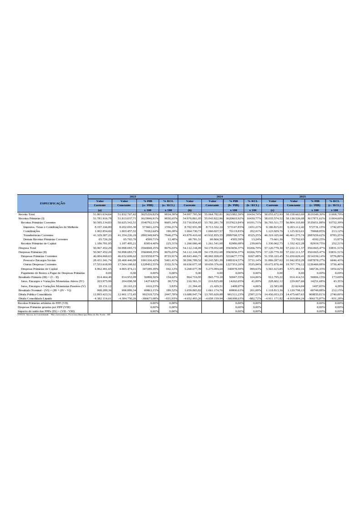
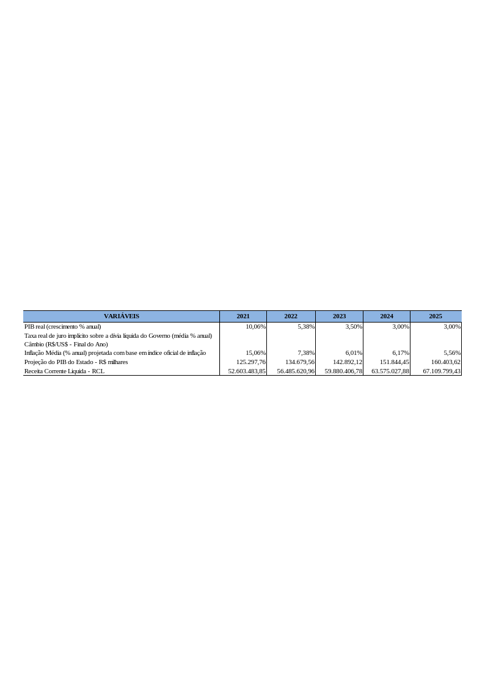
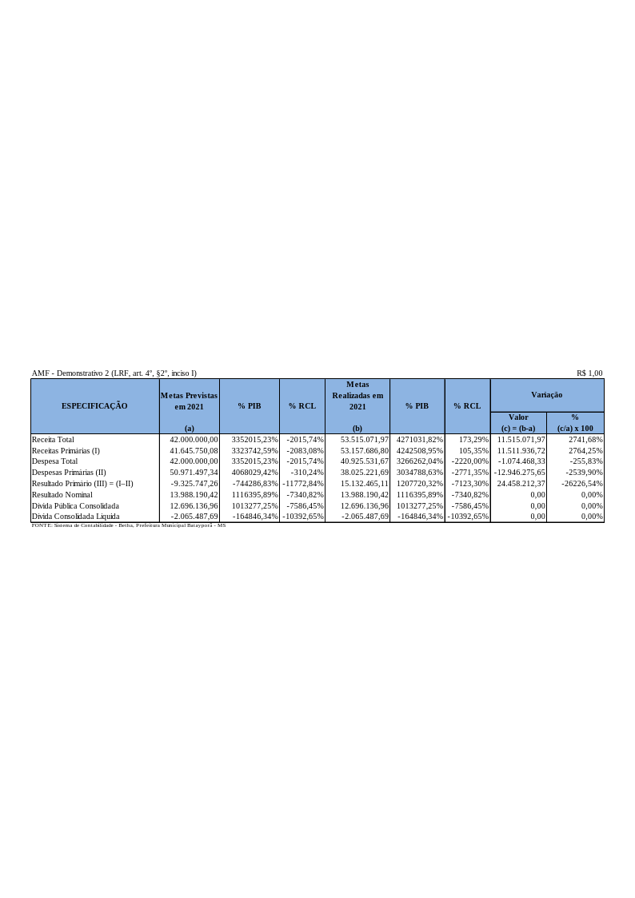
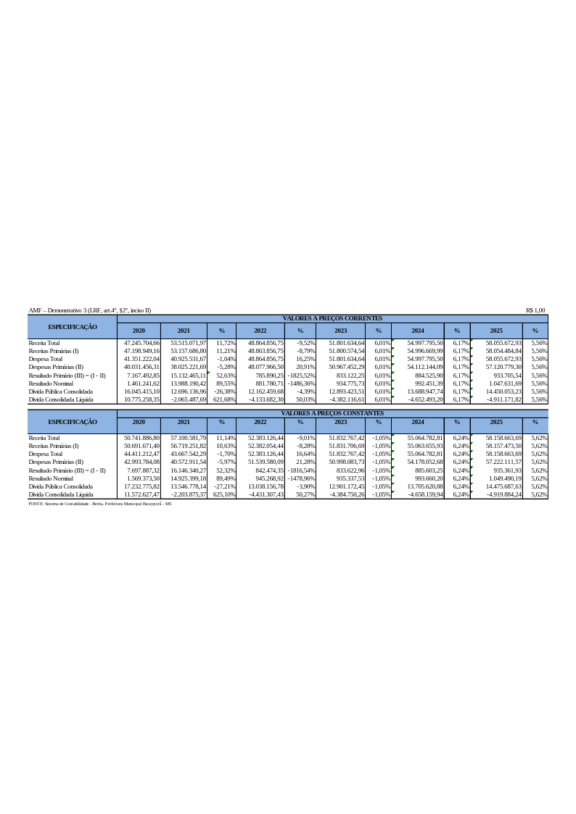
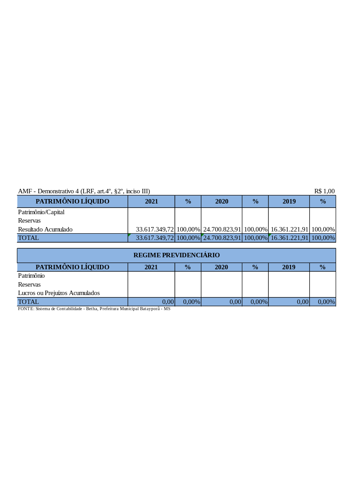
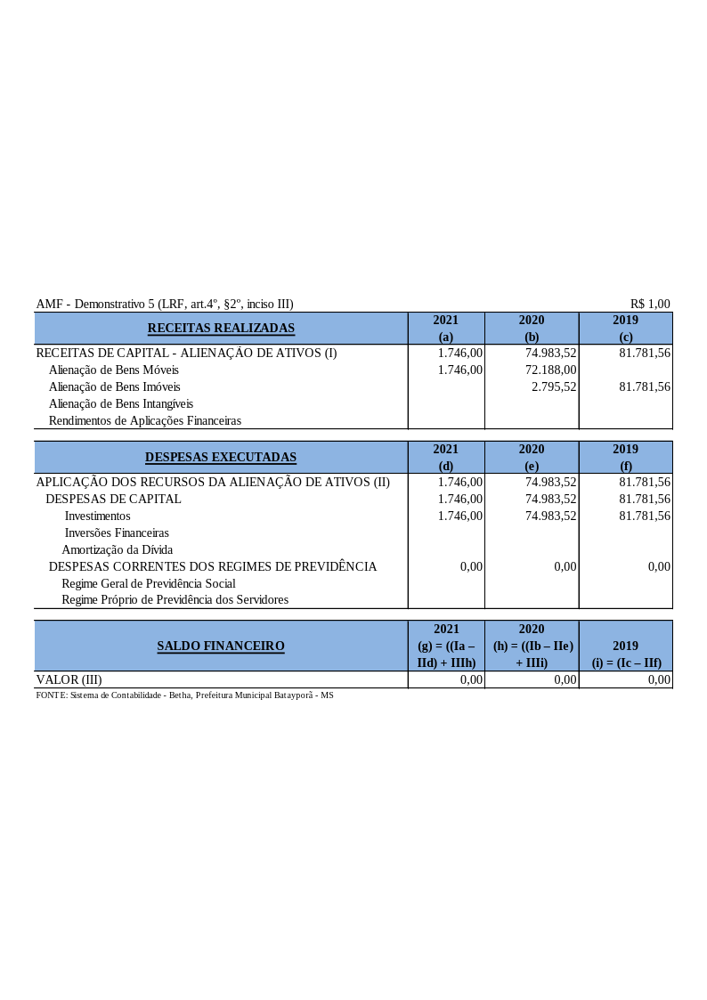
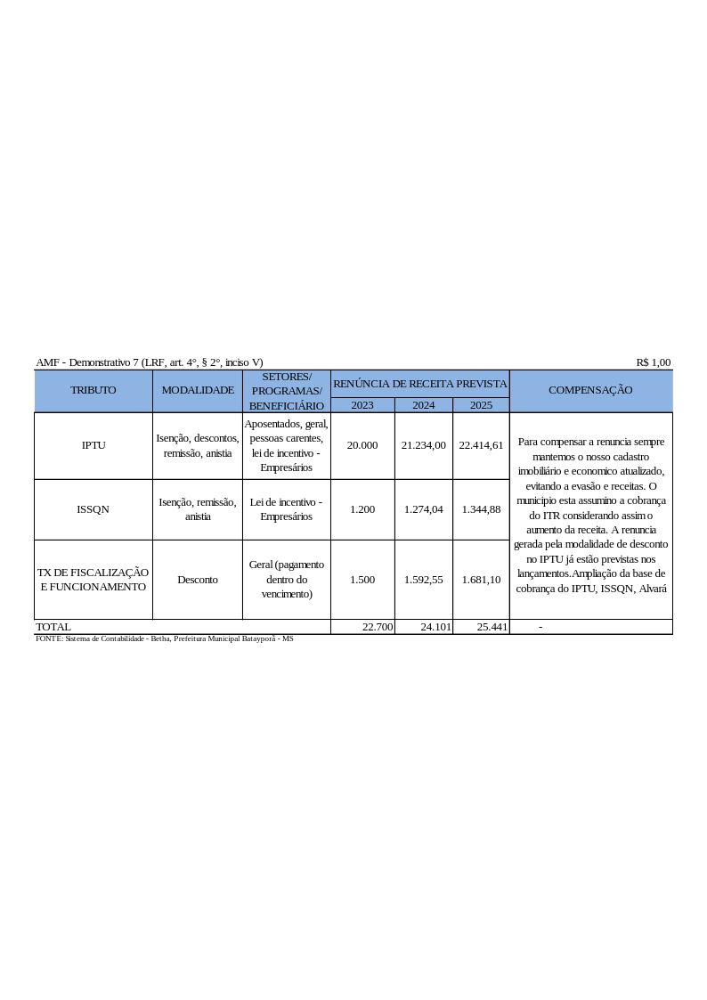
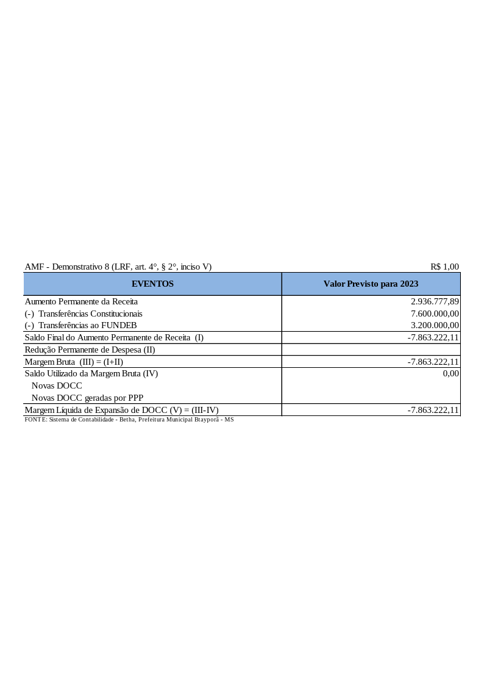
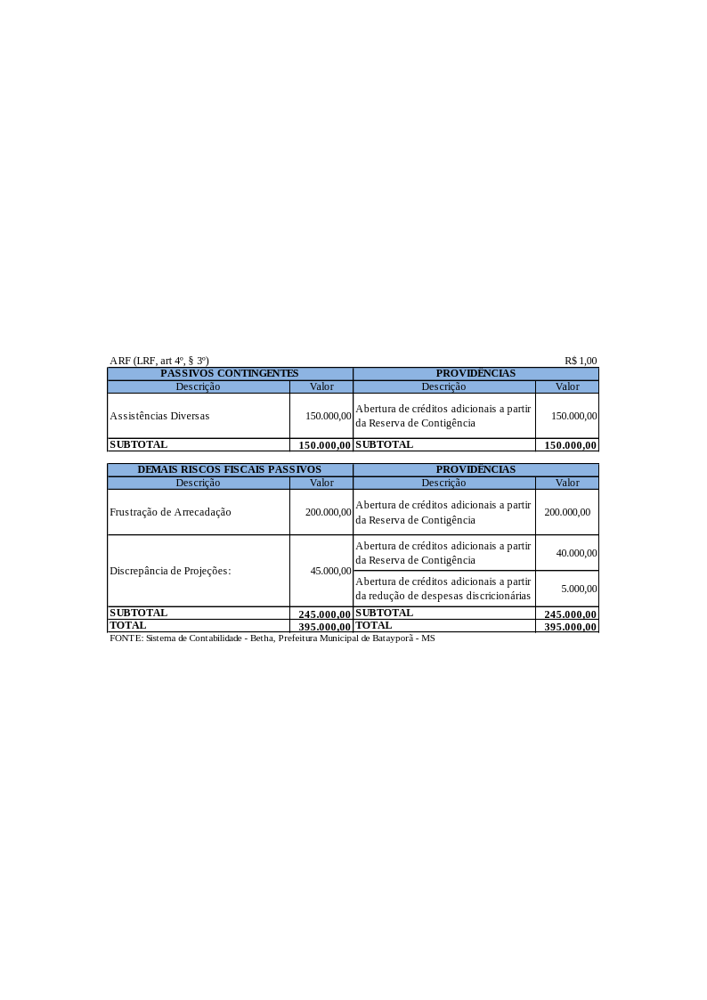

# Lei nº 1290/2022

> Dispõe sobre as diretrizes para a elaboração da Lei Orçamentária do Exercício de 2023, e dá outras providências.

!!! warning "Texto em revisão"
    Transcrito do arquivo .doc da prefeitura, conferido com a [cópia assinada e escaneada](../../assets/lei-1290-2022/lei-1290-2022.pdf) (arquivo da prefeitura), e **ainda em revisão**. Esta lei não está publicada na [página de legislação da prefeitura](https://bataypora.ms.gov.br/cidadao/legislacao-municipal).

Baixar: [PDF](../../baixar/leis-ordinarias/2022/lei-1290-2022.pdf){ .md-button download="lei-1290-2022.pdf" } [Word (.docx)](../../baixar/leis-ordinarias/2022/lei-1290-2022.docx){ .md-button download="lei-1290-2022.docx" } [Texto (.txt)](../../baixar/leis-ordinarias/2022/lei-1290-2022.txt){ .md-button download="lei-1290-2022.txt" } [Markdown (.md)](../../baixar/leis-ordinarias/2022/lei-1290-2022.md.txt){ .md-button download="lei-1290-2022.md" }

!!! abstract "Índice"
    | Divisão | Assunto | Artigos |
    |---|---|---:|
    |  | Disposições iniciais | [1](#art-1) |
    | Capítulo I | DAS PRIORIDADES E METAS DA ADMINISTRAÇÃO PÚBLICA MUNICIPAL | [2](#art-2) a [4](#art-4) |
    | Capítulo II | DA ESTRUTURA E ORGANIZAÇÃO DOS ORÇAMENTOS | [5](#art-5) a [10](#art-10) |
    | Capítulo III | DAS DIRETRIZES ESPECIFICAS | [11](#art-11) a [28](#art-28) |
    | Capítulo VI | LIMITES E CONDIÇÕES PARA EXPANSÃO DAS DESPESAS OBRIGATÓRIAS DE CARÁTER CONTINUADO | [29](#art-29) a [34](#art-34) |
    | Capítulo VIII | DAS DISPOSIÇÕES SOBRE ALTERAÇÕES NA LEGISLAÇÃO TRIBUTÁRIA | [35](#art-35) a [37](#art-37) |
    | Capítulo IX | DAS DISPOSIÇÕES DE CARATER SUPLETIVO SOBRE EXECUÇÃO DOS ORÇAMENTOS | [38](#art-38) a [40](#art-40) |
    | Capítulo X | DAS REGRAS PARA O EQUILIBRIO ENTRE A RECEITA E A DESPESA | [41](#art-41) |
    | Capítulo XI | DAS LIMITAÇÕES DE EMPENHOS | [42](#art-42) |
    | Capítulo XII | DAS TRANSFERÊNCIAS DE RECURSOS | [43](#art-43) a [46](#art-46) |
    | Capítulo XIII | DISPOSIÇÕES RELATIVAS À DIVIDA PÚBLICA MUNICIPAL | [47](#art-47) a [49](#art-49) |
    | Capítulo XIV | DAS DISPOSIÇÕES GERAIS | [50](#art-50) a [58](#art-58) |

**Lei nº. 1.290, de 28 de junho de 2022.**
{ .centro }

“Dispõe sobre as diretrizes para a elaboração da Lei Orçamentária do Exercício de 2023, e dá outras providências”.

O PREFEITO MUNICIPAL DE BATAYPORÃ, ESTADO DE MATO GROSSO DO SUL, no uso e gozo das atribuições lhe conferidas pelo Inciso VI, do art. 47, da Lei Orgânica Municipal;

Faz saber que a Câmara Municipal aprovou e ele sanciona a seguinte Lei;

**DAS DISPOSIÇÕES PRELIMINARES**

**Art. 1º** São estabelecidas em cumprimento ao disposto no § 2°, do art. 165 da Constituição Federal, Lei Orgânica Municipal e Lei Complementar n° 101/2000, as diretrizes orçamentárias do município de Batayporã-MS, para 2023, compreendendo:
{ #art-1 }

I - As prioridades e metas da administração pública municipal;

II - A estrutura e organização dos orçamentos;

III - As diretrizes específicas para o Poder Legislativo;

IV - As diretrizes gerais para elaboração e execução dos Orçamentos do Município e suas alterações;

V - As diretrizes do orçamento fiscal e da seguridade social;

VI - Os limites e condições para expansão das despesas obrigatórias de caráter continuado;

VII - As disposições relativas às despesas com pessoal e encargos sociais;

VIII - As disposições sobre alterações na legislação tributária do Município;

IX - As disposições de caráter supletivo sobre a execução dos orçamentos;

X - As regras para o equilíbrio entre a receita e a despesa;

XI - As limitações de empenho;

XII - As transferências de recursos;

XIII - As disposições relativas à dívida pública municipal e as disposições gerais.

### CAPÍTULO I — DAS PRIORIDADES E METAS DA ADMINISTRAÇÃO PÚBLICA MUNICIPAL { .centro }

**Art. 2º** As prioridades e metas da Administração Pública Municipal para o Exercício de 2023, atendidas as despesas que constituem obrigação constitucional ou legal do Município e as de funcionamento dos órgãos e entidades que integram os orçamentos fiscal e da seguridade social, são as constantes do Art. 3º desta lei, as quais terão precedência na alocação dos recursos na lei orçamentária de 2023, não se constituindo, porém, em limite à programação de despesas.
{ #art-2 }

**Art. 3º** Constituem prioridades da Administração Municipal a serem contempladas na sua programação orçamentária:
{ #art-3 }

I - A modernização da administração pública municipal através da informatização dos serviços, implementação constante dos mecanismos de governança e de um esforço persistente de redução dos custos operacionais e da racionalização dos gastos, conforme prescrições contidas na Lei Complementar n° 101/00 (Lei de Responsabilidade Fiscal);

II - O estímulo ao desenvolvimento dos recursos humanos, promovendo a capacitação e a valorização profissional dos servidores, visando ganhos de produtividade, redução de custos e otimização dos serviços públicos;

III - Uma programação social ampla e efetiva, priorizando sobretudo a população de baixa renda no acesso a serviços básicos de saúde, educação, habitação, do apoio a programas que concorram para a geração de maiores oportunidades de emprego e do estímulo à parceria com a iniciativa privada e a sociedade civil organizada;

IV - Promover ações de incentivos as atividades esportivas, culturais e do turismo, nas manifestações populares e difusão da cultura do município, em parceria com as entidades públicas e privadas, proporcionando aos munícipes o desenvolvimento social, físico e intelectual;

V - Manutenção dos programas de educação básica do município, priorizando o ensino infantil e fundamental, oferecendo aos alunos distribuição de merenda de boa qualidade, transporte escolar, melhorias das escolas municipais, bem como a valorização e capacitação dos profissionais de educação e outros incentivos educacionais que objetivem a melhoria da educação em nosso município;

VI - Implantação de uma política agrícola de valorização ao produtor rural, visando o apoio à produção familiar, ao pequeno produtor rural, incentivo ao associativismo, programa de diversificação das atividades rurais com objetivo de incentivar seu desenvolvimento social e econômico;

VII - A implantação de uma infraestrutura básica de atendimento à população, priorizando a manutenção e estruturação do sistema viário, transporte urbano e rural, drenagem, iluminação pública, saneamento, pavimentação de vias urbanas e outras obras complementares;

VIII - A incentivo às ações voltadas para a preservação, recuperação, conservação do meio ambiente e o uso racional dos recursos naturais renováveis, priorizando ações educativas;

IX - Manutenção, restauração e conservação de edificações públicas integrantes do patrimônio municipal e construção de novas unidades;

X - Desenvolver programas que estimulem a instalação de novos empreendimentos, em especial comércios e indústrias, além dos prestadores de serviços.

**Art. 4º** Constituem metas fiscais da Administração para inclusão na sua programação orçamentária as que estão contempladas nos anexos da presente lei.
{ #art-4 }

### CAPÍTULO II — DA ESTRUTURA E ORGANIZAÇÃO DOS ORÇAMENTOS { .centro }

**Art. 5º** As categorias de programação de que trata esta Lei, serão identificadas no projeto de Lei Orçamentária por Funções, Subfunções, Programas, Atividades e Projetos, órgão concedente e Organizações da Sociedade Civil.
{ #art-5 }

Parágrafo único. Para efeito desta Lei, entende-se por:

I - Função, o maior nível de agregação das diversas áreas de despesa que competem ao setor público;

II - Subfunção, representa uma partição da função, visando a agregar determinado subconjunto de despesa do setor público;

III - Programa, um instrumento de organização da ação governamental visando à concretização dos objetivos pretendidos;

IV - Atividade, um instrumento de programação para alcançar o objetivo de um programa, envolvendo um conjunto de operações que se realizam de modo contínuo e permanente, das quais resulta um produto necessário à manutenção da ação de governo;

V - Projeto, um instrumento de programação para alcançar o objetivo de um programa, envolvendo um conjunto de operações, limitadas no tempo, das quais resulta um produto que concorre para a expansão ou aperfeiçoamento da ação de governo;

VI - Concedente, o órgão ou a entidade da administração pública direta ou indireta responsável pela transferência de recursos financeiros, inclusive os decorrentes de descentralização de créditos orçamentários; e

VII - Organizações da Sociedade Civil as entidades privadas, com os quais o município pactue a transferência de recursos financeiros, inclusive quando decorrentes da descentralização de créditos orçamentários.

**Art. 6º** Os orçamentos fiscais e da seguridade social, referentes aos poderes do Município, seus fundos e órgãos da administração direta, indireta e fundações criadas e mantidas pelo poder público municipal, discriminarão as despesas por unidade orçamentária, detalhada por categoria de programação, segundo exigências da Lei n° 4.320/64.
{ #art-6 }

**Art. 7º** Na lei orçamentária, a discriminação da despesa, quanto à sua natureza, far-se-á, por categoria econômica, grupo de natureza da despesa e modalidade de aplicação.
{ #art-7 }

§ 1º As despesas de cada Unidade Orçamentária serão discriminadas por projeto/atividade e classificadas por:

I - Função, Subfunção e Programa;

II - Grupos de Despesa;

III - Elemento de Despesa.

§ 2º Os Grupos de Despesa a que se refere o inciso II, deste artigo, são os seguintes:

I - Pessoal e Encargos Sociais – 1;

II - Juros e Encargos da Dívida – 2;

III - Outras Despesas Correntes – 3;

IV - Investimentos – 4;

V - Inversões Financeiras – 5; e

VI - Amortização da Dívida – 6.

§ 3º Cada programa identificará as ações necessárias para atingir os seus objetivos, sob a forma de atividades e projetos, especificando os respectivos valores, bem como as unidades orçamentárias responsáveis pela realização da ação.

§ 4º Os conceitos e as especificações dos Grupos de Despesa são os constantes do Manual de Contabilidade Aplicada ao Setor Público.

§ 5º Os conceitos e especificações das Fontes de Receita, são os constantes do Manual de Contabilidade Aplicada ao Setor Público.

§ 6º Cada atividade e projeto identificará a Função, a Subfunção e o Programa aos quais se vinculam.

**Art. 8º** O projeto de Lei Orçamentária que o Poder Executivo encaminhará à Câmara Municipal, será constituído de:
{ #art-8 }

I - Mensagem;

II - Texto da lei;

III - Quadros orçamentários consolidados;

IV - Anexo dos orçamentos fiscal e da seguridade social, discriminando receita e despesa na forma definida na Lei Federal n° 4.320/64.

**Art. 9º** O enquadramento dos projetos e atividades na classificação funcional-programática, deverá observar os objetivos específicos de cada aplicação, independente da unidade a que estiverem vinculados.
{ #art-9 }

**Art. 10.** As despesas e as receitas dos orçamentos fiscais e da seguridade social, bem como do conjunto dos dois orçamentos serão apresentados de forma sintética e agregada, evidenciando o déficit ou o superávit corrente e o total de cada um dos orçamentos.
{ #art-10 }

### CAPÍTULO III — DAS DIRETRIZES ESPECIFICAS { .centro }

**PARA O PODER LEGISLATIVO**

**Art. 11.** total da despesa do Poder Legislativo Municipal, incluídos os subsídios dos Vereadores, será no percentual de 7% (sete por cento), relativo ao somatório da receita tributária e das transferências previstas no §5° do Art. 153 e nos artigos 158 e 159 da Constituição Federal, efetivamente realizado no exercício anterior, conforme regra contida em norma fixada pelo Tribunal de Contas do Estado de Mato Grosso do Sul.
{ #art-11 }

**Art. 12.** duodécimo devido à Câmara Municipal será repassado até o dia 20 (vinte) de cada mês, nos termos do inciso II, § 2° do art. 29-A da Constituição Federal.
{ #art-12 }

**Art. 13.** A despesa total com a folha de pagamento do Poder Legislativo, incluídos os gastos com subsídios dos Vereadores, não poderá ultrapassar a 70% (setenta por cento) de sua receita, de acordo com o estabelecido no §1º do art. 29-A da Constituição Federal.
{ #art-13 }

**Art. 14.** Poder Legislativo encaminhará sua proposta orçamentária ao Poder Executivo, para fins de consolidação, até o final do mês de julho do corrente ano.
{ #art-14 }

**Art. 15.** Será destinado às Emendas Parlamentares Individuais o limite de 1,2% da Receita Corrente Líquida, sendo que a metade desse percentual às ações e serviços públicos de saúde, nos termos do disposto no § 9º, do artigo 166, da Constituição Federal e na Lei Orgânica Municipal.
{ #art-15 }

**CAPÍTULO IV**

**DAS DIRETRIZES GERAIS PARA A ELABORAÇÃO E EXECUÇÃO DOS ORÇAMENTOS DO MUNICÍPIOE SUAS ALTERAÇÕES**

**Art. 16.** A elaboração do projeto, a aprovação e a execução da Lei Orçamentária de 2023 deverão ser realizados de modo a evidenciar a transparência da gestão fiscal, observando-se o princípio da publicidade e permitindo-se o amplo acesso da sociedade a todas as informações.
{ #art-16 }

**Art. 17.** A alocação dos créditos orçamentários será feita diretamente à unidade orçamentária responsável pela execução das ações correspondentes.
{ #art-17 }

**Art. 18.** Na programação da despesa serão vedados:
{ #art-18 }

I - O início de programas ou projetos não incluídos na lei orçamentária anual;

II - Consignar na lei orçamentária projetos com a mesma finalidade em mais de uma Unidade Orçamentária, crédito com finalidade imprecisa ou com dotação ilimitada.

III - A vinculação da receita de impostos à órgãos, fundos ou despesas, nos termos do inciso IV do art. 167 da Constituição Federal.

**Art. 19.** Além das prioridades referidas no artigo 3º, a Lei de Diretrizes Orçamentárias somente admite a inclusão de novos projetos e despesas obrigatórias de duração continuada no orçamento, se:
{ #art-19 }

I - Tiverem sido adequadamente atendidos os projetos já iniciados;

II - Tiverem sido contempladas as despesas de conservação do patrimônio público;

III - No caso de haver excesso de arrecadação no exercício;

IV - Tiverem perfeitamente definidas suas fontes de custeio.

**Art. 20.** A lei orçamentária somente contemplará dotação para investimento com duração superior a um exercício financeiro, se ele estiver contido no Plano Plurianual ou em lei que autorize sua inclusão.
{ #art-20 }

**Art. 21.** As previsões de receita para o exercício de 2023, e eventual reestimativa pelo Poder Legislativo, deverão estar em consonância às disposições do artigo 12 da Lei de Responsabilidade Fiscal.
{ #art-21 }

**Art. 22.** É vedada a aplicação de recursos decorrentes da alienação de bens e direitos que integram o patrimônio público para o financiamento de despesa corrente, salvo se destinada por lei aos regimes de previdência social, geral e próprio dos servidores públicos.
{ #art-22 }

**Art. 23.** É obrigatória a destinação de recursos para compor a contrapartida de empréstimos e para pagamento de amortização, juros e outros encargos da dívida municipal, observados os cronogramas financeiros das respectivas operações.
{ #art-23 }

**Art. 24.** É obrigatória a inclusão no orçamento, de recursos necessários ao pagamento de débitos oriundos de sentenças transitadas em julgado, constantes de precatórios judiciários, apresentados nos termos da legislação vigente.
{ #art-24 }

**Art. 25.** A Lei Orçamentária, destinará:
{ #art-25 }

I - Para a manutenção e desenvolvimento do ensino, o percentual mínimo de 25% (vinte e cinco por cento) da receita resultante de impostos na forma prevista no art. 212 da Constituição Federal e Lei Orgânica Municipal;

II - Em ações e serviços públicos de saúde não menos de 15% (quinze por cento) da receita oriunda de impostos, em conformidade com o inciso III, do § 2º do Art. 198 da Constituição Federal.

III - A receita do FUNDEB será aplicada para o financiamento de ações de manutenção e desenvolvimento da educação básica pública, conforme estabelecido no art. 211 da Constituição Federal e na Legislação do FUNDB.

**CAPÍTULO V**

**DAS DIRETRIZES DOS ORÇAMENTOS FISCAL E DA SEGURIDADE SOCIAL**

**Art. 26.** s recursos ordinários do Município, somente poderão ser programados para atender despesas de capital, depois de atendidas despesas com pessoal e encargos sociais, serviços da dívida e outras despesas de custeio administrativo e operacional, precatórios judiciais, bem como a contrapartida de convênios e de programas financiados e aprovados por lei específica.
{ #art-26 }

Parágrafo único. Na fixação da programação da despesa deverão ser observadas a legislação vigente.

**Art. 27.** Orçamento da Seguridade Social, compreenderá as dotações destinadas a atender às ações de saúde, previdência e assistência social e contará, dentre outros, com recursos provenientes:
{ #art-27 }

I - Das contribuições sociais previstas na Constituição;

II - Das receitas diretamente arrecadadas pelos órgãos, entidades e fundos que integram o orçamento de que trata este artigo;

III - Das receitas transferidas do Orçamento Fiscal do Município.

**Art. 28.** A Lei Orçamentária conterá reserva de contingência de no mínimo 0,5% (meio por cento) da receita corrente líquida, destinada ao atendimento de emendas parlamentares impositivas, passivos contingentes e outros riscos, além de eventos fiscais imprevistos, inclusive para abertura de créditos adicionais destinados ao reforço de dotações que se revelarem insuficientes para atender suas finalidades.
{ #art-28 }

Parágrafo único. Para efeito desta Lei, entendem-se como eventos e riscos fiscais imprevistos, entre outros, as despesas necessárias ao funcionamento e manutenção dos serviços públicos e da estrutura da administração pública municipal, não orçadas, ou orçadas a menor, e as decorrentes de criação, expansão ou aperfeiçoamento de ações governamentais, imprescindíveis às necessidades do Poder Público.

### CAPÍTULO VI — LIMITES E CONDIÇÕES PARA EXPANSÃO DAS DESPESAS OBRIGATÓRIAS DE CARÁTER CONTINUADO { .centro }

**Art. 29.** A criação, expansão ou aperfeiçoamento de ação governamental que acarrete aumento de despesas de caráter continuado, deverá ser acompanhado de estimativa do impacto orçamentário-financeiro no exercício em que deva entrar em vigor e nos dois subsequentes.
{ #art-29 }

**Art. 30.** Para efeito do disposto no § 3º art. 16, da Lei Complementar nº 101, são consideradas despesas irrelevantes, aquelas decorrentes de ação governamental nova, cujo impacto orçamentário-financeiro num exercício não exceda o valor para dispensa de licitação, fixado na Lei de Licitações.
{ #art-30 }

**CAPÍTULO VII**

**DAS DISPOSIÇÕES RELATIVAS AS DESPESAS COM PESSOAL E ENCARGOS SOCIAIS**

**Art. 31.** A despesa com pessoal ativo, inativo, pensionista e encargos sociais do Executivo não poderá exceder, no exercício, ao limite de 54% (cinquenta e quatro por cento) das respectivas receitas correntes líquidas (RCL), na forma do disposto na alínea “b” do inciso III do art. 20 da Lei Complementar n.º 101.
{ #art-31 }

§ 1º Entende-se por receita corrente líquida o somatório das receitas tributárias, de contribuição, patrimoniais, industriais, agropecuárias, de serviços, transferências correntes e outras receitas correntes, deduzidas:

I - Contribuições dos servidores para o custeio de seu sistema de previdência e assistência social;

II - Compensação Financeira entre Regimes de Previdência;

III - dedução de Receita para Formação do FUNDEB.

§ 2º A receita corrente líquida será apurada somando-se as receitas arrecadadas no mês em referência e nos onze meses anteriores, excluídas as duplicidades.

**Art. 32.** Na hipótese de a despesa de pessoal exceder a 95% (noventa e cinco por cento) do limite de que trata o art. 30 desta lei, aplicar-se-á o disposto no parágrafo único do artigo 22 da Lei Complementar n.º 101/00.
{ #art-32 }

**Art. 33.** No exercício de 2023, a realização de horas extras, quando a despesa houver extrapolado 95% (noventa e cinco por cento) dos limites referidos no art. 30 desta Lei, somente poderá ocorrer quando for ao atendimento de relevantes interesses públicos, devidamente justificados pela autoridade competente.
{ #art-33 }

Parágrafo único. A autorização para a realização de serviços extraordinário, no âmbito do Poder Executivo, nas condições estabelecidas no caput deste artigo, é de exclusiva competência do Prefeito Municipal ou por autoridade por ele delegada.

**Art. 34.** Fica autorizada a realização de concursos públicos para todos os Poderes, desde que:
{ #art-34 }

I - atendam os dispositivos do artigo 169 da Constituição Federal e limites estabelecidos na Lei Complementar nº 101. de 04 de maio de 2000;

II - Sejam para suprir deficiências de mão-de-obra ou ampliação de serviços básicos do Município.

### CAPÍTULO VIII — DAS DISPOSIÇÕES SOBRE ALTERAÇÕES NA LEGISLAÇÃO TRIBUTÁRIA { .centro }

**Art. 35.** A estimativa da receita que constará do projeto de Lei Orçamentária para o Exercício de 2023 contemplará medidas de aperfeiçoamento da administração dos tributos municipais, com vistas à expansão de base de tributação e consequentes aumento das receitas próprias.
{ #art-35 }

**Art. 36.** A estimativa da receita citada no artigo anterior levará em consideração, adicionalmente, o impacto de alteração na legislação tributária, observadas a capacidade econômica do contribuinte e a justa distribuição de renda, com destaque para:
{ #art-36 }

I - Atualização e/ou revisão do [Código Tributário](../../codigo-tributario/lc-001-1991.md) e da planta genérica de valores do município;

II - Revisão, atualização ou adequação da legislação sobre Imposto Predial e Territorial Urbano, suas alíquotas, forma de cálculo, condições de pagamento, descontos e isenções;

III - Revisão da legislação sobre o uso do solo, com redefinição dos limites da zona urbana municipal;

IV - Revisão da legislação sobre as taxas pelo exercício do poder da polícia;

V - Revisão das isenções dos tributos municipais, para manter o interesse público e a justiça fiscal.

Parágrafo único. Com o objetivo de estimular o desenvolvimento econômico e sociocultural do Município, o Poder Executivo encaminhará projetos de lei de incentivos ou benefícios de natureza tributária, cuja renúncia de receita poderá alcançar os montantes dimensionados ou superiores aos constantes no Anexo de Metas Fiscais, já consideradas no cálculo do resultado primário, ou será demonstrada nas leis de que tratam os incentivos ou benefícios fiscais.

**Art. 37.** s tributos lançados e não arrecadados, inscritos em dívida ativa, cujos custos para a cobrança sejam superiores ao crédito tributário, poderão ser cancelados, mediante autorização em lei, não se constituindo como renúncia de receita para efeito do disposto no art. 14, §3º da Lei Complementar n. º 101.
{ #art-37 }

### CAPÍTULO IX — DAS DISPOSIÇÕES DE CARATER SUPLETIVO SOBRE EXECUÇÃO DOS ORÇAMENTOS { .centro }

**Art. 38.** A proposta orçamentária do Município para 2023, será encaminhada a Câmara Municipal, pelo Poder Executivo, no prazo definido pela Lei Orgânica Municipal.
{ #art-38 }

**Art. 39.** A Lei Orçamentária Anual definirá o percentual em que o Poder Executivo ficará autorizado a abrir créditos especiais e adicionais suplementares e os remanejamentos, as transposições e as transferências de recursos de uma categoria de programação para outra ou de um órgão para outro, utilizando os recursos previstos no art. 43 da Lei nº 4.320/64.
{ #art-39 }

Parágrafo único. As autorizações contempladas no caput deste artigo são extensivas às dotações orçamentárias consignadas ao Poder Legislativo e às programações orçamentárias dos fundos e dos órgãos da administração indireta.

**Art. 40.** É vedada a realização de despesa ou a assunção de obrigações que excedam os créditos orçamentários ou adicionais, ou quaisquer procedimentos que viabilizem a execução de despesa sem a comprovada e suficiente disponibilidade de dotação orçamentária.
{ #art-40 }

### CAPÍTULO X — DAS REGRAS PARA O EQUILIBRIO ENTRE A RECEITA E A DESPESA { .centro }

**Art. 41.** Para o estabelecimento do equilíbrio entre as receitas e as despesas serão adotadas as regras de acompanhamento da execução orçamentária por via dos relatórios explicitados na Lei Complementar nº 101/00.
{ #art-41 }

### CAPÍTULO XI — DAS LIMITAÇÕES DE EMPENHOS { .centro }

**Art. 42.** s critérios e formas de limitação de empenho são os referidos no art. 9º da Lei Complementar n.º 101/00, ficando o Poder Executivo por ato próprio, responsável pela reprogramação dos empenhos, nos limites do comportamento da receita, excluídas as despesas que constituem obrigação constitucional ou legal de execução.
{ #art-42 }

### CAPÍTULO XII — DAS TRANSFERÊNCIAS DE RECURSOS { .centro }

**Art. 43.** Orçamento Municipal poderá consignar recursos para financiar serviços de sua responsabilidade a serem executados por entidades de direito privado, para a consecução de finalidades de interesse público e recíproco, mediante a execução de atividades ou de projetos previamente estabelecidos em planos de trabalho inseridos em termos de colaboração, em termos de fomento ou em acordos de cooperação, convênios, contratos, e outros instrumentos legais, desde que sejam da conveniência do Município e tenham demonstrado padrões de eficiência no cumprimento dos objetivos determinados.
{ #art-43 }

**Art. 44.** Não poderão ser destinados recursos para atender despesas com:
{ #art-44 }

I - Associações de servidores ou quaisquer outras entidades congêneres, excetuadas as creches e escolas para o atendimento escolar, e as entidades de natureza educacionais, esportivas, de saúde e assistência social.

II - Pagamento, a qualquer título, a servidor da Administração Direta ou Indireta por serviços de consultoria ou assistência técnica ou qualquer serviço ligado à administração municipal.

**Art. 45.** As transferências de recursos financeiros destinados a subvenções sociais, contribuições e auxílios, no que couber, obedecerão, preferencialmente, às regras estipuladas na Lei Complementar n.º 101/00 e no Marco Regulatório da Organizações da Sociedade Civil.
{ #art-45 }

**Art. 46.** As despesas de competência de outros entes da Federação só serão assumidas pela Administração Municipal quando firmados por convênios, acordos ou ajustes e previstos recursos na lei orçamentária, conforme dispõe o Art. 62 da Lei Complementar nº 101/00 – LRF.
{ #art-46 }

Parágrafo único. As despesas de outros entes da Federação somente poderão ocorrer em situações que envolvam claramente o atendimento de interesses locais.

### CAPÍTULO XIII — DISPOSIÇÕES RELATIVAS À DIVIDA PÚBLICA MUNICIPAL { .centro }

**Art. 47.** A Lei Orçamentária garantirá recursos para pagamento da despesa decorrente de débitos refinanciados, inclusive com a previdência social.
{ #art-47 }

**Art. 48.** projeto de Lei Orçamentária poderá incluir, na composição da receita total do Município, recursos provenientes de operação de crédito, respeitados os limites estabelecidos no artigo 167, inciso III, da Constituição Federal.
{ #art-48 }

**Art. 49.** A Lei Orçamentária Anual poderá autorizar a realização de operação de crédito por antecipação de receita, conforme disposto no art. 38, da Lei Complementar n.º 101/2000.
{ #art-49 }

### CAPÍTULO XIV — DAS DISPOSIÇÕES GERAIS { .centro }

**Art. 50.** Poder executivo, de acordo com o § 3° do art. 12 da LRF, encaminhará à Câmara Municipal, no mínimo, trinta dias antes do encaminhamento de sua proposta orçamentária a estimativa das receitas para o exercício subsequente.
{ #art-50 }

**Art. 51.** As propostas de modificações ao projeto de lei orçamentária, serão apresentadas, no que couber, com a forma, o nível de detalhamento, os demonstrativos e as informações estabelecidas para o orçamento, nesta Lei.
{ #art-51 }

**Art. 52.** A classificação da estrutura programática para 2023 poderá sofrer alterações para a adequação ao Plano de Contas Único da Administração Pública Federal regulamentado pela Secretaria do Tesouro Nacional - STN, do Ministério da Fazenda e pelo Tribunal de Contas do Estado de Mato Grosso Sul - TCE-MS.
{ #art-52 }

**Art. 53.** Se o Projeto de Lei Orçamentária não for devolvido para sanção até o encerramento da sessão legislativa, a programação dele constante poderá ser executada mediante créditos especiais ou suplementares, com prévia e específica autorização legislativa, para o atendimento exclusivamente das seguintes despesas:
{ #art-53 }

I - Pessoal e encargos sociais;

II - Pagamento de benefícios previdenciários;

III - Pagamento do serviço da dívida; e.

IV - Pagamento de precatórios e ordens judiciais

**Art. 54.** A Lei Orçamentária Anual, evidenciará as Receitas e Despesas de cada uma das Unidades Gestoras, identificadas com o respectivo código, especificando aquelas vinculadas a fundos e aos orçamentos Fiscal e da Seguridade Social, desdobradas conforme as funções especificadas nesta Lei e nos anexos da Lei 4320/64.
{ #art-54 }

**Art. 55.** ente não ficara escuso da responsabilidade de estabelecer metas fiscais para o exercício financeiro de 2023, mesmo na ocorrência de calamidade, ressaltando que poderá ser dispensado de cumprir as metas fixadas e poderá ser inserido uma previsão para a atualização das metas orçamentárias.
{ #art-55 }

**Art. 56.** A previsão das receitas e a fixação das despesas para 2023, serão orçadas a valores correntes.
{ #art-56 }

**Art. 57.** Conforme dispõe a Constituição Federal, o Plano Plurianual – PPA, deve ser elaborado no primeiro ano de mandato, desta forma, fica o Poder Executivo Municipal autorizado a compatibilizar a LOA para o exercício de 2023, bem como a promover alterações no PPA 2022-2025.
{ #art-57 }

**Art. 58.** Esta lei entrará em vigor na data de sua publicação.
{ #art-58 }

Batayporã-MS, 28 de junho de 2022.

**Germino da Roz Silva**
{ .centro }

Prefeito Municipal
{ .centro }

Publicado e afixado na forma da Lei.

**Gabriel Boffo da Rocha**
{ .centro }

Secretário Municipal de Administração Finanças e Planejamento
{ .centro }

**LEI Nº 1.290/2022**

**LEI DE DIRETRIZES ORÇAMENTÁRIAS**

**2023**

**<u>ANEXO DE METAS E PRIORIDADES</u>**

**Poder Executivo**

<table style="width:62%;">
<colgroup>
<col style="width: 62%" />
</colgroup>
<tbody>
<tr>
<td style="text-align: center;"><strong>Gabinete do Prefeito, Secretaria de Governo, Procuradoria Jurídica</strong></td>
</tr>
<tr>
<td style="text-align: center;"><ul>
<li>
Dar suporte jurídico e orientações jurídicas; 
</li>
</ul></td>
</tr>
<tr>
<td style="text-align: center;"><ul>
<li>
Assessoria completa do Gabinete do Prefeito; 
</li>
</ul></td>
</tr>
<tr>
<td style="text-align: center;"><ul>
<li>
Desenvolver atividades de consultoria e assessoramento jurídicos; 
</li>
</ul></td>
</tr>
<tr>
<td style="text-align: center;"><ul>
<li>
Prestar assessoria às Secretária e Departamentos Municipais; 
</li>
</ul></td>
</tr>
<tr>
<td style="text-align: center;"><ul>
<li>
Emissão de pareceres sobre requerimentos de servidores e terceiros com interesses voltados ao Município; 
</li>
</ul></td>
</tr>
<tr>
<td style="text-align: center;"><ul>
<li>
Representar o Município judicial e extrajudicialmente, recebendo citações, intimações e notificações judiciais; 
</li>
</ul></td>
</tr>
<tr>
<td style="text-align: center;"><ul>
<li>
Elaborar defesas e prestar informações ao Ministério Público e ao Tribunal de Contas do Estado;  
</li>
</ul></td>
</tr>
<tr>
<td style="text-align: center;"><ul>
<li>
Defender em juízo os interesses da Administração; 
</li>
</ul></td>
</tr>
<tr>
<td style="text-align: center;"><ul>
<li>
Realizar cobranças judiciais de dívida ativa; 
</li>
</ul></td>
</tr>
<tr>
<td style="text-align: center;"><ul>
<li>
Edição de Decretos e Portarias, no entanto atualmente a confecção de tais atos administrativos estão sob a responsabilidade da Secretaria Municipal de Administração, por força de Lei, sendo que a revisão final e encaminhamento para publicação em Diário Oficial do Município ocorre via procuradoria, por meio eletrônico;
</li>
</ul></td>
</tr>
<tr>
<td style="text-align: center;"><ul>
<li>
Executar a coordenação, a supervisão e o controle das atividades de apoio ao Prefeito Municipal;
</li>
</ul></td>
</tr>
<tr>
<td style="text-align: center;"><ul>
<li>
Implantar a Procuradoria Geral e reestruturar o quadro de servidores;
</li>
</ul></td>
</tr>
<tr>
<td style="text-align: center;"><ul>
<li>
Melhorar a análise prévia da legalidade dos créditos tributários a serem inscritos em Dívida Ativa.
</li>
</ul></td>
</tr>
</tbody>
</table>

<table style="width:62%;">
<colgroup>
<col style="width: 62%" />
</colgroup>
<tbody>
<tr>
<td style="text-align: center;"><strong>Secretaria de Administração, Finanças e Planejamento</strong> </td>
</tr>
<tr>
<td style="text-align: center;"><ul>
<li>
Qualificação contínua dos servidores municipais, visando a sua valorização e a qualidade dos serviços prestados a população;  
</li>
</ul></td>
</tr>
<tr>
<td style="text-align: center;"><ul>
<li>
Modernizar a estrutura dos setores com a aquisição de equipamentos e materiais permanentes visando a otimização dos serviços prestados a população; 
</li>
</ul></td>
</tr>
<tr>
<td style="text-align: center;"><ul>
<li>
Garantir a execução orçamentária visando uma Gestão Pública eficiente; 
</li>
</ul></td>
</tr>
<tr>
<td style="text-align: center;"><ul>
<li>
Restruturação do setor de tributação, que consiste em uma rede nacional para a simplificação do registro e legalização de empresas e negócios;
</li>
</ul></td>
</tr>
<tr>
<td style="text-align: center;"><ul>
<li>
Aumentar a receita por meio de um esforço de fiscalização com ênfase no monitoramento setorial dos grandes contribuintes; do estímulo à arrecadação; da revisão dos benefícios fiscais; do incremento de ingresso via cobrança e da promoção da educação tributária;
</li>
</ul></td>
</tr>
<tr>
<td style="text-align: center;"><ul>
<li>
Amortizar de dívidas contratadas; 
</li>
</ul></td>
</tr>
<tr>
<td style="text-align: center;"><ul>
<li>
Fortalecer parcerias com as Universidades públicas e privadas da nossa região, como IFMS, UFMS bem como com outras instituições afins, atraindo estagiários dos setores de Administração, Recursos Humanos, Engenharia da produção e outros, prestando serviço de consultoria acompanhada nos empreendimentos do nosso município;
</li>
</ul></td>
</tr>
<tr>
<td style="text-align: center;"><ul>
<li>
Fortalecer a ASEB (Associação Empresarial de Batayporã), firmando parcerias que ofereçam cursos, palestras, seminários, visando ampliar os conhecimentos sobre administração dos seus negócios;
</li>
</ul></td>
</tr>
<tr>
<td style="text-align: center;"><ul>
<li>
Revitalizar, melhorar e dar manutenção do arquivo municipal;
</li>
</ul></td>
</tr>
<tr>
<td style="text-align: center;"><ul>
<li>
Revisar das Leis Municipais, buscando melhorias e atualizações das mesmas;
</li>
</ul></td>
</tr>
<tr>
<td style="text-align: center;"><ul>
<li>
Realizar por meios legais leilões de equipamentos, maquinários ou veículo que já não possua mais vida útil ao poder público;
</li>
</ul></td>
</tr>
<tr>
<td style="text-align: center;"><ul>
<li>
Reformar o paço municipal;
</li>
</ul></td>
</tr>
<tr>
<td style="text-align: center;"><ul>
<li>
Realizar planejamento para as aquisições de produtos e serviços das entidades orçamentárias, por meio do Plano de Contratações Anuais, dessa forma garantindo agilidade aos processos licitatórios;
</li>
</ul></td>
</tr>
<tr>
<td style="text-align: center;"><ul>
<li>
Instruir e implementar ações para reduzir a inadimplência dos contribuintes municipais;
</li>
</ul></td>
</tr>
<tr>
<td style="text-align: center;"><ul>
<li>
Modernizar gestão de processos da administração pública, por meio da implantação do Papel Zero, de forma a agilizar os processos administrativos e reduzir gasto com papel;
</li>
</ul></td>
</tr>
<tr>
<td style="text-align: center;"><ul>
<li>
Estruturar setor de gestão de contratos administrativos;
</li>
</ul></td>
</tr>
<tr>
<td style="text-align: center;"><ul>
<li>
Melhorar processamento de dados e distribuição do sinal de internet para os órgãos públicos;
</li>
</ul></td>
</tr>
<tr>
<td style="text-align: center;"><ul>
<li>
Reorganizar o sistema patrimonial do município;
</li>
</ul></td>
</tr>
<tr>
<td style="text-align: center;"><ul>
<li>
Implantar do almoxarifado central;
</li>
</ul></td>
</tr>
<tr>
<td style="text-align: center;"><ul>
<li>
Modernizar a Administração tributária, para aumentar a eficiência e eficácia da arrecadação fiscal;
</li>
</ul></td>
</tr>
<tr>
<td style="text-align: center;"><ul>
<li>
Financiar as ações das secretarias municipais ao fim do cumprimento de seus objetivos;
</li>
</ul></td>
</tr>
<tr>
<td style="text-align: center;"><ul>
<li>
Implantar o ponto eletrônico para controle de frequência dos servidores municipais;
</li>
</ul></td>
</tr>
<tr>
<td style="text-align: center;"><ul>
<li>
Implantar o gerenciamento da frota veicular, através do controle de manutenção, prevenindo gastos indevidos;
</li>
</ul></td>
</tr>
<tr>
<td style="text-align: center;"><ul>
<li>
Promover a progressão funcional dos vencimentos salariais.
</li>
</ul></td>
</tr>
</tbody>
</table>

<table style="width:62%;">
<colgroup>
<col style="width: 62%" />
</colgroup>
<tbody>
<tr>
<td style="text-align: center;"><strong>Controladoria</strong></td>
</tr>
<tr>
<td style="text-align: center;"><ul>
<li>
Assessorar a administração nos aspectos relacionados aos controles internos e externos e quanto à legalidade dos atos de gestão; 
</li>
</ul></td>
</tr>
<tr>
<td style="text-align: center;"><ul>
<li>
Exercer o acompanhamento sobre a observância dos limites constitucionais, da Lei de Responsabilidade Fiscal e os estabelecidos nos demais instrumentos legais; 
</li>
</ul></td>
</tr>
<tr>
<td style="text-align: center;"><ul>
<li>
Estabelecer mecanismos voltados a comprovar a legalidade e a legitimidade dos atos de gestão e avaliar os resultados, quanto à eficácia, eficiência e economicidade na gestão orçamentária, financeira, patrimonial e operacional no Legislativo, bem como, na aplicação de recursos públicos por entidades de direito privado; 
</li>
</ul></td>
</tr>
<tr>
<td style="text-align: center;"><ul>
<li>
Melhorar os meios de acesso do Público a Publicidade dos Atos do Governo Municipal;
</li>
</ul></td>
</tr>
<tr>
<td style="text-align: center;"><ul>
<li>
Orientar a correta gestão dos recursos públicos na administração municipal, resguardar seus interesses e prevenindo a ocorrência de irregularidades ou ilegalidades, por intermédio do acompanhamento da execução orçamentária, financeira, contábil, de pessoal, operacional e patrimonial;
</li>
</ul></td>
</tr>
<tr>
<td style="text-align: center;"><ul>
<li>
Fiscalização das despesas do município;
</li>
</ul></td>
</tr>
<tr>
<td style="text-align: center;"><ul>
<li>
Examinar os atos praticados pela administração municipal no âmbito financeiro, patrimonial, de pessoal, contábil e operacional, observando pelo princípio da legalidade;
</li>
</ul></td>
</tr>
<tr>
<td style="text-align: center;"><ul>
<li>
Realização de auditorias internas através de planejamento anual;
</li>
</ul></td>
</tr>
<tr>
<td style="text-align: center;"><ul>
<li>
Elaboração de pareceres e relatórios.
</li>
</ul></td>
</tr>
</tbody>
</table>

<table style="width:62%;">
<colgroup>
<col style="width: 62%" />
</colgroup>
<tbody>
<tr>
<td style="text-align: center;"><strong>Secretaria de Obras, Desenvolvimento Econômico, Turismo e Meio Ambiente</strong></td>
</tr>
<tr>
<td style="text-align: center;"><ul>
<li>
Promover ações visando a manutenção do Sistema Viário Urbano; 
</li>
</ul></td>
</tr>
<tr>
<td style="text-align: center;"><ul>
<li>
Buscar recursos via transferências voluntárias, bem como garantir recursos próprios para a realização de Pavimentação Asfáltica em áreas urbanas ainda não atendidas; 
</li>
</ul></td>
</tr>
<tr>
<td style="text-align: center;"><ul>
<li>
Promover a manutenção da Rede de Energia Elétrica Urbana e Implementar ações objetivando o rebaixamento da Iluminação Pública; 
</li>
</ul></td>
</tr>
<tr>
<td style="text-align: center;"><ul>
<li>
Promoção do desenvolvimento ambientalmente, socialmente e economicamente sustentável;
</li>
</ul></td>
</tr>
<tr>
<td style="text-align: center;"><ul>
<li>
Revitalização das Praças Municipais;
</li>
</ul></td>
</tr>
<tr>
<td style="text-align: center;"><ul>
<li>
Recapeamento asfáltico em ruas do Município;
</li>
</ul></td>
</tr>
<tr>
<td style="text-align: center;"><ul>
<li>
Manutenção e cascalhamento em estradas rurais, mantendo a trafegabilidade com segurança;
</li>
</ul></td>
</tr>
<tr>
<td style="text-align: center;"><ul>
<li>
Construção de galerias de águas fluviais na Sede do Município;
</li>
</ul></td>
</tr>
<tr>
<td style="text-align: center;"><ul>
<li>
Construção e reforma dos canteiros central nas Avenidas Brasil e Spinosa Mustafá;
</li>
</ul></td>
</tr>
<tr>
<td style="text-align: center;"><ul>
<li>
Conservação e revitalização contínua da Lagoa do Sapo;
</li>
</ul></td>
</tr>
<tr>
<td style="text-align: center;"><ul>
<li>
Reforma e manutenção dos prédios públicos do Município;
</li>
</ul></td>
</tr>
<tr>
<td style="text-align: center;"><ul>
<li>
Organização do banco de dados do cemitério Municipal;
</li>
</ul></td>
</tr>
<tr>
<td style="text-align: center;"><ul>
<li>
Implantar a coleta seletiva de resíduos sólidos domésticos;
</li>
</ul></td>
</tr>
<tr>
<td style="text-align: center;"><ul>
<li>
Firmar parcerias com a rede municipal de ensino e de assistência social para realização de projetos de educação ambiental;
</li>
</ul></td>
</tr>
<tr>
<td style="text-align: center;"><ul>
<li>
Localizar áreas com potencial para implantação de Unidades de Conservações Municipais, bem como corredores de biodiversidade nos rios e córregos do município;
</li>
</ul></td>
</tr>
<tr>
<td style="text-align: center;"><ul>
<li>
Fomentar a criação de uma associação de catadores de material reciclável;
</li>
</ul></td>
</tr>
<tr>
<td style="text-align: center;"><ul>
<li>
Revitalizar o viveiro municipal de mudas, com o objetivo de disponibilizar material botânico para plantio;
</li>
</ul></td>
</tr>
<tr>
<td style="text-align: center;"><ul>
<li>
Promover evento de ciclismo;
</li>
</ul></td>
</tr>
<tr>
<td style="text-align: center;"><ul>
<li>
Criação de banco de dados dos produtores, o que é produzido e o quanto se produz no município;
</li>
</ul></td>
</tr>
<tr>
<td style="text-align: center;"><ul>
<li>
Manter a patrulha mecanizada em pleno funcionamento para o melhor atendimento;
</li>
</ul></td>
</tr>
<tr>
<td style="text-align: center;"><ul>
<li>
Criar parcerias e programas de fortalecimento das associações de pequenos produtores;
</li>
</ul></td>
</tr>
<tr>
<td style="text-align: center;"><ul>
<li>
Facilitar o acesso a hora máquina por meio do site da prefeitura;
</li>
</ul></td>
</tr>
<tr>
<td style="text-align: center;"><ul>
<li>
Viabilizar programas habitacionais;
</li>
</ul></td>
</tr>
<tr>
<td style="text-align: center;"><ul>
<li>
Inserir os munícipes no cadastro habitacional e manter os cadastros atualizados.
</li>
</ul></td>
</tr>
</tbody>
</table>

<table style="width:62%;">
<colgroup>
<col style="width: 62%" />
</colgroup>
<tbody>
<tr>
<td style="text-align: center;"><strong>Secretaria de Educação, Esporte, cultura e Lazer</strong></td>
</tr>
<tr>
<td style="text-align: center;"><ul>
<li>
Construir uma escola de educação infantil, para atender as crianças de 3 a 5 anos de idade;
</li>
</ul></td>
</tr>
<tr>
<td style="text-align: center;"><ul>
<li>
Criar a Câmara Mirim, programa que aproxima os estudantes do trabalho dos parlamentares, uma ação educativa que simula a atividade legislativa, desde a elaboração do projeto até a votação;
</li>
</ul></td>
</tr>
<tr>
<td style="text-align: center;"><ul>
<li>
Ampliar o programa de Merenda Escolar levando em conta a Agricultura Familiar, fortalecendo a participação dos produtores locais e ressignificando o cardápio da merenda;
</li>
</ul></td>
</tr>
<tr>
<td style="text-align: center;"><ul>
<li>
Cumprir a lei do piso salarial, bem como dar o devido reconhecimento a todo o corpo que integra a comunidade escolar municipal;
</li>
</ul></td>
</tr>
<tr>
<td style="text-align: center;"><ul>
<li>
Implantar o projeto de educação nutricional, visando diversificar os insumos, melhorando o cardápio, estimulando o paladar e o desenvolvimento infantil;
</li>
</ul></td>
</tr>
<tr>
<td style="text-align: center;"><ul>
<li>
Estimular e incentivar o desempenho dos alunos das escolas públicas promovendo gincanas de conhecimento entre eles, com premiação em troféus, bem como, assegurar recursos para garantir a formação continuada do corpo docente e equipe administrativa;
</li>
</ul></td>
</tr>
<tr>
<td style="text-align: center;"><ul>
<li>
Criar condições para a realização de Pesquisas e Estudos e definir diretrizes pedagógicas e sociais e padrões de qualidade para o sistema municipal de ensino; 
</li>
</ul></td>
</tr>
<tr>
<td style="text-align: center;"><ul>
<li>
Garantir o Projeto “Educar e Transformar” que propõe realizar uma série de cursos e palestras para os profissionais de educação do município sobre diversos temas da área como: alfabetização, letramento, socioemocional, ludicidade, lateralidade, artes, jogos e também de temas transversais;
</li>
</ul></td>
</tr>
<tr>
<td style="text-align: center;"><ul>
<li>
Manter atualizado o Plano Municipal de Educação com a participação da comunidade em conformidade com as diretrizes estabelecidas pelo Conselho Municipal de Educação e em consonância com o Plano Nacional de Educação; 
</li>
</ul></td>
</tr>
<tr>
<td style="text-align: center;"><ul>
<li>
Estimular o esporte de rendimento, o esporte educativo e o esporte profissional de acordo com o planejamento estratégico traçado; 
</li>
</ul></td>
</tr>
<tr>
<td style="text-align: center;"><ul>
<li>
Promover a execução dos Eventos especificados no calendário esportivo para todas as modalidades existentes no Município;
</li>
</ul></td>
</tr>
<tr>
<td style="text-align: center;"><ul>
<li>
Elaborar o projeto “Cultura e arte por toda parte”, com encontros mensais nas vilas da cidade, levando sempre alguma atração cultural, fomentando assim a cultura local de Batayporã;
</li>
</ul></td>
</tr>
<tr>
<td style="text-align: center;"><ul>
<li>
Revitalizar e manter atualizado cadastro de artistas locais;
</li>
</ul></td>
</tr>
<tr>
<td style="text-align: center;"><ul>
<li>
Criar o Plano Municipal de Cultura (PMC) para gerar condições que promovam e preservem a diversidade das expressões culturais desenvolvidas, tendo como meta principal a criação de Pontos de Cultura no município para que todos tenham acesso;
</li>
</ul></td>
</tr>
<tr>
<td style="text-align: center;"><ul>
<li>
Reformar o Centro de Cultura para que funcione como um espaço capaz de receber exposições fotográficas, oficinas de arte e artesanato, literatura, dança, circo, sala de músicas, sala de cinema, espetáculos, recitais e outras atividades culturais proporcionando o acesso a comunidade escolar;
</li>
</ul></td>
</tr>
<tr>
<td style="text-align: center;"><ul>
<li>
Propor e elaborar o projeto “Oportunidade para todos”, para que garanta os jogos escolares e pré-escolares municipais de Batayporã em caráter permanente, com o objetivo de promover intercâmbio sócio desportivo da juventude, integrar, promover e formar jovens atletas através do esporte escolar e amador em nossa cidade;
</li>
</ul></td>
</tr>
<tr>
<td style="text-align: center;"><ul>
<li>
Criar o Cadastro Municipal do Desporto Amador (CMDA) que consiste em um banco de dados de cada aluno-atleta devidamente matriculado em qualquer instituição de ensino do município de Batayporã;
</li>
</ul></td>
</tr>
<tr>
<td style="text-align: center;"><ul>
<li>
Criar os “Jogos da Terceira Idade”, sem carácter competitivo, estimulando o interesse na prática de esporte na terceira idade;
</li>
</ul></td>
</tr>
<tr>
<td style="text-align: center;"><ul>
<li>
Garantir o Projeto “Capacita Mais” que propõe realizar uma série de cursos e palestras para professores de educação física do município sobre temas da área como: dança, esportes (basquetebol, voleibol, tênis de mesa etc.), ginástica, lutas, jogos e também de temas transversais;
</li>
</ul></td>
</tr>
<tr>
<td style="text-align: center;"><ul>
<li>
Adquirir bens permanentes para os órgãos ligados a secretaria municipal de educação, cultura, esporte e lazer;
</li>
</ul></td>
</tr>
<tr>
<td style="text-align: center;"><ul>
<li>
Manter políticas públicas que assegurem a alfabetização de crianças nos três primeiros anos da vida escolar, com materiais didáticos;
</li>
</ul></td>
</tr>
<tr>
<td style="text-align: center;"><ul>
<li>
Fortalecer a biblioteca pública criando um espaço aconchegante com inclusão digital que incentive o gosto pela leitura, difundindo o conhecimento e preservando a cultura;
</li>
</ul></td>
</tr>
<tr>
<td style="text-align: center;"><ul>
<li>
Realizar Congresso Municipal de Educação, bem como seminários, conferências, cursos e capacitações, garantindo a participação dos segmentos da comunidade escolar.
</li>
</ul></td>
</tr>
</tbody>
</table>

<table style="width:62%;">
<colgroup>
<col style="width: 62%" />
</colgroup>
<tbody>
<tr>
<td style="text-align: center;"><strong>Secretaria de Assistência Social</strong> </td>
</tr>
<tr>
<td style="text-align: center;"><ul>
<li>
Garantir a realização de acordo de colaboração com as entidades da Rede Socioassistenciais da Sociedade Civil e dos Clubes de Serviços;
</li>
</ul></td>
</tr>
<tr>
<td style="text-align: center;"><ul>
<li>
Desenvolver campanhas municipais de Ação Social em conjunto com as Redes Socioassistenciais e Órgãos de Proteção e Garantia de Direitos e demais segmentos Públicos;
</li>
</ul></td>
</tr>
<tr>
<td style="text-align: center;"><ul>
<li>
Propiciar capacitação a Educação continuada, aos Conselhos Municipais de Assistência Social e da Criança e do Adolescente; 
</li>
</ul></td>
</tr>
<tr>
<td style="text-align: center;"><ul>
<li>
Garantir a capacitação das equipes do serviço de proteção Social da Média e Alta Complexidade;
</li>
</ul></td>
</tr>
<tr>
<td style="text-align: center;"><ul>
<li>
Tornar a estrutura física da Secretaria Municipal de Assistência Social – SMAS acessível conforme normas da ABNT;
</li>
</ul></td>
</tr>
<tr>
<td style="text-align: center;"><ul>
<li>
Elaborar e executar Plano de Educação Permanente contemplando as Proteções Sociais e o Controle Social;
</li>
</ul></td>
</tr>
<tr>
<td style="text-align: center;"><ul>
<li>
Criar mesa de negociação permanente e paritária do Sistema Único de Assistência Social – SUAS objetivando promover discussões entre gestores e os trabalhadores do SUAS;
</li>
</ul></td>
</tr>
<tr>
<td style="text-align: center;"><ul>
<li>
Adequar a legislação municipal às normativas do SUAS, observando o artigo 5º da LOAS, Inciso I que trata do Comando Único da Assistência Social;
</li>
</ul></td>
</tr>
<tr>
<td style="text-align: center;"><ul>
<li>
Elaborar “Diagnóstico Municipal” para realizar levantamento de possíveis usuários com perfil para o Benefício de Prestação Continuada – BPC com o intuito de garantia de direitos;
</li>
</ul></td>
</tr>
<tr>
<td style="text-align: center;"><ul>
<li>
Assegurar capacitações permanentes contemplando o Controle Social;
</li>
</ul></td>
</tr>
<tr>
<td style="text-align: center;"><ul>
<li>
Aquisição de equipamentos e materiais permanentes para montagem da sala da equipe técnica da proteção social especial de alta complexidade, bem como conforme demanda dos demais setores do órgão gestor;
</li>
</ul></td>
</tr>
<tr>
<td style="text-align: center;"><ul>
<li>
Promover capacitações aos conselheiros de direitos e secretário (a) executivo (a);
</li>
</ul></td>
</tr>
<tr>
<td style="text-align: center;"><ul>
<li>
Realizar articulação intersetorial para elaboração de cartilhas ou materiais educativos unificados (físico e virtual) sobre os trabalhos ofertados dentro das políticas públicas, (Assistência Social, Saúde e Educação);
</li>
</ul></td>
</tr>
<tr>
<td style="text-align: center;"><ul>
<li>
Tornar a estrutura física do CRAS (Centro de Referência de Assistência Social) e do Núcleo de Serviços de Convivência e Fortalecimento de Vínculos acessíveis conforme normas da ABNT;
</li>
</ul></td>
</tr>
<tr>
<td style="text-align: center;"><ul>
<li>
Aumentar o número de participantes das reuniões intersetoriais socioeducativas/informativas do Programa Auxílio Brasil;
</li>
</ul></td>
</tr>
<tr>
<td style="text-align: center;"><ul>
<li>
Transferir o local de oferta dos Serviços de Convivência e Fortalecimento de Vínculos para Crianças e Adolescentes – Núcleo para outra estrutura física, e analisar a necessidade de reformas (adequações e/ou ampliações);
</li>
</ul></td>
</tr>
<tr>
<td style="text-align: center;"><ul>
<li>
Aumentar a capacidade de atendimento dos Serviços de Convivência e Fortalecimento de Vínculos de 3 a 17 anos;
</li>
</ul></td>
</tr>
<tr>
<td style="text-align: center;"><ul>
<li>
Possibilitar a implantação do Serviço de Convivência e Fortalecimento de Vínculos para Jovens de 18 a 29 anos, como previsto na “Tipificação Nacional de Serviços Socioassistenciais”;
</li>
</ul></td>
</tr>
<tr>
<td style="text-align: center;"><ul>
<li>
Possibilitar a implantação do Serviço de Convivência e Fortalecimento de Vínculos para adultos de 30 a 59 anos, como previsto na “Tipificação Nacional de Serviços Socioassistenciais”;
</li>
</ul></td>
</tr>
<tr>
<td style="text-align: center;"><ul>
<li>
Propor ações intersetoriais para superação de barreiras relacionada ao Programa BPC na Escola;
</li>
</ul></td>
</tr>
<tr>
<td style="text-align: center;"><ul>
<li>
Aderir ao Programa ACESSUAS Trabalho, por meio de “Termo de Aceite” junto ao governo Federal, quando este disponibilizar tal possibilidade e, dessa forma, materializar a participação dos usuários da Política de Assistência Social no acesso ao mundo do trabalho com foco no público prioritário;
</li>
</ul></td>
</tr>
<tr>
<td style="text-align: center;"><ul>
<li>
Aderir e executar o Programa Primeira Infância no SUAS – Criança Feliz do Governo Federal;
</li>
</ul></td>
</tr>
<tr>
<td style="text-align: center;"><ul>
<li>
Ampliar o número de auxiliares de ações sociais, facilitadores de oficinas e Orientadores Sociais para aumentar a capacidade de atendimento do Núcleo de Serviço de Convivência e Fortalecimento de Vínculos;
</li>
</ul></td>
</tr>
<tr>
<td style="text-align: center;"><ul>
<li>
Realizar aquisição de equipamentos, contratação de serviços terceirizados e realização de concurso público e/ou processo seletivo simplificado para atender as demandas dos Serviços Socioassistenciais;
</li>
</ul></td>
</tr>
<tr>
<td style="text-align: center;"><ul>
<li>
Pleitear recursos para a construção da estrutura física para o Centro de Referência Especializado de Assistência Social – CREAS, garantindo a infraestrutura do equipamento com acessibilidade de acordo com as normas da ABNT com o intuito de melhorar a oferta dos Serviços Socioassistenciais de Proteção Social Especial de Média Complexidade, além de manter a regularidade na provisão dos insumos necessários à oferta dos serviços prestados;
</li>
</ul></td>
</tr>
<tr>
<td style="text-align: center;"><ul>
<li>
Construir sede própria para a Unidade de Acolhimento Institucional “Morada dos Anjos” acessível conforme normas da ABNT;
</li>
</ul></td>
</tr>
<tr>
<td style="text-align: center;"><ul>
<li>
Reordenar os Serviços de Acolhimento para Crianças e Adolescentes, com preferência ao Serviço em Família Acolhedora, como previsto nos Planos Nacional, Estadual e Municipal de Promoção, Proteção e Defesa dos Direitos de Crianças e Adolescentes à Convivência Familiar e Comunitária;
</li>
</ul></td>
</tr>
<tr>
<td style="text-align: center;"><ul>
<li>
Elaborar e executar o Plano Municipal para Garantia de Direitos da População em Situação de Rua;
</li>
</ul></td>
</tr>
<tr>
<td style="text-align: center;"><ul>
<li>
Assegurar acolhimento imediato e provisório em condições dignas de segurança para cuidados pessoais, repouso e alimentação de usuários acometidos por situações de emergência e estado de calamidade pública no Município;
</li>
</ul></td>
</tr>
<tr>
<td style="text-align: center;"><ul>
<li>
Criar instrumental técnico para identificação de perdas e danos ocorridos e cadastrar a população atingida por situações de emergência e estado de calamidade pública;
</li>
</ul></td>
</tr>
<tr>
<td style="text-align: center;"><ul>
<li>
Manter parceria com empresas de informática, academia, modalidades esportivas, entre outros, para atender a demanda do CREAS e da Unidade de Acolhimento Institucional Morada dos Anjos;
</li>
</ul></td>
</tr>
<tr>
<td style="text-align: center;"><ul>
<li>
Emanar atos normativos necessários à efetividade da Lei Nº 13.431, de 04 de abril de 2017, que “estabelece o sistema de garantia de direitos da criança e do adolescente vítima ou testemunha de violência e altera a Lei nº 8.069, de 13 de julho de 1990 (Estatuto da Criança e do Adolescente)”, regulamentada pelo Decreto nº 9.603, de 10 de dezembro de 2018; bem como formalizar estratégias de execução da referida Lei.
</li>
</ul></td>
</tr>
</tbody>
</table>

<table style="width:62%;">
<colgroup>
<col style="width: 62%" />
</colgroup>
<tbody>
<tr>
<td style="text-align: center;"><strong>Secretaria de Saúde</strong> </td>
</tr>
<tr>
<td style="text-align: center;"><ul>
<li>
Buscar Parcerias para viabilizar a instalação de uma UPA;
</li>
</ul></td>
</tr>
<tr>
<td style="text-align: center;"><ul>
<li>
Manter todos os Programas de Atenção Básica;
</li>
</ul></td>
</tr>
<tr>
<td style="text-align: center;"><ul>
<li>
Ampliar e aperfeiçoar o sistema de informação em Saúde, visando à qualificação do processo decisório e da participação social, além da avaliação das ações e serviços de saúde;
</li>
</ul></td>
</tr>
<tr>
<td style="text-align: center;"><ul>
<li>
Atingir todos os indicadores do PREVINE Brasil; 
</li>
</ul></td>
</tr>
<tr>
<td style="text-align: center;"><ul>
<li>
Reestruturar e fortalecer a unidade de Pronto Atendimento Médico, considerando a demanda, equipamentos, reativação de sala de raio - X e horários de funcionamento;
</li>
</ul></td>
</tr>
<tr>
<td style="text-align: center;"><ul>
<li>
Promover ações que visem o controle e a prevenção de doenças, através da vigilância em saúde, controle de vetores, vigilância sanitária e epidemiológica através de campanhas preventivas junto à população;
</li>
</ul></td>
</tr>
<tr>
<td style="text-align: center;"><ul>
<li>
Fortalecer a Rede de Atenção Psicossocial (RAPS);
</li>
</ul></td>
</tr>
<tr>
<td style="text-align: center;"><ul>
<li>
Otimizar investimentos em recursos humanos, equipamentos, medicamentos, materiais de consumo, permanentes e estrutura física das unidades de saúde;
</li>
</ul></td>
</tr>
<tr>
<td style="text-align: center;"><ul>
<li>
Fortalecer o atendimento à Saúde da Mulher com atendimento ginecológico e obstétrico, observando equipe técnica e de qualidade;
</li>
</ul></td>
</tr>
<tr>
<td style="text-align: center;"><ul>
<li>
Implementação da educação permanente em saúde que contemple todos os serviços em saúde, visando a melhoria da qualidade do atendimento;
</li>
</ul></td>
</tr>
<tr>
<td style="text-align: center;"><ul>
<li>
Fortalecer e manter a Saúde do Homem de maneira contínua, numa perspectiva de cuidar da saúde masculina com a prevenção do câncer: PSA e exames laboratoriais;
</li>
</ul></td>
</tr>
<tr>
<td style="text-align: center;"><ul>
<li>
Fortalecimento da política de saúde bucal com intuito de fazer com que essa área se desenvolva de acordo com as “Diretrizes para a Atenção em Saúde Bucal”;
</li>
</ul></td>
</tr>
<tr>
<td style="text-align: center;"><ul>
<li>
A criação de um Centro de Especialidades em Saúde (nutrição, fonoaudiologia, psicologia e especialidades médicas tais como: ginecologista e pediatra);
</li>
</ul></td>
</tr>
<tr>
<td style="text-align: center;"><ul>
<li>
Criar auxílio financeiro para custear despesas de pacientes que realizam tratamento fora do município.
</li>
</ul></td>
</tr>
</tbody>
</table>

**Poder Legislativo**

<table style="width:62%;">
<colgroup>
<col style="width: 62%" />
</colgroup>
<tbody>
<tr>
<td style="text-align: center;"><strong>Câmara Municipal</strong></td>
</tr>
<tr>
<td style="text-align: center;"><ul>
<li>
Garantir ao Poder Legislativo os meios necessários ao cumprimento de suas atribuições constitucionais, qualificando, agilizando e modernizando os seus serviços e procedimentos legislativos, tendo por objetivo atender eficazmente os anseios da sociedade; 
</li>
</ul></td>
</tr>
<tr>
<td style="text-align: center;"><ul>
<li>
Dotar o Poder Legislativo dos materiais, equipamentos e veículos necessários à qualificação e otimização de suas atribuições institucionais. 
</li>
</ul></td>
</tr>
</tbody>
</table>

Batayporã-MS, 28 de junho de 2022.

**Germino da Roz Silva**
{ .centro }

Prefeito Municipal
{ .centro }

**LEI Nº 1.290/2022**

**LEI DE DIRETRIZES ORÇAMENTÁRIAS 2023**

**ANEXO DE METAS FISCAIS**

**DEMONSTRATIVO I**

<figure>

<figcaption>
FONTE: Sistema de Contabilidade – Betha, Prefeitura Municipal Batayporã - MS
</figcaption>
</figure>

A metodologia adotada para fixação das metas fiscais, conforme LRF, art. 4°, § 1°, para os exercícios de 2023 a 2025 é perfeitamente aceitável e realística, pois foi adotado para as projeções a base legal vigente no corrente ano, incrementada com o crescimento projetado pelo PIB do Estado de Mato Grosso do Sul.

A estimativa adotada para fixação das metas fiscais, guarda correlação com a execução de exercícios anteriores, utilizando a metodologia explicitada neste demonstrativo.

A avaliação em apreço, por força do que dispõe o § 2°, e o inciso I do art. 4° da Lei n° 101/2000, deve integrar o Anexo de Metas Fiscais como componente do projeto da Lei de Diretrizes Orçamentárias.

Batayporã-MS, 28 de junho de 2022.

**Germino da Roz Silva**
{ .centro }

Prefeito Municipal
{ .centro }

**LEI Nº 1.290/2022**

**DEMONSTRATIVO II – AVALIAÇÃO DO CUMPRIMENTO DAS METAS FISCAIS**

**DO EXERCÍCIO ANTERIOR**

O quadro supra, demonstra uma execução orçamentária equilibrada, dentro das metas então fixadas para o exercício, revelando a aplicabilidade de um planejamento técnico eficiente. Esse fato serve de parâmetro para fixação das metas futuras, conforme metodologia do cálculo utilizada.

Batayporã-MS, 28 de junho de 2022.

**Germino da Roz Silva**
{ .centro }

Prefeito Municipal
{ .centro }

**LEI Nº 1.290/2022**

**DEMONSTRATIVO III – METAS FISCAIS ATUAIS COMPARADAS COM AS FIXADAS NOS TRÊS EXERCÍCIOS ANTERIORES**

Observação – É de se considerar que no curso do Exercício o saldo da dívida fundada pode sofrer alteração, dado que o índice para sua correção é a taxa SELIC.

Não será demais esclarecer que a metodologia até então adotada para fixação das metas fiscais, tem-se revelado satisfatória, pois, os demonstrativos, dão conta de um crescimento uniforme das receitas e sua compatibilização com a programação do governo municipal, razão que nos faz acreditar que as metas fixadas para 2023 a 2025, a nível de previsão, se fundamentam num planejamento técnico capaz de assegurar uma execução orçamentária equilibrada.

Batayporã-MS, 28 de junho de 2022.

**Germino da Roz Silva**
{ .centro }

Prefeito Municipal
{ .centro }

**LEI Nº 1.290/2022**

**DEMONSTRATIVO IV – EVOLUÇÃO DO PATRIMÔNIO LÍQUIDO**

O Patrimônio Líquido é a diferença positiva entre Ativo e o Passivo da Instituição. Quando o Ativo for menor que o Passivo não é Patrimônio Líquido e sim Passivo a Descoberto.

Os relatórios bimestrais e quadrimestrais ou semestrais da execução orçamentária dão as diretrizes para se obter o equilíbrio financeiro, em razão dos fatores de correção instituídos na própria LRF.

Batayporã-MS, 28 de junho de 2022.

**Germino da Roz Silva**
{ .centro }

Prefeito Municipal
{ .centro }

**LEI Nº 1.290/2022**

**DEMONSTRATIVO V – ORIGEM E APLICAÇÃO DOS RECURSOS OBTIDOS COM A ALIENAÇÃO DE ATIVOS**

Os gestores sempre zelam pelo patrimônio do município, realizando assim leilões de bens não utilizados para transformar em novos bens para o município. nos últimos 03 anos o município realizou alienação de bens e investiu o recurso recebido.

Batayporã-MS, 28 de junho de 2022.

**Germino da Roz Silva**
{ .centro }

Prefeito Municipal
{ .centro }

**LEI Nº 1.290/2022**

**DEMONSTRATIVO VI - RECEITAS E DESPESAS PREVIDÊNCIÁRIAS DO RPPS**

O município é optante pelo regime geral, assim não tendo o Regime Próprio da Previdência dos Servidores.

Batayporã-MS, 28 de junho de 2022.

**Germino da Roz Silva**
{ .centro }

Prefeito Municipal
{ .centro }

**LEI Nº 1.290/2022**

**DEMONTRATIVO VII- ESTIMATIVA E COMPENSAÇÃO DA RENÚNCIA DE RECEITA**

Batayporã-MS, 28 de junho de 2022.

**Germino da Roz Silva**
{ .centro }

Prefeito Municipal
{ .centro }

**LEI Nº 1.290/2022**

**DEMONSTRATIVO VIII – MARGEM DE EXPANSÃO DAS DESPESAS OBRIGATÓRIAS DE CARÁTER CONTINUADO**

Pelo Art. 17 da Lei de Responsabilidade Fiscal – LRF, é considerada obrigatória de caráter continuado a despesa corrente derivada de lei ou outro ato legitimo que fixe para a instituição a obrigação legal de sua execução por um período superior a dois exercícios.

A expansão dessas despesas está adstrita ao aumento da arrecadação das receitas ou redução compensatória da despesa.

Batayporã-MS, 28 de junho de 2022.

**Germino da Roz Silva**
{ .centro }

Prefeito Municipal
{ .centro }

**LEI Nº 1.290/2022**

**ANEXO DE RISCOS FISCAIS**

**(§ 3º do art. 4º da Lei Complementar n.º 101/2000)**

O compromisso com o equilíbrio das contas públicas, preconizado pelo § 1. ° do art. 1. ° da lei de responsabilidade fiscal não se resume apenas a prever gastos e receitas, mas estende-se ao exercício de identificação dos principais riscos a que as contas públicas estão sujeitas no momento da elaboração orçamentária.

Um dos riscos que afetam o cumprimento de determinada meta são os chamados riscos orçamentários que são aqueles que dizem respeito à possibilidade de as receitas e despesas previstas não se confirmarem, isto é, de existir desvios de previsões entre as receitas ou despesas orçadas e as realizadas, por consequência da frustração da arrecadação de determinada receita, em decorrência de fatos novos e imprevisíveis à época da programação orçamentária.

Os riscos que decorrem de possível crescimento do salário-mínimo que possa gerar impacto nas despesas com pessoal e ou fixação de créditos insuficientes para amortização e juros da dívida, serão objeto de abertura de créditos adicionais a partir da Reserva de Contingência.

Com relação a esses riscos, a LRF no seu artigo 9. °, prevê que ao final de um bimestre, se a realização da receita não comportar o cumprimento das metas, o Município promoverá, nos trinta dias subsequentes, limitação de empenho e movimentação financeira. Este mecanismo permite que desvios em relação às previsões sejam corrigidas ao longo do ano de forma a não afetar o equilíbrio orçamentário. Dessa forma, os riscos orçamentários são compensados por meio de realocação e redução da despesa.

A segunda categoria compreende os chamados riscos de dívida. Os chamados passivos contingentes são um risco de dívida, visto que são dívidas cuja existência depende de fatores imprevisíveis.

Os Riscos Fiscais de possíveis acontecimentos que possam impactar negativamente as contas públicas serão objetos de abertura de créditos adicionais a partir da Reserva de Contingência.

Batayporã-MS, 28 de junho de 2022.

**Germino da Roz Silva**
{ .centro }

Prefeito Municipal
{ .centro }
