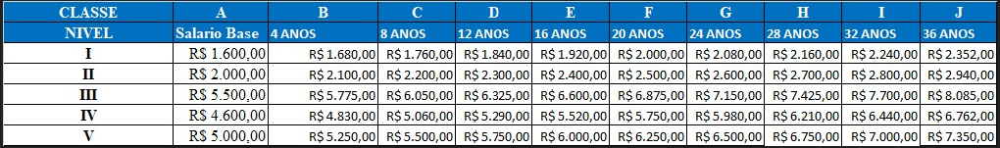
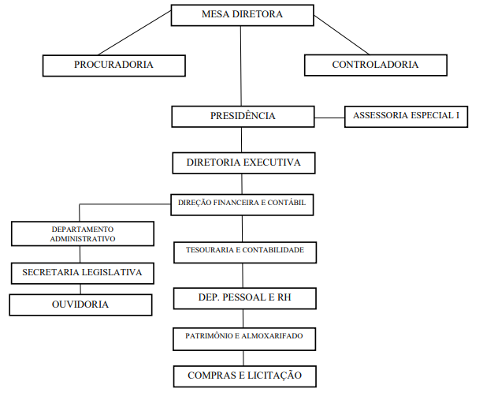

# Lei nº 1350/2024

> Dispõe sobre o Plano de Cargos, Vencimentos e Carreira dos Servidores da Câmara Municipal de Batayporã-MS e dá outras providências.

!!! warning "Texto em revisão"
    Transcrito do arquivo .doc da prefeitura, conferido com a [cópia assinada e escaneada](../../assets/lei-1350-2024/lei-1350-2024.pdf) (arquivo da prefeitura), e **ainda em revisão**. Esta lei não está publicada na [página de legislação da prefeitura](https://bataypora.ms.gov.br/cidadao/legislacao-municipal).

!!! info "Alterada pela Lei nº 1.353/2024"
    Os [arts. 1º](#art-1), [5º](#art-5), [6º](#art-6) e [14](#art-14) e os anexos foram alterados pela [Lei nº 1.353/2024](lei-1353-2024.md), de 18 de março de 2024.

!!! info "Alterada pela Lei nº 1.403/2025"
    Esta lei foi alterada pela [Lei nº 1.403/2025](../2025/lei-1403-2025.md), de 2 de outubro de 2025.

Baixar: [PDF](../../baixar/leis-ordinarias/2024/lei-1350-2024.pdf){ .md-button download="lei-1350-2024.pdf" } [Word (.docx)](../../baixar/leis-ordinarias/2024/lei-1350-2024.docx){ .md-button download="lei-1350-2024.docx" } [Texto (.txt)](../../baixar/leis-ordinarias/2024/lei-1350-2024.txt){ .md-button download="lei-1350-2024.txt" } [Markdown (.md)](../../baixar/leis-ordinarias/2024/lei-1350-2024.md.txt){ .md-button download="lei-1350-2024.md" }

!!! abstract "Índice"
    | Divisão | Assunto | Artigos |
    |---|---|---:|
    | **TÍTULO I** | **DISPOSIÇÕES PRELIMINARES** | |
    | &emsp;Capítulo I | DA FINALIDADE E DOS PRINCÍPIOS | [1](#art-1) a [4](#art-4) |
    | **TÍTULO II** | **DA ESTRUTURA E FINALIDADE DOS CARGOS** | |
    | &emsp;Capítulo I | DA ESTRUTURA DOS CARGOS | [5](#art-5) a [7](#art-7) |
    | &emsp;&emsp;Seção I | DO INGRESSO E DO REGIME FUNCIONAL | [8](#art-8) a [11](#art-11) |
    | &emsp;&emsp;Seção II | DA POSSE E DA VACÂNCIA | [12](#art-12) e [13](#art-13) |
    | &emsp;&emsp;Seção IV | DOS VENCIMENTOS E DA REMUNERAÇÃO | [14](#art-14) a [16](#art-16) |
    | **TÍTULO III** | **DO SISTEMA REMUNERATÓRIO** | |
    | &emsp;**Capítulo I** | **DAS VANTAGENS E BENEFÍCIOS** | |
    | &emsp;&emsp;Seção I | DAS VANTAGENS PECUNIÁRIAS | [17](#art-17) |
    | &emsp;&emsp;Seção II | DA FUNÇÃO GRATIFICADA | [18](#art-18) e [19](#art-19) |
    | &emsp;Capítulo II | DAS VANTAGENS | [20](#art-20) |
    | &emsp;&emsp;Seção I | DAS INDENIZAÇÕES | [21](#art-21) e [22](#art-22) |
    | &emsp;&emsp;&emsp;Subseção I | DO AUXÍLIO-ALIMENTAÇÃO | [23](#art-23) |
    | &emsp;&emsp;&emsp;Subseção II | DA INDENIZAÇÃO DE TRANSPORTE | [24](#art-24) |
    | &emsp;&emsp;Seção II | DAS VANTAGENS PESSOAIS | [25](#art-25) |
    | &emsp;&emsp;&emsp;Subseção I | DO ADICIONAL POR TEMPO DE SERVIÇO | [26](#art-26) e [27](#art-27) |
    | &emsp;&emsp;&emsp;Subseção II | DA GRATIFICAÇÃO NATALINA | [28](#art-28) a [31](#art-31) |
    | &emsp;&emsp;&emsp;Subseção III | FÉRIAS | [32](#art-32) a [41](#art-41) |
    | &emsp;&emsp;&emsp;Subseção IV | ADICIONAL NOTURNO | [42](#art-42) |
    | &emsp;&emsp;&emsp;Subseção V | DO ADICIONAL POR SERVIÇO EXTRAORDINÁRIO | [43](#art-43) a [45](#art-45) |
    | &emsp;&emsp;&emsp;Subseção VI | DO ADICIONAL DE CAPACITAÇÃO | [46](#art-46) a [48](#art-48) |
    | &emsp;&emsp;&emsp;Subseção VII | GRATIFICAÇÕES DE FUNÇÕES (COMISSÃO PERMANENTE, PREGOEIRO E CHEFE DE DEPARTAMENTO) | [49](#art-49) e [50](#art-50) |
    | &emsp;Capítulo III | DAS NORMAS ESTATUTÁRIAS | [51](#art-51) a [53](#art-53) |
    | &emsp;Capítulo IV | DAS DISPOSIÇÕES FINAIS E TRANSITÓRIAS | [54](#art-54) a [59](#art-59) |
    | **[ANEXO I](#anexo-i)** | **TABELA EFETIVOS** |  |
    | **[ANEXO II](#anexo-ii)** | **TABELA COMISSIONADOS** |  |
    | **[ANEXO III](#anexo-iii)** | **DESCRIÇÕES - ATRIBUIÇÕES DOS CARGOS - REQUISITOS** |  |
    | **[ANEXO IV](#anexo-iv)** | **ORGANOGRAMA** |  |

**Lei nº. 1.350, de 1º de março de 2024.**
{ .centro }

“Dispõe sobre o Plano de Cargos, Vencimentos e Carreira dos Servidores da Câmara Municipal de Batayporã-MS e dá outras providências”.

O PREFEITO MUNICIPAL DE BATAYPORÃ, ESTADO DE MATO GROSSO DO SUL, no uso das atribuições lhe conferidas pela Lei Orgânica Municipal;

Faz saber que a Câmara Municipal aprovou e o Poder Executivo sanciona e promulga a seguinte Lei:

## TÍTULO I — DISPOSIÇÕES PRELIMINARES { .centro }

### CAPÍTULO I — DA FINALIDADE E DOS PRINCÍPIOS { .centro }

**Art. 1º** Esta Lei Complementar consolida o Plano de Cargos e Salários, institui a carreira e organiza os cargos públicos da Câmara Municipal de Batayporã – MS, definindo o quadro de vagas e os sistemas de retribuições, em conformidade com os princípios constitucionais e legais aplicados à administração pública.
{ #art-1 }

**Art. 2º** O Plano de Cargos, Carreiras e Vencimentos dos Servidores Públicos do Poder Legislativo Municipal tem por objetivos:
{ #art-2 }

I - estimular o aperfeiçoamento profissional, valorizando o servidor do legislativo municipal, como instrumento de melhoria qualitativa e quantitativa dos serviços executados pela Câmara;

II - garantir o desenvolvimento no cargo de acordo com o tempo de serviço e aperfeiçoamento profissional;

III - assegurar aos servidores remuneração condizente com a natureza e complexidade do trabalho e qualificação para o seu exercício, bem como a isonomia de vencimentos para cargos de atribuições iguais ou assemelhados.

**Art. 3º** O Plano de Cargos, Carreiras e Salários dos Servidores da Câmara Municipal compõe-se de cargos de provimento em comissão, de Função Gratificada e de provimento efetivo, de execução funcional e profissional de todos os níveis e padrões e qualquer natureza.
{ #art-3 }

**Art. 4º** Para os efeitos do presente Plano de Cargos, Carreiras e Salários serão considerados:
{ #art-4 }

I - Cargos: O conjunto de deveres e responsabilidades, tarefas ou atribuições a servidores nomeados para tal fim;

II - Cargos de Provimento Efetivo: o conjunto de deveres e responsabilidades, tarefas ou atribuições, conferidas a servidores nomeados através de concurso público de provas ou de provas e títulos, para tal fim, sob regime estatutário, criados por Lei, com denominação própria e número certo;

III - Cargos de Provimento em Comissão: são os que envolvem atividades de Direção, Assessoramento Superior e Assessoramento Parlamentar de livre nomeação pelo Presidente da Câmara Municipal, satisfeitos os requisitos de qualificação;

IV - Chefe de Departamento: corresponde ao chefe de cada departamento disposto no organograma, conforme anexo IV;

V - Servidor: pessoa legalmente investida em cargo público, sob o regime estatutário;

VI - Vencimento: é a retribuição pecuniária dos servidores pelo exercício de cargo público, conforme símbolo e nível que esteja contido;

VII - Remuneração: a somatória do vencimento com vantagens financeiras permanentes, temporárias ou transitórias, atribuídas ao servidor pelo exercício do cargo público;

VIII - Padrão: o referencial da importância hierárquica dos cargos, segundo a responsabilidade e complexidade, indicado por numerais romanos;

IX - Classe: escala hierárquica horizontal que indica os valores dos vencimentos do cargo segundo o tempo de serviço na carreira ou merecimento, e identificada por letras maiúsculas do alfabeto;

X - Enquadramento: é a passagem do servidor do atual sistema de classificação para os cargos integrantes do quadro de pessoal instituído por esta Lei Complementar, nos grupos ocupacionais previstos neste Plano.

XI - Tabela de vencimentos: conjunto dos padrões salariais, hierarquicamente organizados para identificação dos valores dos vencimentos básicos dos cargos de carreira do Plano de Cargos e Carreiras da Câmara;

XII - Quadro de pessoal: conjunto de cargos agrupados segundo sua natureza e complexidade, nos termos do art. 37, inciso II, da Constituição Federal;

XIII - Vantagem de caráter pessoal: direito financeiro deferido ao servidor individualmente, em virtude do atendimento de condições ou pré-requisitos pessoais;

XIV - Vantagem de caráter funcional: retribuição financeira deferida ao servidor pelo exercício de determinadas funções, responsabilidade ou pela execução de determinado trabalho em exposição a condições ambientais que imponha desgastes físicos ou de saúde.

## TÍTULO II — DA ESTRUTURA E FINALIDADE DOS CARGOS { .centro }

### CAPÍTULO I — DA ESTRUTURA DOS CARGOS { .centro }

**Art. 5º** O Quadro Funcional permanente da Câmara Municipal, será constituído de:
{ #art-5 }

!!! info "Redação dada pela Lei nº 1353/2024"
    Nova redação deste artigo, dada pelo [art. 2º da Lei nº 1353/2024](lei-1353-2024.md#art-2):

    “I – Cargos de Provimento em Comissão:

    a) Procurador Legislativo;

    b) Direção Executiva;

    c) Assessor especial I;

    d) Assessor especial II;

    e) Assessor especial III;

    f) Assessor especial IV;

    g) Assessor especial V;

    h) Chefe de departamento.”

I - **Cargos de Provimento em Comissão:**

a) Procurador Geral;

b) Direção Executiva;

c) Assessor especial I;

d) Assessor especial II;

e) Assessor especial III;

f) Assessor especial IV

g) Chefe de departamento.

II - **Cargos de Provimento Efetivo**:

a) Controlador;

b) Contador;

c) Advogado;

d) Assistente Legislativo;

e) Técnico de contabilidade;

f) Agente Administrativo;

g) Auxiliar de Serviços Gerais;

**Art. 6º** Os grupos são formados por categorias funcionais que se subdividem em classes compostas de cargos.
{ #art-6 }

!!! info "Redação dada pela Lei nº 1353/2024"
    Nova redação deste artigo, dada pelo [art. 3º da Lei nº 1353/2024](lei-1353-2024.md#art-3):

    “Art. 6º. Os grupos são formados por categorias funcionais que se subdividem em classes compostas de cargos.

    Parágrafo único. Os servidores nos cargos de Procurador Legislativo e Advogado ficam impedidos de demandar contra a Fazenda Pública Municipal de Batayporã – MS, mas livres para o exercício da advocacia privada, nos termos da Lei Federal n. 8.906/94.”

**Art. 7º** A estrutura do plano de cargos, vencimentos e carreira, composta de grupos, categorias funcionais e respectivas referências, fica estabelecida na conformidade com o Anexo I.
{ #art-7 }

#### SEÇÃO I — DO INGRESSO E DO REGIME FUNCIONAL { .centro }

**Art. 8º** Os cargos serão providos através de concurso público de provas e títulos e serão acessíveis a todos que preencham os requisitos estabelecidos nesta Lei.
{ #art-8 }

Parágrafo único. O ingresso nas carreiras do Plano ora instituído, de acordo com os Grupos Ocupacional: cargos, referências e requisitos.

**Art. 9º** O concurso público será de provas e títulos, obedecendo as condições e requisitos estabelecidos no respectivo edital de normas, previamente estabelecidas pelo Poder Legislativo Municipal, respeitando a Legislação vigente.
{ #art-9 }

Parágrafo único. O concurso público, a que se refere o caput deste artigo, será realizado sempre que houver necessidade, com validade de 2 (dois) anos, podendo ser prorrogado uma única vez por igual período.

**Art. 10.** A nomeação será feita em caráter efetivo, sujeitando-se o servidor ao estágio probatório.
{ #art-10 }

Parágrafo único. O servidor ao ingressar no serviço público, mediante concurso público, será enquadrado na referência inicial, da sua categoria funcional.

**Art. 11.** O estágio probatório, tempo de exercício profissional a ser avaliado durante 03 (três) anos, ocorrerá entre a posse e a investidura permanente na função.
{ #art-11 }

§ 1º Durante o estágio probatório, o servidor, no exercício das suas atribuições, terá o desempenho avaliado com base nos seguintes requisitos:

I - assiduidade;

II - pontualidade;

III - desempenho profissional.

§ 2º A verificação do cumprimento dos requisitos previstos no parágrafo anterior será procedida segundo normas expedidas pelas Diretorias Executiva e Financeira, definidas em comissão paritária com representantes dos servidores e concluída no período determinado pela Legislação vigente.

§ 3º Será considerado estável o servidor que após o período determinado pela Legislação vigente, satisfazer os requisitos do estágio probatório.

#### SEÇÃO II — DA POSSE E DA VACÂNCIA { .centro }

**Art. 12.** A nomeação e a posse serão por ato do Presidente da Câmara Municipal ou autoridade delegada, observada as exigências legais regulamentares para a investidura no cargo.
{ #art-12 }

**Art. 13.** A vacância decorrerá de exoneração, demissão, promoção, transferência, aposentadoria ou falecimento.
{ #art-13 }

§ 1º A exoneração dar-se à a pedido do interessado ou quando não preenchidos os requisitos do estágio probatório.

§ 2º A demissão é aplicada como penalidade, consoante o disposto na legislação pertinente.

#### SEÇÃO IV — DOS VENCIMENTOS E DA REMUNERAÇÃO { .centro }

**Art. 14.** O vencimento é a retribuição pecuniária devida ao servidor pelo efetivo exercício do cargo e correspondente ao fixado nesta lei.
{ #art-14 }

!!! info "Redação dada pela Lei nº 1353/2024"
    Nova redação deste artigo, dada pelo [art. 4º da Lei nº 1353/2024](lei-1353-2024.md#art-4):

    “Art.14. O vencimento é a retribuição pecuniária devida ao servidor pelo efetivo exercício do cargo e correspondente ao fixado nesta lei.

    Parágrafo único. É assegurada revisão geral anual, sem distinção de índices e fixando como data base o mês de março de cada ano, observando sempre as disponibilidades de recursos e os limites de despesa com pessoal determinados pela Lei de Responsabilidade Fiscal.”

**Art. 15.** A remuneração é o vencimento acrescido das vantagens pecuniárias de que seja titular, em conformidade com esta lei.
{ #art-15 }

**Art. 16.** É vedada a instituição de abonos e parcelas para os vencimentos dos cargos de provimento efetivo e em comissão do Plano ora instituído, que alteram os valores da matriz remuneratória.
{ #art-16 }

## TÍTULO III — DO SISTEMA REMUNERATÓRIO { .centro }

### CAPÍTULO I — DAS VANTAGENS E BENEFÍCIOS { .centro }

#### SEÇÃO I — DAS VANTAGENS PECUNIÁRIAS { .centro }

**Art. 17.** As vantagens pecuniárias classificam se, segundo suas modalidades, em adicionais e gratificações inerentes ao cargo, às atribuições ou a pessoas do servidor público da Câmara Municipal.
{ #art-17 }

Parágrafo único. As vantagens pecuniárias serão devidas, concedidas ou atribuídas em razão da natureza e do exercício do cargo ou da função.

#### SEÇÃO II — DA FUNÇÃO GRATIFICADA { .centro }

**Art. 18.** Além dos vencimentos e das vantagens previstas nesta lei, serão deferidos aos servidores ocupantes de cargos de provimento efetivo, a gratificação denominada chefia de departamento, destinada a complementação de vencimentos, independentemente do cargo que ocupar, por acumulação de tarefas atribuídas a outro cargo.
{ #art-18 }

Parágrafo único. A gratificação de que trata este Artigo será na forma dos anexos e somente será concedida pelo Presidente do Poder Legislativo Municipal.

**Art. 19.** As gratificações de que trata esta lei, deixarão de ser pagas aos servidores municipais que se afastarem do efetivo exercício de suas funções, salvo nos casos de:
{ #art-19 }

I - férias;

II - casamento;

III - luto;

IV - licença paternidade;

V - licença maternidade;

VI - licença para tratamento da própria saúde;

VII - Participação em congressos ou em outros eventos, quando autorizado o afastamento, até o limite de 5 (cinco) dias.

### CAPÍTULO II — DAS VANTAGENS { .centro }

**Art. 20.** Vantagens pecuniárias são acréscimos ao vencimento do servidor público, concedidas a título definitivo ou transitório, em decorrência de condições específicas previstas em lei.
{ #art-20 }

Parágrafo único. Constituem espécies de vantagens pecuniárias as indenizações, os adicionais e as gratificações.

#### SEÇÃO I — DAS INDENIZAÇÕES { .centro }

**Art. 21.** Constituem indenizações ao servidor da Câmara Municipal de Batayporã/MS.
{ #art-21 }

I - auxílio-alimentação;

II - indenização de transporte.

**Art. 22.** O valor das indenizações não pode ser:
{ #art-22 }

I - incorporado à remuneração ou ao subsídio;

II - computado na base de cálculo para fins de incidência de imposto de renda ou de contribuição para a previdência social, ressalvadas as disposições em contrário na legislação federal;

III - computado para cálculo de qualquer outra vantagem pecuniária.

##### SUBSEÇÃO I — DO AUXÍLIO-ALIMENTAÇÃO { .centro }

**Art. 23.** O auxílio-alimentação será devido ao servidor ativo em determinadas situações de exercício, na forma e condições fixadas em Lei.
{ #art-23 }

##### SUBSEÇÃO II — DA INDENIZAÇÃO DE TRANSPORTE { .centro }

**Art. 24.** A indenização de transporte poderá ser concedida ao servidor que realizar despesas com a utilização de próprio meio de locomoção para executar serviços externos, por força das atribuições do cargo/função para atender serviços exclusivos da Câmara Municipal, considerando o percurso percorrido em quilômetros, o consumo de combustível, tendo como referência o preço do litro da gasolina.
{ #art-24 }

Parágrafo único. A indenização de transporte, para compensar despesas pelo uso de veículo próprio, será concedida somente a servidor designado pelo presidente da Câmara Municipal.

#### SEÇÃO II — DAS VANTAGENS PESSOAIS { .centro }

**Art. 25.** As vantagens pecuniárias de caráter pessoal representam a retribuição ao servidor público municipal por situações individuais de caráter permanente pela decorrência de determinada condição ou qualificação pessoal, identificada como:
{ #art-25 }

I - Adicional por Tempo de Serviço;

II - Gratificação Natalina;

III - Férias;

IV - Adicional noturno;

V - Adicional pela prestação de serviços Extraordinário;

VI - Adicional de capacitação;

VII - Gratificações de Funções (Comissão Permanente, Pregoeiro e Chefe de Departamento).

##### SUBSEÇÃO I — DO ADICIONAL POR TEMPO DE SERVIÇO { .centro }

**Art. 26.** O adicional por tempo de serviço é devido ao servidor efetivo, para cada quinquênio de efetivo exercício no legislativo, incidente sobre o vencimento do respectivo cargo efetivo.
{ #art-26 }

§ 1º O adicional corresponde, para cada quinquênio completo, a cinco por cento, até o limite de trinta e cinco por cento.

§ 2º O servidor contará, para efeito de concessão do adicional por tempo de serviço, o período de trabalho prestado à Câmara Municipal de Batayporã, inclusive na condição de contratado como temporário de órgão ou entidade de direito público municipal.

§ 3º O adicional por tempo de serviço é devido a partir do mês imediatamente seguinte àquele em que o servidor completar o quinquênio.

§ 4º O servidor efetivo investido em cargo de provimento em comissão, continuará a perceber o adicional por tempo de serviço, que será calculado sobre o vencimento do seu cargo efetivo.

**Art. 27.** Quando ocorrer aproveitamento ou reversão, serão considerados os quinquênios anteriormente atingidos, bem como a fração do quinquênio interrompido, retomando-se a contagem, a partir do novo exercício.
{ #art-27 }

##### SUBSEÇÃO II — DA GRATIFICAÇÃO NATALINA { .centro }

**Art. 28.** A gratificação corresponderá a 1/12 avos da remuneração devida em dezembro, por mês de serviço, do ano correspondente.
{ #art-28 }

§ 1º A fração igual ou superior a 15 (quinze) dias será considerada como mês integral;

§ 2º A gratificação será paga até o dia 20 (vinte) do mês de dezembro de cada ano.

§ 3º Poderá haver a antecipação da metade da gratificação, de acordo com a conveniência administrativa e a disposição financeira da Câmara Municipal.

**Art. 29.** O servidor exonerado perceberá sua gratificação natalina, proporcionalmente aos meses de exercício, calculada sobre a remuneração do mês da exoneração.
{ #art-29 }

**Art. 30.** A gratificação natalina não será computada para cálculo de qualquer vantagem pecuniária.
{ #art-30 }

**Art. 31.** O servidor exonerado perceberá a gratificação natalina proporcionalmente aos meses de exercício.
{ #art-31 }

##### SUBSEÇÃO III — FÉRIAS { .centro }

**Art. 32.** O servidor efetivo, contratado e os agentes públicos farão jus, anualmente, a 30 (trinta) dias de férias remuneradas, que podem ser acumuladas até o máximo de dois períodos, no caso de necessidade do serviço, devidamente justificada pela chefia imediata.
{ #art-32 }

§ 1º Para o primeiro período aquisitivo de férias, serão exigidos doze meses de exercício.

§ 2º O servidor que tiver cônjuge com vínculo empregatício com a prefeitura ou Câmara, gozara preferencialmente o período de férias no mesmo período de seu companheiro;

§ 3º O servidor que tiver filhos menores idade regularmente matriculados nas escolas do município gozara preferencialmente o período de férias durante as férias escolares;

**Art. 33.** As férias serão reduzidas para:
{ #art-33 }

I - \- vinte e quatro dias corridos, quando o servidor tiver de seis a quatorze faltas injustificadas;

II - \- dezoito dias corridos, quando o servidor tiver de quinze a vinte e três faltas injustificadas; ou

III - \- doze dias corridos, quando o servidor tiver de vinte e quatro a trinta e duas faltas injustificadas.

IV. 

**Art. 34.** É vedado descontar do período de férias as faltas justificadas do servidor ao serviço.
{ #art-34 }

**Art. 35.** As férias poderão ser parceladas em até três etapas, desde que assim requeridas pelo servidor, e no interesse da Câmara Municipal, respeitado o período mínimo de dez dias por parcela.
{ #art-35 }

Parágrafo único. O envio da solicitação de férias deverá ser entregue até o dia 10 (dez) do mês anterior ao gozo de férias, a Gerência de Recursos Humanos.

**Art. 36.** Na exoneração do servidor será devida:
{ #art-36 }

I - \- a remuneração correspondente ao período de férias cujo direito tenha adquirido; e

II - \- a remuneração relativa ao período incompleto de férias, na proporção de um doze avos por mês de prestação de serviço ou fração igual ou superior a quinze dias.

**Art. 37.** Não terá direito a férias o servidor que, no curso do período aquisitivo:
{ #art-37 }

I - faltar ao serviço, sem justificativa e tiver descontos dos seus vencimentos, por mais de trinta e dois dias;

II - tiver afastamento do exercício do cargo em licença por acidente em serviço, para tratamento de saúde ou em auxílio-doença, e licença por motivo de doença em pessoa da família, totalizando mais de cento e oitenta dias.

**Art. 38.** É facultado ao servidor converter até 20 (vinte) dias das férias em pecúnia, desde que o requeira com pelo menos trinta dias antes de completar o período aquisitivo, observado o interesse e a disponibilidade financeira da Câmara Municipal de Batayporã/MS.
{ #art-38 }

Parágrafo único. No caso de conversão em pecúnia, será utilizado como base de cálculo, da remuneração do mês anterior para fins da indenização. E não recairá a incidência de contribuição para a previdência social.

**Art. 39.** As férias somente poderão ser interrompidas por motivo de calamidade pública, comoção interna, convocação para júri, serviço militar ou eleitoral e com extrema necessidade da Câmara Municipal.
{ #art-39 }

**Art. 40.** Independentemente de solicitação, será pago ao servidor, por ocasião das férias, um adicional de 1/3 (um terço) da remuneração, correspondente ao mês anterior que fizer jus.
{ #art-40 }

§ 1º O adicional incidirá, sempre, sobre a remuneração de um mês, ainda que o servidor, por força de lei, possa gozar de férias em período superior.

§ 2º No caso do servidor exercer função de confiança ou ocupar cargo em comissão, a vantagem por esse exercício será considerada no cálculo do adicional de férias.

§ 3º O servidor em regime de acumulação legal perceberá o adicional de férias, calculado sobre a remuneração de cada um dos cargos.

**Art. 41.** O servidor exonerado, aposentado receberá o adicional de férias, relativos aos períodos aquisitivos completos e não gozados, até o limite de dois, juntamente com as parcelas remuneratórias que lhe são devidas em virtude do afastamento do exercício do cargo.
{ #art-41 }

##### SUBSEÇÃO IV — ADICIONAL NOTURNO { .centro }

**Art. 42.** O serviço noturno, prestado por servidor efetivo, em horário compreendido entre as 22 (vinte e duas) horas de um dia e 5 (cinco) horas do dia seguinte, terá o valor-hora acrescido de 20% (vinte por cento), calculado sobre o vencimento básico do servidor, incluídos o adicional por tempo de serviço e adicional de capacitação, quando houver.
{ #art-42 }

##### SUBSEÇÃO V — DO ADICIONAL POR SERVIÇO EXTRAORDINÁRIO { .centro }

**Art. 43.** O serviço extraordinário, prestado por servidor efetivo será remunerado com acréscimo de 50% (cinquenta por cento) em relação à hora normal de trabalho.
{ #art-43 }

**Art. 44.** Somente será permitido serviço extraordinário para atender situações excepcionais e temporais, respeitando o limite máximo de 02 (duas) horas por jornada ou 60 (sessenta) horas mensais de serviço extraordinário.
{ #art-44 }

**Art. 45.** A Câmara Municipal de Batayporã/MS, poderá empregar o regime de compensação de jornada, que atenderá o seguinte:
{ #art-45 }

I - 01 (uma) hora extraordinária desempenhada em dias úteis, sábados e pontos facultativos equivale a 01(uma) hora e 30(trinta) minutos no regime de compensação de jornadas;

II - 01 (uma) hora extraordinária desempenhada aos domingos ou feriados equivale a 02 (duas) horas no regime de compensação de jornadas.

§ 1º A aplicação do regime de compensação de jornadas está condicionada à aprovação prévia pelo Presidente da Câmara Municipal.

§ 2º O regime de compensação de jornadas somente se aplicará ao servidor que estiver desempenhando sua jornada padrão, não se aplicando às hipóteses de jornada de trabalho reduzida.

§ 3º As horas registradas em unidade de controle de frequência deverão refletir o total de horas já convertido, conforme os incisos I e II do caput deste artigo.

§ 4º O regime de compensação de jornada poderá ser operacionalizado nas seguintes modalidades:

I - Banco de horas positivo: caracterizada pelo acúmulo prévio de horas extraordinárias, a serem futuramente compensadas e gozadas;

II - Banco de horas negativo: caracterizada pela antecipação do gozo da compensação de horas extraordinárias, as quais serão desempenhadas em momento futuro, nos termos deste artigo.

§ 5º O regime de compensação de jornada, na modalidade banco de horas positivo, terá como limite máximo o total de 180(cento e oitenta) horas, dentro do período de 06 (seis) meses.

I - Não poderão ser compensadas mais do que 03 dias de folgas dentro de 01 (um) mês.

II - Poderá ser concedido para fins de compensação de horas, o limite de 02 (dois) dias consecutivos.

§ 6º O regime de compensação de jornada, na modalidade banco de horas negativo, terá como limite máximo, dentro do período de 01 (um) mês, o total de horas equivalente à jornada de 01 (um) dia correspondente ao cargo do servidor público.

§ 7º O gozo da compensação de horas extraordinárias, na modalidade banco de horas negativo, bem como o desempenho de horas extraordinárias deverão ser autorizadas, previamente, e registradas formalmente pelo Presidente da Câmara Municipal.

§ 8º A utilização das horas registradas nos termos deste artigo, para fins de compensação, observará às seguintes condições:

I - Solicitação de compensação pelo servidor em tempo hábil, de forma a não prejudicar as atividades da Câmara Municipal de Batayporã/MS;

II - Autorização prévia pelo Presidente da Câmara Municipal;

III - proporções definidas nos incisos I e II do caput deste artigo.

§ 9º Caso o servidor, com banco de horas negativo, não compense o total de horas negativas dentro do mesmo mês, sofrerá desconto em seu vencimento-base, no valor correspondente ao valor - hora de sua jornada, não sendo aplicada a proporção prevista no caput, incisos I e II deste artigo.

##### SUBSEÇÃO VI — DO ADICIONAL DE CAPACITAÇÃO { .centro }

**Art. 46.** O adicional de incentivo a capacitação, será concedido ao servidor efetivo do quadro de pessoal do poder legislativo pela comprovação de escolaridade ou titulação superior ao requisito de formação exigido para exercer o cargo de concurso ocupado.
{ #art-46 }

**Art. 47.** O adicional de incentivo a capacitação será deferido ao servidor efetivo que comprovar a conclusão:
{ #art-47 }

I - do ensino médio, se ocupante de cargo nível fundamental;

II - do ensino superior, se o cargo ocupado for:

a) de ensino fundamental e médio ou menos;

III - de um curso de Pós-Graduação;

IV - de um curso de Mestrado;

V - de um curso de Doutorado;

VI - da capacitação profissional de apoio escolar “pró-funcionário’ ou “educação infantil”, se ocupante de cargo de ensino fundamental e médio;

§ 1º Os cursos e habilitações referidas nos incisos II, III, IV e V, deverão ter conteúdo programático que ofereça conhecimento para capacitação, aperfeiçoamento, ou formação profissional compatível com o cargo exercido pelo servidor.

§ 2º Dos cursos e habilitações referidas nos incisos II, III, IV, V e VI, serão contados apenas uma vez, para fins de recebimento do adicional.

**§º3º** - Dos cursos e habilitações referidas nos incisos II, III, IV, V e VI não será permitido o servidor fazer jus de forma cumulativa, devendo o incentivo de capacitação recair sobre a escolaridade mais elevada.

**Art. 48.** O adicional de incentivo a capacitação será pago nas seguintes proporções sobre o vencimento base do servidor:
{ #art-48 }

| Escolaridade  | Porcentagem |
|:-------------:|:-----------:|
|  Nível Médio  |     10%     |
|   Graduação   |     15%     |
| Pós-Graduação |     20%     |
|   Mestrado    |     25%     |
|   Doutorado   |     30%     |

##### SUBSEÇÃO VII — GRATIFICAÇÕES DE FUNÇÕES (COMISSÃO PERMANENTE, PREGOEIRO E CHEFE DE DEPARTAMENTO) { .centro }

**Art. 49.** O servidor que exercer cumulativamente a sua função, com as atividades: de Comissão Permanente ou Pregoeiro, receberá a título de gratificação de 20% sobre o seu salário base.
{ #art-49 }

Parágrafo único. As gratificações previstas no caput não são cumuláveis, mesmo que o servidor esteja exercendo as 02 (duas) atividades.

**Art. 50.** O servidor que for chefe de departamento receberá a título de gratificação uma porcentagem de 25% (vinte e cinco por cento) para exercer 01(uma) chefia de departamento; acréscimo de 15% (quinze por cento) caso venha a exercer 02 chefias de departamento e o acréscimo de 10% caso haja a acumulação de 03 chefias de departamento.
{ #art-50 }

§ 1º Não será admitida nenhuma gratificação de chefia de departamento além das referidas no caput desse artigo.

§ 2º Essa gratificação poderá ser concedida aos servidores detentores de cargos comissionados.

### CAPÍTULO III — DAS NORMAS ESTATUTÁRIAS { .centro }

**Art. 51.** O servidor público municipal não perceberá, temporariamente, remuneração do cargo de provimento efetivo, quando:
{ #art-51 }

I - designado para exercer cargo de provimento em comissão da Administração do Poder Legislativo Municipal, ressalvada o direito de opção por parte do servidor;

II - estiver a disposição de órgãos ou entidade da União, Estado, Distrito Federal ou outro Município;

III - estiver no desempenho de mandado eletivo, nos termos da Constituição Federal, ressalvado o direito de opção;

IV - estiver em licença para tratar de interesse particular, para acompanhar o cônjuge ou companheiro;

V - estiver em licença por motivo de doença em pessoa da família, por prazo superior a 30 (trinta) dias.

**Art. 52.** O servidor público do Poder Legislativo Municipal perderá:
{ #art-52 }

I - a remuneração dos dias que faltar ao serviço, exceto quando o mesmo estiver em gozo de licença, autorizado por lei.

II - metade da remuneração, nos casos de apenamento suspensivo convertido parcialmente em multa, na forma da lei;

III - as vantagens pecuniárias inerentes ao cargo, quando em afastamento por período superior a 15 (quinze) dias, exceto nos casos de:

a) Licença por motivo de doença;

b) Licença maternidade;

c) Licença paternidade.

**Art. 53.** Os direitos, cuja percepção depender de requerimento do servidor público do Poder Legislativo Municipal e de análise para seu deferimento, serão atualizados se o pagamento não for realizado em até 60 (sessenta) dias após a data de entrada no protocolo da Secretaria de Administração Geral do Legislativo.
{ #art-53 }

Parágrafo único. Consideram se direitos, para os fins deste artigo, os vencimentos, os adicionais e as vantagens pessoais

### CAPÍTULO IV — DAS DISPOSIÇÕES FINAIS E TRANSITÓRIAS { .centro }

**Art. 54.** Ficam extintos mediante vacância os cargos de Técnico em Contabilidade e Assistente Legislativo.
{ #art-54 }

**Art. 55.** O quantitativo de cargos, vagas, carga horária, requisitos de servidores efetivos e comissionados constam no anexo desta lei.
{ #art-55 }

**Art. 56.** Os servidores ativos e efetivos serão enquadrados na tabela do anexo I do o Plano de Cargos, Vencimentos e Carreira dos Servidores da Câmara Municipal de Batayporã-MS, a partir da publicação desta lei complementar.
{ #art-56 }

**Art. 57.** Os cargos de Técnico em Contabilidade e Assistente Legislativo atualmente ocupados passam a integrar o quadro em extinção, e serão automaticamente extintos à medida que houver a vacância.
{ #art-57 }

**Art. 58.** O [Estatuto do Servidor Público](../../estatuto-servidores/lc-003-2001.md) de Batayporã, é fonte subsidiária desta lei, naquilo que não for incompatível.
{ #art-58 }

**Art. 59.** Esta lei entrará em vigor a partir de 1º de março de 2024.
{ #art-59 }

Batayporã-MS, 1º de março de 2024.

**Germino da Roz Silva**
{ .centro }

Prefeito Municipal
{ .centro }

Publicado e afixado na forma da Lei.

**Gabriel Boffo da Rocha**
{ .centro }

Secretário Municipal de Administração Finanças e Planejamento
{ .centro }

**ANEXOS:**

## ANEXO I — TABELA EFETIVOS { #anexo-i .centro }

| **NÍVEL** |        **CARGOS**        | **VAGAS** | **CARGA HORÁRIA** |
|:---------:|:------------------------:|:---------:|:-----------------:|
|     I     |           ASG            |     4     |        40h        |
|    II     |  Agente Administrativo   |     4     |        40h        |
|    III    | Técnico em Contabilidade |     0     |        40h        |
|    IV     |  Assistente Legislativo  |     0     |        40h        |
|     V     |         Advogado         |     1     |        20h        |
|     V     |         Contador         |     1     |        40h        |
|     V     |       Controlador        |     1     |        40h        |

## ANEXO II — TABELA COMISSIONADOS { #anexo-ii .centro }

|        **CARGOS**         | **VENCIMENTO** | **CARGA HORÁRIA** | **VAGAS** |
|:-------------------------:|:--------------:|:-----------------:|:---------:|
|   **PROCURADOR GERAL**    |  R$ 6.375,24  |        20H        |     1     |
|   **DIREÇÃO EXECUTIVA**   |  R$ 7.016,58  |        40H        |     1     |
|  **ASSESSOR ESPECIAL I**  |  R$ 4.504,15  |        40H        |     2     |
| **ASSESSOR ESPECIAL II**  |  R$ 4.072,65  |        40H        |     3     |
| **ASSESSOR ESPECIAL III** |  R$ 3.504,69  |        40H        |     2     |
| **ASSESSOR ESPECIAL IV**  |  R$ 2.030,39  |        40H        |     3     |
|  **ASSESSOR ESPECIAL V**  |  R$ 1.510,00  |        40H        |     2     |

## ANEXO III — DESCRIÇÕES - ATRIBUIÇÕES DOS CARGOS - REQUISITOS { #anexo-iii .centro }

**CARGOS DE PROVIMENTO EFETIVO**

**ASG:** **Descrição sintética das atribuições:** compreende os cargos que se destinam a executar, sob supervisão, serviços de limpeza como varrer, lavar, desinfetar e arrumar as dependências da Câmara. **Descrição analítica das atribuições:** -fechar e abrir portas, janelas e portões, acender e apagar luzes, ligar e desligar bombas e aparelhos elétricos em geral; -preparar, de acordo com a situação, lanches em geral; -servir lanches e pequenas refeições, arrumando adequadamente a mesa, de acordo com a situação;-controlar o estoque e requisitar, quando necessário, café, chá, leite, açúcar e material de limpeza, indispensável ao desempenho de suas atribuições; -limpar, lavar e arrumar áreas internas e externas das dependências da Câmara; -manter limpos os vidros das janelas do prédio da Câmara; -varrer, espanar e recolher o lixo gerado nas dependências da Câmara, depositando e acondicionando os detritos em sacos plásticos ou em latões; -auxiliar, quando necessário, no transporte de mesas, arquivos, armários, utensílios e outros materiais usados nas instalações da Câmara; -manter arrumado e em boas condições de conservação o material sob sua guarda; -executar, quando necessário, serviços externos, apanhando e entregando correspondências, realizando depósitos e retiradas bancárias e pagamentos de pequena monta; -atender, quando necessário, ao público em geral, prestando informações e fazendo encaminhamentos; -recolher e distribuir internamente correspondência, pequenos volumes e expedientes, separando-os por destinatário, observando o nome e a localização, solicitando assinatura em livro de protocolo; -duplicar documentos diversos, operando máquina própria, ligando-a e desligando-a, abastecendo-a de papel e tinta, regulando o número de cópias; -auxiliar na execução de serviços simples de almoxarifado, apanhando materiais de consumo em depósitos, conferindo-os com as requisições, transportando-os e guardando-os em local apropriado; -conservar os instrumentos e utensílios de trabalho; -executar outras atribuições afins.

**Requisitos mínimos do cargo**: Ensino fundamental completo

- **AGENTE ADMINISTRATIVO:** **Descrição sintética das atribuições:** compreende os cargos que se destinam a executar, sob supervisão direta, tarefas rotineiras de apoio administrativo a trabalhos e projetos da Câmara Municipal. **Descrição analítica das atribuições** – Elaborar planilhas, textos, demonstrativos, controles, registros e realizar demais atividades em microcomputador; – Receber, classificar, conferir, protocolar, localizar, expedir e arquivar expedientes e outros documentos, além de colher assinaturas e encaminhar publicações legais; – Auxiliar os serviços de compras, contratos, licitações, controle patrimonial, controle interno, recursos humanos, contabilidade, orçamento público e finanças e outros serviços administrativos e burocráticos em geral; – Realizar serviços de recepção, entrega e controle de materiais de consumo e permanentes, além de elaborar demonstrativos de gastos e despesas das diversas unidades da Câmara Municipal; – Realizar pesquisas de preços e cotações de bens e serviços, além de contatar fornecedores e prestadores de serviços e terceiros, sempre que necessário; – Efetuar o despacho de correspondências, requerimentos e documentos, inclusive com entrega pessoalmente aos diversos órgãos das esferas da administração pública ou entidades privadas; – Localizar, identificar, fotocopiar e fazer levantamento de documentos e congêneres nos arquivos gerais ou específicos, sempre que solicitado;– Elaborar documentos oficiais, submetendo-os ao superiores hierárquicos; – Acompanhar e avaliar serviços prestados por terceiros;– Desempenhar atividades administrativas e burocráticas de nível intermediário e prestar apoio administrativo as unidades da Câmara Municipal; – Realizar e executar outras atribuições afins ou que lhe forem atribuídas por superior.

**Requisitos mínimos do cargo**: ensino médio completo.

- **TÉCNICO EM CONTABILIDADE**: **Descrição sintética das atribuições:** compreende os cargos que se destinam a executar, sob supervisão direta, tarefas de contabilização financeira das atividades da Câmara Municipal. **Descrição analítica das atribuições:** -organizar dos serviços de contabilidade da Câmara, envolvendo o plano de contas, o sistema de livros e documentos e o método de escrituração, para possibilitar o controle contábil, orçamentário e patrimonial; -auxiliar na elaboração da proposta orçamentária anual da Câmara; -coordenar** **a análise e a classificação contábil dos documentos comprobatórios das operações realizadas, de natureza orçamentária ou não, de acordo com o plano de contas da Câmara; -realizar as tarefas relativas à execução orçamentária e ao seu acompanhamento, emitindo e examinando empenhos de despesas em face da existência de saldo nas dotações; -elaborar o balancete e o balanço orçamentário da Câmara; -acompanhar a execução orçamentária da Câmara, examinando empenhos de despesas em face da existência de saldo nas dotações; -executar a escrituração contábil-financeira; -executar os trabalhos de análise e conciliação de contas, conferindo saldos, localizando e retificando possíveis erros, para assegurar a correção das operações contábeis; -elaborar balanços, balancetes, mapas e outros demonstrativos financeiros consolidados da Câmara; -informar processos, dentro de sua área de atuação, e sugerir métodos e procedimentos que visem a melhor coordenação dos serviços contábeis; -organizar relatórios sobre a situação econômica, financeira e patrimonial da Câmara, transcrevendo dados e emitindo pareceres; -arquivar os documentos contábeis; -apor assinatura, reconhecendo a veracidade e correção das informações, nos documentos orçamentários, financeiros e patrimoniais que assim o exijam, bem como em balanços e balancetes; -executar outras atribuições afins.

**Requisitos mínimos do cargo**: curso de Técnico em Contabilidade e registro no Conselho Regional de Contabilidade – C.R.C.

- **ASSISTENTE LEGISLATIVO**: **Descrição sintética das atribuições: **compreende os cargos que se destinam a auxiliar, no desempenho e na execução de atividades legislativas e burocráticas dos vereadores e das comissões, nas sessões da edilidade e no trâmite das proposituras; - opera equipamentos disponíveis e os sistemas e recursos informatizados, na execução de suas atividades; - executa qualquer outra atividade que, por sua natureza, esteja inserida no âmbito de suas atribuições. **Descrição analítica das atribuições:** -Atua fornecendo suporte nas sessões, audiências públicas, reuniões ou outros eventos promovidos pela Câmara Municipal; -efetua o protocolo de todas as proposituras ou proposições, nos termos do Regimento Interno da Câmara Municipal, que dão início ao Processo Legislativo; - Registra e acompanha os prazos para tramitação de todas as proposituras, inclusive os vetos; -elabora os autógrafos, decretos legislativos, leis promulgadas pela Câmara, Resoluções, Atos da Mesa, Atos da Presidência e Portarias; - promove a guarda e controle de toda a documentação produzida pela Câmara, bem como a reprodução de documentos e a coordenação do processamento eletrônico dos sistemas administrativos e legislativos; - auxilia no gerenciamento dos anais da Câmara Municipal; - fornece suporte às Comissões Permanentes e Temporárias da Câmara Municipal, secretariando, digitando pareceres, requerimentos e ofícios, arquivando em meio físico e eletrônico, cópias dos pareceres e votos em separado, com anotação dos signatários; -providencia pesquisas e informações que lhe forem solicitadas pelos Vereadores, pela Mesa ou pela Presidência sobre assuntos relacionados ao processo legislativo e sobre a atuação da Câmara Municipal; auxilia a Assessoria de Comunicação, Cerimonial e Eventos, quando necessário; -auxilia a Diretoria Geral, quando necessário; -exerce outras atividades e tarefas correlatas determinadas pelo superior imediato.

**Requisitos mínimos do cargo**: Ensino Médio completo.

- **ADVOGADO: Descrição sintética das atribuições**: representar a câmara em juízo quando designado pela Presidência ou pela Procuradoria; dar assistência jurídica à Presidência, à Mesa, aos Vereadores, às Comissões e à Direção Geral; emitir parecer prévio sobre proposições submetidas ao Legislativo; prestar assistência jurídica em áreas relacionadas à aplicação de leis, decretos e regulamentos, examinando processos específicos, emitindo pareceres e elaborando documentos jurídicos de interesse da Câmara Municipal, atender as solicitações da Procuradoria.

**Descrição analítica das atribuições:** representar a Câmara Municipal quando ela for autora, ré, assistente ou oponente, em qualquer foro, instância ou tribunal; estudar assuntos de direito de ordem geral ou específica, realizando estudos e pesquisas de doutrina e jurisprudência de modo a habilitar o Legislativo a solucionar problemas pertinentes a suas prerrogativas legais e constitucionais; redigir termos de contratos, convênios e outros atos; assessorar juridicamente na elaboração de proposições legislativas; prestar assessoria jurídica ao Presidente, à Mesa, aos Vereadores, às Comissões e à Direção Geral; prolatar parecer prévio em projetos de emenda à Lei Orgânica, projetos de lei, de resolução, pedidos de autorização e demais proposições apresentadas ao Plenário da Câmara; dar parecer jurídico em processos de ordem administrativa; tratar o público com zelo e urbanidade; executar outras tarefas correlatas, bem como, as designadas pela Procuradoria.

**Requisitos mínimos do cargo**: Bacharel em direito com inscrição na Ordem dos Advogados do Brasil.

- **CONTADOR:** **Descrição sintética das atribuições**: organização e execução dos serviços de contabilidade em geral.

**Descrição analítica das atribuições**: planejar o sistema de registro e operações contábeis, atendendo às necessidades administrativas e legais, para possibilitar controle contábil e orçamentário; escriturar a contabilidade da Câmara Municipal; elaborar e assinar balanços e demonstrativos de contas, observando sua correta classificação e lançamento, verificando a documentação pertinente, para atender as exigências legais e formais de controle; controlar a movimentação de recursos, fiscalizando o ingresso de receitas, o cumprimento das obrigações de pagamentos a terceiros, os saldos em caixa e as contas bancárias, para possibilitar a administração dos recursos financeiros da Câmara; analisar aspectos financeiros, contábeis e orçamentários da execução de contratos, convênios, acordos e atos que gerem direitos e obrigações, verificando a propriedade na aplicação de recursos repassados, analisando cláusulas contratuais, dando orientação aos executores, a fim de assegurar o cumprimento da legislação aplicável; analisar os atos de natureza orçamentária, financeira, contábil e patrimonial, verificando sua correção, para determinar ou realizar auditorias e medidas de aperfeiçoamento de controle interno; orientar à Câmara Municipal quanto ao cumprimento das normas referentes à Lei de Diretrizes Orçamentárias e seus anexos e à Lei Orçamentária e seus anexos; controlar a execução orçamentária, analisando documentos, elaborando relatórios e demonstrativos; elaborar o relatório de gestão fiscal da Câmara; alimentar, com os dados necessários, o sistema da folha de pagamentos; -acompanhar os gastos de pessoal do Legislativo, tendo em vista o cumprimento da Lei de Responsabilidade Fiscal; elaborar pareceres, informes técnicos e relatórios, realizando pesquisas, entrevistas, fazendo observações e sugerindo medidas para a implantação, desenvolvimento e aperfeiçoamento de atividades em sua área de atuação; participar das atividades administrativas de controle e de apoio referentes à sua área de atuação; participar das atividades de treinamento e aperfeiçoamento de pessoal técnico e auxiliar, realizando-as em serviço ou ministrando aulas e palestras, a fim de contribuir para o desenvolvimento qualitativo dos recursos humanos em sua área de atuação; participar de grupos de trabalho e reuniões com unidades da Câmara e outras entidades públicas e particulares, realizando estudos, emitindo pareceres ou fazendo exposições sobre situações e problemas identificados, opinando, oferecendo sugestões, revisando e discutindo trabalhos técnicos, para fins de formulação de diretrizes, planos e programas de trabalho afetos à Câmara Municipal.

**Requisitos mínimos do cargo:** Curso superior completo em contabilidade com registro no Conselho Regional de Contabilidade.

- **CONTROLADOR: Descrição sintética das atribuições:** Coordenar as atividades relacionadas com o sistema de controle Interno da Câmara Municipal, promover a sua integração operacional.

**Descrição analítica das atribuições:** Apoiar o controle externo no exercício de sua missão institucional, centralizando, a nível operacional, o relacionamento com o tribunal CE Contas do Estado, emitir parecer técnico conclusivo sobre as contas, respondendo pelo encaminhamento das prestações de contas anuais, atendimento aos técnicos do controle externo – recebimento de diligências e coordenação das atividades para elaboração de respostas, acompanhamento da tramitação dos processos e coordenação da apresentação de recursos; assessorar a Câmara nos aspectos relacionados com os controles internos e externos e quanto à legalidade dos atos de gestão, emitindo relatórios e pareceres sobre os mesmos; interpretar e pronunciar-se em caráter normativo sobre a legislação concernente à execução orçamentária, financeira e patrimonial; medir e avaliar a eficiência dos procedimentos de controle interno adotados pelos Órgãos Setoriais do sistema, através do processo de auditoria a ser realizado nos sistemas de Planejamento e Orçamento, Contabilidade e Finanças, Compras e Licitações, Obras e Serviços, Administração de Recursos Humanos e demais sistemas administrativos da Administração da Câmara Municipal, expedindo relatórios com recomendações para o aprimoramento dos controles; avaliar o cumprimento dos programas, objetivos e metas espelhadas no Plano Plurianual e na Lei de Diretrizes Orçamentárias, em relação ao Orçamento do Legislativo; exercer o acompanhamento sobre a observância dos limites de gastos total com pessoal em relação à Receita Corrente Liquida e o limite constitucional; estabelecer mecanismos voltados a comprovar a legalidade e a legitimidade dos atos de gestão e avaliar os resultados, quanto à eficácia, eficiência e economicidade na gestão orçamentária, financeira e patrimonial nas atividades da Câmara; efetuar o acompanhamento sobre as medidas adotadas para o retorno da despesa total com pessoal aos limites legais, nos termos dos artigos 22 e 23 da Lei de Responsabilidade Fiscal; efetuar o acompanhamento sobre o cumprimento total dos gastos da Câmara Municipal em relação às despesas total do Legislativo e as despesas total com pessoal, nos termos do artigo 29-A e seguinte da Constituição Federal e do inciso VI do artigo 59, da Lei de Responsabilidade Fiscal; exercer o acompanhamento sobre a divulgação dos instrumentos de transparência da gestão fiscal nos termos da Lei Complementar federal nº 101/2000, em especial ao Relatório Resumido da Execução Orçamentária e ao Relatório de Gestão Fiscal, aferindo a consistência das informações constantes de tais documentos; participar do processo de planejamento e acompanhar a elaboração do Orçamento da Câmara Municipal, acompanhar quando do envio à Câmara na fase do processo legislativo o Plano Plurianual e a Lei de Diretrizes Orçamentárias e dos Orçamentos do Município; manter registros sobre a composição e atuação das comissões de licitações; manifestar-se, quando solicitado pela Presidência da Câmara acerca da regularidade e legalidade de processos licitatórios, sua dispensa ou inexigibilidade e sobre o cumprimento e/ou legalidade de atos, contratos e outros instrumentos congêneres; propor a melhoria ou implantação de sistemas de processamento eletrônico de dados em todas as atividades da Câmara Municipal, com objetivo de aprimorar os controles internos, agilizar as rotinas e melhorar o nível das informações; instituir e manter sistema de informações para o exercício das atividades finalísticas do sistema de Controle Interno do Legislativo; alertar formalmente a autoridade administrativa da Câmara para que instaure imediatamente, sob pena de responsabilidade solidária, as ações destinadas a apurar os atos ou fatos inquinados de ilegais, ilegítimos ou antieconômicos que resultem em prejuízo ao erário, praticadas por agentes públicos, ou quando não forem prestadas as contas ou, ainda, quando ocorrer desfalque, desvio de dinheiro, bens ou valores públicos; dar ciência ao tribunal de contas do Estado das irregularidades ou ilegalidades apuradas, para as quais a administração da Câmara não tomou as providências cabíveis visando à apuração de responsabilidades e o ressarcimento de eventuais danos ou prejuízos ao erário; revisar e emitir relatório sobre os processos de Tomadas de Contas Especiais instauradas pela Câmara Municipal na forma da Lei, inclusive sobre as determinadas pelo Tribunal de Contas do Estado.

**Requisitos mínimos do cargo:** nível de escolaridade superior completo, na área de humanas ligado a legislação, direito, gestão administrativa ou administração; na área de exatas ligado a contabilidade, finanças ou controle.

**CARGOS DE PROVIMENTO EM COMISSÃO**

- **PROCURADOR GERAL**: **Descrição sintética das atribuições:** chefiar a procuradoria Geral da Câmara Municipal; patrocinar causas em que o Poder Legislativo esteja relacionado como parte, ou tenha interesse; elaborar pareceres de ordem jurídica. **Descrição analítica das atribuições:** Expedir atos administrativos, inclusive normativos, para organização, funcionamento e distribuição dos serviços da Procuradoria; - Representar a Câmara judicial e extrajudicialmente, ativa e passivamente, em matéria jurídica, promovendo-lhe a defesa nos processos de qualquer natureza em que figure como autor ou réu;**-** Prestar consultoria e assessoraria jurídica ao Presidente da Câmara, bem como aos demais órgãos da administração, emitindo pareceres; - Designar um procurador jurídico para substituí-lo nas suas ausências e impedimentos, com as mesmas atribuições; -Responder pelo expediente da Procuradoria Jurídica; -** **Zelar pelo cumprimento de prazos legais; - Supervisionar os serviços dos funcionários que estejam sob sua responsabilidade; - Executar outras atividades e tarefas que lhe sejam determinadas pelo Presidente da Câmara Municipal.

**Requisitos mínimos do cargo:** Bacharel em direito com inscrição na Ordem dos Advogados do Brasil – OAB.

- **DIREÇÃO EXECUTIVA: Descrição sintética das atribuições**: Trata da assessoria pessoal e institucional da Presidência, atendendo pessoas, organizando audiências e agenda, viabilizando o relacionamento do Presidente com os demais Vereadores e com a população em geral, exercendo atividades articuladas com todos os órgãos da Casa. **Descrição analítica das atribuições: p**laneja, coordena e avalia o desenvolvimento das atividades das Diretorias e da Assessoria da Casa, promovendo a harmonização e integração dos processos adotados pelas unidades que compõem a estrutura organizacional da Câmara Municipal; -assessorar, no que for necessário, nas Sessões da Câmara, Audiências Públicas e demais eventos, solenidades ou atividades regimentalmente previstas; - organizar a agenda pública do Presidente, dando-lhe ampla transparência, marcando e organizando reuniões, visitas, entrevistas, audiências e outros compromissos atinentes à Presidência; -elaborar atos administrativos, relatórios e outros documentos de acordo com a sua área de atuação; acompanha a legislação relacionada às suas atividades; - tem sob sua responsabilidade a supervisão das atividades de protocolo, serviços administrativos e almoxarifado; - tem sob sua responsabilidade a supervisão das atividades das áreas de compras, licitações e gestão de contratos.; -tem sob sua responsabilidade a supervisão das atividades de Gestão de Pessoas; -tem sob sua responsabilidade a supervisão das atividades da área de Tecnologia da Informação; -tem sob sua responsabilidade a supervisão das atividades das áreas de transportes, manutenção e conservação patrimonial; -tomar decisões administrativas quando ausente o Presidente, desde que não conflitem com sua autoridade; exercer outras atividades inerentes ao cargo de direção.

**Requisitos mínimos do cargo:** Curso superior completo.

- **ASSESSOR ESPECIAL I ao V:** receber estudos técnicos para a elaboração, sob a supervisão superior, de proposições em geral para posterior aprovação e assinatura do parlamentar e manifestações a projetos que estejam tramitando nas comissões permanentes ou temporárias; sugerir e revisar, sob o ponto de vista político, pronunciamentos sobre projetos em tramitação no Legislativo; acompanhar a tramitação das proposições do parlamentar, observando os prazos regimentais; assessorar o vereador nas reuniões e nos debates das comissões permanentes ou temporárias e nas reuniões de bancadas.  LIVRE ESCOLHA DO PRESIDENTE DO LEGISLATIVO.

**Requisitos mínimos do cargo:** Ensino Médio completo.

- **OUVIDORIA**: Receber demandas, manifestações, reclamações, sugestões, consultas ou elogios da população ou de entidades públicas e privadas; Analisar as informações recebidas ou solicitadas, encaminhando-as para as unidades administrativas competentes, visando a solução dos problemas ou atendimento das manifestações suscitadas; Recepcionar as informações das diversas unidades administrativas da Câmara Municipal e encaminhar retorno, respostas ou soluções aos munícipes e entidades requisitantes em geral, observando o prazo legal ou regimental para resolução; Manter o requerente informado do andamento de sua solicitação; Manter controle das reclamações, sugestões, consultas ou elogios da população ou de entidades públicas e privadas; Realizar o atendimento ao público e aos servidores por telefone, meio eletrônico ou pessoalmente; Elaborar estatísticas de questionamentos e atendimento em geral, mantendo as informações atualizadas e disponíveis para consulta; Elaborar relatórios, registros e demais documentos que se fizerem necessários; Operar sistema informatizado para auxílio ou realização de suas tarefas; Divulgar resultados de pesquisas e levantamentos; Prezar pelo sigilo das informações que administra; Observar a legislação e as normas internas em sua área de atuação; Auxiliar os serviços de disponibilização e acesso à informação da Câmara Municipal, principalmente os relacionados a transparência; Realizar outras tarefas administrativas e burocráticas correlatas ao cargo por iniciativa própria ou que lhe forem atribuídas por superior.

## ANEXO IV — ORGANOGRAMA { #anexo-iv .centro }

