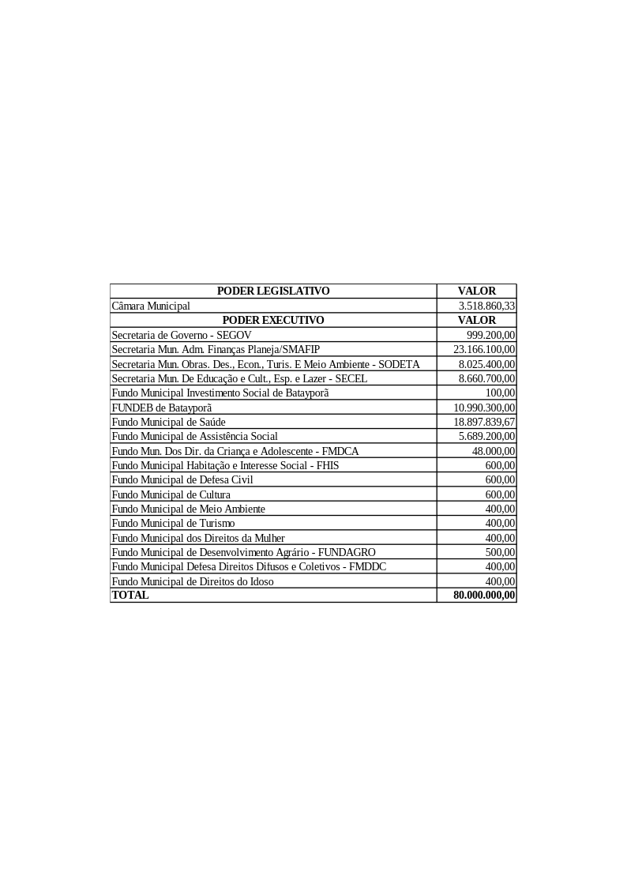

# Lei nº 1369/2024

> Estima a receita e fixa a despesa do Município de Batayporã – MS, para o exercício financeiro de 2025, e dá outras providências.

!!! warning "Texto em revisão"
    Transcrito do arquivo .doc da prefeitura, conferido com a [cópia assinada e escaneada](../../assets/lei-1369-2024/lei-1369-2024.pdf) (arquivo da prefeitura), e **ainda em revisão**. Esta lei não está publicada na [página de legislação da prefeitura](https://bataypora.ms.gov.br/cidadao/legislacao-municipal).

Baixar: [PDF](../../baixar/leis-ordinarias/2024/lei-1369-2024.pdf){ .md-button download="lei-1369-2024.pdf" } [Word (.docx)](../../baixar/leis-ordinarias/2024/lei-1369-2024.docx){ .md-button download="lei-1369-2024.docx" } [Texto (.txt)](../../baixar/leis-ordinarias/2024/lei-1369-2024.txt){ .md-button download="lei-1369-2024.txt" } [Markdown (.md)](../../baixar/leis-ordinarias/2024/lei-1369-2024.md.txt){ .md-button download="lei-1369-2024.md" }

!!! abstract "Índice"
    | Divisão | Assunto | Artigos |
    |---|---|---:|
    |  | Disposições iniciais | [1](#art-1) |
    | Capítulo I | DA ESTIMATIVA DA RECEITA | [2](#art-2) e [3](#art-3) |
    | Capítulo II | DA FIXAÇÃO DA DESPESA | [4](#art-4) e [5](#art-5) |
    | Capítulo III | DA EXECUÇÃO ORÇAMENTÁRIA | [6](#art-6) a [13](#art-13) |

**Lei nº. 1.369, de 20 de dezembro de 2024.**
{ .centro }

“Estima a receita e fixa a despesa do Município de Batayporã – MS, para o exercício financeiro de 2025, e dá outras providências”.

O PREFEITO MUNICIPAL DE BATAYPORÃ, ESTADO DE MATO GROSSO DO SUL, no uso das atribuições lhe conferidas pela Lei Orgânica Municipal;

Faz saber que a Câmara Municipal aprovou e ele sanciona a seguinte Lei;

**Art. 1º** Esta Lei de Meios estima a Receita e fixa a Despesa do Município de BATAYPORÃ para o exercício financeiro de 2025, compreendendo o conjunto do Orçamento Fiscal e da Seguridade Social, sendo:
{ #art-1 }

I - o Orçamento Fiscal, referente aos Poderes do Município, seus Fundos, e unidades da Administração Pública Municipal Direta e Indireta;

II - o Orçamento da Seguridade Social, abrangendo Fundos e Unidades da Administração Pública Direta e Indireta.

### CAPÍTULO I — DA ESTIMATIVA DA RECEITA { .centro }

**Art. 2º** O conjunto do Orçamento Fiscal e da Seguridade Social do Município de Batayporã, para o Exercício de 2025, estima a Receita e fixa a Despesa em igual valor de **R$80.000.000,00** **(oitenta milhões)**, importando o Orçamento Fiscal em **R$ 55.364.060,33 (cinquenta e cinco milhões, trezentos e sessenta e quatro mil, sessenta reais e trinta e três centavos)**; e o Orçamento da Seguridade Social em **R$ 24.635.939,67(vinte e quatro milhões, seiscentos e trinta e cinco mil, novecentos e trinta e nove reais e sessenta e sete centavos).**
{ #art-2 }

**Art. 3º** A estimativa da Receita, por Categoria Econômica, segundo a origem dos recursos, será realizada com base no produto do que for arrecadado, na forma da legislação em vigor, discriminada nos quadros em anexo, e de acordo com o seguinte desdobramento:
{ #art-3 }

<table style="width:92%;">
<colgroup>
<col style="width: 45%" />
<col style="width: 13%" />
<col style="width: 33%" />
</colgroup>
<tbody>
<tr>
<td colspan="3" style="text-align: left;"><strong>RECEITA CONSOLIDADA</strong></td>
</tr>
<tr>
<td style="text-align: left;"><strong>a) Receitas Correntes</strong></td>
<td style="text-align: left;"><strong>R&#36;</strong></td>
<td style="text-align: left;"><strong>79.605.956,01</strong></td>
</tr>
<tr>
<td style="text-align: left;"><strong>b) Receitas de Capital</strong></td>
<td style="text-align: left;"><strong>R&#36;</strong></td>
<td style="text-align: left;"><strong>394.043,99</strong></td>
</tr>
<tr>
<td style="text-align: left;"><strong>Total Geral da Receita</strong></td>
<td style="text-align: left;"><strong>R&#36;</strong></td>
<td style="text-align: left;"><strong>80.000.000,00</strong></td>
</tr>
</tbody>
</table>

### CAPÍTULO II — DA FIXAÇÃO DA DESPESA { .centro }

**Art. 4º** A Despesa Total fixada no Orçamento Fiscal e da Seguridade Social é de **R$80.000.000,00** **(oitenta milhões),** distribuído por Categorias Econômicas e respectivos grupos de Natureza de Despesa, segundo o seguinte desdobramento:
{ #art-4 }

I - no Orçamento Fiscal, em **R$ 55.364.060,33 (cinquenta e cinco milhões, trezentos e sessenta e quatro mil, sessenta reais e trinta e três centavos)**;

II - no Orçamento de Seguridade Social, em **R$ 24.635.939,67(vinte e quatro milhões, seiscentos e trinta e cinco mil, novecentos e trinta e nove reais e sessenta e sete centavos).**

**Art. 5º** A Despesa será realizada de conformidade com as especificações constantes dos quadros que integram esta Lei, compreendendo:
{ #art-5 }

### CAPÍTULO III — DA EXECUÇÃO ORÇAMENTÁRIA { .centro }

**Art. 6º** O Poder Executivo poderá adotar medidas para:
{ #art-6 }

I - em decorrência de alteração de estrutura organizacional ou da competência dos órgãos da administração Municipal, adaptar o Orçamento aprovado pela presente Lei, através da redistribuição dos saldos das dotações das unidades orçamentárias e das categorias de programação, necessários à adequação observado o disposto na Lei de Diretrizes Orçamentárias;

II - remanejar dotações dentro de uma mesma Unidade Orçamentária objetivando readequação de projetos e atividades distribuídos em seu contexto, em vista a uma realidade e/ou prioridade evidenciada no decorrer do exercício, nos termos da Lei Federal nº 4.320/64;

III - alterar a codificação utilizada para controle das Fontes ou destinação de Recursos quando a disponibilidade de recursos assim o exigir.

**Art. 7º** Respeitadas as demais prescrições constitucionais e nos termos da Lei nº 4.320/64, o Poder Executivo poderá abrir créditos suplementares até o valor correspondente a 20% (vinte por cento) das despesas autorizadas na presente Lei, dos Orçamentos Fiscais e da Seguridade Social, com a finalidade de suprir eventuais deficiências, ou incorporar valores que excedam as previsões constantes desta Lei, mediante a utilização de recursos provenientes do art. 43 da Lei nº 4320/64.
{ #art-7 }

**Art. 8º** Nos termos da Lei Federal nº 4320/64, não computando no limite autorizado anteriormente, poderão ser abertos créditos adicionais quando se destinar a:
{ #art-8 }

I - para cobertura de despesas com Vencimentos e Vantagens Fixas (31901100), Obrigações Patronais (31901300), Obrigações Patronais RPPS (31911300), Auxílios Alimentações (33904600), Outros Benefícios Assistenciais do Servidor ou do Militar (33900800) e Indenizações e Restituições Trabalhistas (31909400);

II - abertura de créditos suplementares a conta de recursos transferidos da União e do Estado sob forma de auxílios, contribuições, subvenções e convênios;

III - insuficiência de dotação nos Grupos de Despesas 2 – Juros e Encargos da Dívida e Grupo de Despesa 6 – Amortização da Dívida;

IV - suplementações para atender despesas com o pagamento de Precatórios Judiciais;

V - suplementações que se utilizem de valores apurados conforme estabelecido nos incisos I e II do §1º do artigo 43 da Lei Federal nº 4.320/64;

VI - suplementações para atendimento dos arts. 194 e 212 da Constituição Federal Brasileira;

VII - remanejamento parcial ou total do valor previsto dos elementos desde que seja dentro da mesma unidade orçamentária;

**Art. 9º** O Poder Executivo poderá ainda a:
{ #art-9 }

I - tomar todas as medidas necessárias para ajustar os dispêndios ao efetivo comportamento da receita;

II - realizar Operações de Crédito por Antecipação da Receita Orçamentária, conforme permissão contida no §8º do artigo 165, obedecido o limite estabelecido no inciso III do art. 167, ambos da Constituição Federal;

III - promover a concessão de subvenções sociais a entidades públicas ou privadas, mediante Termo de Colaboração, Termo de Fomento e Acordo de Cooperação, e, ainda, assinar convênios de mútua colaboração com órgãos e entidades da Administração Pública Federal, Estadual e Municipal, obedecendo ao interesse e conveniência do Município;

IV - firmar Termo de Colaboração, Termo de Fomento e Acordo de Cooperação com entidades sem fins lucrativo, enquadradas ou não na Lei Federal nº 13.019, de 2014 e alterações posteriores, para repasse de contribuições, inclusive as destinadas a atender a despesas de manutenção de outras entidades de direito público ou privado, que desenvolvam atividades de interesse da população local, nas áreas de esporte, lazer, cultura, desenvolvimento social e econômico, entre outras áreas;

V - conceder anistia, remissão, crédito presumido, concessão de isenção em caráter não geral, alteração de alíquota ou modificação de base de cálculo que implique redução discriminada de tributos ou contribuições, mediante prévia autorização legislativa, nos termos da Lei de Responsabilidade Fiscal.

Parágrafo único. Fica dispensada a restituição de receitas de origens de convênios, termos de colaboração, de fomento ou contribuição para devolução ou ressarcimento de valor inferior a R$ 10,00 (dez reais).

**Art. 10.** Poder Legislativo do Município terá como limite de despesas em 2025, para efeito de elaboração de sua respectiva proposta orçamentária, a aplicação do percentual de 7% (sete por cento) conforme redação do art. 29-A da Constituição Brasileira.
{ #art-10 }

Parágrafo único. Ao término do exercício de 2024, será levantada a receita efetivamente arrecadada para fins de repasse ao Legislativo, ficando estabelecidas as seguintes alternativas em relação à base de cálculo utilizada para a elaboração do orçamento:

I - caso a receita efetivamente realizada situe-se em patamares inferiores aos previstos, o Legislativo indicará as dotações a serem contingenciadas ou utilizadas para a abertura de créditos adicionais no Poder Executivo;

II - caso a receita efetivamente realizada situe-se em patamares superiores aos previstos, o Legislativo indicará os créditos orçamentários a serem suplementados, ao Executivo, até o limite constitucionalmente previsto.

**Art. 11.** s gestores dos respectivos Fundos Especiais, Fundação e Autarquia deverão, para efeito de execução orçamentária, adotar, cada um, o Quadro Demonstrativo da Receita e Plano de Aplicação dessas unidades.
{ #art-11 }

**Art. 12.** Fica instituída emenda parlamentar individual no orçamento em vigor até o limite global de 2% da Receita Corrente Líquida, nos moldes definidos na Lei Orgânica Municipal, devendo ser destinadas a investimentos ou custeios de Órgãos da Administração Municipal e/ou entidades de caráter filantrópicos sediadas no Município de Batayporã, Estado de Mato Grosso do Sul.
{ #art-12 }

§ 1º É obrigatória a execução orçamentária e financeira das emendas parlamentares de que trata o caput deste artigo, ressalvados os impedimentos de ordem técnica ou jurídica, ou ainda, inviabilidade econômico-financeira.

§ 2º As emendas parlamentares individuais poderão ser direcionadas, por Termo de Colaboração ou Termo de Fomento às entidades de caráter filantrópico, social, cultural, e esportivo, sediadas no Município de Batayporã – Estado de Mato Grosso do Sul, desde que estejam devidamente constituídas e regularizadas na forma da lei.

**Art. 13.** Esta Lei entra em vigor em 1º de janeiro de 2025.
{ #art-13 }

Batayporã-MS, 20 de dezembro de 2024.

**Germino da Roz Silva**
{ .centro }

Prefeito Municipal
{ .centro }

Publicado e afixado na forma da Lei.

**João Nogueira Góz**
Secretário Interino
Secretaria Municipal de Administração Finanças e Planejamento
{ .centro }
