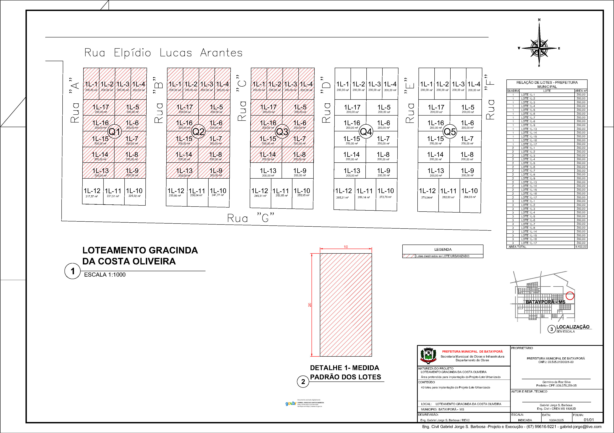

# Lei nº 1391/2025

> Autoriza o Poder Executivo Municipal a doar lotes de terreno de sua propriedade aos beneficiários de Programas de Interesse Social e dá outras providências.

!!! warning "Texto em revisão"
    Transcrito do arquivo .doc da prefeitura, conferido com a [cópia assinada e escaneada](../../assets/lei-1391-2025/lei-1391-2025.pdf) (arquivo da prefeitura), e **ainda em revisão**. Esta lei não está publicada na [página de legislação da prefeitura](https://bataypora.ms.gov.br/cidadao/legislacao-municipal).

Baixar: [PDF](../../baixar/leis-ordinarias/2025/lei-1391-2025.pdf){ .md-button download="lei-1391-2025.pdf" } [Word (.docx)](../../baixar/leis-ordinarias/2025/lei-1391-2025.docx){ .md-button download="lei-1391-2025.docx" } [Texto (.txt)](../../baixar/leis-ordinarias/2025/lei-1391-2025.txt){ .md-button download="lei-1391-2025.txt" } [Markdown (.md)](../../baixar/leis-ordinarias/2025/lei-1391-2025.md.txt){ .md-button download="lei-1391-2025.md" }

**Lei nº 1.391, de 27 de maio de 2025.**
{ .centro }

“Autoriza o Poder Executivo Municipal a doar lotes de terreno de sua propriedade aos beneficiários de Programas de Interesse Social e dá outras providências”.

O PREFEITO MUNICIPAL DE BATAYPORÃ, ESTADO DE MATO GROSSO DO SUL, no uso das atribuições lhe conferidas pela Lei Orgânica Municipal;

Faz saber que a Câmara Municipal aprovou e ele sanciona a seguinte Lei;

**Art. 1º** Fica o Município de Batayporã autorizado a doar os seguintes lotes abaixo relacionados.
{ #art-1 }

I - Lote 01 da Quadra 01, devidamente caracterizado na matricula 7495 do Serviço Registral de Imóveis de Batayporã – MS;

II - Lote 02 da Quadra 01, devidamente caracterizado na matricula 7496 do Serviço Registral de Imóveis de Batayporã – MS;

III - Lote 03 da Quadra 01, devidamente caracterizado na matricula 7497 do Serviço Registral de Imóveis de Batayporã – MS;

IV - Lote 04 da Quadra 01, devidamente caracterizado na matricula 7498 do Serviço Registral de Imóveis de Batayporã – MS;

V - Lote 05 da Quadra 01, devidamente caracterizado na matricula 7499 do Serviço Registral de Imóveis de Batayporã – MS;

VI - Lote 06 da Quadra 01, devidamente caracterizado na matricula 7500 do Serviço Registral de Imóveis de Batayporã – MS;

VII - Lote 07 da Quadra 01, devidamente caracterizado na matricula 7501 do Serviço de Registral de Imóveis de Batayporã – MS;

VIII - Lote 08 da Quadra 01, devidamente caracterizado na matricula 7502 do Serviço de Registral de Imóveis de Batayporã – MS;

IX - Lote 09 da Quadra 01, devidamente caracterizado na matricula 7503 do Serviço de Registral de Imóveis de Batayporã – MS;

X - Lote 13 da Quadra 01, devidamente caracterizado na matricula 7507 do Serviço de Registral de Imóveis de Batayporã – MS;

XI - Lote 14 da Quadra 01, devidamente caracterizado na matricula 7508 do Serviço de Registral de Imóveis de Batayporã – MS;

XII - Lote 15 da Quadra 01, devidamente caracterizado na matricula 7509 do Serviço de Registral de Imóveis de Batayporã – MS;

XIII - Lote 16 da Quadra 01, devidamente caracterizado na matricula 7510 do Serviço de Registral de Imóveis de Batayporã – MS;

XIV - Lote 17 da Quadra 01, devidamente caracterizado na matricula 7511 do Serviço de Registral de Imóveis de Batayporã – MS;

XV - Lote 01 da Quadra 02, devidamente caracterizado na matricula 7512 do Serviço de Registral de Imóveis de Batayporã – MS;

XVI - Lote 02 da Quadra 02, devidamente caracterizado na matricula 7513 do Serviço de Registral de Imóveis de Batayporã – MS;

XVII - Lote 03 da Quadra 02, devidamente caracterizado na matricula 7514 do Serviço de Registral de Imóveis de Batayporã – MS;

XVIII - Lote 04 da Quadra 02, devidamente caracterizado na matricula 7515 do Serviço de Registral de Imóveis de Batayporã – MS;

XIX - Lote 05 da Quadra 02, devidamente caracterizado na matricula 7516 do Serviço de Registral de Imóveis de Batayporã – MS;

XX - Lote 06 da Quadra 02, devidamente caracterizado na matricula 7517 do Serviço de Registral de Imóveis de Batayporã – MS;

XXI - Lote 07 da Quadra 02, devidamente caracterizado na matricula 7518 do Serviço de Registral de Imóveis de Batayporã – MS;

XXII - Lote 08 da Quadra 02, devidamente caracterizado na matricula 7519 do Serviço de Registral de Imóveis de Batayporã – MS;

XXIII - Lote 09 da Quadra 02, devidamente caracterizado na matricula 7520 do Serviço de Registral de Imóveis de Batayporã – MS;

XXIV - Lote 13 da Quadra 02, devidamente caracterizado na matricula 7524 do Serviço de Registral de Imóveis de Batayporã – MS;

XXV - Lote 14 da Quadra 02, devidamente caracterizado na matricula 7525 do Serviço de Registral de Imóveis de Batayporã – MS;

XXVI - Lote 15 da Quadra 02, devidamente caracterizado na matricula 7526 do Serviço de Registral de Imóveis de Batayporã – MS;

XXVII - Lote 16 da Quadra 02, devidamente caracterizado na matricula 7527 do Serviço de Registral de Imóveis de Batayporã – MS;

XXVIII - Lote 17 da Quadra 02, devidamente caracterizado na matricula 7528 do Serviço de Registral de Imóveis de Batayporã – MS;

XXIX - Lote 01 da Quadra 03, devidamente caracterizado na matricula 7529 do Serviço de Registral de Imóveis de Batayporã – MS;

XXX - Lote 02 da Quadra 03, devidamente caracterizado na matricula 7530 do Serviço de Registral de Imóveis de Batayporã – MS;

XXXI - Lote 03 da Quadra 03, devidamente caracterizado na matricula 7531 do Serviço de Registral de Imóveis de Batayporã – MS;

XXXII - Lote 04 da Quadra 03, devidamente caracterizado na matricula 7532 do Serviço de Registral de Imóveis de Batayporã – MS;

XXXIII - Lote 05 da Quadra 03, devidamente caracterizado na matricula 7533 do Serviço de Registral de Imóveis de Batayporã – MS;

XXXIV - Lote 06 da Quadra 03, devidamente caracterizado na matricula 7534 do Serviço de Registral de Imóveis de Batayporã – MS;

XXXV - Lote 07 da Quadra 03, devidamente caracterizado na matricula 7535 do Serviço de Registral de Imóveis de Batayporã – MS;

XXXVI - Lote 08 da Quadra 03, devidamente caracterizado na matricula 7536 do Serviço de Registral de Imóveis de Batayporã – MS;

XXXVII - Lote 09 da Quadra 03, devidamente caracterizado na matricula 7537 do serviço de Registral de Imóveis de Batayporã – MS;

XXXVIII - Lote 13 da Quadra 03, devidamente caracterizado na matricula 7541 do Serviço de Registral de Imóveis de Batayporã – MS;

XXXIX - Lote 14 da Quadra 03, devidamente caracterizado na matricula 7542 do Serviço de Registral de Imóveis de Batayporã – MS;

XL - Lote 15 da Quadra 03, devidamente caracterizado na matricula 7543 do Serviço de Registral de Imóveis de Batayporã – MS;

XLI - Lote 16 da Quadra 03, devidamente caracterizado na matricula 7544 do Serviço de Registral de Imóveis de Batayporã – MS;

XLII - Lote 17 da Quadra 03, devidamente caracterizado na matricula 7545 do serviço de Registral de Imóveis de Batayporã – MS.

Parágrafo único. A doação constante do *caput* deste artigo será precedida de avaliação, atendendo ao disposto nos termos do art. 17 da Lei nº 14.133, de 1º de abril de 2021.

**Art. 2º** Os referidos Lotes serão doados às famílias selecionadas em Programa de Habitação de Interesse Social, instituído pelo Município, Estado ou União, com a finalidade exclusiva de construção de moradias em conformidade com as normas estabelecidas nos referidos programas.
{ #art-2 }

**Art. 3º** A pessoa beneficiária terá o encargo de utilizar o imóvel doado para moradia, sendo vedado vender, alugar, ceder ou abandonar a unidade habitacional, e deverá aderir e obedecer as normas do projeto habitacional, pelo prazo de 10 ( dez ) anos, a contar da conclusão das obras da unidade habitacional, sob pena de reversão da doação ao Município e reembolso dos recursos.
{ #art-3 }

**Art. 4º** O Município às suas expensas deverá escriturar o terreno atendendo ao Croqui constante do Anexo Único desta Lei, em nome do beneficiário até a conclusão das obras da unidade habitacional, constando na matrícula cláusula reversiva para o caso do não cumprimento das obrigações e encargos, previsto no art. 3º desta Lei.
{ #art-4 }

**Art. 5º** A construção das Unidades Habitacionais nos imóveis a serem doados nos termos desta Lei ficará dispensada de pagamento dos seguintes tributos e taxas municipais:
{ #art-5 }

I - IPTU - Imposto Predial e Territorial Urbano, no período compreendido da construção até a expedição do habite-se;

II - ISSQN - Isenção do Imposto Sobre Serviços de qualquer natureza, incidente sobre as operações relativas à construção de unidades habitacionais e obras de infraestrutura necessária a viabilização do empreendimento;

III - Taxas referentes à expedição de alvará de construção e habite-se;

IV - ITBI - Imposto de Transmissão de bens imóveis, quando da transferência da propriedade do imóvel do Município para a pessoa beneficiada, na efetivação a doação.

Parágrafo único. No ato da escrituração do imóvel deverá constar a cláusula de inalienabilidade, a qualquer título, pelo prazo mínimo de 10 (dez) anos, tempo no qual a família beneficiária deverá possuir o imóvel única e exclusivamente para sua moradia, sob pena de reversão ao Município.

**Art. 6º** As localizações dos lotes a serem doados não serão de escolha do beneficiário e serão definidas por sorteio, sendo autorizado ao Poder Executivo estabelecer outros critérios, desde que impessoais e objetivos, e também não sejam ofensivos à moralidade e aos demais princípios regentes da Administração Pública.
{ #art-6 }

**Art. 7º** A doação de que trata esta Lei dar-se-á em estrita observância à legislação pertinente, sendo dispensada a licitação, nos termos do §6º do art. 76 da Lei Federal nº [14.133](http://www.planalto.gov.br/ccivil_03/_ato2019-2022/2021/lei/L14133.htm), de 1º de abril de 2021, devendo ser formalizada mediante escritura pública.
{ #art-7 }

**Art. 8º** Fica o Poder Executivo Municipal autorizado a firmar Termo de Parceria com as demais instituições públicas ou privadas para concretização de Programa Habitacional de Interesse Social.
{ #art-8 }

**Art. 9º** Só Poderão ser beneficiadas pelo programa de interesse social as famílias que atendam ao estabelecido na respectiva legislação do Programa instituído.
{ #art-9 }

**Art. 10.** Em caso de inexecução da obra pelo descumprimento dos prazos estipulados no art. 10 do Decreto 15.816 de 30 de novembro de 2021 e demais legislações pertinentes, poderá ser rescindida a autorização para a execução da unidade habitacional, ressalvado o direito do contraditório e da ampla defesa, se apresentado no prazo de 30 (trinta) dias corridos após sua notificação, podendo ser convocado o pretendente pré-selecionado subsequente, quando se tratar de terreno doado pelo parceiro.
{ #art-10 }

§ 1º Caso a inexecução da obra se der por caso fortuito ou por força maior, desde que devidamente justificada, poderá ser estendido o prazo, mediante aprovação prévia da Gerência de Fiscalização de Obras e Social da AGEHAB/MS e anuência do ente parceiro.

§ 2º O pretendente pré-selecionado subsequente, se convocado, deverá ressarcir o selecionado substituído nos valores dos materiais devidamente empregados na segunda etapa obra, de acordo com a apresentação das notas que comprovarem a despesa, ou após devidamente quantificada pelos fiscais da AGEHAB/MS, nos termos da portaria a ser expedida pelo titular da AGEHAB/MS.

§ 3º Caso o pretendente pré-selecionado a ser substituído tenha firmado contrato de investimento social com retorno, o pretendente que o substituir deverá assumir as demais parcelas vincendas.

**Art. 11.** As despesas decorrentes da execução da presente Lei correrão por conta de dotações consignadas no orçamento vigente e suplementadas, se necessárias, com contrapartidas complementares.
{ #art-11 }

**Art. 12.** Esta Lei poderá ser regulamentada por ato do Poder Executivo.
{ #art-12 }

**Art. 13.** Revogam-se as disposições em contrário, em especial o Inciso I do art. 2º da [Lei nº. 942/2011](../2011/lei-942-2011.md) de 22 de dezembro de 2011.
{ #art-13 }

.

**Art. 14.** Esta lei entra em vigor na data de sua publicação.
{ #art-14 }

Batayporã-MS, 27 de maio de 2025.

**Germino da Roz Silva**
{ .centro }

Prefeito Municipal
{ .centro }

Publicado e afixado na forma da Lei.

**Gabriel Boffo da Rocha**
{ .centro }

**Secretário Municipal de Administração e Finanças**
{ .centro }

**ANEXO ÚNICO DA LEI Nº 1.391/2025**
