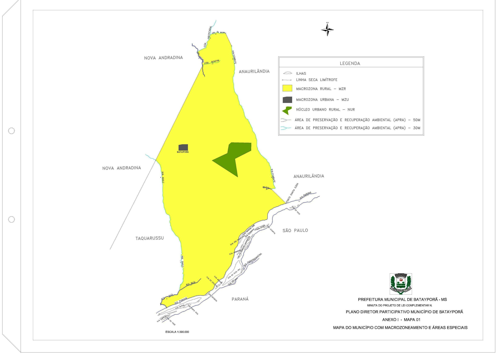
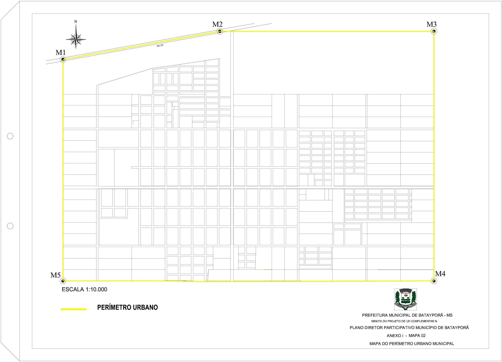
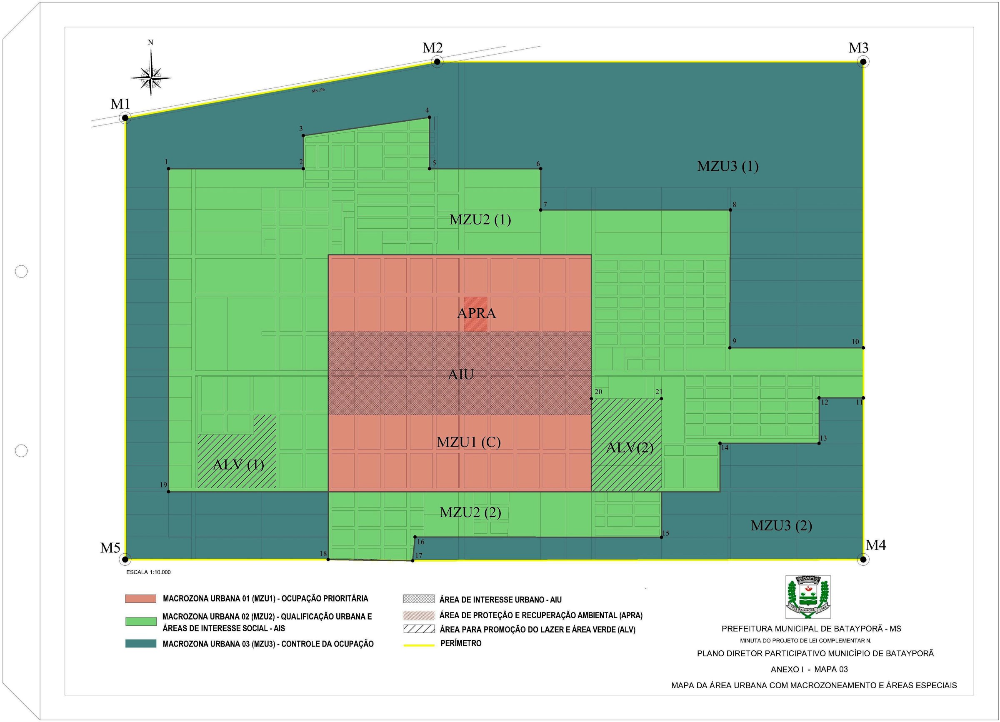

# Lei Complementar nº 024/2013

> Institui o Plano Diretor Participativo do Município de Batayporã e dá outras providências.

!!! warning "Texto em revisão"
    Transcrito do arquivo .doc da prefeitura e **ainda em revisão**. Esta lei não está publicada na [página de legislação da prefeitura](https://bataypora.ms.gov.br/cidadao/legislacao-municipal); por isso não há PDF para conferir.

!!! info "Lei alterada"
    Os incisos IV e V do [art. 50](#art-50) têm nova redação dada pela [Lei Complementar nº 029/2014](lc-029-2014.md).

Baixar: [PDF](../baixar/plano-diretor/lc-024-2013.pdf){ .md-button download="lc-024-2013.pdf" } [Word (.docx)](../baixar/plano-diretor/lc-024-2013.docx){ .md-button download="lc-024-2013.docx" } [Texto (.txt)](../baixar/plano-diretor/lc-024-2013.txt){ .md-button download="lc-024-2013.txt" } [Markdown (.md)](../baixar/plano-diretor/lc-024-2013.md.txt){ .md-button download="lc-024-2013.md" }

!!! abstract "Índice"
    | Divisão | Assunto | Artigos |
    |---|---|---:|
    | **TÍTULO I** | **PRINCÍPIOS GERAIS** | |
    |  Capítulo I | Disposições Iniciais | [1](#art-1) a [4](#art-4) |
    |  Capítulo II | Princípios e Objetivos | [5](#art-5) e [6](#art-6) |
    |  Capítulo III | Função Social da Cidade e da Propriedade | [7](#art-7) e [8](#art-8) |
    | **TÍTULO II** | **DIRETRIZES E AÇÕES ESTRATÉGIAS PARA O DESENVOLVIMENTO SUSTENTÁVEL** | |
    |  Capítulo I | EIXOS ESTRATÉGICOS | [9](#art-9) |
    |   Seção I | Qualidade e Sustentabilidade Ambiental | [10](#art-10) e [11](#art-11) |
    |   Seção II | Desenvolvimento Econômico Descentralizado | [12](#art-12) e [13](#art-13) |
    |   Seção III | Mobilidade e Universalização da Acessibilidade | [14](#art-14) e [15](#art-15) |
    |   Seção IV | Moradia Digna | [16](#art-16) e [17](#art-17) |
    |   Seção V | Desenvolvimento Social | [18](#art-18) e [19](#art-19) |
    |   Seção VI | Proteção do Patrimônio Histórico e Cultural | [20](#art-20) e [21](#art-21) |
    |   **Seção VII** | **Ordenamento Territorial** | |
    |    Subseção I | Instrumentos | [22](#art-22) e [23](#art-23) |
    |    Subseção II | Macrozoneamento | [24](#art-24) a [39](#art-39) |
    |    Subseção III | Direito de Preempção | [40](#art-40) e [41](#art-41) |
    |    Subseção IV | Parcelamento e Edificação Compulsórios | [42](#art-42) a [45](#art-45) |
    |    Subseção V | Imposto Progressivo no Tempo e Desapropriação com Títulos da Dívida Pública | [46](#art-46) e [47](#art-47) |
    |    Subseção VI | Consórcio Imobiliário | [48](#art-48) e [49](#art-49) |
    |    Subseção VII | Parcelamento, Uso e Ocupação do Solo | [50](#art-50) |
    | **TÍTULO III** | **SISTEMA MUNICIPAL DE PLANEJAMENTO E GESTÃO URBANA** | |
    |  Capítulo I | Instrumentos de Gestão Democrática | [51](#art-51) e [52](#art-52) |
    |   Seção I | Núcleo de Planejamento Urbano | [53](#art-53) |
    |   Seção II | Sistema Municipal de Informações | [54](#art-54) |
    |   Seção III | Fundo Municipal de Desenvolvimento Urbano | [55](#art-55) e [56](#art-56) |
    |   Seção IV | Conselho Municipal da Cidade | [57](#art-57) a [59](#art-59) |
    |   Seção V | Conferência da Cidade | [60](#art-60) e [61](#art-61) |
    |   Seção VI | Orçamento Participativo | [62](#art-62) |
    |  **Capítulo II** | **Instrumentos de Participação Popular** | |
    |   Seção I | Audiências, Debates e Consultas Públicas | [63](#art-63) a [66](#art-66) |
    |   Seção II | Iniciativa Popular | [67](#art-67) |
    | **TÍTULO IV** | **DISPOSIÇÕES FINAIS** | |
    |  Capítulo I | Disposições Finais e Transitórias | [68](#art-68) a [71](#art-71) |
    | **ANEXO I DA LEI COMPLEMENTAR Nº 024/2013** |  |  |
    | **ANEXO II DA LEI COMPLEMENTAR Nº 024/2013** |  |  |
    | **Descrição 01** | **Definição do perímetro urbano da sede municipal e sua descrição** |  |
    | **Descrição 02** | **Descrição perimétricas das macrozonas urbanas** |  |
    | **Descrição 03** | **Descrição perimétricas das áreas especiais urbanas** |  |

**Lei Complementar nº. 024/2013 de 23 de agosto de 2013.**
{ .centro }

> “Institui o PLANO DIRETOR PARTICIPATIVO DO MUNICÍPIO DE BATAYPORÃ e dá outras providências”.

ALBERTO LUIZ SÃOVESSO, PREFEITO MUNICIPAL DE BATAYPORÃ, ESTADO DE MATO GROSSO DO SUL, no uso de suas atribuições legais;

Faz saber que a Câmara Municipal aprovou e ele sanciona e promulga a seguinte lei:

## TÍTULO I — PRINCÍPIOS GERAIS { .centro }

### CAPÍTULO I — Disposições Iniciais { .centro }

**Art. 1º** Esta Lei Complementar institui o Plano Diretor Participativo de Batayporã, com fundamento na Constituição Federal, na Lei Federal nº. 10.257, de 10 de julho de 2001 – Estatuto da Cidade, na Constituição do Estado de Mato Grosso do Sul e na Lei Orgânica Municipal.
{ #art-1 }

**Art. 2º** O Plano Diretor Participativo de Batayporã dispõe sobre os princípios, objetivos, diretrizes e estratégias que compõem a Política Municipal de Desenvolvimento Sustentável, abrange todo o território do Município e integra o processo de planejamento municipal, devendo o plano plurianual, a lei de diretrizes orçamentárias e o orçamento anual do Município incorporar as diretrizes e estratégias estabelecidas nesta Lei.
{ #art-2 }

**Art. 3º** O processo de planejamento municipal compreende, nos termos do art. 4º da Lei Federal n.º 10.257/2001, além deste Plano Diretor, os seguintes instrumentos:
{ #art-3 }

I - parcelamento, uso e ocupação do solo;

II - zoneamento ambiental;

III - plano plurianual;

IV - lei de diretrizes orçamentárias e orçamento anual;

V - gestão orçamentária participativa;

VI - planos, programas e projetos setoriais;

VII - planos de desenvolvimento econômico e social.

Parágrafo único. Todos estes instrumentos, quando instituídos, devem respeitar as diretrizes e estratégias estabelecidas neste Plano Diretor.

**Art. 4º** Consideram-se como partes integrantes desta Lei as plantas e memoriais descritivos que a acompanham, sob a forma de anexos:
{ #art-4 }

I - Anexo I - Mapas do Município de Batayporã:

a) macrozonas e áreas especiais;

b) perímetro urbano municipal;

c) área urbana com macrozoneamento e áreas especiais.

II - Anexo II - Descrições perimétricas:

a) do perímetro urbano da sede municipal e sua descrição;

b) das macrozonas;

c) das áreas especiais.

Parágrafo único. O Sistema de Coordenada está na Projeção Universal Tranversa de Mercator - UTM, Dantum horizontal: SIRGAS 2000 UTM Zone 24K; Datum Vertical: Marégrafo de Imbituba/ Mato Grosso do Sul; origem da quilometragem: Equador e Meridiano de 39 ° W Greenwich.

### CAPÍTULO II — Princípios e Objetivos { .centro }

**Art. 5º** São princípios fundamentais do Plano Diretor Participativo de Batayporã:
{ #art-5 }

I - universalização do direito à cidade;

II - função social da cidade e da propriedade;

III - gestão democrática e controle social;

IV - sustentabilidade financeira e socioambiental da política de desenvolvimento municipal;

V - respeito à diversidade regional e socioespacial;

VI - integração das políticas públicas;

VII - dignidade da pessoa humana e respeito aos direitos humanos.

**Art. 6º** São objetivos do Plano Diretor Participativo:
{ #art-6 }

I - orientar a política de desenvolvimento do Município, considerando os condicionantes ambientais e utilizando adequadamente as potencialidades do meio natural, social e econômico, para melhoria contínua da qualidade de vida das gerações presentes e futuras;

II - promover a integração entre as políticas de saneamento ambiental, mobilidade e acessibilidade, habitação, e planejamento e gestão do solo;

III - promover a gestão democrática com a participação da população no processo de planejamento e desenvolvimento do Município;

IV - garantir a preservação, proteção e recuperação do meio ambiente e do patrimônio cultural, histórico e paisagístico;

V - garantir o cumprimento da função social da cidade e da propriedade urbana;

VI - qualificar e integrar os bairros periféricos da sede municipal;

VII - planejar e controlar a produção de novos parcelamentos e conjuntos habitacionais;

VIII - induzir a ocupação das áreas com melhor infraestrutura;

§ 1º Os direitos decorrentes da propriedade individual estarão subordinados aos interesses da coletividade.

§ 2º O direito de propriedade sobre o solo não acarreta, obrigatoriamente, o direito de construir, cujo exercício deverá ser autorizado pelo Poder Executivo Municipal, segundo os critérios estabelecidos nesta Lei Complementar, e nas leis de parcelamento, e uso e ocupação do solo.

§ 3º O Município utilizará os instrumentos previstos nesta Lei Complementar e na legislação pertinente para assegurar o cumprimento da função social da cidade e da propriedade urbana. Em caso de seu descumprimento, deverão ser utilizados os instrumentos da política municipal constantes da Seção VII, do Capítulo I, do Título II, desta Lei Complementar.

### CAPÍTULO III — Função Social da Cidade e da Propriedade { .centro }

**Art. 7º** Para fins desta Lei Complementar, a cidade cumpre com a sua função social, quando assegurar:
{ #art-7 }

I - a promoção da justiça social, a redução das desigualdades sociais e da segregação sócio-espacial;

II - o direito à terra urbanizada, à moradia digna, ao trabalho, ao saneamento ambiental, aos serviços básicos de infraestrutura e equipamentos sociais e ao meio ambiente preservado e sustentável;

III - a universalização da mobilidade e da acessibilidade;

IV - a descentralização das atividades urbanas, com a disseminação de bens, serviços e infraestrutura, considerados os aspectos locais.

**Art. 8º** Para fins desta Lei Complementar, a propriedade urbana cumpre com a sua função social quando:
{ #art-8 }

I - for utilizada para habitação, atividades econômicas, proteção do meio ambiente ou preservação do patrimônio histórico;

II - atender ao ordenamento da cidade, em especial quando promover:

a) a adequação às normas urbanísticas, aos interesses sociais e aos padrões mínimos de parcelamento, uso e ocupação do solo e de construção estabelecidos em lei;

b) a compatibilidade do uso com a infraestrutura e serviços públicos disponíveis;

c) a recuperação da valorização acrescida pelos investimentos públicos à propriedade particular;

d) o adequado aproveitamento dos vazios urbanos e dos terrenos subutilizados;

e) a justa distribuição dos benefícios e dos ônus do processo de urbanização.

## TÍTULO II — DIRETRIZES E AÇÕES ESTRATÉGIAS PARA O DESENVOLVIMENTO SUSTENTÁVEL { .centro }

### CAPÍTULO I — EIXOS ESTRATÉGICOS { .centro }

**Art. 9º** Para promoção do desenvolvimento sustentável do Município ficam estabelecidos os seguintes eixos estratégicos:
{ #art-9 }

I - qualidade e sustentabilidade ambiental;

II - desenvolvimento econômico descentralizado;

III - mobilidade e universalização da acessibilidade;

IV - moradia digna;

V - desenvolvimento social;

VI - proteção do patrimônio histórico e cultural;

VII - ordenamento territorial;

Parágrafo único. Os eixos estratégicos serão implementados por meio de planos, programas e projetos específicos.

#### SEÇÃO I — Qualidade e Sustentabilidade Ambiental { .centro }

**Art. 10.** Para a sustentabilidade ambiental o Município deve elaborar e implementar a Política Municipal de Meio Ambiente, seguindo as seguintes premissas:
{ #art-10 }

I - promover a qualidade ambiental, a preservação e o uso sustentável dos recursos naturais;

II - promover a recuperação ambiental da área rural, em especial das Áreas de Preservação Permanente – APPs, das áreas degradadas e processos erosivos e sua revegetação, com a participação dos agricultores, trabalhadores rurais e instituições envolvidas;

III - fomentar, incentivar e desenvolver práticas voltadas à sustentabilidade ambiental e energética;

IV - adequar as unidades de conservação municipais ao Sistema Nacional de Unidades de Conservação – SNUC;

V - promover a recuperação e preservação da qualidade hídrica dos mananciais;

VI - ampliar as áreas destinadas para praças e parques;

VII - promover a manutenção e ampliação da arborização urbana, integrando as praças, parques e áreas verdes;

VIII - ampliar a permeabilidade do solo nos espaços públicos e privados dentro da área urbana e incentivar o reuso das águas de chuva.

IX - elaborar o Plano Municipal de Saneamento Ambiental Integrado, com vistas a:

a) ampliar o saneamento básico e viabilizar o tratamento do esgoto, impedindo o seu lançamento nos corpos d'água sem tratamento;

b) gerenciar e dispor corretamente os resíduos sólidos produzidos, implantar a coleta seletiva, incentivar iniciativas para reciclagem dos resíduos sólidos e realizar campanhas para redução desses resíduos;

c) estabelecer normativas para a destinação final de resíduos químicos, industriais e hospitalares;

d) promover campanhas para o combate e erradicação dos despejos e acumulados de resíduos em terrenos baldios canais e logradouros públicos;

e) criar o cadastro e sistema de manutenção da drenagem e identificar áreas junto aos parques, rios e córregos para contenção de enchentes;

**Art. 11.** Consideram-se ações estratégicas para a qualificação e sustentabilidade ambiental:
{ #art-11 }

I - delimitar, recuperar e proteger as Áreas de Preservação Permanente – APAs na área urbana e rural, incluída a recomposição das matas ciliares;

II - instituir a Unidade de Conservação Ambiental da APA do Rio Paraná, elaborar e implementar seus planos de manejo;

III - estabelecer critérios e padrões de qualidade ambiental e de normas relativas ao uso e manejo de recursos ambientais e recuperar a qualidade da água dos mananciais hídricos, em especial do Rio Paraná;

IV - incentivar, por meio de benefícios fiscais e tributários, o uso racional e a proteção dos recursos ambientais, a recomposição das matas ciliares e nascentes, a implantação e manutenção de áreas verdes públicas por particulares e o reuso das águas de chuva;

V - elaborar programas de divulgação e adoção de métodos conservacionistas de manejo do solo, que objetivem a redução de queimadas e conscientização quanto ao uso de agrotóxicos nas lavouras e descarte das embalagens;

VI - estruturar um sistema de áreas verdes, formado por espaços de uso público arborizados, com o emprego preferencial de espécies nativas, integrando parques lineares ao longo dos cursos de água, lagos, praças, jardins e arborização de ilhas centrais das vias, para favorecer as condições climáticas e permitir atividades de contemplação e repouso, cultura, lazer e esporte, de forma a promover a integração dos diferentes núcleos urbanos e a convivência dos habitantes;

VII - incentivar a formação de quintais verdes, entendidos como terrenos não impermeabilizados e arborizados;

VIII - elaborar o Plano Municipal de Arborização Urbana, com a definição das espécies e do porte das árvores a serem utilizadas;

IX - fortalecer o órgão de controle ambiental com vistas a:

a- modernizar as ações de licenciamento e fiscalização ambiental, exigindo a realização de estudo de impacto ambiental das atividades causadoras de degradação ou poluição ambiental e a execução de medidas compensatórias ou atenuadoras;

b- criar e instituir o Conselho Consultivo da Área de Proteção Ambiental;

c- criar e instituir o Fundo Municipal de Meio Ambiente com vistas à proteção do patrimônio ambiental do Município;

d- desenvolver ações de educação ambiental integradas aos programas de conservação, recuperação e melhoria do meio ambiente;

X - proibir a pulverização de agrotóxicos, aérea ou mecanizada, nas plantações localizadas a menos de 500 metros da área urbana e incentivar a formação de cinturão verde no limite da área urbana;

XI - exigir nos novos loteamentos áreas destinadas para praças ou parques e garantir áreas permeáveis nos lotes;

XII - implementar o Plano Municipal de Saneamento Ambiental Integrado.

#### SEÇÃO II — Desenvolvimento Econômico Descentralizado { .centro }

**Art. 12.** Desenvolvimento econômico descentralizado:
{ #art-12 }

I - incentivar a atratividade de atividades econômicas geradoras de emprego consolidando a cidade como polo de inovação e da agroindústria;

II - fomentar iniciativas de micro e pequenos empreendedores, e de cooperativas para apoiar o desenvolvimento das atividades econômicas inovadoras, compatibilizando o crescimento econômico com o desenvolvimento social, cultural com equilíbrio ambiental;

III - incentivar a criação de arranjos produtivos locais, estimulando a implantação de empresas de logística, de produtos para a construção civil, beneficiadoras e outras;

IV - promover e incentivar o turismo como fator estratégico de desenvolvimento econômico e social do Município, com vistas à ampliação do emprego e renda;

V - estimular o fortalecimento das cadeias produtivas do Município, buscando a integração do mercado, a valorização dos produtos regionais e orgânicos;

VI - incentivar o ensino e a pesquisa, promovendo parcerias com instituições de ensino superior;

VII - fomentar a implantação de cursos profissionalizantes no nível médio, tecnológico e superior, orientados pela vocação econômica local e regional, de forma articulada com os municípios da região;

VIII - auxiliar o pequeno produtor no desenvolvimento de técnicas para o uso racional, ambientalmente correta e lucrativa;

IX - dotar a zona rural de infraestrutura básica, em especial a manutenção das estradas e eletrificação rural;

a) estradas com no mínimo 12 (doze) metros de largura;

b) corredores com no mínimo 08 (oito) metros de largura.

X - incentivar o empreendedorismo a partir da identificação de vazios econômicos no Município;

XI - estimular a implantação de atividades econômicas de pequeno e médio porte, não poluentes, em toda a zona urbanizada, respeitadas as restrições ambientais e de vizinhança;

XII - captar, promover e incentivar a realização de eventos mobilizadores da demanda de turismo, em especial, do agronegócio;

XIII - estimular a construção de equipamentos de hospedagem na sede urbana;

XIV - fortalecer as atividades gastronômicas, culturais e tradicionais no Município;

XV - promover ações voltadas a qualificar os serviços turísticos no Município;

**Art. 13.** Consideram-se ações estratégicas para o desenvolvimento econômico descentralizado:
{ #art-13 }

I - criar um Programa de Desenvolvimento de Batayporã, com vistas promover o Município à condição de prestador de serviços para os demais municípios da região tornando-se um polo de desenvolvimento tecnológico na produção agropecuária;

II - desenvolver programa de capacitação profissional e inovação tecnológica vinculado ao Programa de Desenvolvimento do Município;

III - criar e instituir um órgão que será responsável pelo gerenciamento do Programa de Desenvolvimento do Município;

IV - promover articulações entre os agentes públicos, privados e da sociedade civil com vistas ao atendimento ao pequeno produtor rural, inclusive na comercialização de sua produção;

V - viabilizar parcerias com as escolas técnicas e de ensino superior;

VI - criar condições que facilitem o acesso às linhas de crédito para o micro e pequeno empresário;

VII - fortalecer o órgão responsável pelo planejamento e gerenciamento das ações voltadas ao turismo;

VIII - elaborar e divulgar roteiros turístico de produtos artesanais, e das belezas naturais do Município;

IX - estimular e fortalecer a diversificação do comércio e serviços no Município;

X - atrair novos estabelecimentos de hospedagem e alimentação de qualidade, com valorização da culinária local;

#### SEÇÃO III — Mobilidade e Universalização da Acessibilidade { .centro }

**Art. 14.** Mobilidade e universalização da acessibilidade:
{ #art-14 }

I - promover a mobilidade, facilitando o deslocamento no Município, através de uma rede integrada de vias e ciclovias, priorizando a segurança, autonomia e conforto do pedestre, em especial àqueles com dificuldade de locomoção;

II - implantar rede cicloviária, estimulando o uso de bicicletas como meio de transporte;

III - promover e melhorar a integração da malha rodoviária por meio de estradas vicinais que facilitem os deslocamentos e o escoamento da produção e possibilitando melhor grau de mobilidade da população;

IV - reduzir a necessidade de deslocamentos nos núcleos habitacionais com o fomento de novas centralidades permitindo atividades comerciais, de serviço e industriais não poluentes;

**Art. 15.** Considera-se ações estratégicas para mobilidade e universalização da acessibilidade:
{ #art-15 }

I - definir uma hierarquia para o sistema viário urbano com vias estruturais, básicas e ciclovias; gabarito mínimo das vias, dotando-as com espaços adequados para a circulação segura, preferencial e eficiente para pessoas com deficiência, pedestres, bicicletas e demais veículos e que minimize o conflito entre a circulação e as atividades urbanas;

II - priorizar a implantação das ciclovias;

III - normatizar e fiscalizar o abastecimento e a distribuição de bens dentro do Município de modo a reduzir seus impactos sobre a circulação viária e o meio ambiente;

IV - elaborar manuais para obediência aos princípios de adaptabilidade para pessoas portadoras de deficiência ou com mobilidade reduzida, observadas as regras previstas na legislação e normas técnicas editadas pelos órgãos competentes, dentre os quais as de acessibilidade da Associação Brasileira de Normas Técnicas – ABNT e promover a orientação e fiscalização;

V - exigir nos novos parcelamentos a continuidade viária dotando-as com espaços adequados para a circulação segura;

VI - implantar interseções de vias sob a rodovia, apontadas como pontos críticos ou com necessidade de ampliação geométrica, para modernização e aumento da segurança e da fluidez das vias;

VII - viabilizar equipe para manutenção das estradas rurais e pontes, garantindo a fluidez no transporte de cargas e mercadorias, visando o desenvolvimento econômico;

#### SEÇÃO IV — Moradia Digna { .centro }

**Art. 16.** Ampliar o acesso à moradia digna:
{ #art-16 }

I - implementar o Plano Local de Habitação de Interesse Social - PLHIS, como forma de orientar as ações do Poder Executivo Municipal e da iniciativa privada no sentido de facilitar o acesso da população de baixa renda às melhores condições de moradia, oferecendo a unidade habitacional dotada de infraestrutura básica e de equipamentos sociais adequados;

II - implantar as unidades habitacionais para população de baixa renda, nas Áreas Especiais de Interesse Social – AIS, definidas como áreas urbanas consolidadas e dotadas de infraestrutura, evitando a criação de novos núcleos urbanos dissociados da malha urbana existentes com a produção de unidades isoladas ou de pequenos conjuntos;

III - regularizar loteamentos nas AIS;

IV - estimular a participação da iniciativa privada na produção de moradias para todas as faixas de renda;

V - estimular a ocupação dos vazios urbanos centrais e áreas dotadas de infraestrutura;

VI - eliminar, gradativamente, o déficit habitacional e atender à evolução da demanda decorrente do crescimento da população, estabelecendo as metas quantitativas, qualitativas e prazos para esse atendimento;

VII - impedir as ocupações irregulares nas áreas urbanas e combater invasões da propriedade pública e/ou privada;

**Art. 17.** Consideram-se ações estratégicas para ampliar o acesso à moradia digna:
{ #art-17 }

I - instituir o órgão gestor da política de habitação, dotando-o de recursos técnicos e pessoal qualificado, para implementar o Plano Municipal de Habitação de Interesse Social e assessorar o Conselho Gestor do Fundo Municipal de Habitação;

II - promover, em parceria com a iniciativa privada e entidades de classe, projetos habitacionais integrados e a autoconstrução, de forma a atender diferentes estratos sociais, com a criação de novos bairros ou a consolidação e densificação dos existentes;

III - promover a empregabilidade nos núcleos habitacionais e a formação de novas centralidades, exigindo áreas comerciais nos empreendimentos residenciais;

IV - Promover gestões junto aos órgãos financiadores para facilitar o acesso ao crédito para a aquisição, construção ou melhoria das habitações e divulgar informações relativas aos programas habitacionais a toda a população;

V - Apoiar a autoconstrução e prestar orientação técnica aos moradores, particularmente à população de menor poder aquisitivo, para a melhoria de suas residências.

#### SEÇÃO V — Desenvolvimento Social { .centro }

**Art. 18.** Desenvolvimento social:
{ #art-18 }

I - promover a justiça social, a redução das desigualdades sociais e a proteção das pessoas em situação de vulnerabilidade;

II - promover a inclusão social, permitindo o acesso às melhores condições de moradia, infraestrutura, equipamentos sociais, cultura e lazer na cidade à população de baixa renda;

III - promover a inserção produtiva e a autonomia econômica das pessoas com menos renda;

IV - facilitar o acesso da população ao ensino público de qualidade em todos os níveis: municipal, estadual e federal;

V - promover a inclusão digital como forma de ampliar o conhecimento e a inclusão social;

VI - garantir atuação preventiva em relação à segurança e violência, mediante criação de programas sociais inclusivos.

**Art. 19.** Consideram-se ações estratégicas para o desenvolvimento social:
{ #art-19 }

I - estabelecer cooperação técnica, administrativa e financeira com instituições públicas e privadas para promover a inclusão social;

II - implementar programas, projetos, serviços da assistência social para promoção do convívio familiar e comunitário, autonomia social e desenvolvimento local;

III - propor áreas de requalificação urbana, de forma a ampliar os espaços públicos e implantar equipamentos sociais;

IV - implementar os serviços sócio-assistenciais para o atendimento da população em situação de vulnerabilidade;

V - desenvolver programas de informação e capacitação da comunidade sobre prevenção da violência;

#### SEÇÃO VI — Proteção do Patrimônio Histórico e Cultural { .centro }

**Art. 20.** Proteção do patrimônio histórico e cultural:
{ #art-20 }

I - compatibilizar o crescimento territorial, econômico e social com a preservação e valorização da identidade histórico e cultural;

II - proteger as expressões culturais matérias, tais como, valores arquitetônicos, arqueológico, científico ou paisagístico, e imateriais, tais como, manifestações literárias, danças, festas ou comidas, que sejam referência à identidade ou memória dos diferentes grupos da sociedade;

III - incentivar e valorizar as manifestações culturais e o resgate ao folclore regional.

**Art. 21.** Consideram-se ações estratégicas para a proteção do patrimônio histórico e cultural:
{ #art-21 }

I - criar setor de proteção do patrimônio histórico cultural e paisagístico, junto ao órgão municipal de cultura;

II - elaborar projetos de preservação e revitalização para sítios históricos com potencial turístico, paisagístico, patrimonial e cultural no Município, para que estas áreas cumpram sua função cultural;

III - inventariar e registrar as manifestações culturais, tradições, hábitos, práticas e referências culturais de qualquer natureza existentes no Município que se refiram à identidade de sua população;

IV - inventariar o patrimônio arqueológico e de caráter histórico.

#### SEÇÃO VII — Ordenamento Territorial { .centro }

##### SUBSEÇÃO I — Instrumentos { .centro }

**Art. 22.** Ordenamento territorial do Município de Batayporã:
{ #art-22 }

I - atender à função social da propriedade, com a subordinação do parcelamento, uso e ocupação do solo ao interesse coletivo, quanto à preservação do meio ambiente e do patrimônio histórico e cultural, estabelecidos neste Plano Diretor;

II - incentivar, qualificar ou coibir a ocupação do espaço urbano, compatibilizado à proteção das áreas frágeis, à capacidade de infraestrutura dos espaços públicos e do sistema viário;

III - reconhecer as áreas para habitação de interesse social, regularização e produção de novos parcelamentos para o planejamento urbano;

IV - estimular a coexistência das atividades produtivas de pequeno e médio porte com o uso residencial, evitando-se a segregação de espaços e deslocamentos desnecessários;

V - priorizar a demarcação topograficamente e manter o perímetro urbano estabelecido nesta Lei Complementar até que este Plano Diretor seja revisado;

**Art. 23.** Para o ordenamento territorial do município de Batayporã, ficam instituídos os seguintes instrumentos:
{ #art-23 }

I - macrozoneamento;

II - direito de preempção;

III - parcelamento e edificação compulsórios;

IV - imposto progressivo no tempo;

V - consórcio imobiliário;

VI - parcelamento, uso e ocupação do solo.

Parágrafo único. A lei de parcelamento, uso e ocupação do solo deverá ser elaborada respeitando as diretrizes, o macrozoneamento e as áreas de interesse coletivo estabelecidos neste Plano Diretor.

##### SUBSEÇÃO II — Macrozoneamento { .centro }

**Art. 24.** O Macrozoneamento tem por objetivo:
{ #art-24 }

I - compatibilizar a ocupação urbana e rural, levando em consideração os condicionantes ambientais;

II - fixar regras de ordenamento do território, definindo áreas para maior e menor adensamento, direcionando o parcelamento do solo conforme a capacidade de infraestrutura e interesse coletivo;

III - otimizar os custos de implantação e manutenção da infraestrutura e dos serviços públicos;

IV - conter a expansão da área urbana que causa exclusão sócio-territorial e a degradação ambiental;

**Art. 25.** As Áreas Especiais são partes do território que necessitam de políticas, programas e projetos do Poder Executivo Municipal, direcionados às suas finalidades, nos termos desta Lei Complementar e sobrepõem às Macrozonas.
{ #art-25 }

**Art. 26.** O Macrozoneamento divide a área do território do Município de Batayporã em:
{ #art-26 }

I - Macrozona Rural;

II - Macrozona Urbana.

**Art. 27.** A Macrozona Rural constitui de todo o território do município não inserido no perímetro urbano, com destinação predominantemente agropecuária ou extrativista, não podendo ocorrer parcelamento do solo para fins urbanos.
{ #art-27 }

**Art. 28.** A Macrozona Rural tem por objetivos:
{ #art-28 }

I - disponibilizar áreas propícias para atividades agropastoris, extrativistas e industriais;

II - controlar a ocupação e o adensamento construtivo e populacional dessas áreas;

III - minimizar os impactos do uso industrial e comercial de grande porte no território do Município;

IV - promover o uso controlado do solo em áreas rurais compatibilizando-as com a proteção do meio ambiente;

V - incentivar o turismo rural e o ecoturismo, disciplinando a implantação de equipamentos e de serviços nessas áreas.

**Art. 29.** A Macrozona Rural será subdividida em:
{ #art-29 }

I - Macrozona Rural Primária - MZR: predominantemente destinada à produção primária;

II - Núcleo Urbano-Rural - NUR: loteamentos nos padrões do Instituto Nacional de Reforma Agrária - INCRA, dotados de infraestrutura urbana, destinada a dar melhores condições nos assentamentos rurais.

III - Área Especial para Preservação e Recuperação Ambiental - APRA: são aquelas destinadas à preservação e revegetação das Áreas de Preservação Permanente - APP e remanescentes de florestas, e atenderão aos seguintes objetivos:

a) proteger e recuperar as margens dos córregos e rios do Município e os remanescentes de florestas naturais;

b) recuperar as nascentes, cabeceiras e várzeas dos rios e córregos com o objetivo de proteger as características ambientais;

c) recuperar e prevenir os processos erosivos.

§ 1º As Áreas Especiais para Preservação Ambiental Rural - APRA são não edificáveis e correspondem à faixa com largura de 30 (trinta) metros ao longo das margens dos córregos e de 50 (cinquenta) metros das margens dos rios e no entorno das nascentes.

§ 2º A queima de cana de açúcar e a pulverização de agrotóxicos, aérea ou mecanizada, apenas poderão acontecer na Macrozona Rural Primária – MZR, de acordo com a legislação estadual, obedecendo ao licenciamento ambiental e com distância mínima de 500 metros da área urbana.

**Art. 30.** A Macrozona Urbana corresponde à parcela do território localizado na sede do Município, cujas atividades estão voltadas ao cumprimento da função social da cidade e da propriedade urbana, considerando o estado de urbanização e as condições da infraestrutura e serviços instalados.
{ #art-30 }

**Art. 31.** A Macrozona Urbana será subdividida em:
{ #art-31 }

I - Macrozona Urbana de Ocupação Prioritária – MZU1;

II - Macrozona Urbana para Qualificação – MZU2;

III - Macrozona Urbana para Controle da Ocupação – MZU3;

IV - Áreas Especiais para Lazer e Áreas Verdes – ALV;

V - Áreas Especiais de Interesse Social – AIS;

VI - Áreas Especiais de Interesse para Proteção do Patrimônio Cultural – AIPC;

VII - Áreas Especiais de Interesse Urbanístico – AIU.

**Art. 32.** A Macrozona Urbana de Ocupação Prioritária – MZU1 abrange a área do território da cidade com ocupação consolidada, que concentra as melhores condições urbanas da cidade: equipamentos sociais, infraestrutura, comércio, serviços e tem por objetivo:
{ #art-32 }

I - maior aproveitamento dos lotes, incentivando sua ocupação para fins urbanos;

II - maior diversidade das atividades econômicas;

III - incentivar a ocupação dos lotes vazios;

IV - melhorar as condições de acessibilidade;

**Art. 33.** A Macrozona Urbana para Qualificação – MZU2 abrange a área do território da cidade que concentra a população de menor renda e carência em infraestrutura, equipamentos sociais e áreas verdes para consolidação da ocupação e tem por objetivo:
{ #art-33 }

I - implantar e qualificar a infraestrutura urbana;

II - ampliar a oferta de equipamentos públicos e de áreas verdes;

III - melhorar as condições de acessibilidade;

IV - integrar os bairros periféricos à área consolidada;

V - desenvolver programas habitacionais e regularização fundiária;

VI - incentivar a diversificação das atividades econômicas para ampliar a empregabilidade.

**Art. 34.** A Macrozona Urbana para Controle da Ocupação – MZU3 se caracteriza pela ocupação rarefeita, desprovida de infraestrutura, carência de serviços públicos e tem por objetivo:
{ #art-34 }

I - controlar a aprovação de novos parcelamentos do solo, permitindo somente aqueles com grandes lotes e baixa densidade;

II - controlar a expansão da cidade;

III - incentivar usos de lazer e turismo;

IV - assegurar a continuidade da malha viária, facilitando a mobilidade urbana.

**Art. 35.** As Áreas Especiais para Promoção do Lazer e Áreas Verdes – ALV são formadas por espaços públicos arborizados, integrando parques lineares ao longo dos cursos de água, lagos, praças, jardins e arborização de ilhas centrais das vias, para favorecer as condições climáticas e permitir atividades de contemplação e repouso, cultura, lazer e esporte, de forma a promover a integração dos diferentes núcleos urbanos, convívio social e ambiência urbana qualificada e atenderão aos seguintes objetivos:
{ #art-35 }

I - formar maciços de vegetação arbórea;

II - preservar áreas alagadiças para formação de parques ao longo dos cursos de água;

III - ampliar a oferta de áreas de lazer.

**Art. 36.** A Área Especial de Interesse Social – AIS é a porção do território onde devem ser implantados os loteamentos de interesse social, as regularizações urbanísticas e fundiárias e atenderão aos seguintes objetivos:
{ #art-36 }

I - cumprir a função social da propriedade, assegurando a preservação e conservação ambiental;

II - ampliar a oferta de moradias populares em parceria com o poder público federal e estadual e a iniciativa privada, ocupando os terrenos vazios para programas habitacionais;

III - promover a regularização urbanística e fundiária de áreas irregulares;

IV - possibilitar a diversidade de atividades econômicas locais e a integração de bairros periféricos;

V - promover o remanejamento de famílias que ocupam áreas de risco.

Parágrafo único. As urbanizações na AIS devem ser implementadas obedecendo a o estabelecido no Plano Municipal de Habitação.

**Art. 37.** A Área Especial de Interesse para Proteção do Patrimônio Cultural – AIPC são imóveis e seu entorno que, por suas características, têm relevante interesse cultural, histórico, paisagístico, arquitetônico ou arqueológico para o Município e tem por objetivos:
{ #art-37 }

I - valorizar e proteger o patrimônio histórico, cultural, paisagístico ou arqueológico;

II - estimular o reconhecimento deste valor cultural do patrimônio pelo proprietário e pela comunidade;

III - estimular a proteção destes espaços por meio de incentivos tributários.

Parágrafo único. Poderão ser delimitadas Áreas Especiais de Interesse para Proteção do Patrimônio Cultural – AIPC em área urbana ou rural.

**Art. 38.** As Áreas Especiais de Interesse Urbanístico – AIU identificam localidades estratégicas para o desenvolvimento urbano e econômico e têm por objetivos:
{ #art-38 }

I - estimular a formação de centros comerciais e de serviços;

II - garantir a implantação de polos empresariais e industriais;

III - proteger a área aeroportuária;

IV - garantir a implementação e ampliação de instituições públicas de ensino superior;

V - implementar sistemas para contenção e retenção de enchentes e urbanização de áreas alagadiças.

**Art. 39.** A Área Especial para Preservação e Recuperação Ambiental - APRA na área urbana: são aquelas destinadas à preservação e recuperação ambiental, e atenderão aos seguintes objetivos:
{ #art-39 }

a) promover a valorização ambiental;

b) qualificar a paisagem urbana;

c) melhorar o conforto térmico na malha urbana.

##### SUBSEÇÃO III — Direito de Preempção { .centro }

**Art. 40.** O direito de preempção confere ao Poder Executivo Municipal a preferência para a aquisição de imóvel urbano, objeto de alienação onerosa entre particulares, quando necessitar áreas para fins de:
{ #art-40 }

I - programas habitacionais de interesse sociais ou regularização fundiária na Área Especial de Interesse Social – AIS;

II\_ implantação de equipamentos comunitários e infraestrutura na Macrozona Urbana para Qualificação – MZU2;

III - criação de espaços públicos de lazer localizados nas Áreas Especiais para Promoção do Lazer e Áreas Verdes – ALV;

IV - proteção de unidades de conservação ou áreas de preservação permanente;

V - proteção de Áreas Especiais de Interesse para Proteção do Patrimônio Cultural – AIPC.

§ 1º Lei municipal específica delimitará as áreas em que incidirá o direito de preempção e fixará prazo de vigência, não superior a cinco anos, renovável a partir de um ano após o decurso do prazo inicial de vigência.

§ 2º Para exercício do direito de preempção o Poder Executivo Municipal deve publicar em jornal de grande circulação ou notificar por carta registrada com aviso de recebimento, a preferência na aquisição do imóvel, ao(s) proprietário(s) do(s) imóvel(is) no prazo de 30 dias, a partir da lei municipal específica.

§ 3º O direito de preempção fica assegurado durante o prazo de vigência fixado na forma do § 1º deste artigo, independentemente do número de alienações referentes ao mesmo imóvel.

**Art. 41.** O proprietário deve notificar o Poder Executivo Municipal da sua intenção de vender o imóvel, para o qual deve anexar:
{ #art-41 }

I - proposta de compra apresentada por terceiro interressado na aquisição do imóvel, constando preço, condições de pagamento e prazo de validade;

II - endereço do proprietário, para recebimento da notificações;

III - certidão de inteiro teor da matrícula do imóvel, expedida pelo Cartório de Registro de Imóvel competente;

IV - declaração do proprietário quanto a inexistência de encargos e ônus sobre o imóvel;

§ 1º A partir da notificação o Poder Executivo Municipal terá o prazo de 30 dias para manifestar o seu interesse em comprar o referido imóvel.

§ 2º Transcorridos o prazo acima, o proprietário fica autorizado a alienar o imóvel para terceiros, nas condições da proposta apresentada.

§ 3º Caso a alienação seja efetivada em condições diferentes da proposta apresentada automaticamente torna-se nula de pleno direito.

§ 4º Em 30 dias após a venda, o proprietário fica obrigado a apresentar ao Poder Executivo Municipal, cópia do instrumento de alienação do imóvel.

§ 5º Ocorrida a alienação nas condições do § 3º deste artigo, o Poder Executivo Municipal poderá adquirir o imóvel pelo valor venal estabelecido para o Imposto Predial e Territorial Urbano – IPTU, ou a proposta apresentada, o que for menor.

##### SUBSEÇÃO IV — Parcelamento e Edificação Compulsórios { .centro }

**Art. 42.** Nos termos do Art. 182 da Constituição Federal e dos artigos 5º e 6º da Lei Federal n. 10.257, de 10 de julho de 2001, O parcelamento, a edificação e a utilização compulsória do solo urbano visam, complementarmente, garantir o cumprimento da função social da cidade e da propriedade, por meio da indução da ocupação de áreas não edificada, subutilizada ou não utilizada, onde for considerada prioritária, na forma de lei específica que disporá sobre a matéria e considera-se:
{ #art-42 }

I - Imóvel subutilizado: aquele que não esteja desenvolvendo qualquer atividade econômica, ou com edificação cuja área edificada não atingir 10% (dez por cento) do menor coeficiente de aproveitamento estabelecido na lei de uso e ocupação do solo, exceto quando exerce função ambiental essencial, tecnicamente comprovada pelo órgão ambiental ou quando de interesse de preservação do patrimônio histórico ou cultural;

II - Imóvel não utilizado: aquele cuja edificação encontra-se sem uso, abandonada ou paralisada há mais de 5 anos, desde que não seja o único imóvel do proprietário;

III - Imóvel não edificado: aquele que não possua qualquer tipo de edificação.

**Art. 43.** A implementação do parcelamento, da edificação e da utilização compulsória do solo urbano tem por objetivos:
{ #art-43 }

I - otimizar a ocupação nas áreas da cidade dotadas de infraestrutura e equipamentos urbanos;

II - aumentar a oferta de lotes urbanizados nas regiões já consolidadas da malha urbana;

III - combater o processo de periferização;

IV - combater a retenção especulativa de imóvel urbano;

V - inibir a expansão urbana nas áreas não dotadas de infraestrutura e ambientalmente frágeis.

**Art. 44.** Os imóveis nas condições a que se referem o art. 42 desta Lei Complementar serão identificados e seus proprietários notificados:
{ #art-44 }

I - por funcionário do órgão competente do Poder Executivo Municipal, por carta pessoal registrada com aviso de recebimento;

II - por edital quando frustrada, por três vezes, a tentativa de notificação;

§ 1º A notificação deve ser averbada no cartório de registro de imóveis.

§ 2º Os proprietários notificados devem atender aos seguintes prazos:

a) 12 meses, a partir da notificação, para que seja protocolado o projeto no órgão municipal competente;

b) 12 meses, a partir da protocolização, para a sua aprovação;

c) 12 meses, a partir da aprovação do projeto, para iniciar as obras do empreendimento;

d) 24 meses para a conclusão do empreendimento.

§ 3º Em empreendimentos de grande porte, em caráter excepcional, poderá prever a conclusão em etapas, assegurando-se que o projeto aprovado compreenda o empreendimento como um todo.

§ 4º As edificações enquadradas no § 2º. do art. 42 desta Lei Complementar deverão estar ocupadas no prazo máximo de um ano a partir do recebimento da notificação.

§ 5º A transmissão do imóvel, por “ato inter vivos” ou “causa mortis”, posterior à data da notificação, transfere as obrigações de parcelamento, edificação ou utilização previstas neste artigo, sem interrupção de quaisquer prazos aos herdeiros ou sucessores.

§ 6º Fica facultado aos proprietários notificados, de que trata este artigo, propor ao Poder Executivo Municipal, o estabelecimento do Consórcio Imobiliário para viabilizar empreendimentos habitacionais de interesse social.

**Art. 45.** O parcelamento, da edificação e da utilização compulsória do solo urbano deverá ser aplicado na Macrozona Urbana de Ocupação Prioritária – MZU1 e Macrozona Urbana para Qualificação – MZU2.
{ #art-45 }

##### SUBSEÇÃO V — Imposto Progressivo no Tempo e Desapropriação com Títulos da Dívida Pública { .centro }

**Art. 46.** Em caso de descumprimento do art. 44 desta Lei Complementar, deverá o Poder Executivo Municipal, exigir do proprietário do solo urbano não parcelado, não edificado, subutilizado ou não utilizado, o Imposto sobre a Propriedade Predial e Territorial Urbana Progressivo no Tempo - IPTU Progressivo.
{ #art-46 }

§ 1º O valor da alíquota a ser aplicada a cada ano será fixada em lei específica e não excederá a duas vezes o valor referente ao ano anterior, respeitada a alíquota máxima de 15% (quinze por cento).

§ 2º É vedada a concessão de isenções ou de anistias relativas à tributação progressiva de que trata este artigo.

§ 3º O Poder Executivo aplicará, no prazo máximo de 5 (cinco) anos, o Imposto Predial e Territorial Urbano, progressivo no tempo, findos os quais proceder-se-á à desapropriação, com pagamentos em títulos da dívida pública, nos termos da Lei Federal nº 10.257, de 10 de julho de 2001 e da legislação municipal pertinente.

**Art. 47.** O IPTU Progressivo no Tempo deverá ser aplicado na Macrozona Urbana de Ocupação Prioritária – MZU1 e Macrozona Urbana para Qualificação – MZU2.
{ #art-47 }

##### SUBSEÇÃO VI — Consórcio Imobiliário { .centro }

**Art. 48.** O Consórcio Imobiliário é um instrumento de cooperação entre o Poder Executivo Municipal e a iniciativa privada, por meio da qual o proprietário transfere à municipalidade seu imóvel atendendo às seguintes finalidades:
{ #art-48 }

I - promoção da construção de habitação de interesse social e equipamentos comunitários;

II - melhoria da infraestrutura básica;

III - urbanização de áreas necessárias ao crescimento da cidade.

§ 1º Como forma de viabilização do Consórcio Imobiliário, o proprietário deverá transferir ao Poder Executivo Municipal o seu imóvel, recebendo como pagamento, após a realização das obras, percentual de unidades imobiliárias devidamente urbanizadas ou edificadas.

§ 2º O Poder Público Municipal deverá promover o aproveitamento do imóvel que receber por transferência nos termos do “caput” deste artigo, direta ou indiretamente, mediante concessão urbanística ou outra forma de contratação.

§ 3º O valor das unidades imobiliárias a serem entregues ao proprietário será correspondente ao valor do imóvel antes da execução das obras e terá como base:

a) o valor da base de cálculo do IPTU, descontado o montante incorporado em função de obras realizadas pelo Poder Público na área onde o mesmo se localiza após a notificação de que trata o art. 44 desta Lei Complementar;

b) não computará expectativas de ganhos, lucros cessantes e juros compensatórios.

§ 4º Os consórcios imobiliários deverão ser formalizados por contrato e registrado no Ofício de Registro de Imóveis.

**Art. 49.** O Poder Executivo Municipal poderá facultar, ao proprietário de imóveis sujeitos ao parcelamento e edificação compulsórios previstos na Subseção IV, Seção VII, do Capítulo I, do Título I, desta Lei Complementar, o estabelecimento de Consórcio Imobiliário como forma de viabilização financeira do aproveitamento do imóvel.
{ #art-49 }

##### SUBSEÇÃO VII — Parcelamento, Uso e Ocupação do Solo { .centro }

**Art. 50.** Lei municipal específica, baseada no Macrozoneamento e demais disposições desta Lei Complementar, deverá fixar as normas para o parcelamento, uso e ocupação do solo, atendendo às seguintes diretrizes:
{ #art-50 }

I - proteger a área urbana quanto à qualidade ambiental e paisagística;

II - promover a ocupação de espaços vazios em áreas dotadas de infraestrutura;

III - estabelecer procedimentos para a expedição de diretrizes para loteamentos, desmembramentos e outros empreendimentos ou atividades urbanas de maior relevância ou impacto.

IV - exigir nos novos loteamentos o percentual mínimo de 20% do total da gleba para uso público, destinado a implantação de equipamentos comunitários, parque e áreas de lazer.

!!! info "Redação dada pela Lei Complementar nº 029/2014"
    Nova redação deste inciso, dada pelo [art. 1º da Lei Complementar nº 029/2014](lc-029-2014.md#art-1):

    IV - exigir nos novos loteamentos o percentual mínimo de 10% do total da gleba para uso público, destinado a implantação de equipamentos comunitários, parque e áreas de lazer.

V - estabelecer área mínima dos lotes de 300m² (trezentos metros quadrados) nas Macrozonas MZ1, MZ2 (com exceção para loteamento de interesse social localizados na MZ2, que deverá ter área mínima dos lotes de 200m² (duzentos metros quadrados)), para MZ3, a área mínima dos lotes é de 500 m² (quinhentos metros quadrados);

!!! info "Redação dada pela Lei Complementar nº 029/2014"
    Nova redação deste inciso, dada pelo [art. 1º da Lei Complementar nº 029/2014](lc-029-2014.md#art-1):

    V - estabelecer área mínima dos lotes juntamente com suas testadas em observância ao Inciso II do art. 4º da Lei Federal nº. 6766, de 19 de dezembro de 1979 e o Código de Obras Municipal;

VI - estabelecer índices urbanísticos proporcionais aos preceitos estabelecidos para o Macrozoneamento e à infraestrutura instalada;

VII - permitir usos para cada localidade que proporcionem a diversificação e complementação de atividades, reduzindo a necessidade de grandes deslocamentos e utilização de veículos automotores;

VIII - estabelecer critérios para a hierarquização do sistema viário.

Parágrafo único. As alterações na lei de uso e ocupação do solo Urbano não poderão contrariar ou resultar em desconformidade com as diretrizes e normas estabelecidas neste Plano Diretor e dependerão de parecer prévio do setor de planejamento urbano municipal e do Conselho Municipal da Cidade.

## TÍTULO III — SISTEMA MUNICIPAL DE PLANEJAMENTO E GESTÃO URBANA { .centro }

### CAPÍTULO I — Instrumentos de Gestão Democrática { .centro }

**Art. 51.** O Poder Executivo Municipal deve implantar um Sistema Municipal de Planejamento e Gestão Urbana, que permita estabelecer um processo contínuo, dinâmico e participativo de planejamento e gestão da política urbana, com os seguintes objetivos:
{ #art-51 }

I - instituir a participação da sociedade na gestão municipal da política urbana;

II - buscar a transparência e democratização no processo de decisão sobre assuntos de interesse público;

III - instituir um processo permanente e sistemático de discussões públicas para atuar no detalhamento, atualização e revisão dos rumos da política urbana municipal, em especial, o Plano Diretor Participativo.

**Art. 52.** O Sistema Municipal de Planejamento e Gestão Urbana é composto pelo Núcleo de Planejamento Urbano do Município de Batayporã e utiliza dos seguintes instrumentos:
{ #art-52 }

I - Instrumentos de gestão:

a) Sistema Municipal de Informações;

b) Fundo Municipal de Desenvolvimento Urbano;

c) Conselho Municipal da Cidade;

d) conferências municipais;

e) orçamento participativo.

II - Instrumentos de participação popular:

a) debates, audiências e consultas públicas;

b) iniciativa popular de projetos de lei, de planos, programas e projetos de desenvolvimento urbano.

#### SEÇÃO I — Núcleo de Planejamento Urbano { .centro }

**Art. 53.** O Núcleo de Planejamento Urbano, órgão responsável pela implementação do Plano Diretor Participativo, no âmbito do Poder Executivo Municipal, é o órgão central do Sistema Municipal de Planejamento e Gestão, cabendo-lhe, entre outras atribuições:
{ #art-53 }

I - promover a articulação dos órgãos e entidades da Administração Municipal, com vistas à implementação do Plano Diretor Participativo;

II - gerenciar o Plano Diretor, formular e aprovar os programas e projetos para a sua implementação;

III - monitorar e controlar os instrumentos urbanísticos e os programas e projetos aprovados.

IV - promover a implementação das estratégias e ações do Plano Diretor de Desenvolvimento Participativo, mediante articulação com outras esferas de governo, setor privado, entidades comunitárias e organizações não governamentais;

V - elaborar o Relatório Anual de Atividades, contendo a avaliação da implementação do Plano Diretor de Desenvolvimento Participativo, a ser encaminhado ao Conselho Municipal da Cidade e à Câmara de Vereadores;

VI - estruturar, implementar e gerir o Sistema Municipal de Informações, assegurando a ampla e periódica divulgação;

VII - elaborar estudos técnicos, assim como anteprojetos de lei necessários à regulamentação dos instrumentos estabelecidos pelo Plano Diretor Participativo e da legislação urbanística;

VIII - demais atividades compatíveis com suas atribuições de órgão executivo do Sistema Municipal de Planejamento e Gestão.

#### SEÇÃO II — Sistema Municipal de Informações { .centro }

**Art. 54.** Fica instituído o Sistema Municipal de Informações, com os seguintes objetivos principais:
{ #art-54 }

I - Coletar, atualizar periodicamente e disponibilizar dados e informações para dar suporte ao planejamento e monitoramento da política urbana, proporcionando melhor implementação e avaliação das ações realizadas;

II - Fornecer informações e indicadores sociais, culturais, econômicos, financeiros, patrimoniais, administrativos, físico-territoriais, inclusive cartográficos, ambientais, imobiliários e outros de relevante interesse para o monitoramento do Plano Diretor Participativo;

III - Promover a ampla divulgação de informações à população.

§ 1º O Sistema Municipal de Informações conterá dados e indicadores sociais, culturais, econômicas, financeiras, patrimoniais, administrativas, físico-territoriais, inclusive cartográficas e geológicas, ambientais, imobiliárias e outras de relevante interesse para o Município, progressivamente georreferenciadas, devendo ser permanentemente atualizado.

§ 2º O Sistema Municipal de Informações deverá oferecer indicadores dos serviços públicos, da infraestrutura instalada e dos demais temas pertinentes à implementação das diretrizes e estratégias constantes do Plano Diretor Participativo.

§ 3º Os agentes públicos e privados, em especial os concessionários de serviços públicos que atuam no Município deverão fornecer os dados e informações que forem considerados necessários ao Sistema Municipal de Informações.

§ 4º Para implementação do Sistema Municipal de Informações deverá ser implantado o Cadastro de Imóveis Municipal.

#### SEÇÃO III — Fundo Municipal de Desenvolvimento Urbano { .centro }

**Art. 55.** Fica criado o Fundo Municipal de Desenvolvimento Urbano formado por recursos:
{ #art-55 }

I - próprios do Município;

II - repasses intergovernamentais;

III - repasses de instituições privadas ou internacionais;

IV - repasses de pessoas física;

V - receitas decorrentes da aplicação dos instrumentos urbanísticos previstos neste Plano Diretor Participativo, em especial, de consórcios imobiliários;

VI - provenientes de aplicação financeira sobre os recursos em conta;

VII - doações;

VIII - outras receitas.

**Art. 56.** Os recursos do Fundo de Desenvolvimento Urbano deverão ser aplicados na consecução das finalidades previstas nesta Lei Complementar, em especial:
{ #art-56 }

I - implantação de equipamentos comunitários;

II - proteção e recuperação de imóveis ou áreas especiais de interesse para proteção do patrimônio cultural;

III - implementação das áreas especiais para lazer e áreas verdes;

IV - implementação de projetos nas áreas de interesse urbanístico;

V - implementação de projetos para melhoria da infraestrutura e serviços públicos na Macrozona Urbana para Qualificação - MZU2 e MZU3;

VI - Implantação de sistema de retenção e contenção de enchentes nas Áreas Especiais de Interesse Urbanístico - AIU;

VII - montagem de base para geração de informações e indicadores para o monitoramento do planejamento e gestão urbana;

VIII - realização de diagnóstico, elaboração de planos, projetos que objetivem as ações estratégicas da política urbana, expressas nesta Lei Complementar;

IX - capacitar e elaborar material informativo para a sociedade acerca da política urbana.

#### SEÇÃO IV — Conselho Municipal da Cidade { .centro }

**Art. 57.** Fica instituído o Conselho Municipal da Cidade, órgão consultivo em matéria de natureza urbanística e da política urbana, saneamento ambiental, habitação e mobilidade urbana, com seus objetivos, atribuições, composição, estrutura e organização.
{ #art-57 }

I - O Conselho Municipal da Cidade têm a finalidade de:

a) integrar e articular as políticas específicas e setoriais na área do desenvolvimento urbano, como planejamento e gestão do uso do solo, habitação, saneamento ambiental, transporte e mobilidade urbana;

b) mediar interesses existentes em cada local, constituindo-se em um espaço permanente de discussão, negociação e pactuação, visando garantir a gestão pública participativa na cidade;

c) fortalecer os atores sociopolíticos autônomos;

d) consolidar a gestão democrática, como garantia da implementação das políticas públicas constituídas coletivamente nos canais de participação;

e) compartilhar as informações e decisões, pertinentes à política de desenvolvimento urbano, com a população.

II - O Conselho Municipal da Cidade tem a atribuição de:

a) debater, avaliar, propor, definir e fiscalizar programas, projetos, a política de desenvolvimento urbano e as políticas de gestão do solo, habitação, saneamento ambiental, transporte e mobilidade em conjunto com o governo municipal e a sociedade civil;

b) coordenar a organização das conferências das cidades na esfera municipal, possibilitando a participação de todos os segmentos da sociedade;

c) promover a articulação entre os programas e os recurso que tenham impacto sobre o desenvolvimento urbano;

d) coordenar o processo participativo da revisão e execução do plano diretor;

e) debater a elaboração e execução do orçamento público, plano plurianual, leis de diretrizes orçamentárias e planejamento participativo de forma integrada;

f) divulgar amplamente seus trabalhos e ações realizadas;

g) promover a realização de estudos, debates, pesquisas e ações que propiciem a utilização de conhecimentos científicos e tecnológicos, para a população urbana, na área de desenvolvimento urbano;

h) realizar cursos, oficinas, debates, simpósios, seminários com diversos segmentos da sociedade, buscando a disseminação de informação e a formação continuada;

i) elaborar e aprovar o regimento interno e deliberar sobre as alterações propostas por seus membros.

III - A composição do Conselho Municipal da Cidade deverá:

a) contemplar a representação de todos os segmentos sociais existentes, tais como: Poder Público Federal, Poder Público Estadual, Poder Público Municipal, Entidades dos Movimentos Populares, Entidades Empresariais, Entidades dos Trabalhadores, Entidade dos Profissionais, Acadêmicas e de Pesquisa e Organizações não Governamentais.

IV - Estrutura e organização do Conselho Municipal da Cidade:

a) o conselho poderá criar comitês técnicos para contemplar o debate específico das temáticas setoriais - habitação, saneamento ambiental, trânsito, transporte e mobilidade, planejamento e gestão do solo urbano;

b) O governo municipal deve garantir: dotação orçamentária e a autonomia ao pleno funcionamento dos conselhos, recursos para a realização de processo contínuo de capacitação dos conselheiros, a constituição de uma secretaria executiva, que deve ser a unidade de apoio do Poder Público ao seu funcionamento e terá suas funções definidas no regimento interno do conselho e o orçamento para a participação dos conselheiros dos segmentos movimentos populares, ONGs e trabalhadores, nas atividades do conselho.

c) Distribuir, com antecedência de 15 (quinze) dias antes dos eventos, material referente às atividades que envolvem a participação comunitária, possibilitando a melhor participação dos representantes das entidades;

d) Dar prioridade ao período noturno e final de semana para a realização de eventos com a participação dos atores sociais.

V - As atividades realizadas pelos membros do Conselho Municipal da Cidade não serão remuneradas, a qualquer título, sendo consideradas de relevância para o Município.

VI - O mandato dos membros do Conselho Municipal da Cidade será de 3 (três) anos, podendo haver recondução por igual período.

**Art. 58.** Compete ao Conselho Municipal da Cidade:
{ #art-58 }

I - acompanhar a implementação do Plano Diretor Participativo;

II - acompanhar a execução de planos e projetos do desenvolvimento urbano;

III - dar parecer sobre projetos de lei de interesse da política urbana, antes do encaminhamento à Câmara Municipal;

IV - fiscalizar a aplicação dos recursos do Fundo Municipal de Desenvolvimento Urbano;

V - acompanhar e monitorar a implementação dos instrumentos urbanísticos;

VI - elaborar o seu regimento interno.

§ 1º Para o desenvolvimento dos seus trabalhos, o Conselho Municipal da Cidade poderá instituir câmaras técnicas e grupos de trabalho específicos.

§ 2º O Poder Executivo Municipal garantirá o suporte técnico e operacional necessário ao funcionamento deste Conselho Municipal da Cidade.

**Art. 59.** O Conselho Municipal da Cidade é composto por 11 (onze) membros titulares e 11 (dez) suplentes, de acordo com os incisos I e II do §3º do art. 66 desta lei:
{ #art-59 }

I - Poder público - 4 (quatro) representantes titulares e 4 (quatro) suplentes;

II - Movimentos populares - 3 (três) representantes titulares e 3 (três) suplentes;

III - Representantes dos trabalhadores - 1 (um) titular e 1 (um) suplente;

IV - Representantes dos empresários - 1 (um) titular e 1 (um) suplente;

V - Representantes das entidades profissionais, acadêmicos e de pesquisa - 1 (um) titular e 1 (um) suplente;

VI - Representantes das Organizações não governamentais – ONG - 1 (um) titular e 1 (um) suplente.

#### SEÇÃO V — Conferência da Cidade { .centro }

**Art. 60.** A Conferência da Cidade ocorrerá ordinariamente a cada 3 (três) anos, sempre precedendo a Conferência Estadual e/ou Nacional, sendo sua convocação, organização e coordenação realizada por iniciativa do Poder Executivo Municipal, caso esse não o faça o Poder Legislativo Municipal juntamente com mais 4 (quatro) segmentos poderá convocar.
{ #art-60 }

§ 1º A Conferência de que trata o caput do artigo, poderá ser realizada de forma regionalizada, em parceria com outros órgãos e municípios da região e terá a mesma validade, sendo aberta à participação de todos os cidadãos interessados.

§ 2º No caso da Conferência ser feita regionalmente, os Municípios participantes coordenarão a Conferência.

**Art. 61.** A Conferência Municipal ou Regional da Cidade deverá, dentre outras atribuições:
{ #art-61 }

I - apreciar as diretrizes da política urbana do Município e da Região;

II - formular propostas para os programas federais e estaduais de política urbana;

III - debater os relatórios anuais de gestão da política urbana, apresentando críticas e sugestões;

IV - sugerir ao Poder Executivo, adequações nas ações estratégicas, destinadas à implementação dos objetivos, diretrizes, planos, programas e projetos;

V - deliberar sobre plano de trabalho para o triênio seguinte;

VI - sugerir propostas de alteração da Lei do Plano Diretor, a serem consideradas no momento de sua modificação ou revisão;

VII - eleger, os órgãos e as entidades para compor o Conselho Municipal da Cidade.

#### SEÇÃO VI — Orçamento Participativo { .centro }

**Art. 62.** O Poder Executivo Municipal incluirá a realização de debates, audiências e consultas públicas sobre as propostas de plano plurianual, lei de diretrizes orçamentária e do orçamento anual, em consonância com o Plano Diretor Participativo.
{ #art-62 }

### CAPÍTULO II — Instrumentos de Participação Popular { .centro }

#### SEÇÃO I — Audiências, Debates e Consultas Públicas { .centro }

**Art. 63.** A audiência, debate ou consulta pública é uma instância de discussão onde o Poder Executivo Municipal informa e esclarece as dúvidas sobre ações, planos, projetos públicos ou privados, relativos à política urbana de interesse dos cidadãos, direta ou indiretamente atingidos pela decisão administrativa, convidados a exercer o direito à informação e manifestação.
{ #art-63 }

**Art. 64.** O conteúdo dos debates poderão ser requeridos em até 10 dias após a realização da audiência pública, pelo Conselho Municipal da Cidade ou mediante apresentação de requerimento de associações constituídas há mais de 1 ano, que tenha dentre suas atribuições a defesa dos interesses envolvidos na discussão ou assinado por, no mínimo 20% dos participantes da audiência pública, contendo nome legível e cópia de documento pessoal.
{ #art-64 }

**Art. 65.** A consulta pública é a instância decisiva, onde o Poder Executivo Municipal tomará decisões vinculadas ao seu resultado.
{ #art-65 }

Parágrafo único. A consulta pública deverá ser precedida de audiência e debate público para viabilizar a plena compreensão dos fatos pelos votantes.

**Art. 66.** A convocação para a realização de audiência, debates e consulta pública será feita com, no mínimo, 15 (quinze) dias de antecedência, por meio de edital, com anúncios na imprensa local e utilizando os meios de comunicação de massa ao alcance da população.
{ #art-66 }

§ 1º O local e horários para a realização dessas reuniões devem ser acessível à maioria da população .

§ 2º Deverá ser garantido a presença dos cidadão, independente de comprovação de residência ou qualquer outra condição.

§ 3º As reuniões deverão ser gravadas e, ao final de cada uma, lavrada a respectiva ata, cujos conteúdos deverão ser apensados ao Projeto de Lei, compondo memorial do processo, inclusive na sua tramitação legislativa.

#### SEÇÃO II — Iniciativa Popular { .centro }

**Art. 67.** Fica assegurada a iniciativa popular na elaboração de leis, planos, programas e projetos de desenvolvimento urbano.
{ #art-67 }

Parágrafo único. Para a iniciativa popular de leis, planos, programas e projetos de desenvolvimento urbano será necessária a manifestação de pelo menos 5% (cinco por cento) dos moradores do município.

## TÍTULO IV — DISPOSIÇÕES FINAIS { .centro }

### CAPÍTULO I — Disposições Finais e Transitórias { .centro }

**Art. 68.** A contar da data de entrada em vigor desta Lei Complementar, o Executivo Municipal deverá encaminhar para a Câmara de Vereadores:
{ #art-68 }

I - no prazo de 1 (um) ano:

a) projeto de lei do parcelamento, uso e ocupação do solo.

II - no prazo de 2 (dois) anos:

a) leis regulamentadoras dos instrumentos urbanísticos;

b) projeto de lei do código de posturas;

c) código de obras e edificações.

**Art. 69.** Este Plano Diretor deve ser revisado no prazo máximo de 10 anos, a partir de um processo participativo, contínuo e permanente de monitoramento e avaliação.
{ #art-69 }

**Art. 70.** Integram esta Lei Complementar, os seguintes anexos:
{ #art-70 }

I - Os mapas do perímetro urbano e das macrozonas:

a) Mapa 01, com macrozonas e áreas especiais;

b) Mapa 02, perímetro urbano municipal;

c) Mapa 03, área urbana com macrozoneamento e áreas especiais.

II - Descrições perimétricas:

a) Descrição 01, Definição do perímetro urbano da sede municipal;

b) Descrição 02, das macrozonas urbanas;

c) Descrição 03, das áreas especiais urbanas.

**Art. 71.** Esta Lei Complementar entra em vigor na data de sua publicação, revogadas as disposições em contrário e em especial a Lei nº 415, de 10 de dezembro de 1998.
{ #art-71 }

Prefeitura Municipal de Batayporã-MS., aos vinte e três dias do mês de agosto de 2013.

**Alberto Luiz Sãovesso**  
Prefeito Municipal
{ .centro }

Registrada em livro próprio da Secretaria de Administração, Finanças e Planejamento, e afixada em local de costume em data acima citada.

**Anderson Alex da Silva**  
Secretário
{ .centro }

## ANEXO I DA LEI COMPLEMENTAR Nº 024/2013 { .centro }

**Mapa 01 — Mapa do Município com macrozoneamento e áreas especiais**
{ .centro }

**Mapa 02 — Mapa do perímetro urbano municipal**
{ .centro }

**Mapa 03 — Mapa da área urbana com macrozoneamento e áreas especiais**
{ .centro }

## ANEXO II DA LEI COMPLEMENTAR Nº 024/2013 { .centro }

**DESCRIÇÕES PERIMÉTRICAS**
{ .centro }

### Descrição 01 — Definição do perímetro urbano da sede municipal e sua descrição { .centro }

O Perímetro Urbano do Município de Batayporã fica assim descrito: “A descrição do perímetro urbano do distrito sede do município de Batayporã – MS, começa no marco M1, definido pela coordenada geográfica de Latitude 22°17'21.57" Sul e Longitude 53°16'56.83" Oeste, seguindo uma distância de 1.286,85m com orientação NE, até chegar ao marco M2, definido pela coordenada geográfica de Latitude 22°17'10.81" Sul e Longitude 53°16'13.88" Oeste, seguindo uma distância de 1.716,44m com orientação L, até chegar ao marco M3, definido pela coordenada geográfica de Latitude 22°17'6.30" Sul e Longitude 53°15'14.29" Oeste, seguindo uma distância de 2.005,52m com orientação S, até chegar ao marco M4, definido pela coordenada geográfica de Latitude 22°18'11.54" Sul e Longitude 53°15'8.44" Oeste, seguindo uma distância de 2.973,00m com orientação O, até chegar ao marco M5, definido pela coordenada geográfica de Latitude 22°18'19.44" Sul e Longitude 53°16'51.71" Oeste, seguindo uma distância de 1.778,80m com orientação N, até chegar ao marco M1, ponto inicial da descrição deste perímetro fechando assim o polígono, com perímetro total da descrição de 9.750,65m e com área total intra-perimetral de 5.825.353,50m²”.

### Descrição 02 — Descrição perimétricas das macrozonas urbanas { .centro }

**MZU1 (C)** — O Perímetro da Macrozona Urbana 1 (central) fica assim descrito: Inicia-se no encontro das Ruas Ceará e a Rua Levino Lopes da Silva, percorrendo uma distância de 1.060,00m na Rua Ceará, até o cruzamento com a Rua Sergipe, percorrendo uma distância de 954,90m na Rua Sergipe, até o cruzamento com a Rua Valdir Sãovesso, percorrendo uma distância de 1.060,00m na Rua Valdir Sãovesso, até o cruzamento com a Rua Levino Lopes da Silva, percorrendo uma distância de 954,90m na Rua Levino Lopes da Silva, até o cruzamento com a Rua Ceará, ponto inicial da descrição deste perímetro fechando assim o polígono, com perímetro total da descrição de 4.030,00m e com área total intra-perimetral de 1.012.299,24m².

**MZU2 (1)** — O Perímetro da Macrozona Urbana 2 (1) fica assim descrito: Inicia-se no ponto 1, definido pela coordenada geográfica de Latitude 22°17'27.74" Sul e Longitude 53°16'50.23" Oeste, seguindo uma distância de 542,81m com orientação L, até chegar ao ponto 2, definido pela coordenada geográfica de Latitude 22°17'26.30" Sul e Longitude 53°16'31.42" Oeste, seguindo uma distância de 133,32m com orientação N, até chegar ao ponto 3, definido pela coordenada geográfica de Latitude 22°17'21.95" Sul e Longitude 53°16'31.77" Oeste, seguindo uma distância de 513,55m com orientação NE, até chegar ao ponto 4, definido pela coordenada geográfica de Latitude 22°17'18.21" Sul e Longitude 53°16'14.37" Oeste, seguindo uma distância de 206,92m com orientação S, até chegar ao ponto 5, definido pela coordenada geográfica de Latitude 22°17'24.93" Sul e Longitude 53°16'13.76" Oeste, seguindo uma distância de 448,00m com orientação L, até chegar ao ponto 6, definido pela coordenada geográfica de Latitude 22°17'23.75" Sul e Longitude 53°15'58.17" Oeste, seguindo uma distância de 166,60m com orientação S, até chegar ao ponto 7, definido pela coordenada geográfica de Latitude 22°17'29.15" Sul e Longitude 53°15'57.68" Oeste, seguindo uma distância de 764,40m com orientação L, até chegar ao ponto 8, definido pela coordenada geográfica de Latitude 22°17'27.17" Sul e Longitude 53°15'31.27" Oeste, seguindo uma distância de 554,90m com orientação S, até chegar ao ponto 9 definido pela coordenada geográfica de Latitude 22°17'45.17" Sul e Longitude 53°15'29.65" Oeste, seguindo uma distância de 537,87m com orientação L, até chegar ao ponto 10 definido pela coordenada geográfica de Latitude 22°17'43.77" Sul e Longitude 53°15'10.97" Oeste, seguindo uma distância de 202,00m com orientação S, até chegar ao ponto 11 definido pela coordenada geográfica de Latitude 22°17'50.32" Sul e Longitude 53°15'10.34" Oeste, seguindo uma distância de 178,34m com orientação O, até chegar ao ponto 12 definido pela coordenada geográfica de Latitude 22°17'50.80" Sul e Longitude 53°15'16.51" Oeste, seguindo uma distância de 183,00m com orientação S, até chegar ao ponto 13 definido pela coordenada geográfica de Latitude 22°17'56.74" Sul e Longitude 53°15'16.02" Oeste, seguindo uma distância de 398,98m com orientação O, até chegar ao ponto 14 definido pela coordenada geográfica de Latitude 22°17'57.84" Sul e Longitude 53°15'29.92" Oeste, percorrendo uma distância de 195,00m na Rua C, até o cruzamento com a Rua Valdir Sãovesso, percorrendo uma distância de 518,12m na Rua Valdir Sãovesso, até o cruzamento com a Rua Sergipe, percorrendo uma distância de 954,12m na Rua Sergipe, até o cruzamento com a Rua Ceará, percorrendo uma distância de 1.060,00m na Rua Ceará, até o cruzamento com a Rua Levino Lopes da Silva, percorrendo uma distância de 954,90m na Rua Levino Lopes da Silva, até o cruzamento com a Rua Valdir Sãovesso, percorrendo uma distância de 643,06m na Rua Valdir Sãovesso, até o encontro com o ponto 19, definido pela coordenada geográfica de Latitude 22°18'10.10" Sul e Longitude 53°16'46.43" Oeste, seguindo uma distância de 1.301,50m com orientação N, até chegar ao ponto 1, ponto inicial da descrição deste perímetro fechando assim o polígono, com perímetro total da descrição de 10.458,20m e com área total intra-perimetral de 2.057.066,06m².

**MZU2 (2)** — O Perímetro da Macrozona Urbana 2 (2) fica assim descrito: Inicia-se no encontro das Ruas Levino Lopes da Silva e da Rua Valdir Sãovesso, percorrendo uma distância de 1.342,52m na Rua Valdir Sãovesso, até o cruzamento com a Travessa Tucano, percorrendo uma distância de 183,00m na Travessa Tucano, até o encontro com o ponto 15, definido pela coordenada geográfica de Latitude 22°18'10.77" Sul e Longitude 53°15'36.97" Oeste, seguindo uma distância de 907,33m com orientação SE, até chegar ao ponto 16, definido pela coordenada geográfica de Latitude 22°18'13.39" Sul e Longitude 53°16'11.48" Oeste, seguindo uma distância de 198,76m com orientação N, até chegar ao ponto 17, definido pela coordenada geográfica de Latitude 22°18'16.50" Sul e Longitude 53°16'11.56" Oeste, seguindo uma distância de 227,40m com orientação SE, até chegar ao ponto 18, definido pela coordenada geográfica de Latitude 22°18'17.18" Sul e Longitude 53°16'23.29" Oeste, seguindo uma distância de 273,00m na Rua Levino Lopes da Silva, até o encontro com a Rua Valdir Sãovesso, inicio da descrição deste perímetro fechando assim o polígono, com perímetro total da descrição de 3.227,57m e com área total intra-perimetral de 277.032,65m².

**MZU3 (1)** — O Perímetro da Macrozona Urbana 3 (1) fica assim descrito: Inicia-se no marco M1, definido pela coordenada geográfica de Latitude 22°17'21.57" Sul e Longitude 53°16'56.83" Oeste, seguindo uma distância de 1.286,85m com orientação NE, até chegar ao marco M2, definido pela coordenada geográfica de Latitude 22°17'10.81" Sul e Longitude 53°16'13.88" Oeste, seguindo uma distância de 1.716,44m com orientação L, até chegar ao marco M3, definido pela coordenada geográfica de Latitude 22°17'6.30" Sul e Longitude 53°15'14.29" Oeste, seguindo uma distância de 2.005,52m com orientação S, até chegar ao ponto 10 definido pela coordenada geográfica de Latitude 22°17'43.77" Sul e Longitude 53°15'10.97" Oeste, seguindo uma distância de 537,87m com orientação O, até chegar ao ponto 9 definido pela coordenada geográfica de Latitude 22°17'45.17" Sul e Longitude 53°15'29.65" Oeste, seguindo uma distância de 554,90m com orientação N, até chegar ao ponto 8, definido pela coordenada geográfica de Latitude 22°17'27.17" Sul e Longitude 53°15'31.27" Oeste, seguindo uma distância de 764,40m com orientação O, até chegar ao ponto 7, definido pela coordenada geográfica de Latitude 22°17'29.15" Sul e Longitude 53°15'57.68" Oeste, seguindo uma distância de 166,60m com orientação N, até chegar ao ponto 6, definido pela coordenada geográfica de Latitude 22°17'23.75" Sul e Longitude 53°15'58.17" Oeste, seguindo uma distância de 448,00m com orientação O, até chegar ao ponto 5, definido pela coordenada geográfica de Latitude 22°17'24.93" Sul e Longitude 53°16'13.76" Oeste, seguindo uma distância de 206,92m com orientação N, até chegar ao ponto 4, definido pela coordenada geográfica de Latitude 22°17'18.21" Sul e Longitude 53°16'14.37" Oeste, seguindo uma distância de 513,55m com orientação SO, até chegar ao ponto 3, definido pela coordenada geográfica de Latitude 22°17'21.95" Sul e Longitude 53°16'31.77" Oeste, seguindo uma distância de 133,32m com orientação S, até chegar ao ponto 2, definido pela coordenada geográfica de Latitude 22°17'26.30" Sul e Longitude 53°16'31.42" Oeste, seguindo uma distância de 542,81m com orientação O, até chegar ao ponto 1, definido pela coordenada geográfica de Latitude 22°17'27.74" Sul e Longitude 53°16'50.23" Oeste, seguindo uma distância de 1.302,50m com orientação S, até chegar ao ponto 19, definido pela coordenada geográfica de Latitude 22°18'10.10" Sul e Longitude 53°16'46.43" Oeste, percorrendo uma distância de 643,06m na Rua Valdir Sãovesso, até o encontro com a Rua Levino Lopes da Silva, percorrendo uma distância de 273,00m na Rua Levino Lopes da Silva, até chegar ao ponto 18, definido pela coordenada geográfica de Latitude 22°18'17.18" Sul e Longitude 53°16'23.29" Oeste, seguindo uma distância de 273,00m com orientação O, até chegar ao marco M5, definido pela coordenada geográfica de Latitude 22°18'19.44" Sul e Longitude 53°16'51.71" Oeste, seguindo uma distância de 1.778,80m com orientação N, até chegar ao marco M1, ponto inicial da descrição deste perímetro fechando assim o polígono, com perímetro total da descrição de 12.828,03m e com área total intra-perimetral de 2.017.003,23m².

**MZU3 (2)** — O Perímetro da Macrozona Urbana 3 (2) fica assim descrito: Inicia-se no ponto 17, definido pela coordenada geográfica de Latitude 22°18'16.50" Sul e Longitude 53°16'11.56" Oeste, seguindo uma distância de 96,44m com orientação NE, até chegar ao ponto 16, definido pela coordenada geográfica de Latitude 22°18'13.39" Sul e Longitude 53°16'11.48" Oeste, seguindo uma distância de 992,57m com orientação L, até chegar ao ponto 15, definido pela coordenada geográfica de Latitude 22°18'10.77" Sul e Longitude 53°15'36.97" Oeste, percorrendo uma distância de 183,00m na Travessa Tucano, até o encontro com a Rua Valdir Sãovesso, percorrendo uma distância de 235,60m na Rua Valdir Sãovesso, até o encontro com a Rua C, percorrendo uma distância de 195,00m na Rua C, até chegar ao ponto 14 definido pela coordenada geográfica de Latitude 22°17'57.84" Sul e Longitude 53°15'29.92" Oeste, seguindo uma distância de 398,98m com orientação L, até chegar ao ponto 13 definido pela coordenada geográfica de Latitude 22°17'56.74" Sul e Longitude 53°15'16.02" Oeste, seguindo uma distância de 183,00m com orientação N, até chegar ao ponto 12 definido pela coordenada geográfica de Latitude 22°17'50.80" Sul e Longitude 53°15'16.51" Oeste, seguindo uma distância de 178,34m com orientação L, até chegar ao ponto 11 definido pela coordenada geográfica de Latitude 22°17'50.32" Sul e Longitude 53°15'10.34" Oeste, seguindo uma distância de 651,00m com orientação S, até chegar ao marco M4, definido pela coordenada geográfica de Latitude 22°18'11.54" Sul e Longitude 53°15'8.44" Oeste, seguindo uma distância de 1.814,67m com orientação O, até chegar ao ponto 17, ponto inicial da descrição deste perímetro fechando assim o polígono, com perímetro total da descrição de 4.929,10m e com área total intra-perimetral de 461.701,66m².

### Descrição 03 — Descrição perimétricas das áreas especiais urbanas { .centro }

**AIS 1** — O Perímetro da Área Especial de Interesse Social 1 fica assim descrito: Inicia-se no ponto 1, definido pela coordenada geográfica de Latitude 22°17'27.74" Sul e Longitude 53°16'50.23" Oeste, seguindo uma distância de 542,81m com orientação L, até chegar ao ponto 2, definido pela coordenada geográfica de Latitude 22°17'26.30" Sul e Longitude 53°16'31.42" Oeste, seguindo uma distância de 133,32m com orientação N, até chegar ao ponto 3, definido pela coordenada geográfica de Latitude 22°17'21.95" Sul e Longitude 53°16'31.77" Oeste, seguindo uma distância de 513,55m com orientação NE, até chegar ao ponto 4, definido pela coordenada geográfica de Latitude 22°17'18.21" Sul e Longitude 53°16'14.37" Oeste, seguindo uma distância de 206,92m com orientação S, até chegar ao ponto 5, definido pela coordenada geográfica de Latitude 22°17'24.93" Sul e Longitude 53°16'13.76" Oeste, seguindo uma distância de 448,00m com orientação L, até chegar ao ponto 6, definido pela coordenada geográfica de Latitude 22°17'23.75" Sul e Longitude 53°15'58.17" Oeste, seguindo uma distância de 166,60m com orientação S, até chegar ao ponto 7, definido pela coordenada geográfica de Latitude 22°17'29.15" Sul e Longitude 53°15'57.68" Oeste, seguindo uma distância de 764,40m com orientação L, até chegar ao ponto 8, definido pela coordenada geográfica de Latitude 22°17'27.17" Sul e Longitude 53°15'31.27" Oeste, seguindo uma distância de 554,90m com orientação S, até chegar ao ponto 9 definido pela coordenada geográfica de Latitude 22°17'45.17" Sul e Longitude 53°15'29.65" Oeste, seguindo uma distância de 537,87m com orientação L, até chegar ao ponto 10 definido pela coordenada geográfica de Latitude 22°17'43.77" Sul e Longitude 53°15'10.97" Oeste, seguindo uma distância de 202,00m com orientação S, até chegar ao ponto 11 definido pela coordenada geográfica de Latitude 22°17'50.32" Sul e Longitude 53°15'10.34" Oeste, seguindo uma distância de 178,34m com orientação O, até chegar ao ponto 12 definido pela coordenada geográfica de Latitude 22°17'50.80" Sul e Longitude 53°15'16.51" Oeste, seguindo uma distância de 183,00m com orientação S, até chegar ao ponto 13 definido pela coordenada geográfica de Latitude 22°17'56.74" Sul e Longitude 53°15'16.02" Oeste, seguindo uma distância de 398,98m com orientação O, até chegar ao ponto 14 definido pela coordenada geográfica de Latitude 22°17'57.84" Sul e Longitude 53°15'29.92" Oeste, percorrendo uma distância de 195,00m na Rua C, até o cruzamento com a Rua Valdir Sãovesso, percorrendo uma distância de 518,12m na Rua Valdir Sãovesso, até o cruzamento com a Rua Sergipe, percorrendo uma distância de 954,12m na Rua Sergipe, até o cruzamento com a Rua Ceará, percorrendo uma distância de 1.060,00m na Rua Ceará, até o cruzamento com a Rua Levino Lopes da Silva, percorrendo uma distância de 954,90m na Rua Levino Lopes da Silva, até o cruzamento com a Rua Valdir Sãovesso, percorrendo uma distância de 643,06m na Rua Valdir Sãovesso, até o encontro com o ponto 19, definido pela coordenada geográfica de Latitude 22°18'10.10" Sul e Longitude 53°16'46.43" Oeste, seguindo uma distância de 1.301,50m com orientação N, até chegar ao ponto 1, ponto inicial da descrição deste perímetro fechando assim o polígono, com perímetro total da descrição de 10.458,20m e com área total intra-perimetral de 2.057.066,06m².

**AIS 2** — O Perímetro da Área Especial de Interesse Social 2 fica assim descrito: Inicia-se no encontro das Ruas Levino Lopes da Silva e da Rua Valdir Sãovesso, percorrendo uma distância de 1.342,52m na Rua Valdir Sãovesso, até o cruzamento com a Travessa Tucano, percorrendo uma distância de 183,00m na Travessa Tucano, até o encontro com o ponto 15, definido pela coordenada geográfica de Latitude 22°18'10.77" Sul e Longitude 53°15'36.97" Oeste, seguindo uma distância de 907,33m com orientação SE, até chegar ao ponto 16, definido pela coordenada geográfica de Latitude 22°18'13.39" Sul e Longitude 53°16'11.48" Oeste, seguindo uma distância de 198,76m com orientação N, até chegar ao ponto 17, definido pela coordenada geográfica de Latitude 22°18'16.50" Sul e Longitude 53°16'11.56" Oeste, seguindo uma distância de 227,40m com orientação SE, até chegar ao ponto 18, definido pela coordenada geográfica de Latitude 22°18'17.18" Sul e Longitude 53°16'23.29" Oeste, seguindo uma distância de 273,00m na Rua Levino Lopes da Silva, até o encontro com a Rua Valdir Sãovesso, inicio da descrição deste perímetro fechando assim o polígono, com perímetro total da descrição de 3.227,57m e com área total intra-perimetral de 277.032,65m².

**AIU 1** — O Perímetro da Área Especial de Interesse Urbanístico 1 fica assim descrito: Inicia-se no encontro das Ruas Paschoal José da Silva e a Rua Levino Lopes da Silva, percorrendo uma distância de 1.060,00m na Rua Paschoal José da Silva, até o cruzamento com a Rua Sergipe, percorrendo uma distância de 335,00m na Rua Sergipe, até o cruzamento com a Rua Jonas Pedro Nunes, percorrendo uma distância de 1.060,00m na Rua Jonas Pedro Nunes, até o cruzamento com a Rua Levino Lopes da Silva, percorrendo uma distância de 335,00m na Rua Levino Lopes da Silva, até o cruzamento com a Rua Paschoal José da Silva, ponto inicial da descrição deste perímetro fechando assim o polígono, com perímetro total da descrição de 2.790,00m e com área total intra-perimetral de 355.100,00m².

**ALV 1** — O Perímetro da Área Especial para Promoção do Lazer e Área Verde 1 fica assim descrito: Inicia-se no encontro das Rodovia MS 134 e a Rua Rondônia, percorrendo uma distância de 305,00m na Rua Rondônia, até o cruzamento com a Rua Jonas Pedro Nunes, percorrendo uma distância de 90,00m na Rua Jonas Pedro Nunes, até o cruzamento com a Rua Maranhão, percorrendo uma distância de 295,00m na Rua Maranhão, até o cruzamento com a Rua Valdir Sãovesso, percorrendo uma distância de 315,00m na Rua Valdir Sãovesso, até o cruzamento com a Rodovia MS 134, percorrendo uma distância de 215,00m na Rua Rodovia MS 134, até o cruzamento com a Rua Rondônia, ponto inicial da descrição deste perímetro fechando assim o polígono, com perímetro total da descrição de 1.220,00m e com área total intra-perimetral de 74.925,00m².

**ALV 2** — O Perímetro da Área Especial para Promoção do Lazer e Área Verde 2 fica assim descrito: Inicia-se no ponto 20, definido pela coordenada geográfica de Latitude 22°17'53.37" Sul e Longitude 53°15'48.37" Oeste, seguindo uma distância de 282,45m orientação L, até chegar ao ponto 21, definido pela coordenada geográfica de Latitude 22°17'52.56" Sul e Longitude 53°15'38.57" Oeste, seguindo uma distância de 375,00m com orientação S, até o encontro com a Rua Valdir Sãovesso, percorrendo uma distância de 282,45m na Rua Valdir Sãovesso, até o cruzamento com a Rua Sergipe, percorrendo uma distância de 375,00m na Rua Sergipe com orientação N, até o encontro com o ponto 20, ponto inicial da descrição deste perímetro fechando assim o polígono, com perímetro total da descrição de 1.315,04m e com área total intra-perimetral de 105.945,00m².

**APRA 1** — O Perímetro da Área Especial para Preservação e Recuperação Ambiental 1 fica assim descrito: Inicia-se no encontro das vias Avenida Antônia Spinosa Mustafá e a Rua João A. da Silva, percorrendo uma distância de 93,00m na Rua João A. da Silva, até o cruzamento com a Rua Luiz Antônio da Silva, percorrendo uma distância de 140,00m na Rua Luiz Antônio da Silva, até o cruzamento com a Rua Paschoal José da Silva, percorrendo uma distância de 93,00m na Rua Paschoal José da Silva, até o cruzamento com a Avenida Antônia Spinosa Mustafá, percorrendo uma distância de 140,00m na Avenida Antônia Spinosa Mustafá, até o cruzamento com a Rua João A. da Silva, ponto inicial da descrição deste perímetro fechando assim o polígono, com perímetro total da descrição de 466,00m e com área total intra-perimetral de 13.020,00m².

Batayporã-MS, 23 de agosto de 2013.

**Alberto Luiz Sãovesso**  
Prefeito Municipal
{ .centro }
